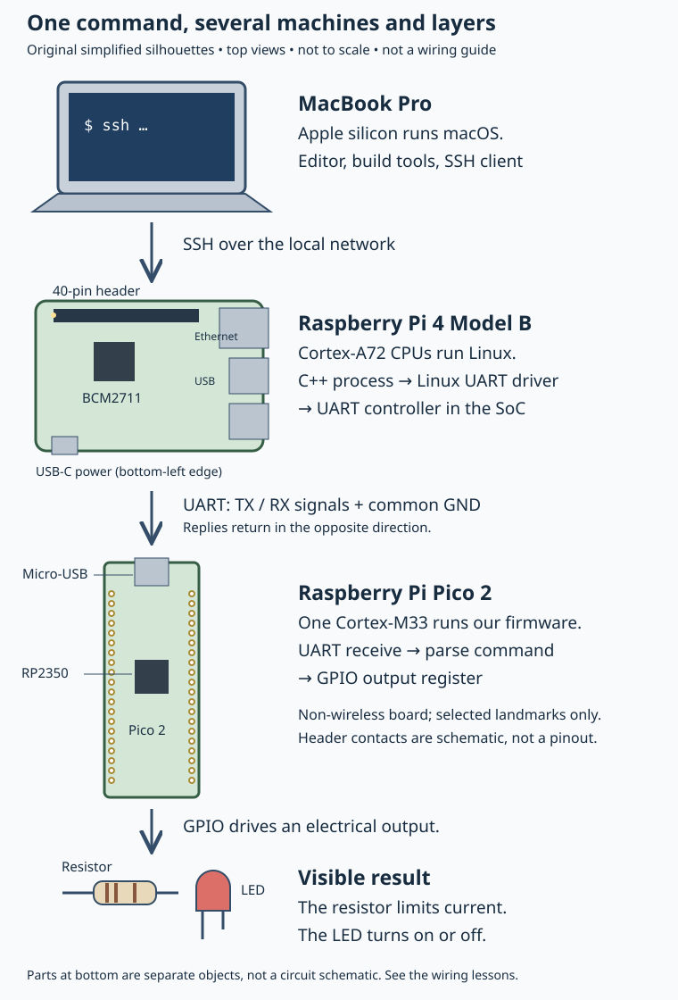

# 0.1 — What you are going to build

You will make a program running under Linux change a physical LED on another board. Along the way, you will trace a CPU instruction into a peripheral register, stop firmware with a debugger, handle a button interrupt, exchange bytes over wires, and write a small Linux driver.

The final result is deliberately small. An LED gives you a visible endpoint for a chain that contains several different kinds of software and hardware. Understanding that chain is the purpose of the book.

There is nothing to install or connect on this page. Leave the boards unpowered while identifying them. The rest of Chapter 0 introduces the parts before you assemble a circuit.

## Three computers, three jobs

The baseline bench has a MacBook Pro with Apple silicon, a Raspberry Pi 4 Model B, and a **non-wireless Raspberry Pi Pico 2 with headers**. Read the markings on your boards; a shared Raspberry Pi name does not make the Pi 4 and Pico interchangeable. Raspberry Pi documents the Pico 2 as an RP2350 microcontroller board, distinct from its Linux computers. This book selects Arm Cortex-M33 firmware and uses one application core. The chip offers other cores and an alternative architecture, but those are outside this route. [Pico-series hardware documentation](https://www.raspberrypi.com/documentation/microcontrollers/pico-series.html)

[Open the larger diagram](assets/0.1-build-chain.svg). These are simplified identification drawings, not photographs of your particular boards or instructions for connecting pins. The Pi outline follows the [official mechanical drawing](https://datasheets.raspberrypi.com/rpi4/raspberry-pi-4-mechanical-drawing.pdf); the Pico landmarks follow the board views in the hardware documentation. Small components are omitted.

| Label in the drawing | What and where it is | What it does and when we use it |
| --- | --- | --- |
| MacBook Pro | The laptop on your desk; its processor is inside the case. | Runs the editor, compiler and debugger tools. Later, its Secure Shell (SSH) client opens a remote shell on the Pi. |
| Raspberry Pi 4 Model B | The larger board, with a long header and stacked external ports. | Runs Raspberry Pi OS and our Linux programs. Its BCM2711 system-on-chip contains the Cortex-A72 CPUs that execute them. |
| Pi header and ports | The exposed pin header is along one edge; Ethernet and USB connectors occupy the adjacent short edge. | The network provides remote access. Later, selected header pins carry electrical signals to our circuits and the Pico. A connector is a physical endpoint, not the program that controls it. |
| Raspberry Pi Pico 2 | The narrow board, with micro-USB at one end and two long rows of header contacts. | Runs the firmware we build on the Mac. It receives commands and controls its own pins. |
| RP2350 | The square chip near the middle of the Pico board. | Contains the CPU cores and peripheral hardware. Our firmware executes here; the whole green board is not itself a processor. |
| Resistor and LED | Separate breadboard components: an axial resistor and a two-lead light-emitting diode. | The resistor limits current; the LED converts some of that electrical energy to visible light. We use an external LED so its GPIO path is explicit. |

The Pi 4's SoC, network interfaces and header are described in the [official Pi 4 specifications](https://www.raspberrypi.com/products/raspberry-pi-4-model-b/). Your memory capacity and board revision will be checked on the actual machine, rather than inferred from this drawing.

## Software is not the controller

A **Linux process** is a running userspace program. Our C++ client on the Pi opens a device and asks Linux to send or receive data. Linux schedules the process and supplies interfaces such as `read`, `write` and `poll`; the process does not own the machine's peripheral registers merely because it has a pointer.

A **kernel driver** is software executing within Linux that manages a device or a hardware-facing interface. Existing drivers operate the Pi's UART and GPIO controllers. Later, our educational button driver requests GPIO resources through the kernel's GPIO subsystem and presents a small `/dev/mybutton` interface to a userspace client. These are separate responsibilities: our driver consumes a GPIO service rather than replacing the controller driver. The kernel's [GPIO introduction](https://www.kernel.org/doc/html/latest/driver-api/gpio/intro.html) explains GPIO signals and the distinction between consuming and providing them.

**Bare-metal firmware** is the program on the Pico. Here it runs without Linux or an RTOS. SDK startup code prepares the execution environment, and our code configures peripherals and handles events. “Register-level” programming means we will expose the peripheral operations; it does not mean that we first write a bootloader, linker script and entire runtime.

A **processor**, or CPU, executes instructions. GPIO means general-purpose input/output: a configurable digital signal. UART means Universal Asynchronous Receiver/Transmitter: hardware that sends and receives serial data, one bit after another. A **peripheral controller** is hardware that performs a specialised task, such as shifting UART bits onto a wire or reporting a GPIO input change. A CPU writes configuration and data registers to direct that hardware. The controller can continue its work between CPU instructions. On these boards, many controllers are inside the main chip, not separately visible packages. A **physical component**, such as the external LED, responds to voltage and current; it does not execute C++.

## Follow one command

In the UART lessons, the Mac opens an SSH session over the local network. The shell you see on the Mac launches the C++ client **on the Pi**, so the Pi CPU executes it. SSH transports terminal input and output; it is not the electrical serial link between the boards.

The client asks Linux to transmit a command with a defined maximum length. The Linux UART driver feeds the Pi's UART controller, which sends bits through a header pin. The Pico's UART controller receives those bits. Pico firmware assembles and validates the command, then changes the configured GPIO output. Current through the resistor and LED produces the visible result. An acknowledgement returns through the UART link and Linux to the client.

Each boundary can fail independently. A successful SSH login establishes remote access, not a working UART. A UART reply establishes communication with firmware, not correct LED polarity. A debugger showing a changed output register is useful evidence, but the pin configuration and external circuit still matter. The lessons add these boundaries one at a time so a failure has a manageable set of causes.

## The seven experiments and their destination

| Original experiment | Where it appears | What you will account for |
| --- | --- | --- |
| Set up and run firmware | Chapter 1 | Which tools run on the Mac and which binary executes on the Pico. |
| Change an LED through registers | Chapter 2 | A generated CPU store, the GPIO hardware and the external circuit. |
| Stop and inspect the board | Chapter 3 | How the Debug Probe and SWD let the Mac debugger control the target CPU; the probe has its own separate controller. |
| Handle button interrupts | Chapter 4 | A physical input change, interrupt notification and safe communication with the main loop. |
| Read a peripheral over I²C or SPI | Chapters 5–6; optional Appendix C | Pi setup, a Pico register interface over I²C, and SPI loopback. A real BME280 is optional; the main route needs no purchased sensor. |
| Send commands from Linux over UART | Chapter 7 | Userspace I/O, framing, controller hardware, firmware parsing and replies. |
| Write a driver and explore memory/MMIO | Chapters 8–9 | Kernel device lifetime, process memory mappings and the real driver's register-access path. |

Chapter 10 combines them: a physical button on the Pi causes a kernel event; a waiting C++ process wakes and sends a UART command; the Pico changes its LED and replies. The Mac remains your remote workstation. It does not need to relay each button event.

The drawings describe the intended system, not a recorded hardware demonstration. Later pages distinguish source review, compilation and physical observations. Next, [tour the Pico 2](0.2-a-labelled-tour-of-your-pico-2.md) before choosing a pin or attaching a cable.

## References

- [Raspberry Pi Pico-series hardware documentation](https://www.raspberrypi.com/documentation/microcontrollers/pico-series.html) — board identity, variants and chip features.
- [Raspberry Pi 4 product documentation](https://www.raspberrypi.com/products/raspberry-pi-4-model-b/) — SoC and external interfaces; links to mechanical drawings.
- [Raspberry Pi Debug Probe documentation](https://www.raspberrypi.com/documentation/microcontrollers/debug-probe.html) — separate USB-to-SWD and UART interfaces used in Chapter 3.
- [Linux kernel GPIO introduction](https://www.kernel.org/doc/html/latest/driver-api/gpio/intro.html) — GPIO signals and driver roles.
