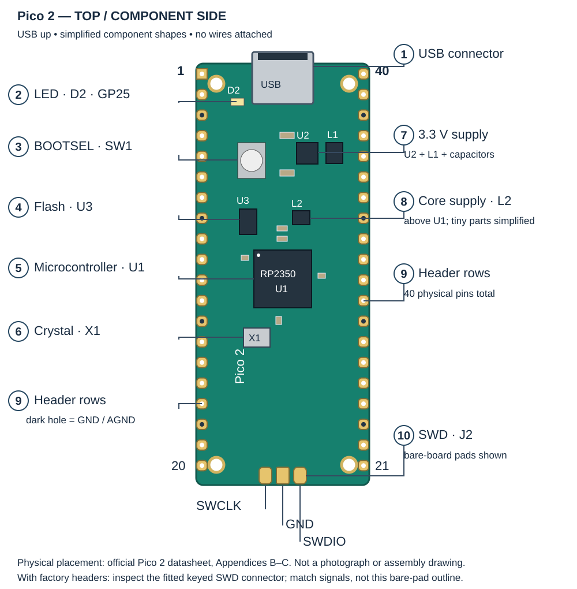
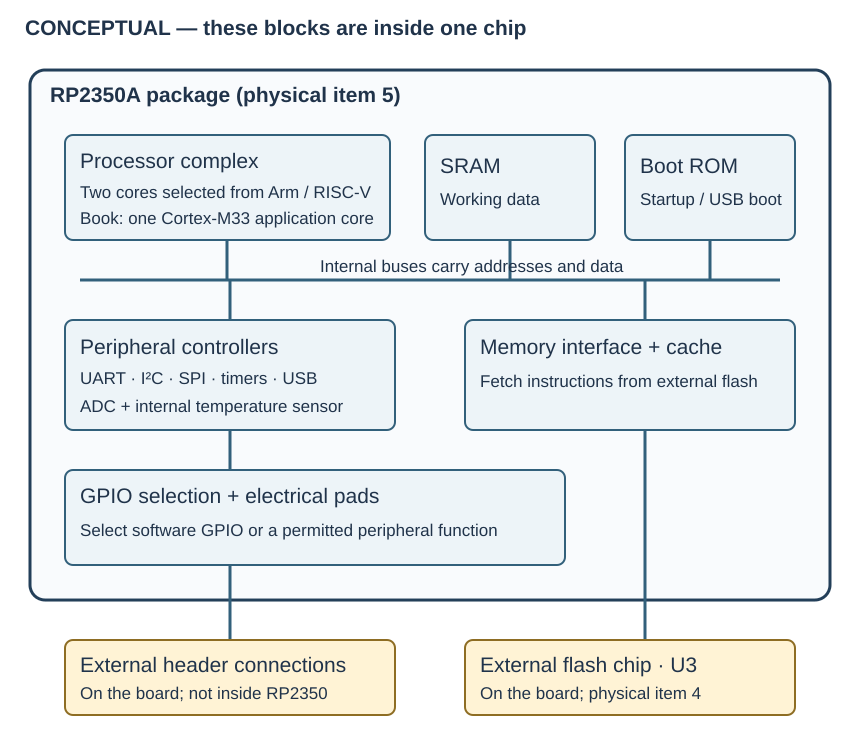
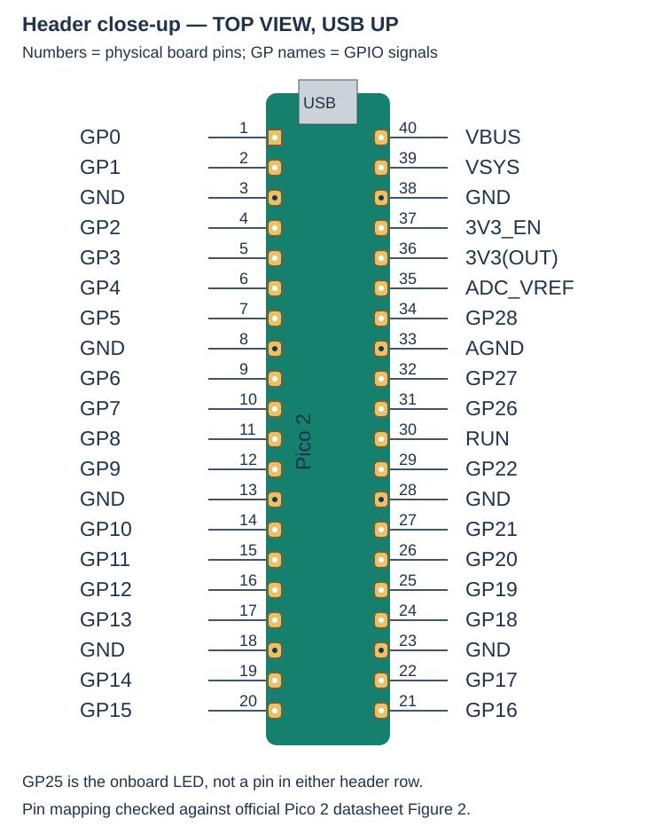

# 0.2 — A labelled tour of your Pico 2

The **Pico 2** is the whole green circuit board. The **RP2350** is the microcontroller mounted on it: a chip containing processors, memory and hardware controllers. The board adds the connections, storage and supporting circuitry that make the chip convenient to use.

Keep the Pico unplugged for this tour. No breadboard, program or wiring is required. By the end, you should be able to locate the firmware storage, processor, power connections and debug interface before connecting anything.

## Orient the board first

Use the **non-wireless Pico 2 with headers** for this book. Read the model marking; an original Pico uses RP2040, and a Pico 2 W adds wireless hardware. The W board has a different physical layout, a different debug location and an LED controlled through its wireless chip. The non-wireless board's LED is connected to RP2350 GP25. These differences matter when following register-level examples. See the official [model and layout guide](https://www.raspberrypi.com/documentation/microcontrollers/pico-series.html#board-layouts).

Place the component side upward, with the USB connector at the top. **Physical pin 1 is top-left**, pin 20 bottom-left, pin 21 bottom-right and pin 40 top-right. The drawing uses this orientation throughout. An underside view reverses left and right; do not use one as though it were a top view.

[Open the larger physical drawing](assets/0.2-pico2-physical.svg). This is an original simplified drawing checked against the official [Pico 2 datasheet, schematic and component locations](https://datasheets.raspberrypi.com/pico/pico-2-datasheet.pdf) (Figures 2, 11 and 12), not a photograph of your board. Small passive parts are simplified. The drawing shows bare debug pads; factory headers change the fitted debug connector, as explained below.

| Label | What and where | What it does; when we use it |
| --- | --- | --- |
| 1 | Micro-USB connector at the top | Carries USB power and data. We use a data-capable cable for firmware loading and diagnostic text. |
| 2 | D2, the small onboard LED left of USB | Turns an electrical output into visible light. Firmware controls it through GP25 on this board; our main experiments use a separate external LED so its entire circuit is visible. |
| 3 | SW1, BOOTSEL below USB on the left | Selects USB boot when held during connection to power. We use it to load or recover firmware; it is not a general reset button. |
| 4 | U3, the small flash package above-left of the main chip | Stores firmware without power. We replace its contents when flashing a program. |
| 5 | U1, the large square RP2350A package near the middle | Runs the firmware and contains the controllers that operate the pins. Every Pico experiment uses it. |
| 6 | X1, the metal crystal package below-left of U1 | Provides a frequency reference for the chip's clock circuitry. Startup code configures clocks; we leave this physical circuit alone. |
| 7 | U2 and L1, above-right of U1, with nearby capacitors | The board's switching supply produces the 3.3 V rail. L1 is an inductor, which stores energy magnetically while the supply switches. This supports every powered experiment. |
| 8 | L2 and nearby capacitors immediately above U1 | Support RP2350's core voltage regulator. The processors use a lower supply voltage than the header's 3.3 V logic. We do not connect lab wires here. |
| 9 | Two long header rows | Bring GPIO, power and ground connections to jumper wires and the breadboard. Later wiring tables identify both the GPIO name and the physical pin. |
| 10 | J2, the three-contact debug interface at the bottom | Carries SWCLK, GND and SWDIO for Serial Wire Debug. We use it to stop, inspect and program the chip with the Debug Probe. |

A **capacitor** stores electric charge. The tiny capacitors around the chip and regulators help keep supply voltages steady when current demand changes rapidly. They are part of the board's power system, not extra memory chips. U2's 3.3 V supply and U1's core regulator serve different voltage domains; neither is a software-controlled output for our LED. The [board schematic](https://datasheets.raspberrypi.com/pico/pico-2-datasheet.pdf#page=21) shows their separate circuits.

## Firmware storage and working memory

The flash package is outside RP2350; SRAM is inside it. **Flash** preserves a program across power loss. **SRAM** holds the running program's stack, mutable globals, buffers and other working state; its contents do not survive loss of power. Pico 2 provides 4 MB of external flash and 520 kB of on-chip SRAM. Those are different resources, not a single interchangeable pool. See the official [board specifications](https://www.raspberrypi.com/documentation/microcontrollers/pico-series.html#raspberry-pi-pico-2).

A normal firmware image contains instructions and initial data. On startup, SDK support prepares the execution environment, including initialized data and zero-initialized storage in SRAM. Much of the program can execute from external flash through the chip's memory interface and cache, called **execute in place**. A cache keeps recently fetched material close to the processor; it does not turn flash into writable SRAM. Later, the debugger can inspect both the stored instructions and the live variables.

[Open the larger internal diagram](assets/0.2-rp2350-concept.svg). This is a conceptual connection diagram, not a floor plan of the silicon. The blocks cannot be identified as separate packages on the board.

A **processor core** fetches and executes instructions. RP2350 offers Arm Cortex-M33 and Hazard3 RISC-V cores, with two cores selected for execution; this book uses one Arm application core. The other core is not needed for our labs. A **peripheral controller** is dedicated hardware that performs a particular task, such as shifting UART bits or generating SPI clock edges. Firmware configures it by accessing registers: documented locations with hardware-defined meanings. An internal bus carries these accesses between cores, memory and controllers. The [RP2350 overview](https://www.raspberrypi.com/documentation/microcontrollers/microcontroller-chips.html#rp2350) describes these chip resources.

The ADC converts a voltage into a number. Its internal temperature sensor measures a property of the chip itself; it is neither a separate visible sensor package nor an accurate ambient thermometer by assumption. We use it later as a useful changing data source. Timers count clock-driven ticks for delays and event timing. USB has its own controller inside the chip; the silver connector is only the physical attachment point.

## A physical pin is not a peripheral

**Physical pin 21** means a location on the Pico header. **GP16** names the GPIO signal connected to that location. These two numbers are not interchangeable. A chip package also has numbered terminals, creating a third numbering scheme that our wiring tables do not use.

GPIO means general-purpose input/output. A selectable routing circuit inside RP2350 connects a GPIO pad to a permitted function: ordinary software-controlled input/output, a UART signal, SPI, I²C, or another documented choice. The function is selected by firmware, and only the documented alternatives for that GPIO are available. Thus a diagram that labels a pin with several functions lists choices, not several independent wires. The [chip documentation](https://www.raspberrypi.com/documentation/microcontrollers/microcontroller-chips.html#key-features) introduces this multiplexing; Chapter 2 follows the actual register path.

[Open the larger header close-up](assets/0.2-pico2-headers.svg). For example, find physical pin 21 at bottom-right and read its signal name, GP16. We later connect the external LED there. Keep “Pico physical pin 21” and “Pico GP16” together in your wiring notes.

The header also contains connections that are **not GPIO**:

| Connection | Pico physical pins | Meaning in this book |
| --- | --- | --- |
| GND | 3, 8, 13, 18, 23, 28, 38 | Common electrical reference and return path. Later circuits choose a convenient listed ground. |
| AGND | 33 | Ground connection intended for analogue circuits; not an extra GPIO. |
| VBUS | 40 | USB's nominal 5 V supply connection. It is not a 3.3 V signal pin. |
| VSYS | 39 | Input to the board's power supply. Our baseline supplies the board through USB. |
| 3V3(OUT) | 36 | Regulated 3.3 V output; later provides a button pull-up's supply. |
| 3V3_EN | 37 | Enables the board regulator; not an ordinary GPIO. Leave it alone in these labs. |
| ADC_VREF | 35 | Reference supply for analogue conversion. Leave its board circuit in place. |
| RUN | 30 | Reset control input. Leave it unconnected unless a lesson explicitly uses it. |

Check these against the official [Pico 2 pinout](https://datasheets.raspberrypi.com/pico/pico-2-datasheet.pdf#page=5). The GPIO logic level is 3.3 V. A pin being physically beside a 5 V power pin does not make it suitable for 5 V signalling.

## Identify the debug connection before using a cable

On the bare non-wireless board, the top-view debug pads are **SWCLK, GND, SWDIO from left to right** with USB up. SWCLK carries the probe's clock; SWDIO carries bidirectional debug data. The factory “with headers” variant has a small keyed debug connector at this end instead of requiring you to solder pins into bare pads. Inspect the connector you actually have and use its documented signal order; do not force a cable onto pads or infer connector orientation from wire colours. Boards with separately added headers may still have bare debug pads.

There is **no power contact** in this three-signal interface. The Pico must have its own supply, normally its USB cable, while the probe has a separate USB connection. Ground gives their signals a common reference. The official [debug connector guide](https://www.raspberrypi.com/documentation/microcontrollers/pico-series.html#debug-connector-swd) distinguishes the connector variants. Chapter 3 supplies the actual connection procedure.

Leave the board unplugged and without jumper wires. Continue to the [Pi 4 tour](0.3-a-labelled-tour-of-your-raspberry-pi-4.md), or return to this drawing whenever a later circuit names a Pico connection.

## References

- [Pico 2 datasheet](https://datasheets.raspberrypi.com/pico/pico-2-datasheet.pdf): pinout, powerchain, schematic (Appendix B), component locations (Appendix C).
- [Pico-series hardware documentation](https://www.raspberrypi.com/documentation/microcontrollers/pico-series.html): model identification, physical layouts and debug connector variants.
- [RP2350 chip documentation](https://www.raspberrypi.com/documentation/microcontrollers/microcontroller-chips.html#rp2350): processor choices, memory and controller overview, with the full chip datasheet linked there.
