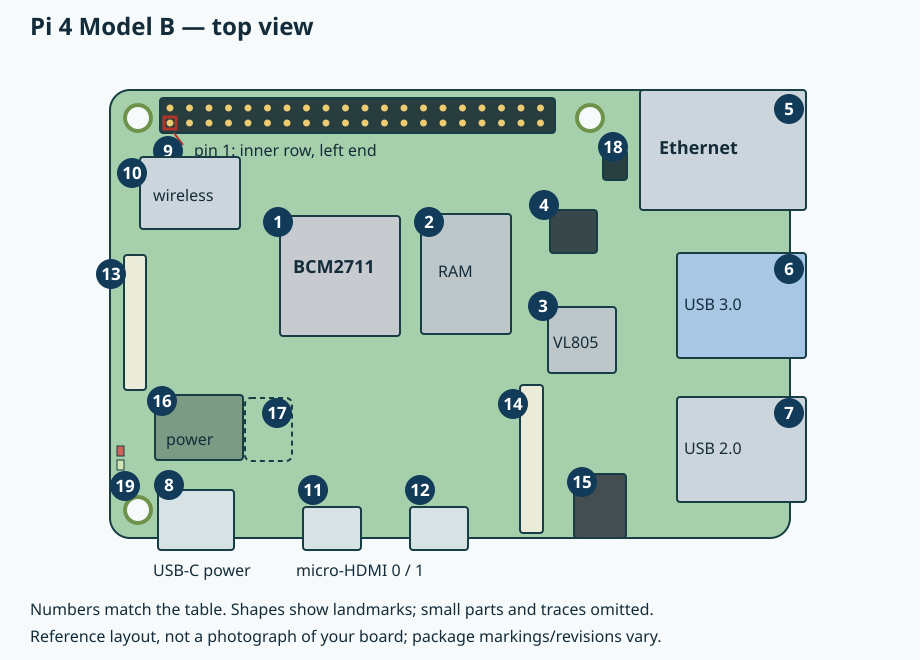
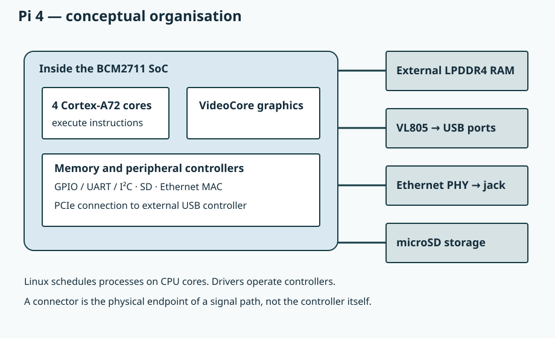
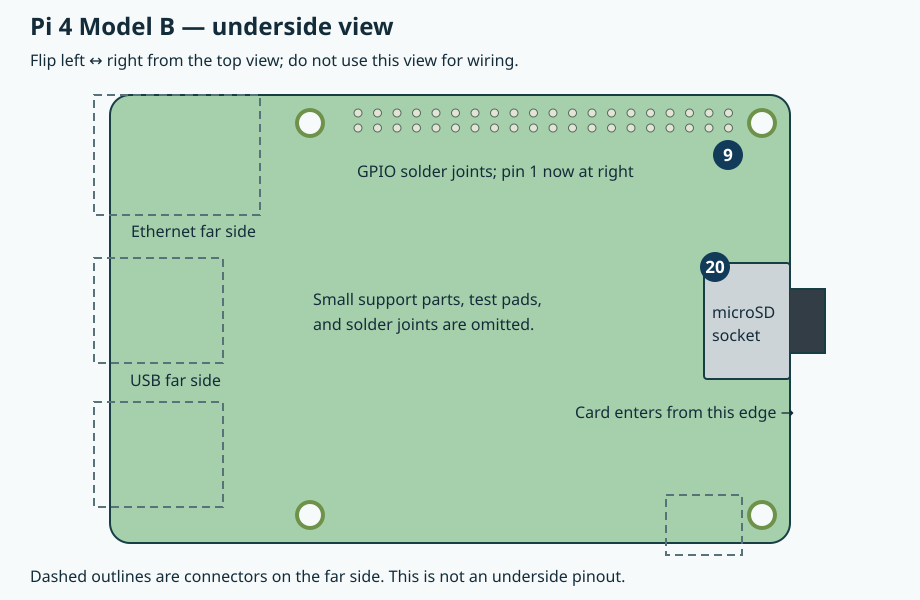

# 0.3 — A labelled tour of your Raspberry Pi 4

The Raspberry Pi 4 Model B is a Linux computer on one board. In our labs it runs Linux applications, provides a network connection to your Mac, and talks to the Pico through its GPIO header. This page identifies the parts before we connect anything.

Inspect an unpowered board. If it is already running, shut Linux down before disconnecting power. A case or heatsink may hide the chips; identify the exposed ports and compare them with the drawing. There is no need to remove a heatsink or dismantle a case for this lesson.

## Orient the board

Use the **top view**, with the 40-pin header across the upper edge and USB-C power at the lower left. On a Pi 4, the Ethernet jack is at the **upper right**, next to the header. The two USB stacks are below it. This arrangement helps distinguish it from other Pi models.

These are original, simplified drawings of the Pi 4 Model B reference layout, checked against Raspberry Pi's [mechanical drawing](https://datasheets.raspberrypi.com/rpi4/raspberry-pi-4-mechanical-drawing.pdf) and [official illustrated component tour](https://magazine.raspberrypi.com/articles/raspberry-pi-4-in-detail). They are not photographs of your exact board. Your board revision, RAM capacity, and cooling arrangement remain to be checked in [the Linux environment lesson](5.2-verify-the-linux-development-environment.md).

[Open the larger top view](assets/0.3-pi4-top.svg). Numbers correspond to the tables below. Tiny components are omitted.

## Chips do the work; connectors expose a path

A **package** is the physical component soldered to the board. Inside package **1**, the Broadcom **BCM2711 system-on-chip (SoC)** integrates four Arm Cortex-A72 CPU cores, graphics hardware, and peripheral controllers. A CPU core executes instructions. A peripheral controller implements a hardware operation, such as shifting serial bits or handling a memory transfer. The board adds memory, power conversion, interface chips, and connectors around the SoC. Raspberry Pi's [Pi 4 specifications](https://www.raspberrypi.com/products/raspberry-pi-4-model-b/#specifications) identify its processor, memory technology, and interfaces.

This diagram shows relationships, not physical positions or every bus. Linux schedules your C++ process on a CPU core. A system call passes a request to a kernel driver; the driver configures the relevant controller. The metal connector is where the resulting electrical signals leave the board. It does not execute the request itself.

The Ethernet path illustrates the distinction: the SoC contains the **MAC**, which handles Ethernet frames; a separate **PHY** handles physical signalling towards the cable; the jack accepts the plug. The USB host controller is also a separate chip. The [official component tour](https://magazine.raspberrypi.com/articles/raspberry-pi-4-in-detail) identifies these external chips.

| Label and location | What it is and why it is there | When we use it |
| --- | --- | --- |
| **1 — central square package** | BCM2711 SoC: CPU cores and integrated controllers. Often covered by a heatsink. | Every Pi program and Linux driver in the book runs through this hardware. |
| **2 — rectangular package right of the SoC** | LPDDR4 RAM: working memory for the kernel, processes, stacks, and caches. Contents do not persist without power. | All running software uses it. We inspect virtual memory later. |
| **3 — square chip below/right of RAM** | VIA VL805 USB host controller: manages devices on the Type-A ports. | Optional peripherals; headless labs need no keyboard or mouse. |
| **4 — smaller chip above the USB controller** | BCM54213PE Ethernet PHY: physical interface between the SoC's Ethernet hardware and jack. | Used automatically with wired networking. |
| **10 — shielded upper-left section** | Wireless radio circuitry and nearby board antenna provide Wi-Fi and Bluetooth. | Wi-Fi can carry SSH. Bluetooth is not needed; UART setup later accounts for its routing. |

RAM capacity belongs to the installed board; do not infer it from a generic drawing. We do not assume a capacity here. **RAM and microSD storage are different resources**: Linux loads executable code and file data from storage into memory; saving a file writes persistent storage. A larger card does not add RAM.

## Ports and headers

The Pi 4's interfaces are listed in its [specifications](https://www.raspberrypi.com/products/raspberry-pi-4-model-b/#specifications). Its [reduced schematic](https://datasheets.raspberrypi.com/rpi4/raspberry-pi-4-reduced-schematics.pdf) identifies the power input, ribbon connectors, LEDs, and expansion headers.

| Label and location | What it is and why it is there | When we use it |
| --- | --- | --- |
| **5 — upper-right jack** | RJ45 Gigabit Ethernet connector for a network cable. | Optional alternative to Wi-Fi for SSH. Power over Ethernet requires a compatible PoE HAT; the jack alone does not replace our supply. |
| **6 — middle-right stack** | Two USB 3.0 Type-A ports, normally with blue inserts. | Optional USB peripherals; leave empty for the main route. |
| **7 — lower-right stack** | Two USB 2.0 Type-A ports, normally with black inserts. | Optional peripherals such as a keyboard or mouse. |
| **8 — lower-left USB-C** | Power input. Use the official Pi 4 supply from the bench inventory. | Powers the Pi separately from the Pico. Our UART connection uses the GPIO header. |
| **9 — upper-edge 2 × 20 header** | GPIO expansion header: signal, ground, and power pins. | I²C/UART to the Pico, then a Pi button and LED. |
| **11, 12 — lower-edge small metal sockets** | Micro-HDMI 0, nearest USB-C, and micro-HDMI 1: digital display outputs. | Optional monitor for setup/recovery; unnecessary for SSH. |
| **13 — narrow left-edge ribbon socket** | DSI connector for a compatible ribbon-connected display. | Leave alone; separate from HDMI. |
| **14 — ribbon socket near lower-right interior** | CSI camera connector. Similar appearance does not make it interchangeable with DSI. | Leave alone; no camera is required. |
| **15 — lower-edge black round socket** | Combined analogue audio/composite-video jack. | Leave alone; no speakers or analogue display needed. |
| **16 — lower-left power circuitry** | Regulators, inductors, and capacitors convert/filter input power into the rails used by the chips. | Always working when powered; no adjustment needed. |
| **17 — support-part region beside the regulators** | Clock references provide timing from which chip clocks are derived. The dashed region is an overview cue, not identification of one particular package. | Used automatically; no user connection. |
| **18 — four-pin block near Ethernet** | PoE header for an appropriate power-over-Ethernet accessory. | Leave unconnected; our baseline uses USB-C. |
| **19 — left edge near power input** | PWR and ACT LEDs give power/status indications. | Boot troubleshooting clues; neither is our external lab LED. |

Power and clock callouts identify regions, not a complete component inventory; additional support parts lie elsewhere on the board. Small-part arrangements can vary by revision. Do not probe or bridge them to follow this book.

### Locate pin 1 before counting

In the top view, **physical pin 1 is at the left end of the header, on the row nearer the centre of the board**. It is the 3.3 V pin. The adjacent outer-row pin is physical pin 2, a 5 V pin. The inner row runs 1, 3, 5 … 39 left to right; the outer row runs 2, 4, 6 … 40. The PCB's pin-1 pad/marking helps confirm the corner when visible.

A physical pin number describes a connector position. **BCM17** describes a GPIO signal; BCM17 is at **physical pin 11**, not pin 17. GPIO uses 3.3 V logic and is not 5 V tolerant. Fixed power and ground pins are not configurable GPIO. Use the top view and each lesson's wiring table, backed by the [official GPIO layout](https://www.raspberrypi.com/documentation/computers/raspberry-pi.html#gpio), before attaching wires. Leave the reserved HAT identification pins alone.

## Look underneath for storage

[Open the larger underside view](assets/0.3-pi4-underside.svg). This flips the top drawing **left to right**, as if turning a book page about a vertical axis. The USB/Ethernet side moves left and the microSD edge moves right. It is not a GPIO wiring diagram.

| Label and location | What it is and why it is there | When we use it |
| --- | --- | --- |
| **20 — underside, opposite USB/Ethernet edge** | MicroSD socket holds the removable card containing our Raspberry Pi OS installation and files. The card slides in from the board edge. | Chapter 5 checks/prepares the card. Keep it installed for the labs. |
| **9 — underside upper edge** | Solder joints connect the top header pins to PCB tracks: the back of the same header. | Recognise only; attach jumpers from the top. |

Do not remove the card from a running Pi: writes may still be pending. Later we shut Linux down before removing power or changing wiring. For now, leave the board unpowered, its card in place, and GPIO unconnected. The next tour identifies the [Debug Probe and cables](0.4-a-labelled-tour-of-the-debug-probe-and-cables.md).

## References

- [Pi 4 specifications](https://www.raspberrypi.com/products/raspberry-pi-4-model-b/#specifications) — principal hardware and interfaces.
- [Pi 4 mechanical drawing](https://datasheets.raspberrypi.com/rpi4/raspberry-pi-4-mechanical-drawing.pdf) — physical layout.
- [Pi 4 reduced schematic](https://datasheets.raspberrypi.com/rpi4/raspberry-pi-4-reduced-schematics.pdf) — power, connectors, and headers.
- [Raspberry Pi hardware documentation](https://www.raspberrypi.com/documentation/computers/raspberry-pi.html#gpio) — GPIO orientation, numbering, and electrical roles.
