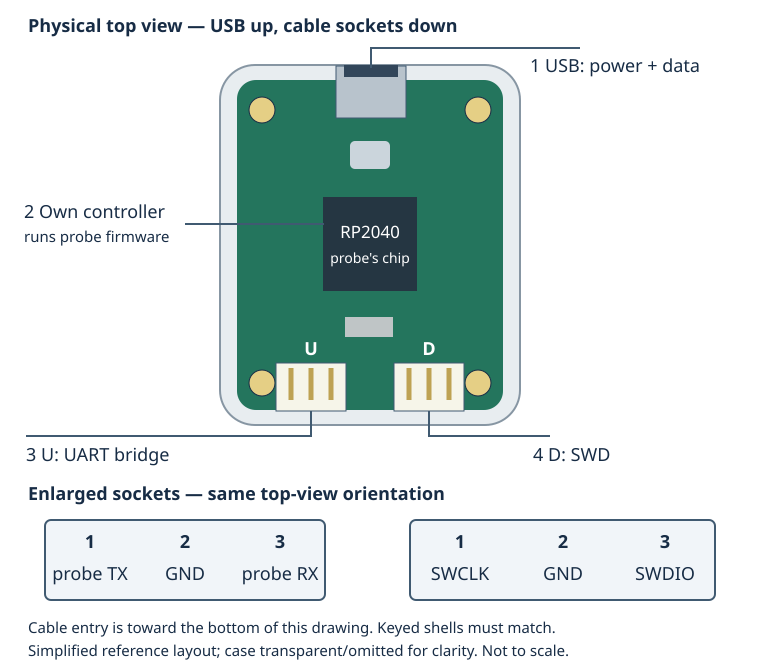
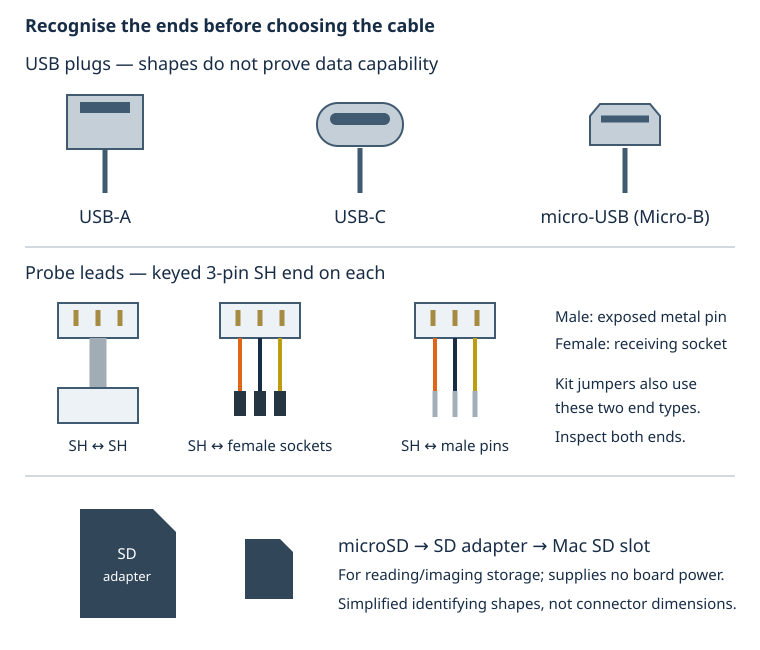
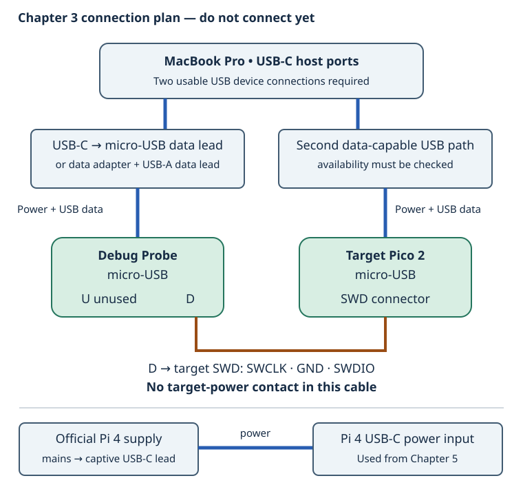

# 0.4 — A labelled tour of the Debug Probe and cables

The **Debug Probe** translates commands from the Mac's USB connection into electrical signals the Pico's debug interface understands. The **target** is the Pico 2 running our program. They are two separate computers: the probe runs its own firmware, while the target runs the firmware we build.

Keep both boards unplugged during this tour. After the [Pico tour](0.2-a-labelled-tour-of-your-pico-2.md), you can identify its USB and debug connections. Here we identify the matching probe sockets and account for every cable before installation or wiring.

## Orient the probe

Place the probe with its component side visible through the case and its micro-USB connector at the top. The small **U** socket is at bottom-left; **D** is at bottom-right. These sockets have the same shape but serve different interfaces. Leave the enclosure closed; the drawing makes the internal controller visible for identification.

[Open the larger physical drawing](assets/0.4-probe-physical.svg). This original simplified view follows the official [mechanical drawing](https://pip.raspberrypi.com/documents/RP-008192-DS); it is not a photograph of your exact probe. Component details are simplified.

| Label | What and where | What it does; when we use it |
| --- | --- | --- |
| 1 | Micro-USB socket at the top | Receives power and USB data from the Mac. This is the Mac-to-probe connection for Chapter 3. |
| 2 | RP2040, the square chip in the middle | Runs the probe firmware that handles USB and drives the debug/serial interfaces. It is separate from the target's RP2350. |
| 3 | U, the lower-left keyed socket | Bridges USB to UART transmit/receive signals. We identify it here but leave it unused in the main route. |
| 4 | D, the lower-right keyed socket | Carries Serial Wire Debug signals to the Pico's debug connection. We use it to program, stop and inspect the target. |

The [probe schematic](https://pip.raspberrypi.com/documents/RP-008194-DS) identifies the RP2040 and the independent USB, UART and debug circuits. The probe's firmware is a different binary from our Pico 2 application: a firmware file intended for one board does not belong on the other.

## Read the signal names

**Serial Wire Debug (SWD)** is a debug interface. SWCLK is the clock driven by the probe; SWDIO is bidirectional data. GND is the common electrical reference. SWD lets debugging tools access the target without depending on its application having a working USB interface.

The sockets are three-pin, keyed **JST SH** connectors, with 1 mm contact spacing. The drawing's enlarged views use the same top-view orientation, looking down on the board with cable entry toward the bottom. They are not views looking into a loose cable plug. Pin numbers remain attached to the connector when you turn it; apparent left and right do not. The official [connector specification](https://rpltd.co/debug-spec) defines the numbering and straight-through cable.

| Socket contact | D: debug signal | U: UART signal, from the probe's perspective |
| --- | --- | --- |
| 1 | SC / SWCLK, output | TX, output |
| 2 | GND | GND |
| 3 | SD / SWDIO, bidirectional | RX, input |

**UART** is an asynchronous serial interface: TX transmits bits and RX receives them. A probe TX wire would connect to a target RX; probe RX would connect to target TX. The specification also labels UART pins from the *target's* perspective, so always say whose TX or RX you mean. The [schematic](https://pip.raspberrypi.com/documents/RP-008194-DS) confirms the probe-side directions above.

The supplied breakout leads use orange for probe TX/SC, black for GND, and yellow for probe RX/SD. Use signal names to establish the connection, with colours as a cross-check. The [official probe guide](https://www.raspberrypi.com/documentation/microcontrollers/debug-probe.html#the-debug-probe) documents those leads and nominal 3.3 V signalling. These are logic signals, not an RS-232 voltage interface.

There is **no target-power pin** on D: all three contacts already have signal/reference roles. Connecting D to an unpowered Pico does not power the Pico. Likewise, U supplies serial signals and ground, not a power rail.

## Match the cable to the target

[Open the larger cable-end drawing](assets/0.4-cable-ends.svg). A **male** end has exposed pins; a **female** end has sockets that receive pins. Breadboard holes receive male jumper ends. A fitted male board header receives female ends. The housing shape and key matter as well as the number of contacts.

For a factory **Pico 2 with headers**, use the supplied SH-to-SH lead from probe D to the Pico's keyed SWD connector. A bare Pico 2 to which someone added the long GPIO headers may still have bare debug pads. Long headers alone do not prove the debug cable will fit. As [0.2 explains](0.2-a-labelled-tour-of-your-pico-2.md#identify-the-debug-connection-before-using-a-cable), inspect the actual board. Do not push sockets against bare pads or assume soldering is already done. Resolve a missing debug connector before Chapter 3, following the official [Pico debug connector guide](https://www.raspberrypi.com/documentation/microcontrollers/pico-series.html#debug-connector-swd).

## Inventory the complete path

[Open the larger cable-path drawing](assets/0.4-cable-paths.svg). This is the planned Chapter 3 setup, not an instruction to attach wires now. Pico USB carries both its supply and the book's diagnostic text. Probe USB carries the probe's supply and debugger traffic. The U socket stays empty. Later, Chapter 7 connects the Pi UART directly to Pico GP0/GP1 for protocol traffic; those wires are separate from Pico USB diagnostics.

| Item | Endpoints and purpose | Availability to establish |
| --- | --- | --- |
| Existing micro-USB data cable | Mac USB path → Pico micro-USB; power, BOOTSEL loading and USB diagnostics | One data cable is identified in the equipment record. Inspect its host plug. |
| Probe USB lead | Mac USB path → probe micro-USB; power and debugger data | The official package lists a USB lead. Check your box, its host plug and actual data operation; do not count a missing cable. |
| USB-C data lead, adapter or hub | Mac USB-C → the USB host plug on each lead | No adapter/hub or second usable data path is confirmed. A USB-A lead requires a data-capable USB-C-to-A adapter/hub. A USB-C-to-micro-USB data lead can connect directly. |
| SH-to-SH lead | Probe D → fitted target SWD connector | Listed in the official probe package; verify presence and fit. |
| SH-to-female breakout | Probe socket → fitted 2.54 mm male pins | Listed accessory; useful only when the target connector and signal order match. |
| SH-to-male breakout | Probe socket → breadboard sockets | Listed accessory; U is unused here. Keep this lead available rather than substituting it for USB. |
| Kit jumper wires | Male/male for breadboard holes; female ends for male board headers | Kit revision and quantities are unknown. Inspect both ends; later circuits specify the needed type. |
| Official Pi 4 supply | Mains → its USB-C lead → Pi 4 power input | Identified in the equipment record. It powers the Pi; it is not a Mac data cable or a micro-USB Pico lead. |
| microSD and full-size SD adapter | microSD card → adapter → Mac SD slot for imaging | Both are identified in the record. The passive adapter changes the physical fit, not the stored data. |

The package inventory above is documented in the [official probe guide](https://www.raspberrypi.com/documentation/microcontrollers/debug-probe.html#the-debug-probe); it does not establish what is currently on your bench. Two powered USB devices require two usable USB paths. With only one verified cable, you can begin the USB-only Chapter 1 work. Record the missing second path and resolve it before the two-device debugger lesson; moving one lead between devices cannot supply both simultaneously.

## Inspect now; connect later

1. With everything unpowered, find USB, U and D on the probe and USB/SWD on the Pico.
2. Lay each cable between its intended endpoints without plugging it in. Match keys and male/female ends. Record missing or incompatible pieces.
3. Separate the Pi's power supply and SD adapter from the Pico/probe data cables. Count two complete Mac-to-micro-USB paths, including any adapters, before planning Chapter 3.

A **power light with no USB device** can mean a charge-only cable: plug shape and illumination do not prove data wires exist. Chapter 1 uses BOOTSEL enumeration to verify the Pico path. **A visible probe with no target** can mean the Pico lacks its own power, D is confused with U, or the debug signals/connector do not match; Chapter 3 checks those separately. **A plug that resists insertion** calls for checking its type and orientation, not more force.

Leave both boards unplugged and all signal leads detached. When wiring later, remove power from both boards before changing signal connections. Never join their 3.3 V, 5 V or VSYS outputs merely because ground is shared. Continue to [the breadboard and kit tour](0.5-recognise-the-breadboard-and-kit-components.md).

## References

- [Debug Probe documentation](https://www.raspberrypi.com/documentation/microcontrollers/debug-probe.html): supplied cables, signal colours and interface use.
- [Debug Probe schematic](https://pip.raspberrypi.com/documents/RP-008194-DS): RP2040, USB supply/data and connector signal assignments.
- [Debug Probe mechanical drawing](https://pip.raspberrypi.com/documents/RP-008192-DS): physical board and connector placement.
- [Three-pin connector specification](https://rpltd.co/debug-spec): pin numbering, keyed connector types and host/target directions.
