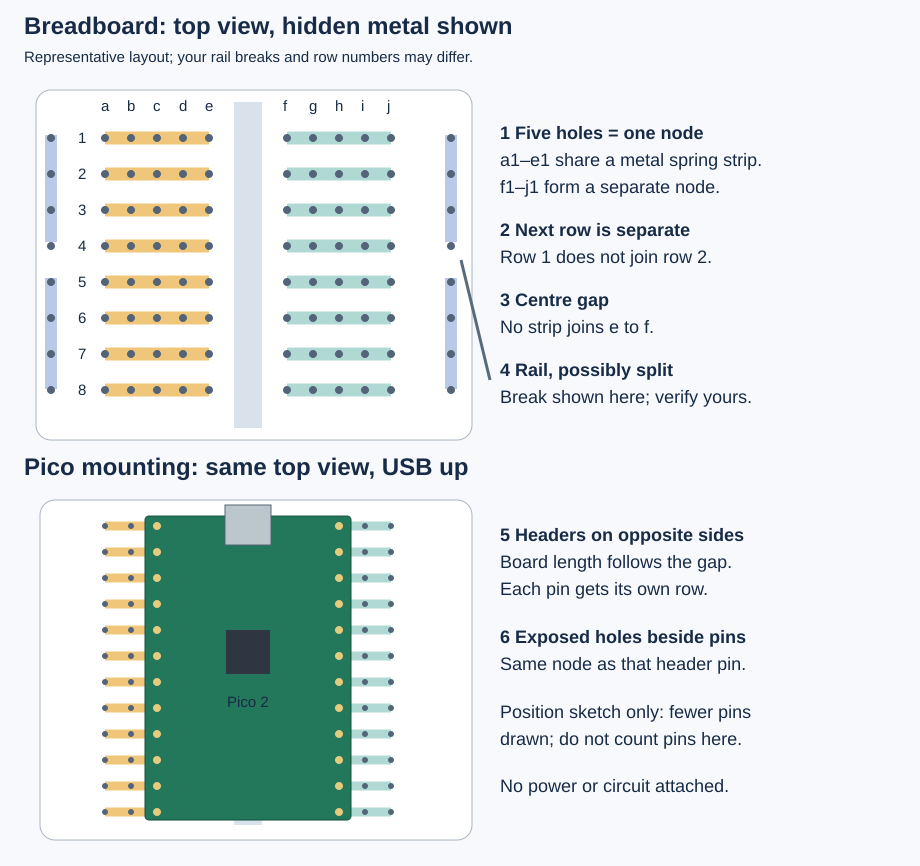
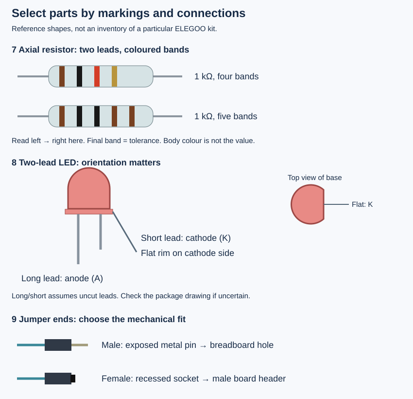
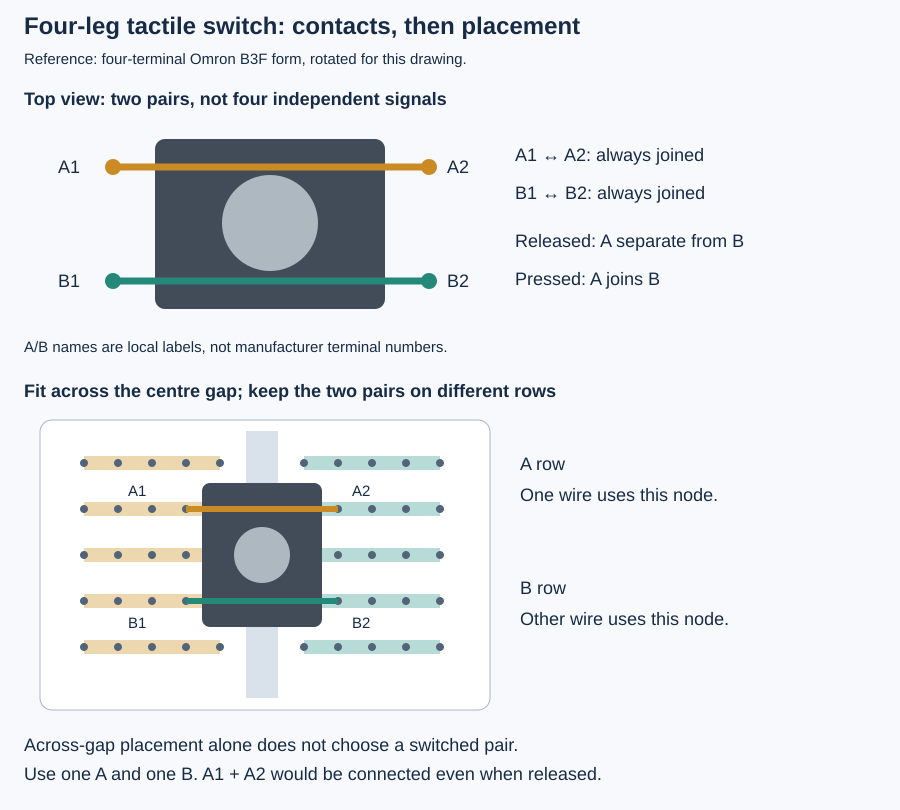

# 0.5 — Recognise the breadboard and kit components

A breadboard lets you connect components without soldering. Its holes are sockets with hidden metal contacts; the plastic grid alone does not tell you which holes are connected. Understanding those contacts prevents several faults that otherwise look like firmware bugs.

Keep the Pico, Pi and Debug Probe unpowered and disconnected during this tour. After [identifying the cables](0.4-a-labelled-tour-of-the-debug-probe-and-cables.md), set out your breadboard, resistors, two-lead LEDs, four-leg buttons and jumper wires. The equipment record identifies these categories in an **ELEGOO Electronics Fun Kit**, but its exact revision, quantities and component manufacturers are unconfirmed. The drawings below identify common forms to compare with your actual parts; they are not a verified packing list. Record anything missing or different before proceeding.

## Follow the hidden contacts

[Open the larger breadboard drawing](assets/0.5-breadboard.svg). The coloured bars reveal normally hidden metal, rather than wires you must add. On this representative layout, **a1–e1 form one electrical node**: a connected group of contacts. The group f1–j1 is another node. Row 2 is separate from row 1, and the centre gap separates e from f. Numbering printed on your breadboard may differ. Adafruit's [breadboard guide](https://learn.adafruit.com/breadboards-for-beginners?view=all) illustrates the contact clips and rail variants.

| Label | What and where | What it does; when we use it |
| --- | --- | --- |
| 1 | Five-hole spring strip under each half-row | Joins component leads placed in that group. This replaces a soldered junction. |
| 2 | Next numbered row | Provides a separate junction for the next signal. |
| 3 | Centre gap between the two terminal fields | Keeps the two sides independent; boards and buttons can bridge it deliberately. |
| 4 | Long rail near an outer edge | Distributes a chosen supply or ground **after** you wire it. It may have a break halfway along. |
| 5 | Pico header rows on opposite sides of the gap | Keeps opposing pins out of the same five-hole strip. |
| 6 | Uncovered holes beside a header pin | Let a jumper share that pin's node without attaching directly to the pin. |

A rail's printed `+` or `−` is a label, not a built-in voltage source. Opposite rails are separate; some long rails are also split into sections. Do not infer continuity from a stripe. An optional multimeter's continuity mode can check an **unpowered, otherwise empty** board; no meter is assumed here. Until verified, use one known short rail section or direct point-to-point connections. The [Adafruit guide's split-rail section](https://learn.adafruit.com/breadboards-for-beginners?view=all) explains the interruption.

Mount the Pico with its component side up, USB at the top, and its length following the centre gap. Its two header rows enter opposite terminal fields, with every pin along a header entering a different numbered row. The drawing shows fewer pins for clarity; use [0.2's header view](0.2-a-labelled-tour-of-your-pico-2.md) for actual pin identity. The [Pico 2 mechanical specification](https://datasheets.raspberrypi.com/pico/pico-2-datasheet.pdf#page=8) defines its 2.54 mm header pitch. Align both rows before gently seating the board; leave USB accessible. A board that will not align calls for checking its headers and breadboard fit.

Two leads inserted into the same node are already connected. Putting both resistor leads into one five-hole strip bypasses the resistor. Putting both LED leads there joins its terminals. A circuit drawing's junctions must become distinct breadboard nodes wherever the drawing shows a component between them.

## Select the resistors

[Open the larger parts drawing](assets/0.5-parts.svg). An **axial resistor** has a wire lead at each end. Its resistance opposes current; the unit is the **ohm**, written Ω. Here `1 kΩ` means 1,000 Ω and `4.7 kΩ` means 4,700 Ω. A plain resistor has no required orientation: reversing it does not change its role.

Our LED uses **1 kΩ in series**, meaning current follows one path through both resistor and LED. Our button uses a separate **4.7 kΩ pull-up**, which connects its input node weakly to 3.3 V when the switch is open. The next lesson explains the electrical reasons. Keep these values separate rather than choosing by body colour.

Vishay's [colour-code chart](https://www.vishay.com/docs/20143/colorcod.pdf) defines the bands. Four bands give two digits, a multiplier and tolerance; five give three digits, a multiplier and tolerance. Tolerance describes permitted variation around the nominal value.

| Nominal value | Four bands, left to right (example ±5%) | Five bands, left to right (example ±1%) |
| --- | --- | --- |
| 1 kΩ | Brown, black, red, gold: 10 × 100 | Brown, black, black, brown, brown: 100 × 10 |
| 4.7 kΩ | Yellow, violet, red, gold: 47 × 100 | Yellow, violet, black, brown, brown: 470 × 10 |

The final gold band means ±5%; final brown means ±1%. Start at the end opposite the tolerance band, often separated by a larger space. Spacing can be subtle. Read all bands, compare the bag's value label, and use a resistance meter if available when colours remain ambiguous. Do not substitute a guessed part.

## Identify LED polarity and jumper ends

An **LED**, or light-emitting diode, produces light when forward current flows from its **anode (A)** to **cathode (K)**. On the usual uncut two-lead indicator package, the longer lead is the anode; the shorter lead and flat edge of the base identify the cathode. Kingbright's [WP7113ID package drawing](https://www.kingbrightusa.com/images/catalog/SPEC/WP7113ID.pdf) shows the cathode and lead-length difference for that reference form. It does not establish the manufacturer of your kit LED. After leads have been clipped, length is no longer reliable; check the package marks and exact part documentation rather than relying on the shape of metal visible inside the lens.

| Label | What and where | What it does; when we use it |
| --- | --- | --- |
| 7 | Banded resistor body between two wire leads | 1 kΩ limits LED current; 4.7 kΩ establishes the released button input. |
| 8 | LED's domed body, base rim and two leads | Makes GPIO output visible. Later: Pico GP16 → 1 kΩ → anode; cathode → GND. |
| 9 | Jumper's exposed pin or recessed socket | Extends a node to another contact. Inspect both ends to select the required fit. |

A **male/male** jumper fits breadboard holes at both ends. A **female/male** jumper connects a fitted male board header to a breadboard hole. A **female/female** jumper connects two male headers. The Pi header normally needs female ends; a breadboard-mounted Pico is reached through male ends in the exposed holes alongside its pins. Wire colour is an organisational choice, not an electrical function. Use ground and signal labels to track connections.

## A four-leg button contains two contact groups

[Open the larger switch drawing](assets/0.5-switch.svg). The square body holds a spring-return actuator: pressing temporarily closes an electrical contact; releasing opens it. We use it for polling, interrupts and the Linux driver. Four legs provide mechanical support and duplicate contacts, not four separate input signals.

The drawing follows the four-terminal [Omron B3F internal connection diagram](https://omronfs.omron.com/en_US/ecb/products/pdf/en-b3f.pdf#page=4), rotated for the breadboard view. **A1 and A2 are permanently joined; B1 and B2 are permanently joined.** Pressing connects group A to group B. These A/B labels are ours, not printed manufacturer pin numbers. In this orientation each permanent pair crosses the body left-to-right; the two legs emerging from the same left edge belong to different groups. Avoid the ambiguous rule “legs on the same side are connected.”

Place a matching button across the centre gap, with A and B on different numbered rows as shown. Connect one circuit wire to A and the other to B. Connecting A1 to A2 bypasses the switching action even though the two legs are across the gap. A diagonal pair selects different groups for this reference form.

Your kit's switch identity remains unconfirmed. Verify its contact diagram, or check pairs with an optional continuity meter off the breadboard: one permanent pair conducts released and pressed; a pair from different groups conducts only while pressed. Do not force a switch whose legs do not match the layout. Gap placement by itself does not establish the internal contacts.

## Prepare the next wiring step

1. Set aside one identified 1 kΩ resistor, one identified 4.7 kΩ resistor, one two-lead LED and one verified four-leg button. Keep any value labels with them.
2. Identify the breadboard's five-hole groups and central gap. Seat the unpowered Pico only if its headers align; attach no signal wires yet.
3. Separate male/male jumpers for the breadboard from wires with female ends for the Pi header. Note missing parts or unresolved contact markings.

Later, an **LED that stays dark** can mean reversed polarity or both leads in one node. A **button that always reads pressed** can mean both wires use a permanently joined pair. A **circuit that works on only half a rail** suggests a rail break. Inspect these physical junctions before changing software.

No powered circuit or physical runtime test has been performed for this page. Leave the bench unpowered and keep the selected parts ready for [assembly and electrical rules](0.6-assemble-the-bench-and-understand-the-electrical-rules.md).

## References

- [Adafruit: Breadboards for Beginners](https://learn.adafruit.com/breadboards-for-beginners?view=all) — contact strips, rail isolation and split rails.
- [Vishay colour-code chart](https://www.vishay.com/docs/20143/colorcod.pdf) — digit, multiplier and tolerance bands.
- [Kingbright WP7113ID datasheet](https://www.kingbrightusa.com/images/catalog/SPEC/WP7113ID.pdf) — reference two-lead LED package and cathode marking.
- [Omron B3F datasheet](https://omronfs.omron.com/en_US/ecb/products/pdf/en-b3f.pdf) — reference four-terminal switch connections and view orientation.
