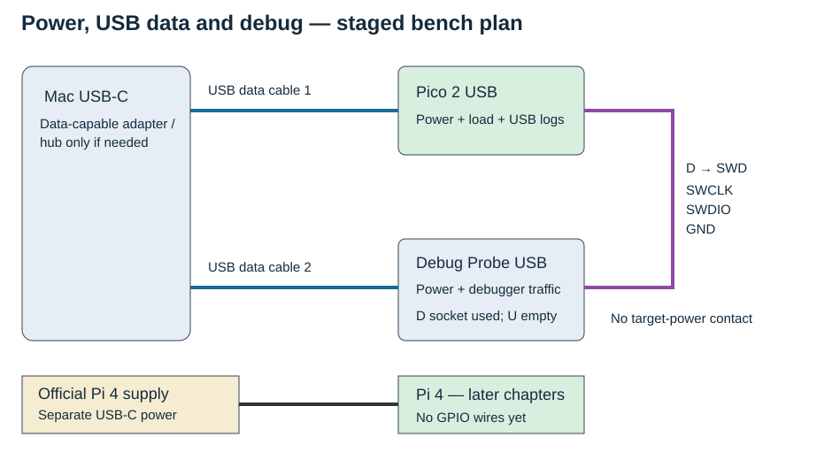
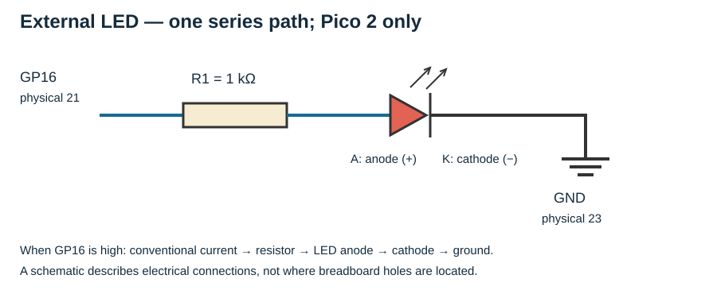
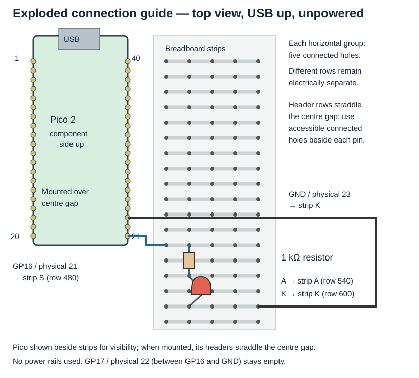

# 0.6 — Assemble the bench and understand the electrical rules

By the end of this page, the external LED circuit will be assembled **with the Pico unplugged**. It will be ready for firmware in Chapter 2. No program or measurement is needed here. First complete the [component tour](0.5-recognise-the-breadboard-and-kit-components.md): you need to recognise connected breadboard strips, a 1 kΩ resistor, and the LED's two different leads.

## Put the equipment in place

Keep the work on a clear, nonconductive surface. Leave USB cables and the Pi supply disconnected while assembling. Lay out the following items; the earlier tours identify their physical parts.

| Item | Where it belongs; purpose and stage |
| --- | --- |
| Mac and non-wireless Pico 2 with fitted headers | Mac builds programs; Pico runs them. Place Pico component side up, USB at the top. |
| Breadboard, one LED, one 1 kΩ resistor, suitable jumper wires | Breadboard holds the circuit without solder. Resistor limits LED current. Male jumper ends fit breadboard holes; female ends fit exposed male headers. Used below. |
| Micro-USB data cable and compatible Mac USB-C connection | Mac → Pico USB supplies power and carries firmware/diagnostics in Chapter 1. Check the host plug; an adapter or hub is not assumed present. |
| Debug Probe, its USB lead and supplied matching SWD cable | A second complete USB data path is needed while debugging. Factory Pico 2 with headers uses its keyed debug connector; inspect actual fit as in [0.4](0.4-a-labelled-tour-of-the-debug-probe-and-cables.md#match-the-cable-to-the-target). Used in Chapter 3. |
| Pi 4, official USB-C supply, microSD and SD adapter | Leave aside until Chapter 5. Supply powers the Pi; card stores its OS; adapter lets the Mac access the card. |
| Button and 4.7 kΩ resistor from the kit | Reserve for Chapter 4. The resistor establishes a defined button input state. Do not fit them yet. |

The equipment record confirms one micro-USB data cable; it does not confirm a second working Mac USB path or any USB-C adapter. Check what is actually present. One verified path is enough to begin Chapter 1; resolve the second before Chapter 3. A multimeter, sensor or logic analyser is not required.



[Open the larger connection plan](assets/0.6-bench-paths.svg). This original diagram consolidates the [official probe connections](https://www.raspberrypi.com/documentation/microcontrollers/debug-probe.html#the-debug-probe) and [Pico power arrangement](https://datasheets.raspberrypi.com/pico/pico-2-datasheet.pdf#page=16). It shows later connections, not today's assembled state. Probe **D** carries SWCLK, SWDIO and GND; it has no target-power contact. Pico needs its own USB supply. Leave probe **U** unused; later Pi–Pico UART data uses separate wires.

## Voltage needs a reference

A voltage is a difference between two points. Saying “GP16 is at 3.3 V” means approximately 3.3 V **relative to that board's GND**. Ground is the circuit's reference and a return path for current; here it does not mean a separate connection to the building's protective earth.

Pico 2 uses 3.3 V GPIO, and Pi GPIO also uses 3.3 V logic. A digital input interprets voltage ranges as low or high; real devices have specified thresholds, rather than comparing floating-point voltages to exactly 0 or 3.3. Use only the book's 3.3 V signal connections. The Pi's 5 V header pins and Pico's USB supply connections are power connections, not GPIO signal levels. In particular, Pi GPIO is not 5 V tolerant. See the [Pico GPIO specification](https://datasheets.raspberrypi.com/pico/pico-2-datasheet.pdf#page=15) and [Pi input documentation](https://www.raspberrypi.com/documentation/computers/raspberry-pi.html#inputs).

When two separately powered boards exchange signals, the receiving board needs the same reference. Later wiring therefore includes an explicit **GND-to-GND wire** alongside the signal wires. Do not rely on an accidental ground path through a Mac or hub. Conversely, **do not join the Pi and Pico 3.3 V, 5 V, VBUS or VSYS rails**. Each board already has its intended supply. Connecting supply outputs can make one source drive current into another; sharing a reference does not require sharing their positive rails. Pico's documented multiple-source power arrangements use explicit isolation components; they are outside this bench configuration ([powerchain](https://datasheets.raspberrypi.com/pico/pico-2-datasheet.pdf#page=16)).

Remove power from **both boards before changing inter-board wiring**, including a board's USB cable and the probe's USB power where relevant. Shut down a running Pi cleanly before removing its supply. Wire while unpowered, check the whole table, then restore the intended supplies. This also satisfies the probe documentation's requirement to establish a common reference before applying debug signals.

## Give the LED a controlled current

An LED is a diode that emits light when current flows in its forward direction: anode to cathode. It does not behave like a resistor with a fixed resistance. Connecting it directly between a GPIO output and ground can draw excessive current; the series resistor supplies the needed current limiting. The [official GPIO guide](https://www.raspberrypi.com/documentation/computers/raspberry-pi.html#outputs) explicitly requires a suitable resistor with an LED.

For an illustrative calculation, assume the high output is 3.3 V and the selected LED's forward voltage, `Vf`, is 2.0 V at the resulting current. Ohm's law applied to the resistor gives:

```text
I ≈ (Vhigh − Vf) / R
  ≈ (3.3 V − 2.0 V) / 1000 Ω
  ≈ 0.0013 A = 1.3 mA
```

This is an estimate, not a measurement or a specification for the kit's unidentified LED. Forward voltage varies with LED type and current, and a loaded GPIO is not an ideal voltage source. We choose **1 kΩ** for a modest current rather than maximum brightness. Even ignoring the LED's voltage drop, 3.3 V across 1 kΩ gives only 3.3 mA. Keep the resistor in series; a resistor connected across the LED does not limit its branch current. Do not remove it to make a dim LED brighter.



[Open the larger schematic](assets/0.6-led-schematic.svg). This original circuit uses the [official Pico 2 pinout](https://datasheets.raspberrypi.com/pico/pico-2-datasheet.pdf#page=5). Symbols show connectivity; the physical guide below shows placement.

## Assemble without power

View the Pico from above, components visible and USB at the top. Physical pin 1 is top-left; numbering runs down to 20 at bottom-left, then starts at **21 bottom-right** and runs up to 40. **GP16** is the signal name at **physical pin 21**. It is not physical pin 16. Pi wiring tables separately name the Pi and its BCM GPIO numbers; never transfer a Pico pin number to the Pi.

| From | Through / to | Electrical purpose |
| --- | --- | --- |
| Pico GP16, physical 21 | One end of 1 kΩ resistor | Output drives the series circuit later. |
| Other resistor end | LED anode (+) | Current enters the LED here. |
| LED cathode (−) | Pico GND, physical 23 | Completes the return path. |



[Open the larger placement guide](assets/0.6-led-placement.svg). This original exploded connection guide follows the same pinout. Pico is shown beside the strips for visibility; in the assembled circuit its header rows straddle the centre gap, as shown in 0.5. Breadboard row coordinates identify this drawing only; actual kit markings differ. Grey lines represent five-hole contact strips, not connections between adjacent rows. The side power rails are unused.

1. Unplug Pico, probe and Pi power. Remove any previous signal wiring. Keep Pi and probe detached throughout this assembly.
2. Seat the Pico headers across the breadboard's centre gap, with one header row on each side. Keep USB accessible. Use the connected holes beside each header pin; if the board obscures them, use the placement approach established in 0.5 rather than forcing a lead underneath it.
3. Find Pico physical 21 by counting from the USB-up orientation and checking the GP16 label. Connect it to an unused five-hole strip, **S** in the drawing.
4. Put one resistor lead in S and the other in a different unused strip, **A**. A resistor's orientation does not matter. Its two leads must not land in one connected strip.
5. Put the LED anode in A. Put its cathode in a third unused strip, **K**. An untrimmed LED normally has a longer anode lead; the body flat marks the cathode side. If the markings cannot be identified, return to 0.5 rather than guessing.
6. Connect K to Pico GND physical 23. Leave physical 22, GP17, empty. Trace the complete path with the wiring table: GP16 → resistor → anode → cathode → GND. Check for stray leads touching adjacent pins.

The expected state is an unpowered board and an unlit LED. That visual check cannot establish polarity, continuity or correct resistor value by itself. Chapter 2 supplies a known output program to exercise the circuit; do not power it merely to see whether unknown pre-existing firmware lights it.

## Why a button needs another resistor

An input senses a voltage while drawing very little current. If neither a driver nor a pull resistor establishes that voltage, it is **floating**: leakage and coupled electrical noise can determine what the program reads. It does not reliably mean low.

A **pull-up** connects an input to its logic supply through a resistor; a **pull-down** connects it to ground. The resistor establishes an idle state while allowing a switch or suitable signal driver to overcome it. Unlike a direct supply wire, it limits current when the switch connects the input to the opposite rail. The [GPIO input documentation](https://www.raspberrypi.com/documentation/computers/raspberry-pi.html#inputs) describes this role.

In Chapter 4, Pico GP17 physical 22 will have a **4.7 kΩ external pull-up to Pico 3V3(OUT), physical 36**, and a button to GND physical 23. Released means high; pressed means low, called **active-low**. A pressed switch then draws approximately `3.3 V / 4700 Ω = 0.70 mA` through the resistor. That pull-up is a different job from the LED's series resistor. We postpone assembly and the RP2350 silicon-revision input qualifications until [the button lesson](4.1-read-a-button-by-polling.md).

## Resolve visible mistakes and leave a known state

| Symptom during inspection | Check before proceeding |
| --- | --- |
| Resistor or LED leads occupy the same contact strip | Move them to the distinct S/A/K strips; otherwise a component may be bypassed. |
| Header labels disagree with the table | Restore USB-up top view; distinguish GP16 from physical 16 and check the board model. |
| A jumper end will not fit | Match male ends to breadboard sockets and female ends to exposed pins; do not force it. |
| Only one complete USB data path is available | Proceed with Chapter 1's Pico-only work; establish the second path before debugging. |
| LED remains dark now | This is expected without power. Functional troubleshooting belongs to 2.1. |

Leave the LED circuit assembled and all power unplugged. There are no Pi–Pico wires, button connections or rail jumpers. Continue to [the Mac toolchain](1.1-install-a-reproducible-macos-toolchain.md). The first firmware uses USB diagnostics; Chapter 2 deliberately enables the external LED output.

## References

- [Pico 2 datasheet](https://datasheets.raspberrypi.com/pico/pico-2-datasheet.pdf): Figure 2 pinout, GPIO voltage, powerchain and multiple-source isolation.
- [Raspberry Pi GPIO documentation](https://www.raspberrypi.com/documentation/computers/raspberry-pi.html#gpio): 3.3 V inputs/outputs, pulls and LED current limiting.
- [Debug Probe documentation](https://www.raspberrypi.com/documentation/microcontrollers/debug-probe.html): USB and debug connections, supplied leads and common-reference requirement.
