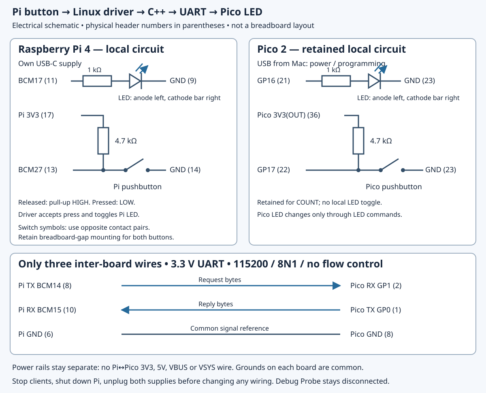

# 10.1 — Use a Linux device event to control Pico hardware

A press on the **Pi button** will change the Pi's local LED, wake a C++ process, and send the new LED state to the Pico. The process accepts success only after checking the Pico's identified reply. This joins the driver from Chapter 8 to the UART transport from Chapter 7.

Start after [9.4](9.4-explain-ordering-access-semantics-and-ownership.md): the Pi driver is bound, its permissions rule is installed, and clients are stopped. The Pi LED/button circuit remains attached. The Pico is unplugged with its own LED/button circuit retained; **all inter-board bus and debug wires are absent**. You need three jumpers and the existing separate USB supplies. Source review, Pico compilation, host protocol/serial tests and native Arm64 Linux/module compilation are recorded in `verification.json`. **The physical capstone has not been exercised during authoring.**

## Forward a state, rather than invent a toggle

The driver returns `<sequence> <state>\n`, such as `7 1\n`. The sequence counts accepted Pi presses; the state is the driver's LED value. The integration program sends **`1 LED 1\n`** and requires **`1 OK 1\n`**. UART ID 1 belongs to this transaction; it is independent of kernel sequence 7. The next successful transaction uses ID 2.

This distinction matters when the process is slow. `/dev/mybutton` offers a latest snapshot, not a queue of every press. Several accepted presses during one UART transaction can coalesce into the next record. Forwarding the returned state eventually applies that snapshot; toggling the Pico once per read would give the wrong result after an even number of skipped transitions. The requested count below counts **successfully forwarded records**, not physical presses.

Opening `/dev/mybutton` starts at its current counter and waits for a **future** accepted press. No initial snapshot is sent. The Pi LED can therefore be on while the freshly booted Pico LED is off. The first forwarded press snapshot brings them to the same commanded state. Restarting the client neither replays history nor automatically resynchronises the LEDs.

## 1. Establish firmware while the boards are separate

Keep all three UART wires absent. The Pico must run **`uart_device`**, not raw `uart_echo` or an earlier I²C program. If its installed image is known to be the Chapter 7 device image, retain it. Otherwise build on the **Mac — checkout root `~/hardware-from-software`**:

```sh
cd ~/hardware-from-software
python3 scripts/setup_deps.py
python3 scripts/build_examples.py --pico
ls -l .build/pico/uart_device.uf2 .build/pico/uart_device.elf
```

Connect only the isolated Pico to the Mac while holding BOOTSEL. Release it when `/Volumes/RP2350` appears, then run **on the Mac, same directory**:

```sh
cp .build/pico/uart_device.uf2 /Volumes/RP2350/
```

Its volume should disappear as firmware starts. Keep the ELF matched to the UF2. Unplug Pico USB again. The complete [firmware and `device_io.hpp` in 7.3](7.3-build-a-robust-c-serial-client.md#1-replace-echo-with-the-device-firmware) remain unchanged, with [individual firmware](downloads/examples/pico/uart_device.cpp) and [device helper](downloads/examples/pico/device_io.hpp) downloads. Firmware polls UART0, applies `LED` to GP16, and replies with its recorded software state. The retained Pico button increments its separate COUNT value; it does not toggle either LED in this exercise. USB stdio has no normal banner, and protocol bytes use GPIO UART only. The [pinned SDK UART interface](https://github.com/raspberrypi/pico-sdk/blob/079c6f39023649b154152db30f1d781e884879bc/src/rp2_common/hardware_uart/include/hardware/uart.h) defines those UART operations.

If Chapter 7's UART configuration was rolled back, restore [7.2's PL011 setup](7.2-configure-the-pi-uart-and-test-an-echo.md#2-reserve-the-pis-pl011-uart) **with the Pico and all inter-board wires disconnected**. Preserve the Chapter 8 button overlay when editing boot configuration. Configuration changes may require a Pi reboot; manual module loading and binding must then be repeated below.

## 2. Power down and assemble the complete circuit

Stop your Pi clients. In a **Pi SSH shell, any directory**, run `sudo poweroff`, wait for shutdown to finish, and unplug its USB-C supply. Confirm Pico USB is also unplugged. Leave the Debug Probe disconnected, including its D lead, and its U socket unused. Remove any leftover I²C wires and the GP19–GP20 SPI jumper before proceeding.



[Open the full-size schematic](assets/10.1-capstone-circuit.svg). This is an electrical connection diagram, not a breadboard hole map. Use the [Pi header orientation](0.3-a-labelled-tour-of-your-raspberry-pi-4.md) and [Pico top view](0.2-a-labelled-tour-of-your-pico-2.md) before counting contacts.

| Circuit | Exact connection |
| --- | --- |
| Pi LED | **BCM17 physical 11** → **1 kΩ** → LED anode; cathode → Pi **GND physical 9** |
| Pi button | **BCM27 physical 13** → switch → Pi **GND physical 14**; **4.7 kΩ** from that BCM27 node to Pi **3V3 physical 17** |
| Pico LED | **GP16 physical 21** → **1 kΩ** → LED anode; cathode → Pico **GND physical 23** |
| Retained Pico button | **GP17 physical 22** → switch → Pico **GND physical 23**; **4.7 kΩ** from that GP17 node to Pico **3V3(OUT) physical 36** |
| Request wire | Pi **BCM14 TX physical 8** → Pico **GP1 RX physical 2** |
| Reply wire | Pico **GP0 TX physical 1** → Pi **BCM15 RX physical 10** |
| Common reference | Pi **GND physical 6** ↔ Pico **GND physical 8** |

The [Pico 2 pinout](https://datasheets.raspberrypi.com/pico/pico-2-datasheet.pdf) and [Pi GPIO header reference](https://www.raspberrypi.com/documentation/computers/raspberry-pi.html#gpio) establish these physical contacts. Retain both local circuits and add exactly the three inter-board wires in the final three rows. Use opposite switch contact pairs across the breadboard gap, as in [8.1](8.1-establish-a-userspace-gpio-baseline.md#1-separate-the-boards-and-build-the-pi-circuit) and [4.1](4.1-read-a-button-by-polling.md); two legs already joined inside a four-leg switch do not make a working press circuit. Check resistor values and LED polarity. **Pi BCM17 is not Pico GP17**: one is the Pi LED output; the other is the Pico button input.

Trace all connections while both boards remain off. Join **no 3V3, 5V, VBUS or VSYS rails** between boards. Each uses its own USB supply; the ground wire supplies a shared signal reference. UART uses 3.3 V logic, **115200/8N1**, no flow control, as specified by [Raspberry Pi's UART documentation](https://www.raspberrypi.com/documentation/computers/configuration.html#configuring-uarts). Power both boards through their separate USB connections and reconnect SSH. Any later wiring change requires stopping the program, shutting down the Pi and unplugging **both** supplies first.

## 3. Verify live ownership after the power cycle

The shutdown removed the manually loaded module. The boot overlay persists, but this book has not configured module autoload. On the **Pi — `~/hardware-from-software`**, repeat [8.6 step 1](8.6-make-failure-and-teardown-behaviour-explicit.md#1-establish-exactly-which-device-will-be-detached): discover the unique platform device by `/sys/firmware/devicetree/base/hfs_button`, verify compatible `hfs,mybutton`, check the `.ko` release against `uname -r`, insert the known artifact if absent, and verify its driver and module links. The expected owner is `/sys/bus/platform/drivers/hfs-mybutton`, supplied by `/sys/module/mybutton`.

If the `.ko` is missing or its release differs, return to [8.3's matching-header build and binding](8.3-describe-the-device-and-bind-the-driver.md#5-verify-the-device-then-load-and-verify-binding). Do not force-load it. Kernel headers are needed for that **Pi kernel-module rebuild**, not for the C++ userspace build below. Keep `gpio_events` stopped: the driver owns BCM17/27 through GPIO descriptors, whose ownership rules are documented in the [kernel consumer interface](https://www.kernel.org/doc/html/v6.12/driver-api/gpio/consumer.html).

**Pi — SSH, checkout root:**

```sh
cd ~/hardware-from-software
ls -l /dev/mybutton /dev/serial0 /dev/ttyAMA0
readlink -f /dev/serial0
id
cat /proc/cmdline
systemctl is-active hciuart.service
systemctl list-units --all 'serial-getty@*'
sudo fuser -v /dev/mybutton /dev/ttyAMA0
```

Require `/dev/serial0` → **`/dev/ttyAMA0`**, the Pi 4 PL011 route. Keep `enable_uart=1`, `dtoverlay=disable-bt`, `hciuart` stopped/disabled or absent, and no UART console/debug token or active serial getty. `fuser` should show no client; its no-owner exit status is normal. Revisit [7.2's live checks](7.2-configure-the-pi-uart-and-test-an-echo.md#3-verify-the-live-owner-and-permissions) for a different result. Verify your fresh login has access through `dialout` for the UART and the installed [8.5 `gpio` rule](8.5-expose-dev-mybutton-to-a-c-client.md#2-grant-access-through-a-deliberate-group-policy) for `/dev/mybutton`. Resolve permissions there, then reconnect if membership changed. Do not conceal them with root execution or world-writable nodes.

## 4. Build and read the bridge

Use the Pi checkout or extract the [complete examples archive](downloads/hardware-examples.zip), preserving the `examples/linux` and `examples/common` directory relationship. These are the complete bridge and its two headers:

```cpp
{{#include ../examples/linux/capstone.cpp}}
```

```cpp
{{#include ../examples/linux/serial_port.hpp}}
```

```cpp
{{#include ../examples/common/protocol.hpp}}
```

The bridge validates the space, final LF and exactly one `0`/`1` state byte. It **does not numerically parse the sequence prefix**; this small integration trusts our kernel producer. Its nonblocking read follows `poll`; `EAGAIN` or `EINTR` retries, while a failed/empty read or malformed record terminates it. Each button `poll` gets a fresh **30 seconds**, including after `EINTR`; there is no absolute whole-program deadline. Error/hangup/invalid-descriptor flags terminate before reading. These readiness rules follow [poll(2)](https://man7.org/linux/man-pages/man2/poll.2.html).

`Serial` sets raw 115200/8N1, clears software and hardware flow control, and flushes local queues on construction. Partial writes and one-byte reads share one **absolute two-second transaction deadline**. A fragment does not restart that clock. The bounded line parser checks framing; the serial owner checks the reply ID, `OK` and numeric LED result. The bridge additionally requires the exact text `<id> OK <state>`. See [7.3's serial explanation](7.3-build-a-robust-c-serial-client.md#2-read-and-build-the-linux-client) and [termios(3)](https://man7.org/linux/man-pages/man3/termios.3.html).

The RAII owner closes its descriptor on ordinary return or exception but **does not restore previous terminal settings**. It requests no exclusive lock: UART exclusivity is a bench convention. Never run a terminal, `serial_client`, echo helper or second bridge concurrently on this UART; readers can divide the reply bytes.

**Pi — SSH, checkout root:**

```sh
cd ~/hardware-from-software
mkdir -p .build
g++ -std=c++20 -Wall -Wextra -Wpedantic -O2 \
  examples/linux/capstone.cpp -o .build/capstone
./.build/capstone /dev/mybutton /dev/serial0 3
```

All three arguments are required: there are **no default paths or count**. The count must be an integer from 1 through 1000; invalid arguments return status 2. This is a native Pi application build; do not run the Mac tool installer or compile the kernel on the Mac for this step.

## 5. Press and account for the result

Release the **Pi** button, wait half a second, then make a new press after launch. Leave about half a second between press/release transitions, and wait for each reply before the next press. A stable hold should not keep incrementing. Three successful forwarded records make the program exit. Illustrative output, assuming these are the first three accepted presses since probe:

```text
button 1 -> 1 OK 1
button 2 -> 2 OK 0
button 3 -> 3 OK 1
```

Expected physical observation: the Pi LED changes when its driver accepts a press; the Pico LED follows after its command is handled. Your kernel numbers may start later or jump; UART IDs still start at 1. Pressing the retained **Pico** button alone produces no bridge output.

The full path is contact closure → BCM27 electrical LOW → GPIO IRQ → threaded handler reschedules debounce work → delayed logical sample → locked counter increment and Pi LED state toggle → Pi LED output and wait-queue wake → sleeping C++ `poll` → record `read` → identified UART `LED` request → Pico parser → GP16 output → identified reply → validated terminal line. Release updates the driver's remembered button level without publishing a press record. The nominal 20 ms delayed sample is not proof of continuous electrical stability.

The record and reply report software states, not LED current. Looking at **both** external LEDs is a separate observation. During rapid presses they need not display every same intermediate state: transactions are sequential and snapshots coalesce. A timeout can occur after the Pico applied the command; the program has no automatic retry, reconnect, deduplication or state replay. Resetting the Pico drops its state, and restarting the bridge alone does not restore it until another Pi press snapshot is forwarded.

## Diagnose and leave the next state

| Symptom | Next check |
| --- | --- |
| No `/dev/mybutton` after boot | Repeat the unique-DT-device/module/binding checks; an overlay alone does not load the manual module. |
| Silent wait, then `button timeout/offline` | Make a future press after open; release a held button first. Check binding and Pi button circuit. Offline poll flags or other poll failures use this same diagnostic. |
| Pi LED changes, then UART error | Check correct free-running `uart_device`, supplies, port ownership and 7.2 routing. Power both off before checking crossed UART and ground. |
| `bad button record` | Ensure the input path is our bound misc device, not another stream; compare the actual ABI/source before retrying. |
| Reply-ID/status/value error | Stop competing clients; inspect console noise, old echo firmware or delayed replies. Do not strip bytes to manufacture success. |
| Valid reply but Pico LED dark | Power both off and check GP16 physical 21, 1 kΩ, LED polarity and GND physical 23. |
| Counter jumps or rapid presses seem skipped | Latest snapshots coalesced; the count argument limits successful forwards. Repeat slowly to inspect each state. |

Let the bridge exit, or stop your foreground instance with Ctrl-C. Caught errors print a diagnostic, close both descriptors and return 1; normal completion returns 0. Ctrl-C's default process termination also closes descriptors. Stop any earlier helpers, terminals, traces, GDB and OpenOCD sessions; check `fuser` again for both devices. Closing clients does not unload the driver or reset either LED.

Leave `uart_device` free-running, the driver bound, both permissions policies and UART configuration retained, both local circuits and the three UART wires intact, no debugger attached and **no client running**. This is the starting state for [10.2](10.2-verify-troubleshoot-and-explain-the-system.md). To stop bench work, shut down the Pi, wait, then unplug both supplies. Disconnect or reconnect wires only then. To abandon the setup, follow [8.3's driver/overlay cleanup](8.3-describe-the-device-and-bind-the-driver.md#troubleshooting-and-next-state) and [7.2's recorded UART rollback](7.2-configure-the-pi-uart-and-test-an-echo.md#diagnose-and-leave-the-next-state), preserving unrelated configuration.

## References

- [Raspberry Pi UART configuration](https://www.raspberrypi.com/documentation/computers/configuration.html#configuring-uarts) — routing, levels and console ownership.
- [Linux GPIO descriptor consumers](https://www.kernel.org/doc/html/v6.12/driver-api/gpio/consumer.html) — GPIO ownership and logical levels.
- [Linux poll(2)](https://man7.org/linux/man-pages/man2/poll.2.html) — readiness, errors and waits.
- [Pico SDK UART source](https://github.com/raspberrypi/pico-sdk/blob/079c6f39023649b154152db30f1d781e884879bc/src/rp2_common/hardware_uart/include/hardware/uart.h) — the pinned firmware API.
