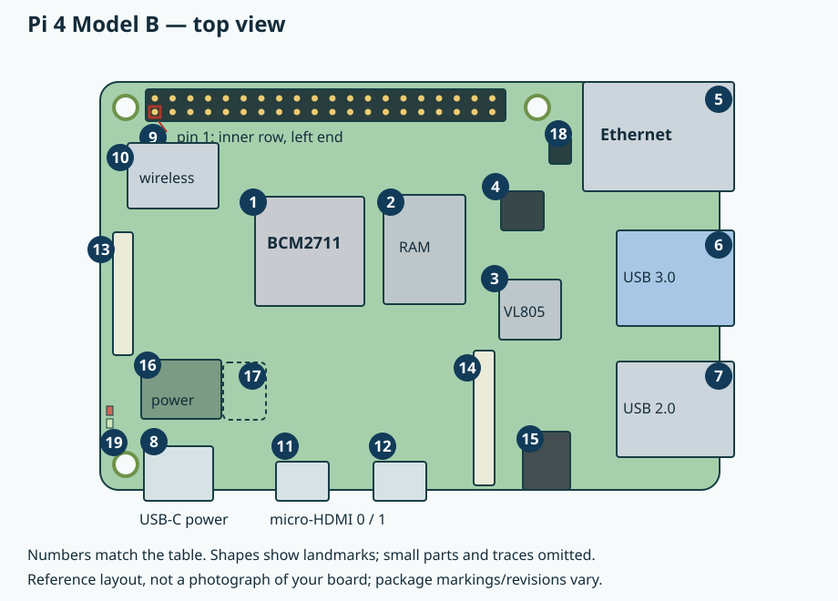
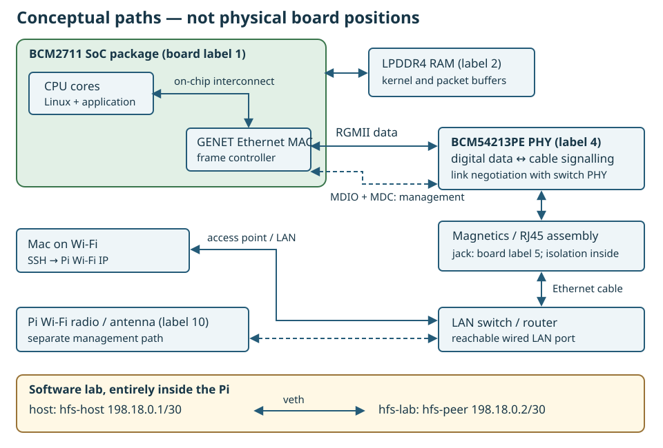

# 11.1 — Identify the network hardware and establish a recoverable lab

By the end of this lesson you will have a record of the Pi's Ethernet interface and a private software link that can be recreated without changing SSH connectivity. Begin with [the Linux environment from 5.2](5.2-verify-the-linux-development-environment.md): the same `6.12.96-hfs1-v8` kernel serves these chapters.

Stop the Chapter 10 client with Ctrl-C in its terminal. With both boards powered down, disconnect the Pico and all inter-board signal/debug connections; leave the Pi's existing LED/button circuit unchanged. Power only the Pi. No GPIO changes or custom-module removal are needed here. Physical Ethernet additionally needs an Ethernet cable and a reachable router/switch LAN port. The Mac can remain on Wi-Fi.

## Find the components

Reuse the [physical board tour](0.3-a-labelled-tour-of-your-raspberry-pi-4.md). Its reference drawing has the GPIO header along the top and Ethernet at the upper right; do not remove a heatsink to inspect hidden chips.



| Physical label | Networking role |
| --- | --- |
| **1 — BCM2711 package** | Contains the CPU cores and GENET Ethernet **MAC**, the controller that handles frames. The MAC is inside this package, not another visible chip. |
| **2 — RAM package** | Holds working data, including packet buffers used by Linux. |
| **4 — BCM54213PE** | Separate **PHY**, the physical-layer transceiver between digital frame data and cable signalling. |
| **5 — RJ45 jack** | Accepts the cable plug. Magnetics in the cable interface provide isolation; they are not exposed programming pins. |
| **10 — wireless section** | Wi-Fi radio circuitry and antenna, providing a separate possible SSH path. |

Raspberry Pi's [official component tour](https://magazine.raspberrypi.com/articles/raspberry-pi-4-in-detail) identifies the external PHY and separate USB controller. Pi 4 Ethernet does not travel through that USB controller.



[Open the larger conceptual diagram](assets/11.1-network-path.svg). A **MAC address** is a link-layer identifier; the **MAC** is hardware. A socket is a kernel-managed communication endpoint, not the RJ45 hardware port.

**RGMII** carries digital packet data between MAC and PHY on several clocked lines. **MDIO**, with its MDC clock, carries PHY management register transactions instead. The [pinned Pi 4 Device Tree](https://github.com/raspberrypi/linux/blob/ae161617d7a4552fa91d03626b8d9f3696d17481/arch/arm/boot/dts/broadcom/bcm2711-rpi-4-b.dts) connects GENET to its PHY and selects `rgmii-rxid`. Timing relationships matter when sampling these parallel signals; the PHY converts between this digital interface and encoded cable signals across clock domains. Ethernet is not a UART-like single serial wire.

The PHY negotiates supported link parameters with its immediate link partner, usually a switch, as described by [Linux's PHY documentation](https://www.kernel.org/doc/html/v6.12/networking/phy.html). Carrier therefore describes a local link, not reachability of your Mac. Magnetics couple signals while providing galvanic isolation; [TI's Ethernet reference design](https://www.ti.com/lit/ug/tidues1a/tidues1a.pdf) explains that general function, rather than documenting the Pi's exact jack internals. This lab does not measure analogue waveforms.

## Record the real interfaces

1. Open SSH using the Pi address already verified in Chapter 5. In the **Pi SSH shell**, start at the checkout root (adjust this path if your checkout is elsewhere):

```sh
cd ~/hardware-from-software
uname -r
sudo apt update
sudo apt install iproute2 iputils-ping ethtool python3
mkdir -p .build
printf '%s\n' "$SSH_CONNECTION"
ip -br address
ip route show
ip -6 route show
```

Require `uname -r` to report `6.12.96-hfs1-v8`; otherwise return to 5.2 before continuing.

`SSH_CONNECTION` contains client address, client port, server address and server port. Record these privately alongside interface names, addresses and routes. For IPv4 SSH, set `MAC_IP` to the first address; for IPv6 use the same address and `ip -6 route get` instead:

```sh
MAC_IP='replace-with-SSH-client-address'
ip route get "$MAC_IP"
for path in /sys/class/net/*; do
    name=${path##*/}
    printf '\nInterface: %s\n' "$name"
    ethtool -i "$name"
done
```

Unsupported-driver messages for loopback are harmless. Find the interface reporting `driver: bcmgenet`; set the variable below to that discovered name. `eth0` is only an example.

```sh
WIRED='eth0'
ip -d link show dev "$WIRED"
ip -4 address show dev "$WIRED"
ethtool -i "$WIRED"
ethtool "$WIRED"
readlink -f "/sys/class/net/$WIRED/device"
readlink -f "/sys/class/net/$WIRED/device/driver"
cat "/sys/class/net/$WIRED/carrier"
```

Record driver, bus information, speed, duplex, autonegotiation and link detection. These `ethtool` commands read state. Do not change speed, offloads or interface configuration. A disconnected link can report unknown speed or an unavailable carrier value.

2. For the physical route, connect Pi Ethernet to a LAN port and repeat the address/link checks. Use an existing network connection profile; do not improvise static addressing here. Record its assigned IPv4 address. From a **second Mac terminal, any directory**, open SSH to the recorded **Wi-Fi address**:

```sh
PI_LOGIN='replace-with-Pi-user'
PI_WIFI_IP='replace-with-Pi-Wi-Fi-address'
ssh "$PI_LOGIN@$PI_WIFI_IP"
```

In that new **Pi shell, any directory**, run the route-to-Mac check above. Require its selected `dev` to be the Wi-Fi interface before considering it an independent management path. If SSH currently uses Ethernet, keep it and use the software lab for later active experiments.

3. In the **Mac terminal, any directory**, test the recorded wired address:

```sh
PI_WIRED_IP='replace-with-Pi-wired-IPv4-address'
route -n get "$PI_WIRED_IP"
ping -c 3 "$PI_WIRED_IP"
```

Replies establish IP connectivity to that address, not proof of wired ingress: Linux can accept traffic for a local address on another interface. Lesson 11.2 checks the actual ingress with a filtered capture. Guest Wi-Fi/client isolation, VLANs, subnets or firewall rules can block this path even when both machines reach the Internet. Keep a failed result in your record and continue below; no router reconfiguration is required.

## Create the private link

4. Back in the **Pi shell, `~/hardware-from-software`**, use the supplied complete helper, `scripts/network_lab.py` ([download the lab helper](downloads/scripts/network_lab.py)). It creates one veth pair: virtual Ethernet endpoints joined in software. One stays in the host network namespace; the other enters `hfs-lab`, which has its own interfaces, routes and sockets.

```sh
sudo python3 scripts/network_lab.py setup
sudo python3 scripts/network_lab.py show
ping -c 3 -W 2 198.18.0.2
sudo ip netns exec hfs-lab ping -c 3 -W 2 198.18.0.1
```

The endpoints are host `hfs-host` at `198.18.0.1/30` and namespace `hfs-peer` at `198.18.0.2/30`. The helper refuses conflicting names and routes and tracks resource ownership. Setup reports and disables TX checksum offload on these two new veth endpoints so later packet responders see complete checksums; `show` reports their features. It changes no physical-interface settings, default route, bridge, NAT or DHCP configuration. Both pings should receive three replies; that is an expected reader observation, not a measured result from this authoring session. This path exercises Linux networking without the Pi's PHY or physical Ethernet DMA.

If setup refuses a collision, inspect its diagnostic and existing resources; do not delete an unfamiliar interface or route. If pings fail, inspect `show`, confirm both endpoints are up, and inspect local firewall policy rather than disabling it globally. If no GENET interface exists, recheck board/kernel identity before treating a USB adapter as the onboard controller.

5. Save the topology and link record with the kernel release and whether the physical route succeeded. Finish by proving cleanup, still in the **Pi checkout root**:

```sh
sudo python3 scripts/network_lab.py cleanup
sudo python3 scripts/network_lab.py show
ip route get "$MAC_IP"
```

`show` should now report “No ownership record”; its refusal after cleanup is expected. For IPv6 management use `ip -6 route get`. Cleanup refuses while namespace processes remain: stop your own lab programs normally, then retry. It deletes only resources whose identity matches its ownership record. Check that SSH and its route still work. In [11.2](11.2-send-numbered-udp.md), recreate this link and send the first numbered application datagram.

## References

- [Raspberry Pi 4 component tour](https://magazine.raspberrypi.com/articles/raspberry-pi-4-in-detail).
- [Course-source Pi 4 Device Tree](https://github.com/raspberrypi/linux/blob/ae161617d7a4552fa91d03626b8d9f3696d17481/arch/arm/boot/dts/broadcom/bcm2711-rpi-4-b.dts).
- [Linux 6.12 PHY abstraction](https://www.kernel.org/doc/html/v6.12/networking/phy.html).
- [TI Ethernet design guide: isolation magnetics](https://www.ti.com/lit/ug/tidues1a/tidues1a.pdf).
