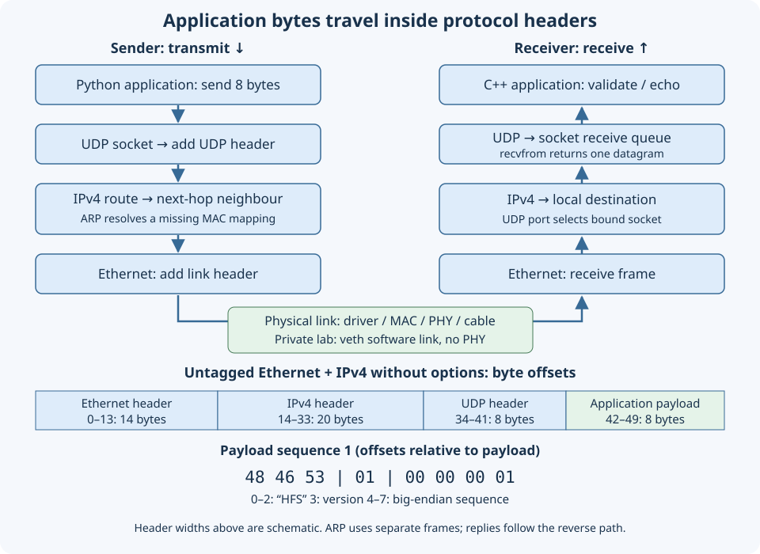

# 11.2 — Send a numbered UDP message through the normal stack

This lesson sends five numbered requests and checks their replies, first across the private link from [11.1](11.1-identify-network-hardware.md), then optionally from the Mac to the Pi's wired interface. Keep the Pico and inter-board wires disconnected, the Pi GPIO circuit unchanged, and the same `6.12.96-hfs1-v8` kernel. No packet filter is attached.

## Give the bytes a meaning

A UDP socket identifies an application endpoint by an IP address and a **port**, a 16-bit number unrelated to a physical connector. `bind` reserves our local address/port in that network namespace. The kernel queues received datagrams until the process reads them; finite socket buffers can overflow. One receive returns one datagram, preserving its boundary. An undersized receive buffer loses the excess rather than saving it for another read. These are [Linux UDP socket semantics](https://man7.org/linux/man-pages/man7/udp.7.html).

UDP provides neither guaranteed delivery nor ordered, duplicate-free delivery. TCP supplies connection state, retransmission and ordered byte streams; an application would still need message framing. Our sequence number makes individual UDP requests recognisable without adding retransmission. A successful send establishes local acceptance, not peer receipt. See [RFC 768](https://www.rfc-editor.org/rfc/rfc768).



[Open the larger diagram](assets/11.2-udp-stack-and-bytes.svg). All requests and replies contain exactly eight application bytes:

| Payload offset | Meaning | Sequence 1, hexadecimal |
| --- | --- | --- |
| 0–2 | ASCII magic `HFS` | `48 46 53` |
| 3 | Protocol version 1 | `01` |
| 4–7 | Unsigned sequence, most significant byte first | `00 00 00 01` |

Network byte order is big endian. Python's `!3sBI` packs this layout explicitly; C++ decodes bytes instead of sending a padded native structure. `htons` separately converts the UDP port. [Download the shared header](downloads/examples/network/wire.hpp), which supplies message validation; its frame decoder is examined in [11.3](11.3-decode-ethernet-frame.md).

The route selects an interface and next hop. For Ethernet IPv4, neighbour lookup maps that next-hop IP to a MAC address; ARP obtains a missing mapping. On a routed path this can be the gateway's MAC, not the destination machine's. ARP is a separate Ethernet protocol, outside UDP, as [RFC 826](https://www.rfc-editor.org/rfc/rfc826) explains. Cached neighbours mean a run need not emit ARP. Loopback never exercises the cable or PHY; our veth pair also remains entirely software.

## Build the complete endpoint

1. In **Pi terminal A, checkout root**:

```sh
cd ~/hardware-from-software
uname -r
sudo apt update
sudo apt install build-essential clang llvm pkg-config libxdp-dev libbpf-dev libelf-dev zlib1g-dev python3 iproute2 ethtool tcpdump
python3 scripts/build_network.py
sudo python3 scripts/network_lab.py setup
sudo python3 scripts/network_lab.py show
```

Require the course kernel release. The build script builds the networking examples and runs shared byte/checksum fixtures; later lessons use the other binaries. Setup recreates the link cleaned up in 11.1. If it reports existing resources, inspect with `show`; reuse only your verified lab rather than deleting unfamiliar resources.

Here is the entire `examples/network/udp_endpoint.cpp`:

```cpp
{{#include ../examples/network/udp_endpoint.cpp}}
```

The endpoint accepts only the exact magic/version/length and echoes those eight bytes. Its 2048-byte receive array is a storage bound, not the permitted protocol length; Linux `MSG_TRUNC` lets it detect oversized datagrams. Invalid packets do not advance the accepted count. The process ends after the requested count or its absolute monotonic deadline, so repeated malformed packets cannot restart the wait. Count means valid requests, including duplicates; the endpoint does not deduplicate sequences.

Here is the entire portable sender, `examples/network/udp_sender.py`, usable on either Pi or Mac:

```python
{{#include ../examples/network/udp_sender.py}}
```

Its UDP `connect` selects a peer without a TCP handshake. It checks the entire reply against the outstanding request and retains one deadline per request despite unexpected replies. It sends sequentially with bounded count, interval and wait. RTT uses one local monotonic clock; subtracting remote capture timestamps would not establish one-way latency.

## Match application records to a capture

2. Start the receiver in **Pi terminal A, checkout root**:

```sh
sudo ip netns exec hfs-lab .build/network/udp_endpoint 198.18.0.2 40420 5 30
```

Wait for `ready`. In **Pi terminal C, checkout root**, start this capture before sending:

```sh
sudo ip netns exec hfs-lab timeout 40 tcpdump -i hfs-peer -Q in -nn -e -XX -s 128 -c 5 'ip and udp dst port 40420 and src host 198.18.0.1 and dst host 198.18.0.2'
```

`-Q in` selects ingress, `-e` prints link addresses and `-XX` includes link-header bytes. The filter excludes SSH and unrelated UDP. `-c` limits matching packets; `timeout` also limits silence. These options are documented in the [upstream tcpdump manual](https://github.com/the-tcpdump-group/tcpdump/blob/master/tcpdump.1.in).

3. In **Pi terminal B, checkout root**:

```sh
cd ~/hardware-from-software
python3 examples/network/udp_sender.py 198.18.0.2 --count 5
ip neigh show dev hfs-host
sudo ip netns exec hfs-lab ip neigh show dev hfs-peer
```

Expect matching reply IDs 1–5, sender summary `sent: 5`, `received: 5`, `timeouts: 0`, and endpoint summary `accepted: 5`, `rejected: 0`. These are illustrative expectations, not recorded hardware results. The capture's first payload should be `48 46 53 01 00 00 00 01`. For an untagged frame with a 20-byte IPv4 header, it begins at frame offset 42; IPv4 options change that offset. Compare all five IDs. Capture timestamps describe capture events, not application execution times.

4. Test rejection. Restart **Pi terminal A's endpoint** with a shorter finite wait:

```sh
sudo ip netns exec hfs-lab .build/network/udp_endpoint 198.18.0.2 40420 1 10
```

After `ready`, in **Pi terminal B**:

```sh
python3 examples/network/udp_sender.py 198.18.0.2 --count 1 --timeout 2 --malformed --expect-timeout
```

The sender deliberately uses version 2. Expect one timeout and no reply; its expected-timeout exit status is zero. Leave the endpoint running until its ten-second deadline: expect one rejected packet, zero accepted, and exit status **1**, because its requested valid count was not reached. This distinguishes protocol rejection from an absent receiver, which may produce an `unreachable` record and fails this expected-timeout check.

## Repeat over physical Ethernet

5. Use the wired IPv4 address and interface discovered in 11.1, with the Pi cable connected to the LAN and Mac on its verified network. In **Pi terminal A, checkout root**, replace the value:

```sh
PI_WIRED_IP='replace-with-Pi-wired-IPv4-address'
.build/network/udp_endpoint "$PI_WIRED_IP" 40420 5 30
```

In **Pi terminal C, checkout root**, substitute all recorded values and start before sending:

```sh
WIRED='replace-with-discovered-wired-interface'
PI_WIRED_IP='replace-with-Pi-wired-IPv4-address'
MAC_IP='replace-with-Mac-test-source-IPv4-address'
sudo timeout 40 tcpdump -i "$WIRED" -Q in -nn -e -XX -s 128 -c 5 "ip and udp dst port 40420 and src host $MAC_IP and dst host $PI_WIRED_IP"
```

In **Mac terminal, your Mac checkout root** (the authoring checkout is shown; adjust if yours differs):

```sh
cd /Users/hermes/Desktop/hardware-from-software
PI_WIRED_IP='replace-with-Pi-wired-IPv4-address'
route -n get "$PI_WIRED_IP"
python3 examples/network/udp_sender.py "$PI_WIRED_IP" --count 5
```

The namespace address `198.18.0.2` is private to the Pi lab and is not the Mac destination. Replies plus matching ingress on the discovered GENET interface establish this wired receive path; an IP address alone does not. AP isolation, routing or firewall policy may block it. Retain the software result if so; no physical Ethernet claim follows.

## Diagnose and finish

`Cannot assign requested address` means the bind address is absent in that namespace. `Address already in use` suggests an earlier endpoint still owns the port; inspect `ss -lunp` in the relevant namespace. Timeouts with captured requests direct attention to endpoint validation, bind state and local firewall rules; no captured requests directs attention to route, interface, filter or LAN isolation. A capture ending with status 124 reached its time limit. Unexpected replies can indicate delayed IDs or another responder; record them instead of counting them as success.

6. Let finite programs finish, stop any remaining lab capture with Ctrl-C, then in **Pi checkout root**:

```sh
sudo python3 scripts/network_lab.py cleanup
```

Cleanup refuses running namespace processes; stop your own endpoint before retrying. Keep the source and sequence records. Lesson 11.3 recreates this private link and uses the same UDP payload while examining Ethernet bytes.

## References

- [RFC 768: UDP fields and guarantees](https://www.rfc-editor.org/rfc/rfc768).
- [Linux udp(7): socket and datagram behaviour](https://man7.org/linux/man-pages/man7/udp.7.html).
- [RFC 826: Ethernet address resolution](https://www.rfc-editor.org/rfc/rfc826).
- [tcpdump's upstream manual](https://github.com/the-tcpdump-group/tcpdump/blob/master/tcpdump.1.in).
