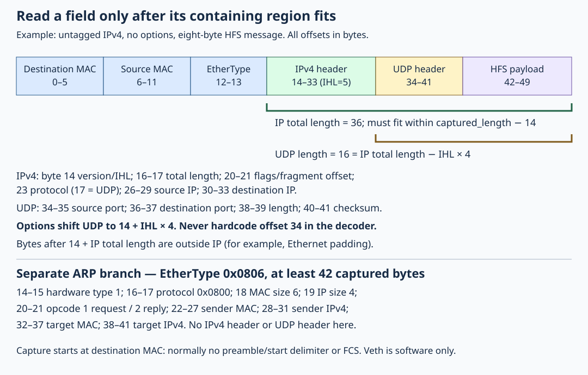

# 11.3 — Decode an Ethernet frame without trusting its layout

You will receive Ethernet bytes through a bounded Linux packet socket, decode the numbered requests from [11.2](11.2-send-numbered-udp.md), and compare them with tcpdump. Keep the Pi on `6.12.96-hfs1-v8`, its GPIO wiring unchanged, and the Pico powered off with inter-board wires disconnected. This exercise uses the private software link; it establishes no physical PHY or DMA result.

## Establish each boundary before reading

An `AF_PACKET` socket with `SOCK_RAW` includes the link header. It observes packets before normal kernel protocol handling; the ordinary UDP endpoint can still receive them. “Raw” describes the bytes exposed, not removal of Linux from the path. Creation requires `CAP_NET_RAW` in the governing user namespace; the lab uses `sudo`. See [packet(7)](https://man7.org/linux/man-pages/man7/packet.7.html).



[Open the larger diagram](assets/11.3-frame-boundaries.svg). Offsets start at the first destination-MAC byte. Ethernet supplies destination/source MAC addresses and EtherType. `0x0800` selects IPv4; `0x0806` selects ARP. For Ethernet/IPv4 ARP, the decoder checks hardware/protocol types, address sizes and request/reply opcode before reading sender/target addresses. ARP resolves neighbours, without a UDP header; see [RFC 826](https://www.rfc-editor.org/rfc/rfc826.html).

For IPv4, IHL counts four-byte words. Check version 4 and IHL ≥ 5, then require `IHL*4 ≤ total_length ≤ captured_length−14`. Only then can the code locate UDP, including after IPv4 options. It rejects both nonzero fragment offsets and “more fragments”: this reader does no reassembly. These fields are defined by [RFC 791](https://www.rfc-editor.org/rfc/rfc791.html).

UDP needs eight bytes within that IP region. Its length includes its header; this decoder requires `udp_length == total_length−IHL*4`, then restricts message decoding to `udp_length−8` bytes. Ethernet padding cannot become application data. This is a deliberately strict supported-layout policy; see [RFC 768](https://www.rfc-editor.org/rfc/rfc768.html).

Network integers are big endian: bytes `9d e4` mean port 40420. `read16` shifts bytes into a native value. Casting to `iphdr*` would neither check available bytes nor convert byte order; arbitrary packet storage may also violate alignment and C++ object-access rules. The byte helpers themselves assume sufficient input: the enclosing decoder establishes that precondition before every read. A `span` records length but does not automatically check `operator[]`.

## Read and build the complete implementation

1. The full shared `examples/network/wire.hpp` follows. Focus first on `decode_frame` and `describe_frame`. The checksum/reply helpers support later lessons; **decoding here does not validate checksums** or certify complete IPv4 semantics. Options are skipped by length rather than interpreted. VLAN, IPv6, other EtherTypes, fragments and non-UDP IPv4 are classified unsupported; invalid or truncated supported headers are malformed.

```cpp
{{#include ../examples/network/wire.hpp}}
```

The full Linux `examples/network/packet_rx.cpp` binds one interface, ignores outgoing packets, polls until an absolute deadline, and counts only destination-port-40420 requests with valid eight-byte markers. Unsupported/malformed frames do not advance that count; most are silent. ARP and lab-port UDP are printed, and the final record includes socket drops and truncations.

```cpp
{{#include ../examples/network/packet_rx.cpp}}
```

`MSG_TRUNC` reports the original packet length: bytes beyond the storage bound are discarded before decoding. `PACKET_AUXDATA` supplies ancillary metadata; VLAN stripping can hide a tag from packet bytes. The receiver rejects VLAN metadata and truncated ancillary data rather than misclassifying the frame as untagged. It does not use checksum-status metadata as checksum proof.

2. **Mac, authoring checkout root** (adjust the checkout location if needed), or **Linux, your checkout root**:

```sh
cd /Users/hermes/Desktop/hardware-from-software
python3 scripts/build_network.py --portable-only
```

On Linux use `cd ~/hardware-from-software` instead of that Mac path. This builds and runs ordinary and ASan/UBSan fixtures with the native C++20 compiler. [Download the complete fixture source](downloads/examples/network/wire_test.cpp). It tests every truncated prefix of a valid frame, inconsistent IP/UDP lengths, padding, unaligned storage, options, unsupported layouts, and 20,000 deterministic malformed inputs. Passing establishes exercised bounds, not protocol completeness. The expected success line is `wire fixtures and 20000 bounded malformed inputs passed`; this is an expectation, not a claimed run on your machine.

3. **Pi terminal A, checkout root**:

```sh
cd ~/hardware-from-software
uname -r
sudo apt update
sudo apt install build-essential clang llvm pkg-config libxdp-dev libbpf-dev libelf-dev zlib1g-dev python3 iproute2 ethtool tcpdump
python3 scripts/build_network.py
sudo python3 scripts/network_lab.py setup
sudo python3 scripts/network_lab.py show
sudo ip netns exec hfs-lab .build/network/packet_rx hfs-peer 5 30
```

Require the course release. Setup recreates the lab cleaned up in 11.2; on a collision inspect `show` and reuse only your verified lab. It explicitly disables TX checksum offload on the two disposable veth peers and reports it; physical-interface settings are untouched. Wait for the reader's `ready` record.

## Compare three views of the same requests

4. **Pi terminal B, checkout root**, start the ordinary endpoint and wait for `ready`:

```sh
cd ~/hardware-from-software
sudo ip netns exec hfs-lab .build/network/udp_endpoint 198.18.0.2 40420 5 30
```

The packet reader never replies. Without this separate endpoint the sender can receive ICMP port-unreachable errors even while the raw reader sees requests.

5. **Pi terminal D, checkout root**, start an independent ingress capture before sending:

```sh
cd ~/hardware-from-software
sudo ip netns exec hfs-lab timeout 30 tcpdump -i hfs-peer -Q in -nn -e -vv -XX -s 128 -c 5 'ip and udp dst port 40420 and src host 198.18.0.1 and dst host 198.18.0.2'
```

6. **Pi terminal C, checkout root**, after tcpdump says it is listening:

```sh
cd ~/hardware-from-software
python3 examples/network/udp_sender.py 198.18.0.2 --count 5
ip -br link show hfs-host
sudo ip netns exec hfs-lab ip -br link show hfs-peer
```

Illustrative expectations: five sender replies, endpoint `accepted:5`, and reader `matched:5`. Each reader record should identify source IP `198.18.0.1`, destination IP `198.18.0.2`, destination port 40420, and sequences 1–5. Match MAC addresses against the discovered peer addresses and tcpdump's link header; do not copy the fixture's invented MACs. The sender's source port is selected dynamically. For no-options requests, expect IPv4 header 20, total 36, UDP length 16, payload eight, and first payload `48 46 53 01 00 00 00 01` at offset 42. ARP may appear in the reader, but an existing neighbour cache can eliminate it; the tcpdump filter intentionally selects only UDP.

Physical Ethernet normally hides preamble/start delimiter and FCS from applications; padding may be present or absent in captures. Veth has no physical signalling and may expose the 50-byte request without wire padding. See [Wireshark's Ethernet capture explanation](https://wiki.wireshark.org/Ethernet). On physical captures an outgoing UDP checksum may appear bad because capture precedes checksum completion; inspect `ethtool -k` rather than changing settings blindly. [Linux checksum-offload documentation](https://www.kernel.org/doc/html/v6.12/networking/checksum-offloads.html) explains that deferred work. Equal payloads across these observations establish correlation, not a zero-copy path or capture-to-application latency.

## Diagnose and finish

`Operation not permitted` suggests missing packet-socket privilege. `unknown interface` usually means the receiver is outside `hfs-lab`. Sender replies but zero reader matches suggests wrong interface, starting too late, or an unsupported layout. Requests captured but sender errors suggest a missing/expired endpoint. Nonzero `kernel_drops` means the packet socket lost packets; fewer records do not prove the UDP endpoint also lost them. Receiver status 1 means its count was not reached before its deadline; tcpdump status 124 means its timeout expired.

7. Let the finite programs finish, or use Ctrl-C in their own terminals. In **Pi checkout root**:

```sh
sudo python3 scripts/network_lab.py cleanup
```

Cleanup refuses running namespace processes; stop only your own remaining lab programs and retry. The next state is ordinary course-kernel networking, no lab namespace or capture processes, and unchanged GPIO wiring. Keep the compared records for the driver walkthrough.

## References

- [Linux packet sockets and ancillary metadata](https://man7.org/linux/man-pages/man7/packet.7.html).
- [RFC 791: IPv4 header and fragmentation fields](https://www.rfc-editor.org/rfc/rfc791.html).
- [RFC 768: UDP header and length](https://www.rfc-editor.org/rfc/rfc768.html).
- [RFC 826: Ethernet/IPv4 ARP layout](https://www.rfc-editor.org/rfc/rfc826.html).
