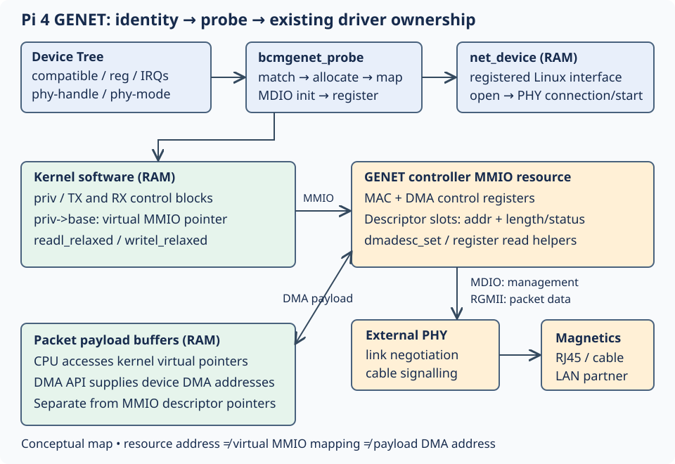

# 12.1 — Connect Device Tree, driver probe, MMIO and the PHY

In [11.3](11.3-decode-ethernet-frame.md), you decoded frames exposed by Linux. Now connect the real interface to the source that controls the Pi's Ethernet hardware. The result is a source/resource map, without taking ownership away from Linux.

Reuse the Pi 4 and `6.12.96-hfs1-v8` kernel from [5.2](5.2-verify-the-linux-development-environment.md), with `ethtool` installed in 11.1. Keep the Pi powered, its existing GPIO circuit unchanged, and the Pico powered off with inter-board connections disconnected. Ethernet may remain connected to its existing LAN. A disconnected cable still permits identity/source inspection. A veth interface cannot supply GENET hardware evidence.



[Open the larger diagram](assets/12.1-genet-probe-map.svg). The diagram separates software objects from hardware; it is not a board wiring drawing.

1. Open your existing SSH connection in a **Mac terminal, any directory**. Substitute the login and address established earlier:

```sh
PI_LOGIN='replace-with-Pi-user'
PI_ADDRESS='replace-with-verified-Pi-address'
ssh "$PI_LOGIN@$PI_ADDRESS"
```

In the **Pi shell, checkout root**, discover the driver rather than assuming an interface name:

```sh
cd ~/hardware-from-software
uname -r
for path in /sys/class/net/*; do
    printf '\n%s\n' "${path##*/}"
    ethtool -i "${path##*/}"
done
```

Require the course release and an interface reporting `driver: bcmgenet`. Unsupported queries for loopback are expected. Set `WIRED` to the discovered name, then inspect its binding:

```sh
WIRED='replace-with-discovered-interface'
DEVICE=$(readlink -f "/sys/class/net/$WIRED/device")
DTNODE=$(readlink -f "$DEVICE/of_node")
printf '%s\n' "$DEVICE" "$DTNODE"
readlink -f "$DEVICE/driver"
cat "$DEVICE/uevent"
cat "$DEVICE/resource"
tr '\000' '\n' < "$DTNODE/compatible"
tr '\000' '\n' < "$DTNODE/phy-mode"
od -An -tx1 "$DTNODE/reg"
ethtool -i "$WIRED"
ethtool "$WIRED"
```

`ethtool -i` identifies the driver; version/firmware fields are not a source-commit certificate. Its bus information, when supplied, describes the parent device, not a PCI slot requirement. Use the sysfs links to establish the platform binding. Save the observed paths privately; no example address here substitutes for them.

The `resource` rows contain start, inclusive end and flags. These are resource metadata, not live register contents or packet addresses. The binary DT `reg` cells use big-endian encoding and parent bus translation; interpreting the hex dump as a native integer is incorrect. In the [pinned SoC DT](https://github.com/raspberrypi/linux/blob/ae161617d7a4552fa91d03626b8d9f3696d17481/arch/arm/boot/dts/broadcom/bcm2711.dtsi), follow `genet` under `scb` and its parent's `ranges` rather than copying an address from another Pi generation.

2. Verify source provenance on the **Pi, same directory**:

```sh
python3 -m json.tool .build/pi-kernel/build-report.json
git -C .build/pi-kernel/source rev-parse HEAD
readlink -f "/lib/modules/$(uname -r)/build"
```

Require report `release` to match `uname -r`, and both report `source_commit` and checkout HEAD to equal `ae161617d7a4552fa91d03626b8d9f3696d17481`. The 5.2 report also records configuration, image, DTB and symbol hashes. Together with that installation/boot record, these establish the intended provenance; a release string alone does not prove binary identity. An APT source/header package with a similar version is insufficient. Missing or mismatched evidence means return to 5.2, without installing another kernel here.

3. Read the matched files on the **Pi, checkout root**. No new program or build is needed:

```sh
GENET=.build/pi-kernel/source/drivers/net/ethernet/broadcom/genet
DTS=.build/pi-kernel/source/arch/arm/boot/dts/broadcom
grep -nE 'bcmgenet_match|bcmgenet_probe|ioremap_resource|register_netdev|bcmgenet_open|bcmgenet_mii_probe|phy_start' "$GENET/bcmgenet.c"
sed -n '3935,4128p' "$GENET/bcmgenet.c"
sed -n '545,561p' "$DTS/bcm2711.dtsi"
sed -n '198,208p' "$DTS/bcm2711-rpi-4-b.dts"
```

For independent reading on the **Mac, checkout root**, fetch just the same pinned primary files. This creates local reading copies, not a replacement kernel tree:

```sh
cd /Users/hermes/Desktop/hardware-from-software
mkdir -p .build/genet-reading
BASE=https://raw.githubusercontent.com/raspberrypi/linux/ae161617d7a4552fa91d03626b8d9f3696d17481
for name in bcmgenet.c bcmgenet.h bcmmii.c; do
    curl --fail --location "$BASE/drivers/net/ethernet/broadcom/genet/$name" -o ".build/genet-reading/$name"
done
```

Adjust the Mac checkout path if needed. Use the Pi tree for the DT files and numbered landmarks below. Lines are specific to this commit.

The board DT enables GENET, selects `rgmii-rxid`, and points `phy-handle` at PHY address 1 on its MDIO bus. This is a management-bus address, not an IP address. Read the [board DT](https://github.com/raspberrypi/linux/blob/ae161617d7a4552fa91d03626b8d9f3696d17481/arch/arm/boot/dts/broadcom/bcm2711-rpi-4-b.dts) alongside the inherited SoC definition.

4. Follow this ordered source map. In the **Pi shell, checkout root**, open each range:

```sh
sed -n '75,123p' "$GENET/bcmgenet.c"
sed -n '3023,3056p' "$GENET/bcmgenet.c"
sed -n '3299,3395p' "$GENET/bcmgenet.c"
sed -n '432,552p' "$GENET/bcmmii.c"
sed -n '277,329p' "$GENET/bcmmii.c"
sed -n '25,120p' "$GENET/bcmmii.c"
```

In [GENET source](https://github.com/raspberrypi/linux/blob/ae161617d7a4552fa91d03626b8d9f3696d17481/drivers/net/ethernet/broadcom/genet/bcmgenet.c), the compatible table selects hardware parameters. `bcmgenet_probe` allocates the RAM `net_device` and private state, obtains IRQs, and maps resource 0 using `devm_platform_ioremap_resource`. Its `priv->base` is a kernel virtual MMIO mapping, not the resource's physical address. Probe initializes MDIO and finishes with `register_netdev`; registration makes an interface available, not necessarily linked.

The Pi's register accessor reaches `readl_relaxed`, with writes through `writel_relaxed`. `bcmgenet_init_dma` derives descriptor pointers from `priv->base`; `dmadesc_set` writes address and length/status through MMIO helpers. GENET descriptors therefore occupy mapped controller space. RAM control blocks track them separately. Packet payload buffers reside in RAM.

A DMA mapping returns a device-visible `dma_addr_t` for a payload. It is neither a CPU pointer nor the controller resource address. Linux's [DMA guide](https://docs.kernel.org/6.12/core-api/dma-api-howto.html) explains why these address spaces require separate APIs. Relaxed register accesses do not remove DMA ownership/ordering requirements; the next lesson follows those transitions.

In `bcmmii.c`, `bcmgenet_mii_register` creates the UniMAC MDIO child controller; DT initialization resolves `phy-handle`. During interface open, `bcmgenet_mii_probe` connects the PHY using `of_phy_connect`. Network start calls `phy_start`. Link changes reach `bcmgenet_mii_setup`, which updates carrier and configures MAC speed/duplex. MDIO carries this management traffic; RGMII carries packet data. These operations describe the existing driver's work, not commands to repeat manually.

5. On the **Pi, same shell/directory**, compare exported PHY identity with that source path:

```sh
readlink -f "/sys/class/net/$WIRED/phydev"
readlink -f "/sys/class/net/$WIRED/phydev/driver"
cat "/sys/class/net/$WIRED/phydev/phy_id"
ethtool "$WIRED"
```

Expected reader observations are a platform GENET binding, matching DT compatible, and a PHY association when the interface has been opened. Speed/duplex may be unknown without carrier; carrier alone proves no remote application delivery. No physical output was measured during authoring.

If GENET is absent, check board/kernel identity and the selected interface. If `phydev` is absent, inspect interface state and boot diagnostics; do not cycle an SSH interface to reproduce probe. Permission-denied or unavailable resource information is a visibility limit, not permission to use `/dev/mem`. Stop on provenance mismatches.

Finish by closing source inspection. No unbind, register access program, register write, or interface reconfiguration is needed; Linux retains NIC ownership and SSH stays usable. Keep your identity/source notes for [12.2 — transmit DMA and completion](12.2-trace-network-transmit-dma.md).

## References

- [Pinned GENET driver](https://github.com/raspberrypi/linux/blob/ae161617d7a4552fa91d03626b8d9f3696d17481/drivers/net/ethernet/broadcom/genet/bcmgenet.c).
- [Pinned PHY/MDIO implementation](https://github.com/raspberrypi/linux/blob/ae161617d7a4552fa91d03626b8d9f3696d17481/drivers/net/ethernet/broadcom/genet/bcmmii.c).
- [Pinned Pi 4 board DT](https://github.com/raspberrypi/linux/blob/ae161617d7a4552fa91d03626b8d9f3696d17481/arch/arm/boot/dts/broadcom/bcm2711-rpi-4-b.dts).
- [Linux 6.12 DMA address spaces](https://docs.kernel.org/6.12/core-api/dma-api-howto.html).
