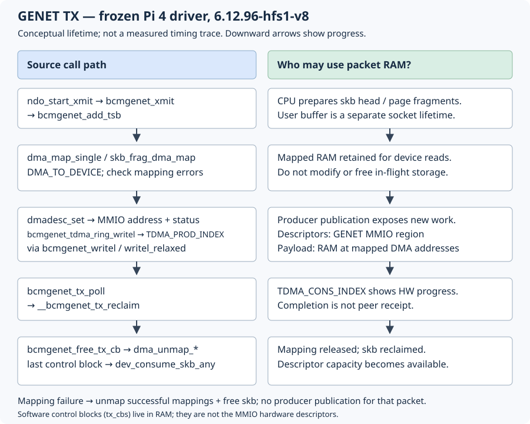

# 12.2 — Follow a transmit buffer through DMA and completion

A successful `send()` means Linux accepted a datagram. It does not mean the Ethernet controller has finished reading its buffers, or that a peer received it. Here we follow those separate events through the Pi 4's GENET driver, then repeat the bounded exchange from [11.2](11.2-send-numbered-udp.md).

Keep the `6.12.96-hfs1-v8` kernel established in 5.2. Finish [12.1](12.1-trace-network-driver-probe.md) first. Leave GPIO wiring unchanged, the Pico powered off and inter-board wires disconnected. No driver unloading, headers installation, register writes or kernel changes are needed.

## Which address belongs to whom?

The sender builds eight payload bytes in its **user virtual address space**. Ordinary socket transmission lets the application reuse that buffer after the syscall; this is not a promise of delivery. The stack constructs UDP/IP headers and an Ethernet header after route/neighbour resolution. An `sk_buff` is kernel metadata describing associated packet storage: a linear head and possibly page fragments. A short datagram need not exercise the fragment path. See the [kernel's skb geometry](https://docs.kernel.org/networking/skbuff.html).

The driver sees kernel virtual pointers such as `skb->data`. `dma_map_single()` returns a **DMA address** for the controller, not a pointer it can dereference on the CPU. CPU physical RAM addresses, DMA addresses and the physical/resource addresses describing controller registers are distinct concepts, even where some numeric values happen to coincide. Mapping registers produces a kernel `__iomem` address; mapping packet RAM for DMA serves a different purpose. The [DMA guide](https://docs.kernel.org/6.12/core-api/dma-api-howto.html#cpu-and-dma-addresses) explains the translations and mapping lifetime.



## Read the actual publication path

1. On the **Mac, repository root** (`~/Desktop/hardware-from-software`), fetch the exact source used by our baseline. This is a source download, not a kernel installation.

```sh
mkdir -p .build/network-source
curl --fail --location https://raw.githubusercontent.com/raspberrypi/linux/ae161617d7a4552fa91d03626b8d9f3696d17481/drivers/net/ethernet/broadcom/genet/bcmgenet.c -o .build/network-source/bcmgenet.c
grep -nE 'bcmgenet_xmit|bcmgenet_free_tx_cb|__bcmgenet_tx_reclaim|bcmgenet_tx_poll|dmadesc_set|TDMA_PROD_INDEX|tx_bds =' .build/network-source/bcmgenet.c
less +2070 .build/network-source/bcmgenet.c
```

2. Follow these landmarks in the [pinned driver](https://github.com/raspberrypi/linux/blob/ae161617d7a4552fa91d03626b8d9f3696d17481/drivers/net/ethernet/broadcom/genet/bcmgenet.c). Line numbers below refer to this downloaded file.

`ndo_start_xmit` selects `bcmgenet_xmit` (3677). It selects the skb's queue and locks that ring. Too few free descriptors stops the queue and returns `NETDEV_TX_BUSY` without consuming this skb. Otherwise `bcmgenet_add_tsb` prepends a transmit status block, reallocating headroom if necessary. For `CHECKSUM_PARTIAL`, it records checksum offsets; the first descriptor requests checksum work. This status block is controller metadata, not an extra UDP payload header.

The loop at 2116 maps the linear head with `dma_map_single`, then each page fragment with `skb_frag_dma_map`, all `DMA_TO_DEVICE`: the device reads RAM. It checks `dma_mapping_error` before using each result. Software control blocks retain mapping address, length and skb identity for later cleanup. On mapping failure, `out_unmap_frags` backs up the failed slot, unmaps previously successful mappings and frees the skb. It never publishes this failed packet. A headroom-allocation failure also consumes/drops the packet. `NETDEV_TX_OK` here means the stack need not retry, not that transmission succeeded.

`dmadesc_set` writes address and length/status, including start/end-of-packet flags and append-CRC. Crucially, initialization at 3043 derives `priv->tx_bds` from `priv->base + tdma_offset`; `bd_addr` points into that MMIO region. **Packet bytes live in RAM; these GENET descriptors are accessed through MMIO.** Software `tx_cbs`, allocated with `kcalloc`, are bookkeeping rather than a hardware descriptor array.

Actual fragment from the pinned source (2173–2186; omitted statements are described above):

```c
ring->free_bds -= nr_frags + 1;
ring->prod_index += nr_frags + 1;
ring->prod_index &= DMA_P_INDEX_MASK;
```

After accounting, `bcmgenet_tdma_ring_writel(..., TDMA_PROD_INDEX)` publishes work when `!netdev_xmit_more()` or the queue is stopped. Publication can batch packets. Follow that helper at 421 to `bcmgenet_writel` at 73: on our Arm64 Pi it uses `writel_relaxed`. There is no explicit `dma_wmb()` in this transmit path. Do not replace this source sequence with a generic coherent-RAM descriptor example. DMA mapping handles the platform's streaming-buffer preparation; ring locking coordinates CPUs. A relaxed MMIO accessor is not a general RAM-to-device barrier; see [Linux I/O ordering](https://docs.kernel.org/6.12/driver-api/device-io.html). `volatile` neither performs DMA mapping/cache maintenance nor establishes completion. Sleeping merely delays the CPU; it does not transfer ownership.

3. Read completion at 1869. `__bcmgenet_tx_reclaim` reads `TDMA_CONS_INDEX`, computes progress modulo the index mask and walks completed control blocks. `bcmgenet_free_tx_cb` matches head mappings with `dma_unmap_single` and fragment mappings with `dma_unmap_page`. Only the last control block returns the skb for `dev_consume_skb_any`. Reclamation restores free descriptor counts and reports completed bytes/packets; `bcmgenet_tx_poll` can wake the stopped queue. Software must preserve mapped storage while the controller can read it. Completion permits reclamation, not a claim of remote receipt.

## Observe a finite exchange

4. On the **Pi, repository root** (`~/hardware-from-software`, the checkout used in 11.2), verify `uname -r`. If it differs, return to 5.2. Reuse the built examples from 11.2 and private lab from 11.1 (build again with `python3 scripts/build_network.py` if needed). If the lab was cleaned up, recreate it:

```sh
sudo python3 scripts/network_lab.py setup
sudo python3 scripts/network_lab.py show
ip -s link show dev hfs-host
```

If setup reports an existing lab, inspect it with `show` instead of replacing it. The complete reused programs are below; the endpoint also uses the existing [wire.hpp](downloads/examples/network/wire.hpp) message helpers.

```cpp
{{#include ../examples/network/udp_endpoint.cpp}}
```

```python
{{#include ../examples/network/udp_sender.py}}
```

On **Pi terminal 1, repository root**:

```sh
sudo ip netns exec hfs-lab .build/network/udp_endpoint 198.18.0.2 40420 10 30
```

On **Pi terminal 2, repository root**, after the endpoint reports ready:

```sh
python3 examples/network/udp_sender.py 198.18.0.2 --count 10
ip -s link show dev hfs-host
```

Expect sequence-tagged replies and a summary, not a particular RTT. Record actual sent/received/timeouts and before/after TX counts. These packets traverse veth: **they do not exercise GENET DMA**.

5. Optionally repeat the already verified physical topology from 11.1/11.2. On the **Pi, repository root**, set `IFACE` and `PI_WIRED_IP` to the discovered wired interface and its address. Confirm `ethtool -i "$IFACE"` identifies `bcmgenet`. Read the two values from your 11.1 record:

```sh
read -r IFACE
read -r PI_WIRED_IP
ethtool -i "$IFACE"
```

Before and after the run, record:

```sh
ip -s link show dev "$IFACE"
ethtool -S "$IFACE" | grep -E 'tx|Tx'
ethtool -k "$IFACE"
```

On the **Pi, repository root**, start:

```sh
.build/network/udp_endpoint "$PI_WIRED_IP" 40420 10 30
```

On the **Mac, `~/Desktop/hardware-from-software`**, enter the same verified Pi address, then send:

```sh
read -r PI_WIRED_IP
python3 examples/network/udp_sender.py "$PI_WIRED_IP" --count 10
```

Before calling this a GENET transmit run, verify the return route on the **Pi, same shell**. Enter the Mac test source IPv4 address recorded in 11.2, then inspect the route with the endpoint's source address:

```sh
read -r MAC_IP
ip route get "$MAC_IP" from "$PI_WIRED_IP"
```

Require the selected `dev` to equal `IFACE`. Binding to the wired IP alone does not force wired egress: Linux can choose another interface, including Wi-Fi. If the route uses another interface, keep this as an application/source observation and do not claim GENET TX; no route change is needed. Repeat the finite exchange only after establishing this existing wired return path. Keep offload settings unchanged. Outgoing captures may precede checksum completion; apparent bad checksums do not alone prove damaged frames. Interface/driver counters include unrelated traffic and may count at different stages. Successful sends and completion counters cannot establish peer receipt; validated replies establish an application exchange, without exposing individual DMA timings.

If replies time out, check endpoint readiness, addresses and route before blaming DMA. If counters barely change, confirm which interface carried the traffic. If `ethtool -S` is unsupported or counter names differ, retain its diagnostic and use interface statistics; do not invent replacements.

Close endpoint/sender/capture processes (Ctrl-C if still waiting), then run `sudo python3 scripts/network_lab.py cleanup` on the Pi from the repository root. Remove only the source download if unwanted. Normal networking and GPIO remain in their previous state. Next, [12.3](12.3-trace-network-receive-napi.md) follows incoming buffers through interrupts and NAPI.

References: [pinned GENET implementation](https://github.com/raspberrypi/linux/blob/ae161617d7a4552fa91d03626b8d9f3696d17481/drivers/net/ethernet/broadcom/genet/bcmgenet.c), [Linux 6.12 DMA guide](https://docs.kernel.org/6.12/core-api/dma-api-howto.html), [skb geometry](https://docs.kernel.org/networking/skbuff.html), [Linux 6.12 device I/O](https://docs.kernel.org/6.12/driver-api/device-io.html).
