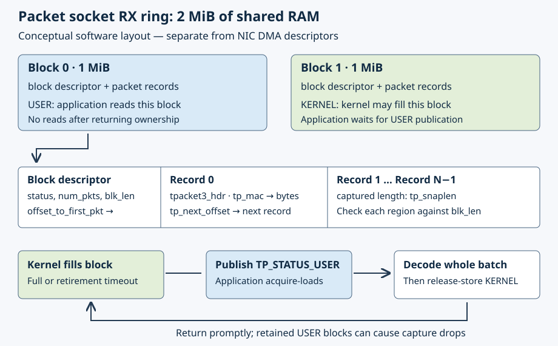

# 13.1 — Receive through a shared packet ring

You will replace the per-packet `recvmsg` in [11.3](11.3-decode-ethernet-frame.md) with a mapped `TPACKET_V3` receive ring. The same decoder will identify the same numbered UDP requests. The change is how a packet socket hands batches to your process.

Use the Pi's existing `6.12.96-hfs1-v8` course kernel and private namespace lab. A separately recorded Linux test machine can exercise the software path, but macOS cannot run this Linux interface. Keep the Pico powered off and inter-board wires disconnected; Pi GPIO wiring needs no change. Stop earlier networking programs before starting. No Ethernet cable or physical-interface modification is needed here.

## A block is the unit of ownership

`PACKET_RX_RING` allocates packet-socket storage in the kernel. `mmap(MAP_SHARED)` exposes that storage to the process. V3 groups variable-size packet records into **blocks** and makes readiness a block-level event. A block is retired when full or when its retirement timer expires with packets waiting. This lets light traffic become visible without filling a large block. It trades waiting time against batch size; a 50 ms retirement setting is not a guaranteed packet latency. See the [Linux 6.12 packet-ring documentation](https://docs.kernel.org/6.12/networking/packet_mmap.html).



[Open the larger diagram](assets/13.1-packet-ring-ownership.svg). This is ordinary shared RAM for a packet socket. It is separate from the GENET hardware descriptor ring in Chapter 12.

The example allocates two 1 MiB blocks: 2 MiB mapped in total. `tp_frame_size=2048` and `tp_frame_nr=1024` satisfy ring configuration accounting; they do not mean V3 packet records must be traversed in 2048-byte steps. Within each block, `offset_to_first_pkt` locates the first `tpacket3_hdr`. Its `tp_mac` locates Ethernet bytes relative to that record, `tp_snaplen` gives captured bytes, and `tp_next_offset` locates the next record. `num_pkts` bounds the traversal; `blk_len` bounds the used block region. These fields are defined in the [Linux UAPI header](https://github.com/torvalds/linux/blob/v6.12/include/uapi/linux/if_packet.h).

The application tests the block's `TP_STATUS_USER` bit with an acquire load. Only after observing that bit does it read metadata and packet bytes. After decoding the whole batch, a release store writes `TP_STATUS_KERNEL`, allowing the kernel to reuse the block. No span or pointer into that block may survive the release. A plain `volatile` access would not supply this ordering. The kernel publishes completed blocks with a write barrier and checks returned blocks before reuse; inspect `prb_close_block` and `prb_open_block` in the [packet-socket implementation](https://github.com/torvalds/linux/blob/v6.12/net/packet/af_packet.c).

Returning blocks promptly matters: if the kernel reaches a block still owned by userspace, capture can freeze and packets can be dropped. Decoding and printing happen while this small teaching reader owns the block. Slow terminal output can therefore contribute to drops.

## Read the complete implementation

1. Read `examples/network/packet_ring.cpp` below. It creates the socket with protocol zero, configures and maps the ring, then binds `ETH_P_ALL` on the selected interface. Capture starts at that bind. `PACKET_IGNORE_OUTGOING` excludes the endpoint's outgoing replies.

```cpp
{{#include ../examples/network/packet_ring.cpp}}
```

The process checks block version, used length, packet count, first offset and record alignment before dereferencing records. It checks that each header and captured region fit, that captured length does not exceed original length, and that a next-record offset moves forward beyond the current captured data. Subtractions follow upper-bound checks to avoid unsigned underflow. Packet bytes then pass through the existing length-checked decoder. VLAN metadata is classified unsupported, since a stripped tag would otherwise hide that layout from the byte decoder. Decoding does not validate checksums.

The complete shared `examples/network/wire.hpp` is unchanged from 11.3; the ring uses `decode_frame` and `describe_frame`. Its reply helpers are for later exercises.

```cpp
{{#include ../examples/network/wire.hpp}}
```

A block is returned even when a metadata check fails, then the exception path unmaps and closes the socket. Normal completion reads socket statistics, unmaps and closes. Exiting the process also releases these process resources. Nothing attaches to the interface or persists after socket closure.

When the next block is kernel-owned, `poll` sleeps with the remaining absolute run deadline. Interruptions retry with a newly computed remainder. A ready notification leads back to the ownership check. The 30-second run limit is separate from the 50 ms block-retirement setting. Processing finishes the current finite block before checking the deadline or target count again, so a batch can take `matched` beyond the requested count.

## Compare the same requests

2. **Pi terminal A — checkout root**:

```sh
cd ~/hardware-from-software
uname -r
python3 scripts/build_network.py
sudo python3 scripts/network_lab.py setup
sudo python3 scripts/network_lab.py show
```

Require the course release on the Pi. If the previous lesson left your lab running, use `show` to inspect it instead of repeating `setup`; collision refusal is intentional. The helper owns `hfs-host` (`198.18.0.1/30`) and namespace `hfs-lab` with `hfs-peer` (`198.18.0.2/30`). It disables TX checksum offload only on those disposable veth peers and changes no default route. Build prerequisites and package installation are in [11.3](11.3-decode-ethernet-frame.md).

3. **Pi terminal A — checkout root**, start the ordinary endpoint and wait for its `ready` record:

```sh
sudo ip netns exec hfs-lab .build/network/udp_endpoint 198.18.0.2 40420 10 30
```

4. **Pi terminal B — checkout root**, start the ring reader and wait for `ready`:

```sh
cd ~/hardware-from-software
sudo ip netns exec hfs-lab .build/network/packet_ring hfs-peer 10 30
```

5. **Pi terminal C — checkout root**, send only after both are ready:

```sh
cd ~/hardware-from-software
python3 examples/network/udp_sender.py 198.18.0.2 --count 10
```

The ring is passive: the ordinary endpoint supplies replies. Illustrative expectations are ten validated sender replies, endpoint `accepted:10`, and ring `matched:10`. Compare the ring's sequence records with the sender's `sequences` array: both should contain 1–10, with source `198.18.0.1`, destination `198.18.0.2`, destination port 40420 and eight payload bytes. MAC addresses and sender source port come from this run. ARP may appear or be absent because of neighbour caching.

Record `packets`, `blocks`, `kernel_drops` and `queue_freezes` from the actual summary. `packets` counts all traversed records, including traffic that did not match. `blocks` counts batches acquired. `kernel_drops` reports packet-socket losses; `queue_freezes` counts occasions the V3 queue could not advance into a userspace-owned block. Neither is a count of UDP endpoint losses or NIC hardware drops. Reading `PACKET_STATISTICS` resets the socket statistics; this reader reads them once at the end. See [packet-socket statistics implementation](https://github.com/torvalds/linux/blob/v6.12/net/packet/af_packet.c).

6. After all three programs finish, restart the endpoint from step 3 and replace the ring command in step 4 with:

```sh
sudo ip netns exec hfs-lab .build/network/packet_rx hfs-peer 10 30
```

Run the same sender again. A new sender starts at sequence 1. Compare decoded fields and sequence sets, rather than expecting identical ARP totals or batch counts. The reader's count is not duplicate detection: validate the printed sequence set as well as `matched`.

For an optional syscall observation, install `strace` on the Pi with `sudo apt install strace`, then repeat each finite run, replacing its reader command with the corresponding command below. Keep the endpoint and sender procedure the same, and wait for each reader's `ready` record.

**Pi terminal B — checkout root, one run at a time:**

```sh
sudo ip netns exec hfs-lab strace -c -e trace=poll,recvmsg .build/network/packet_rx hfs-peer 10 30
sudo ip netns exec hfs-lab strace -c -e trace=poll,recvmsg .build/network/packet_ring hfs-peer 10 30
```

The ordinary reader calls `recvmsg` per received frame. The ring reader has no `recvmsg` calls: it traverses mapped records and may handle several before another `poll`. Actual poll counts depend on arrival timing and scheduling; ten slowly spaced requests need not form a large batch. Tracing and per-frame printing perturb execution, so these runs teach syscall placement rather than establish throughput improvement.

## Which copy disappeared?

The mapped reader avoids copying each captured record from the packet socket into a separate application receive array through `recvmsg`. It does **not** remove the kernel's packet representation or the copy into the ring: `tpacket_rcv` still accepts an `sk_buff` (SKB, Linux's packet metadata object referring to packet storage) and uses `skb_copy_bits` to fill mapped packet storage. Linux still owns the device, runs its driver and delivers the same requests to the ordinary UDP stack. The [Linux receive implementation](https://github.com/torvalds/linux/blob/v6.12/net/packet/af_packet.c) makes that boundary explicit. Neither mapping RAM nor reducing receive syscalls establishes hardware zero-copy or kernel bypass.

## Diagnose and clean up

`Operation not permitted` indicates missing packet-socket privilege. `unknown interface` commonly means the reader ran outside `hfs-lab`. Replies with zero capture matches suggest a late reader or wrong interface. Captured requests with sender timeouts suggest the endpoint expired or was absent. `invalid TPACKET_V3 block metadata` is a rejected ring layout, not a decoder success; preserve the error and kernel/build record. Nonzero drop/freeze counters suggest capture pressure: reduce traffic or terminal logging before interpreting missing sequences. Exit status 1 means the count was not reached by the deadline; status 2 reports an argument or checked-operation failure.

7. Let finite runs finish, or stop your own programs with Ctrl-C in their terminals. **Pi — checkout root**:

```sh
sudo python3 scripts/network_lab.py cleanup
```

Cleanup refuses running namespace processes or changed resource identities. Stop your remaining lab programs and retry rather than deleting an unidentified interface. The next state is normal course-kernel networking, unchanged physical-interface settings, and no lab namespace or packet-reader process. Retain the measured comparison; a software veth result establishes no Pi PHY, GENET DMA or physical-link performance result.

## References

- [Linux 6.12 Packet MMAP: V3 block polling and configuration](https://docs.kernel.org/6.12/networking/packet_mmap.html).
- [Linux 6.12 packet UAPI: block and record fields](https://github.com/torvalds/linux/blob/v6.12/include/uapi/linux/if_packet.h).
- [Linux 6.12 packet socket implementation: publication, copying and statistics](https://github.com/torvalds/linux/blob/v6.12/net/packet/af_packet.c).
