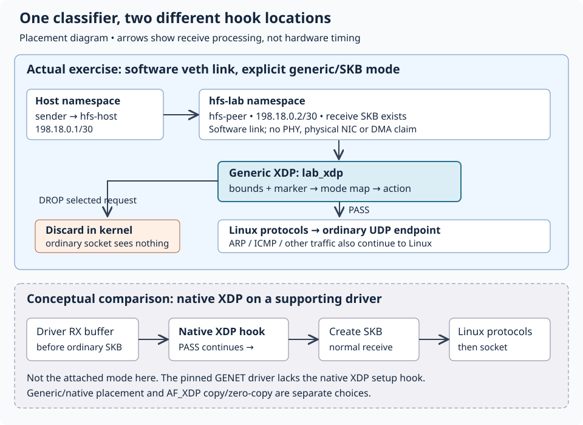

# 13.2 — Run a selective generic XDP program

You will load a packet classifier into Linux, first count and pass the numbered UDP requests, then drop those requests before the ordinary UDP endpoint receives them. ARP, ICMP and packets outside the classifier's narrow layout continue to Linux. Unlike the passive readers in [13.1](13.1-receive-packet-ring.md), this program changes delivery.

Use the Pi's existing `6.12.96-hfs1-v8` course kernel, the networking build from [11.3](11.3-decode-ethernet-frame.md), and the private namespace from [11.1](11.1-identify-network-hardware.md). Stop earlier networking programs. Keep the Pico powered off and inter-board wires disconnected; Pi GPIO wiring needs no change. These exercises attach only to disposable `hfs-peer`. They require Linux privileges and cannot run on macOS. A separately recorded Linux machine can exercise this software path without establishing Pi hardware behavior.

## Where the program runs

**XDP** is a receive hook where a BPF program returns a packet action. Clang translates this small C function into BPF instructions in an ELF object. Loading that object asks the kernel verifier to check the instruction program before Linux permits it to run. The C++ controller is an ordinary userspace process; the classifier executes in the kernel for arriving frames.



[Open the larger diagram](assets/13.2-generic-xdp-placement.svg). An **SKB** (`sk_buff`) is Linux's packet metadata object referring to packet storage. Generic XDP processes a packet that already has an SKB, before ordinary protocol delivery. `XDP_PASS` continues receive processing; `XDP_DROP` discards the packet. See `do_xdp_generic` and `__netif_receive_skb_core` in the [Linux 6.12 receive implementation](https://github.com/torvalds/linux/blob/v6.12/net/core/dev.c).

Native XDP needs driver support and runs earlier, before constructing the ordinary receive SKB. This loader explicitly requests **generic/SKB mode** with `XDP_FLAGS_SKB_MODE`; it does not probe native mode and silently fall back. The pinned Pi GENET driver's `bcmgenet_netdev_ops` has no native XDP setup hook (`ndo_bpf`), so generic mode is the course route. Inspect the [pinned GENET implementation](https://raw.githubusercontent.com/raspberrypi/linux/ae161617d7a4552fa91d03626b8d9f3696d17481/drivers/net/ethernet/broadcom/genet/bcmgenet.c) when comparing another kernel. A successful veth attachment says nothing about physical DMA or native GENET support.

## Make every read conditional on available bytes

1. Read the complete `examples/network/lab_xdp.bpf.c`:

```c
{{#include ../examples/network/lab_xdp.bpf.c}}
```

`context->data` and `data_end` delimit the directly accessible packet region. Before reading Ethernet and IPv4 fields, the first condition requires 14 + 20 bytes. After checking the IPv4 header length, the second requires that header plus 16 bytes: an eight-byte UDP header and eight-byte message. A failed bound returns PASS before the later reads. Byte accesses avoid assuming alignment, and shifts assemble network-order lengths explicitly.

The verifier tracks pointer types and accessible ranges along control-flow paths; map lookups also return pointers that must be checked before dereferencing. A program can compile successfully and still fail verification at load time. Verification constrains memory access and helper use; it does not prove that the chosen traffic policy is correct. The [Linux verifier documentation](https://docs.kernel.org/6.12/bpf/verifier.html) explains packet-pointer range tracking and nullable map values.

This classifier selects untagged Ethernet IPv4, version 4 with a 20-byte header, UDP protocol 17, no fragment offset or more-fragments bit, IPv4 total length 36, UDP length 16, destination port **40420**, and payload prefix `H F S 01`. The remaining four payload bytes are the sequence number. It does not restrict source port or IP/MAC addresses: any ingress packet with those fields matches. Ethernet padding may follow the IP datagram. It does not validate IPv4/UDP checksums; checksum validity is separate from recognizing these marker bytes.

VLAN, IPv6, IPv4 options, fragments, short headers, inconsistent checked lengths, other ports and wrong marker/version take PASS. PASS delegates further decisions to Linux; it does not promise Linux will accept a malformed packet. ARP's EtherType and ICMP's IP protocol fail the selection tests, so both pass without incrementing the selected-flow counters.

Three **maps** are kernel-managed objects accessible from BPF and through userspace file descriptors. `mode[0]` selects 0 = pass, 1 = drop, or 2 = redirect. `counters[0..2]` holds selected pass/drop/redirect counts; atomic increments avoid lost updates when multiple CPUs execute the classifier. These are counts of classifier decisions, not confirmed UDP deliveries. The `sockets` XSK map is for later AF_XDP lessons. This controller leaves it empty, so `redirect` explicitly falls back to PASS and increments the pass counter. No packet reaches a userspace AF_XDP receiver in this lesson. The [AF_XDP documentation](https://docs.kernel.org/6.12/networking/af_xdp.html) describes XSK map targets and their interface/queue constraints.

## Own the attachment as well as the object

2. Read `examples/network/xdp_control.cpp`:

```cpp
{{#include ../examples/network/xdp_control.cpp}}
```

The complete shared header is below. For this lesson, follow its signal/argument helpers and `XdpProgram` class. The later `XskBuffers` and `run_xsk` definitions are shared dependencies for lessons 13.4–13.5 and are not executed by `xdp_control`. The header includes `wire.hpp`, whose complete decoder and message definitions appear in [11.3](11.3-decode-ethernet-frame.md).

<details>
<summary>Complete examples/network/xsk_common.hpp, including the owned loader</summary>

```cpp
{{#include ../examples/network/xsk_common.hpp}}
```

</details>

`XdpProgram` resolves the interface in the current network namespace and queries generic, native and hardware modes. Any existing program or failed inspection stops construction. It opens and loads the object, finds `lab_xdp`, and records its kernel program ID. Setting `mode` updates the map before attachment. `UPDATE_IF_NOEXIST` makes attachment refuse replacement even if another generic attachment races the initial checks.

At shutdown, the class queries the current generic program ID. A different ID or failed query prevents an unverified detach. With a matching ID, it also supplies `old_prog_fd` to the detach operation: the kernel checks the expected program, covering a change between query and detach. The [libbpf 1.1.2 implementation](https://github.com/libbpf/libbpf/blob/v1.1.2/src/netlink.c) passes that expected descriptor through the netlink replacement operation. Destruction attempts cleanup on exceptions too. Only after detachment does the normal path print counters and close the object.

The lifetime argument is 1–300 seconds after successful attachment. Ctrl-C/SIGTERM requests the normal cleanup path. Closing the controller's object alone does not remove this netlink attachment: SIGKILL or a crash can leave it attached. This is why we use a disposable namespace and inspect the result.

## Pass, then drop the same five requests

3. **Pi terminal A — checkout root**, prepare the build and lab:

```sh
cd ~/hardware-from-software
uname -r
python3 scripts/build_network.py
sudo python3 scripts/network_lab.py setup
sudo python3 scripts/network_lab.py show
sudo ip netns exec hfs-lab ip -details link show dev hfs-peer
sudo ip netns exec hfs-lab .build/network/xdp_control hfs-peer self-test 1
```

Require the course release on the Pi. Package installation is in 11.3. If the lab remains from an earlier page, inspect it with `show` instead of repeating `setup`. The helper verifies ownership, creates `hfs-host` at `198.18.0.1/30` and `hfs-peer` at `198.18.0.2/30`, and disables TX checksum offload only on those new veth interfaces. It changes no default route or physical interface.

The self-test loads/verifies the object but never attaches it. Finite kernel fixtures check selected pass/drop, truncated buffers from the minimum Ethernet-header size onward, unsupported layouts, marker mismatches and empty-XSK fallback. The initial interface should show no XDP attachment. Missing BPF privileges or verifier support is a failed test; preserve the error rather than calling it a skipped success.

4. **Pi terminal A — checkout root**, start the ordinary receiver and wait for its `ready` record:

```sh
sudo ip netns exec hfs-lab .build/network/udp_endpoint 198.18.0.2 40420 5 20
```

5. **Pi terminal B — checkout root**, start pass/count and wait for `READY mode=generic action=pass`:

```sh
cd ~/hardware-from-software
sudo ip netns exec hfs-lab .build/network/xdp_control hfs-peer pass 60
```

6. **Pi terminal C — checkout root**, promptly inspect the attachment, test collision refusal, then send:

```sh
cd ~/hardware-from-software
sudo ip netns exec hfs-lab ip -details link show dev hfs-peer
sudo ip netns exec hfs-lab .build/network/xdp_control hfs-peer drop 1
sudo ip netns exec hfs-lab ip -details link show dev hfs-peer
python3 examples/network/udp_sender.py 198.18.0.2 --count 5 --timeout 0.2
```

The second controller must exit nonzero with replacement refusal; that intentional failure is the collision check. The ID in both interface inspections must stay the same. With no other marked sender, illustrative expectations are five replies with sequences 1–5 and endpoint `accepted:5`. After the sender finishes, press Ctrl-C in terminal B. Its illustrative summary is `selected_flow pass=5 drop=0 redirect=0`. The endpoint replies travel out of `hfs-peer`; these counters describe selected ingress requests.

7. **Pi terminal C — checkout root**, inspect after terminal B exits:

```sh
sudo ip netns exec hfs-lab ip -details link show dev hfs-peer
```

Require no remaining XDP program. Restart the endpoint from step 4 in terminal A. In terminal B, run the following and wait for its READY record:

```sh
sudo ip netns exec hfs-lab .build/network/xdp_control hfs-peer drop 60
```

8. **Pi terminal C — checkout root**, promptly send and check unselected traffic while the drop program remains attached:

```sh
python3 examples/network/udp_sender.py 198.18.0.2 --count 5 --timeout 0.2 --expect-timeout
sudo ip neigh flush to 198.18.0.2 dev hfs-host
ping -I hfs-host -c 3 -W 1 198.18.0.2
python3 examples/network/udp_sender.py 198.18.0.2 --count 1 --timeout 0.2 --malformed --expect-timeout
```

The neighbour flush affects only the disposable peer's cached entry; the ping requires neighbour resolution again, exercising passed ARP and ICMP. The malformed sender uses version 2: the classifier passes it, and the still-running endpoint should print a rejection. It sends no reply to an invalid message.

Let terminal A reach its 20-second deadline before stopping B. Illustrative expectations are endpoint `accepted:0,rejected:1`, five valid-request timeouts with no unreachable records, a successful ping, and one rejected malformed request. Endpoint exit status 1 is expected because it did not accept its target count. Then Ctrl-C terminal B: its illustrative summary is `selected_flow pass=0 drop=5 redirect=0`. ARP, ping and version-2 packets are not selected and add nothing to these counters. If the endpoint or controller expired before sending, repeat with freshly started processes; silence by itself cannot establish XDP drop.

9. Confirm removal with step 7's inspection. Restart the endpoint from step 4 and run the normal five-request sender from step 6 with no controller. Replies should return. Keep the actual sender, endpoint, counter and program-ID records together: that comparison establishes the delivery change and restoration. No numbers above are measured results from this page's writer.

## Diagnose and restore the lab

`Unknown interface` usually means the controller ran outside `hfs-lab`. `BPF load/verifier failed` requires the preceding libbpf diagnostic, running kernel and build record; recompilation alone does not establish verification. `Interface already has an XDP program` is intentional refusal. Inspect the current ID and stop its known owner; do not issue a blanket detach against an unidentified program.

Timeouts with zero selected drop counts suggest the wrong namespace/interface, an expired controller, or packets outside the exact marker/layout. A nonzero `unreachable` sender count can mean the UDP endpoint was absent; it is not proof of drop. Lost ping replies require inspecting the lab and controller policy before further experiments. These finite tests do not measure throughput or prove the policy for every possible packet.

10. Let all endpoints finish and stop your controllers with Ctrl-C. **Pi — checkout root**:

```sh
sudo ip netns exec hfs-lab ip -details link show dev hfs-peer
sudo ip netns pids hfs-lab
sudo python3 scripts/network_lab.py cleanup
```

Normally there is no XDP attachment and no namespace process. If a killed controller left a program on this helper-owned disposable peer, preserve its ID and error record; after all your namespace processes stop, the ownership-checking helper can remove the private link and namespace, which also removes that attachment. It refuses changed resource identities and running processes. Do not apply this recovery to a physical interface.

The next state is ordinary course-kernel networking with no private lab or active classifier. Later physical repetition requires a separately verified Wi-Fi management session before attaching to wired ingress; an Ethernet-only management setup stays with the namespace route. This page supplies no physical attachment exercise. The next lesson separates AF_XDP memory ownership from the hook placement demonstrated here.

## References

- [Linux 6.12 BPF verifier: packet bounds and map-pointer checks](https://docs.kernel.org/6.12/bpf/verifier.html).
- [Linux 6.12 receive implementation: generic XDP and SKB processing](https://github.com/torvalds/linux/blob/v6.12/net/core/dev.c).
- [libbpf 1.1.2 netlink implementation: query, attach and expected-program detach](https://github.com/libbpf/libbpf/blob/v1.1.2/src/netlink.c).
- [Linux 6.12 AF_XDP: generic/native modes and XSK maps](https://docs.kernel.org/6.12/networking/af_xdp.html).
