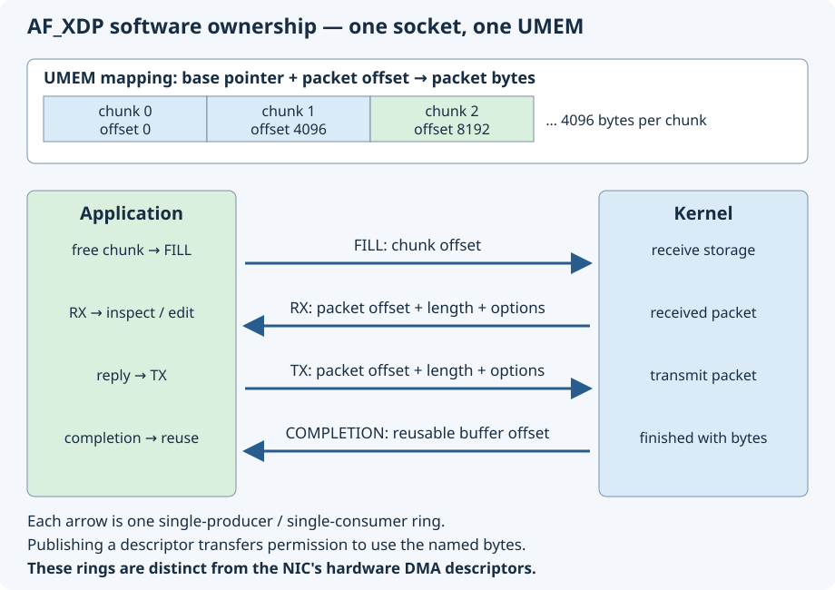

# 13.3 — Verify AF_XDP availability and understand its memory model

AF_XDP connects selected XDP traffic to packet memory managed by an application. Before redirecting packets, verify the existing kernel and learn the buffer ownership contract. This lesson creates and closes one **unbound** socket. It attaches no packet program and receives no packets.

Finish [13.2](13.2-selective-generic-xdp.md) and let its controller exit before continuing. Keep the Pi on its normal supply and SSH connection, using the **same `6.12.96-hfs1-v8` kernel established in [5.2](5.2-verify-the-linux-development-environment.md)**. Pico and inter-board wires remain disconnected; leave any existing GPIO circuits alone. No cable or physical-interface change is required. The private software link from 11.1 is the next exercise's traffic path.

## Verify the running environment

A source tree containing `CONFIG_XDP_SOCKETS=y` says what could be built. `uname -r` says which release is running. The build record, installed image and embedded configuration connect those observations to the intended build. None alone establishes the whole chain.

1. **Pi — `~/hardware-from-software`**, run these read-only identity checks:

```sh
cd ~/hardware-from-software
uname -r
test "$(uname -r)" = 6.12.96-hfs1-v8
readlink -f "/lib/modules/$(uname -r)/build"
make -s -C "/lib/modules/$(uname -r)/build" LOCALVERSION= kernelrelease
git -C .build/pi-kernel/source rev-parse HEAD
git -C .build/pi-kernel/source status --porcelain
cat .build/pi-kernel/config-diff.json
```

Require the course release from both release commands, the native output directory `.build/pi-kernel/output`, source commit `ae161617d7a4552fa91d03626b8d9f3696d17481`, and no source modifications. The configuration differences are the record retained by 5.2's build, including the deliberate AF_XDP enablement and local release. If anything differs, stop and resolve the existing installation using 5.2; do not build a second networking kernel or install unrelated headers.

2. Expose the kernel's embedded configuration. The `configs` module provides `/proc/config.gz` when built as a module; it does not attach XDP. See the pinned [`configs` implementation](https://github.com/raspberrypi/linux/blob/ae161617d7a4552fa91d03626b8d9f3696d17481/kernel/configs.c). **Pi — same directory and shell:**

```sh
configs_was_loaded=no
if test -d /sys/module/configs; then
    configs_was_loaded=yes
fi
sudo modprobe configs
zgrep -E '^(CONFIG_XDP_SOCKETS|CONFIG_BPF_SYSCALL|CONFIG_NET_NS|CONFIG_VETH)=' /proc/config.gz
```

Require `CONFIG_XDP_SOCKETS=y`, `CONFIG_BPF_SYSCALL=y`, `CONFIG_NET_NS=y` and `CONFIG_VETH=m` for the selected course configuration. A missing embedded configuration is a failed check to investigate, not permission to substitute a convenient `/boot/config-*` file.

3. Check the saved provenance and the configuration/image hashes. This finite Python command only reads files and Git metadata. **Pi — same directory:**

```sh
python3 - <<'PYCODE'
import gzip
import hashlib
import json
import platform
import subprocess
from pathlib import Path

baseline = json.loads(Path('kernel-baseline.json').read_text())
build = Path(baseline['build_directory']).resolve()
report = json.loads((build / 'build-report.json').read_text())
installed = json.loads(Path('/boot/firmware/hfs-kernel/build-report.json').read_text())
assert platform.release() == baseline['release'] == report['release']
assert report == installed
assert report['cross_compile'] == ''
assert report['source_commit'] == baseline['source_commit']
source_commit = subprocess.check_output(
    ['git', '-C', str(build / 'source'), 'rev-parse', 'HEAD'], text=True).strip()
assert source_commit == baseline['source_commit']
assert (Path('/lib/modules') / platform.release() / 'build').resolve() == build / 'output'
config = (build / 'output/.config').read_bytes()
assert hashlib.sha256(config).hexdigest() == report['config_sha256']
assert gzip.decompress(Path('/proc/config.gz').read_bytes()) == config
assert Path('/boot/firmware/config-' + platform.release()).read_bytes() == config
image = Path('/boot/firmware/hfs-kernel/kernel8.img')
assert hashlib.sha256(image.read_bytes()).hexdigest() == report['image_sha256']
assert (build / 'output/Module.symvers').stat().st_size > 0
print('Release, source, embedded configuration and installed image match the build record')
PYCODE
```

Success connects the running release and exposed configuration to the retained build and installed image. This is a reproducibility check, not cryptographic attestation of boot: files could have been changed since startup. Keep the existing 5.2 firmware selection and its recovery files. A Linux CI or VM result cannot establish that your Pi booted this image.

## Create a socket, then close it

4. **Pi — `~/hardware-from-software`:**

```sh
sudo python3 - <<'PYCODE'
import errno
import socket

# Linux AF_XDP is 44; some Python builds omit socket.AF_XDP.
afxdp = getattr(socket, 'AF_XDP', 44)
try:
    with socket.socket(afxdp, socket.SOCK_RAW, 0):
        print('AF_XDP socket created; leaving context closes it')
except OSError as error:
    print(f'AF_XDP creation failed: errno={error.errno}: {error.strerror}')
    if error.errno in (errno.EPERM, errno.EACCES):
        print('Check capabilities or security policy; this is not proof of a missing family')
    elif error.errno == errno.EAFNOSUPPORT:
        print('Address family unavailable in this running environment')
    raise
PYCODE
```

The numeric fallback is Linux's [AF_XDP family definition](https://github.com/raspberrypi/linux/blob/ae161617d7a4552fa91d03626b8d9f3696d17481/include/linux/socket.h). It is not an Ethernet protocol number. The pinned kernel's [`xsk_create`](https://github.com/raspberrypi/linux/blob/ae161617d7a4552fa91d03626b8d9f3696d17481/net/xdp/xsk.c) checks `CAP_NET_RAW` in the network namespace's owning user namespace. Consequently an ordinary-user `EPERM` does not establish that AF_XDP is disabled. Even `sudo` inside a restricted container may lack that capability.

The success message above is expected, **not a captured Pi result**. The context manager closes the descriptor immediately. Success proves that this process can create this socket family. It does not prove UMEM registration, queue binding, BPF loading, redirection, packet delivery or zero-copy support. Those operations have their own checks and permission requirements.

## Packet memory and four ownership transfers

The next example's `XskBuffers` in `examples/network/xsk_common.hpp` allocates an anonymous mapping and registers it as **UMEM**, the packet-data region shared with AF_XDP. It divides that region into 4096-byte **chunks**. The default 64 chunks occupy 262144 bytes; these are source constants, not measured traffic results. Packets in this bounded lab fit in one chunk.



[Open the larger diagram](assets/13.3-umem-ownership.svg). This is a conceptual software diagram, not a view of physical NIC internals.

The mapping has a process virtual base address. AF_XDP descriptors identify packet locations using **offsets from the UMEM base**, not that process pointer, a physical address or a GENET DMA address. For example, chunk 2 starts at offset 8192. A packet can start farther into that chunk; the example preserves the RX packet offset and derives the aligned chunk base before recycling. Its bounds checks reject out-of-region and cross-chunk packets. See the pinned [AF_XDP descriptor and registration structures](https://github.com/raspberrypi/linux/blob/ae161617d7a4552fa91d03626b8d9f3696d17481/include/uapi/linux/if_xdp.h).

The four rings hold descriptors, not copies of all packet bytes:

| Ring | Producer → consumer | Meaning of one published entry |
| --- | --- | --- |
| FILL | Application → kernel | An available UMEM chunk offset; the application relinquishes its bytes for receive use. |
| RX | Kernel → application | Packet offset, length and options; the application can inspect that packet. |
| TX | Application → kernel | Packet offset, length and options; the application must stop changing or recycling its bytes. |
| COMPLETION | Kernel → application | A transmitted buffer offset is available for reuse. This does not establish peer receipt. |

Receive-only processing follows free chunk → FILL → RX → application → FILL. A reply follows RX → application edits packet → TX → COMPLETION → free chunk → FILL. Releasing an **RX ring slot** lets the kernel reuse that descriptor slot; it is not completion of a TX using the same packet bytes. Publishing a chunk to FILL and TX simultaneously would give two kernel paths permission to reuse the same storage.

Each ring is **single producer, single consumer**. This means one producer and one consumer per ring, not one unsynchronized producer per application thread. A producer writes entries before publishing its index with release ordering; a consumer acquires the published index before reading entries. Consumer release also prevents a producer from overwriting a slot still being read. These are shared-memory synchronization operations, not MMIO writes or guarantees supplied by `volatile`. The kernel documents the pairing in [`xsk_queue.h`](https://github.com/raspberrypi/linux/blob/ae161617d7a4552fa91d03626b8d9f3696d17481/net/xdp/xsk_queue.h).

Our examples use maintained [libxdp ring helpers](https://github.com/xdp-project/xdp-tools/blob/v1.3.1/headers/xdp/xsk.h): `reserve`/`submit` for producer rings and `peek`/`release` for consumer rings. `XskBuffers` separately tracks which owner holds each chunk; ring synchronization cannot repair an application that submits the same chunk twice. The AF_XDP software descriptors are distinct from the GENET hardware descriptors followed in Chapter 12. In copy mode the kernel copies received bytes into UMEM; the mapping does not expose GENET's descriptor registers.

## Attachment mode and copy mode answer different questions

**Generic XDP** runs on the SKB receive path; **native XDP** runs in a supporting driver's earlier receive path. **AF_XDP copy mode** copies packet data into UMEM. **Zero-copy mode** needs driver support to use UMEM buffers without that packet-data copy. Native XDP does not by itself establish AF_XDP zero-copy. Both AF_XDP modes still involve the kernel. [Linux AF_XDP documentation](https://docs.kernel.org/6.12/networking/af_xdp.html).

For this frozen Pi source, `bcmgenet_netdev_ops` has neither `ndo_bpf` nor `ndo_xsk_wakeup`. This is the source basis for using **generic XDP and AF_XDP copy mode** on GENET; enabling a Kconfig option does not add driver hooks. Recheck this conclusion if you change kernels or NIC drivers. [Pinned GENET operations](https://github.com/raspberrypi/linux/blob/ae161617d7a4552fa91d03626b8d9f3696d17481/drivers/net/ethernet/broadcom/genet/bcmgenet.c).

The coming example explicitly requests `XDP_FLAGS_SKB_MODE` and `XDP_COPY`, then checks `XDP_OPTIONS` to reject an unexpected zero-copy result. The private veth route tests that software contract; it cannot demonstrate physical Ethernet DMA or link throughput.

## Prepare the next exercise

5. **Pi — `~/hardware-from-software`**, install distribution-matched libraries and build the existing examples:

```sh
sudo apt update
sudo apt install build-essential clang llvm pkg-config libxdp-dev libbpf-dev libelf-dev zlib1g-dev python3 iproute2 ethtool tcpdump iputils-ping
pkg-config --modversion libxdp libbpf
python3 scripts/build_network.py
cat .build/network/build-report.json
```

The source API baseline is Bookworm's libxdp 1.3.1/libbpf 1.1.2 pair. The report records actual installed versions, compiler and hashes. The build compiles native Linux applications and the BPF object and runs ordinary/sanitized portable fixtures. Loading through the kernel verifier happens later. Build as your normal user; use `sudo` for the namespace and later privileged runtime operations. UMEM registration and BPF loading also have memory-accounting/permission checks; a successful bare socket does not bypass them.

6. If the helper-owned lab still exists, inspect it. **Pi — same directory:**

```sh
sudo python3 scripts/network_lab.py show
sudo ip netns exec hfs-lab ip -details link show dev hfs-peer
sudo ip netns exec hfs-lab ls /sys/class/net/hfs-peer/queues
```

If you deliberately cleaned it after 13.2, first run `sudo python3 scripts/network_lab.py setup`, then repeat these inspections. Do not repeat setup over an existing lab. Require host `hfs-host` at `198.18.0.1/30`, peer `hfs-peer` at `198.18.0.2/30`, exactly one `rx-0` receive queue, and no remaining XDP attachment. An existing attachment needs identification and its owner's cleanup, not blind replacement. The helper changes checksum offload only on its disposable veth peers; it changes no default route or physical interface.

## Troubleshooting and next state

| Symptom | Action |
| --- | --- |
| Wrong release, config/hash assertion fails, or missing native output | Return to the provenance and recovery checks in 5.2. Retain evidence; do not fabricate a new record for mismatched files. |
| `modprobe configs` fails or `/proc/config.gz` is missing | Inspect the matching module installation and `CONFIG_IKCONFIG`/`CONFIG_IKCONFIG_PROC` in the retained build. Do not call the embedded-config check passed. |
| Python lacks `socket.AF_XDP` | The command's Linux family-number fallback handles this; missing Python naming is independent of kernel support. |
| `EAFNOSUPPORT` or privilege/security error | Use the actual errno and running-release check. A restricted VM/container is a separate environment, not evidence about the Pi. |
| Missing `xdp/xsk.h`, pkg-config failure, or clang rejects `-target bpf` | Install the matched distribution development packages and a clang with the BPF backend; inspect the build's first failure. |
| Namespace ownership/collision check fails | Inspect existing names and routes with 11.1's procedure. Do not delete unrelated resources or alter management routing. |

The probe socket is already closed. If this shell loaded the diagnostic module, remove it on the **Pi**, from the same directory and shell:

```sh
if test "$configs_was_loaded" = no; then
    sudo modprobe -r configs
fi
```

Keep the course kernel and completed native build tree. Leave the inspected private lab present, with no packet program or receiver running, for [13.4](13.4-af-xdp-receive.md). If stopping here, run `sudo python3 scripts/network_lab.py cleanup` after closing lab processes; next time recreate it with `setup`. No physical runtime, Pi boot or packet result is claimed by this page's source review alone.

## References

- [Linux 6.12 AF_XDP](https://docs.kernel.org/6.12/networking/af_xdp.html) — UMEM, queue binding and copy/zero-copy modes.
- [Pinned kernel AF_XDP implementation](https://github.com/raspberrypi/linux/blob/ae161617d7a4552fa91d03626b8d9f3696d17481/net/xdp/xsk.c) — socket creation, permissions and lifecycle.
- [Pinned kernel ring synchronization](https://github.com/raspberrypi/linux/blob/ae161617d7a4552fa91d03626b8d9f3696d17481/net/xdp/xsk_queue.h) — producer/consumer ordering.
- [libxdp 1.3.1 socket and ring API](https://github.com/xdp-project/xdp-tools/blob/v1.3.1/headers/xdp/xsk.h) — maintained application helpers.
