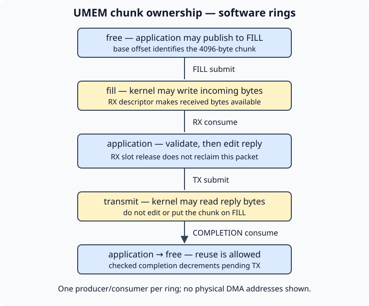

# 13.5 — Transmit replies and reclaim buffers correctly

The [receive lesson](13.4-af-xdp-receive.md) gave selected packets to userspace. Now the same UMEM chunk becomes a reply and travels back through TX. The result is a finite UDP responder whose buffers return to FILL only after their last user has finished.

Reuse the Pi's `6.12.96-hfs1-v8` kernel, the libraries and build from [13.3](13.3-verify-af-xdp-memory.md), and the private namespace from [11.1](11.1-identify-network-hardware.md). This exercise uses generic XDP and AF_XDP **copy mode** on a software veth link. It requires no Ethernet cable or GPIO change; leave the Pico and inter-board wires disconnected. macOS can build the portable fixtures, but cannot run this Linux socket/BPF exercise.

## A descriptor slot and a packet have different lifetimes

Releasing RX entries tells the kernel that those *ring slots* are available again. It does not return the associated packet chunks to FILL. Once a chunk is submitted to TX, the kernel may still read its bytes even though its RX descriptor has been released. Reusing that chunk for another received packet would overwrite an in-flight reply.



The source records each chunk's state using `Owner`:

| State | Allowed next operation |
| --- | --- |
| `free` | `replenish()` publishes its base offset on FILL. |
| `fill` | The kernel may fill it; `packet()` checks the RX descriptor and transfers it to `application`. |
| `application` | Validate/edit bytes, then submit TX or `recycle()` without transmitting. |
| `transmit` | Leave bytes untouched until a checked COMPLETION address returns it to `application`, then recycle. |

All addresses on these rings are offsets into UMEM, not C++ pointers or physical DMA addresses. This example uses aligned 4096-byte chunks. RX addresses can include an offset within a chunk; the bounds checks prevent a packet from crossing its chunk, and ownership is tracked using the chunk's base. The four ring roles are defined by the [AF_XDP interface](https://docs.kernel.org/6.12/networking/af_xdp.html).

One application thread produces FILL/TX and consumes RX/COMPLETION. `peek()` can return fewer RX entries than requested. TX reservation requests one entry at a time: some replies in a received batch may be submitted while a later reservation fails. In that case the unsent chunk is recycled, and the final count check fails the run. There is no unbounded queue or retry loop holding arbitrary replies. A successful submission increments `pending_transmits_`; only a checked completion decrements it.

The maintained [libxdp 1.3.1 ring helpers](https://github.com/xdp-project/xdp-tools/blob/v1.3.1/headers/xdp/xsk.h) provide the acquire/release publication operations. The `Owner` checks detect lifetime mistakes; they do not replace those memory-ordering operations.

## Construct only the supported reply

`make_udp_reply()` accepts an untagged, unfragmented IPv4 UDP request to port 40420 with a 20-byte IP header and the exact eight-byte `HFS`, version 1, sequence payload. The decoder checks lengths before accessing fields. Then the function validates the incoming IPv4 checksum and, when present, the UDP checksum **before changing any bytes**. A zero IPv4 UDP checksum denotes an omitted checksum and is accepted; the reply always includes one.

The reply swaps the six-byte MAC endpoints, four-byte IPv4 endpoints and UDP ports in place. It retains the payload and lengths, sets a fresh TTL of 64 and recalculates both checksums. The IPv4 checksum covers only the IP header. The UDP checksum also covers a pseudo-header containing the IP addresses, protocol 17 and UDP length. `checksum_sum()` adds network-order 16-bit words, `checksum_finish()` folds carries and complements the result, and a computed UDP zero is encoded as `0xffff`. These rules come from [RFC 768](https://www.rfc-editor.org/rfc/rfc768.html) and [RFC 791](https://www.rfc-editor.org/rfc/rfc791.html).

This is a reply to a directly reachable lab peer, using the request's link-layer endpoints. It has no routing, IP reassembly, options handling, TCP state, retransmission or general neighbour implementation. The BPF classifier passes ARP and unrelated traffic to Linux; Linux can therefore answer the host's neighbour lookup before the first UDP request. Incoming marked packets with bad checksums can reach the XSK, but the responder rejects them. The classifier checks layout and marker, not checksums.

## Build and run the eight-frame experiment

1. Stop the previous receiver/controller and any ordinary `udp_endpoint` in their foreground terminals with Ctrl-C. Use exactly one responder for this flow. Keep the normal endpoint stopped even during cleanup, when the classifier returns packets to the ordinary stack.

   **Pi — repository root:**

   ```sh
   uname -r
   python3 scripts/build_network.py
   sudo python3 scripts/network_lab.py setup
   sudo python3 scripts/network_lab.py show
   ```

   The Pi release must be `6.12.96-hfs1-v8`. If the helper-owned lab already exists from the previous lesson, omit `setup` and use `show` to verify it; do not create a second lab. The helper creates one RX queue and disables TX checksum offload on its two disposable veth interfaces so the responder receives complete input checksums.

2. Read the complete responder. The small entry point selects reply mode; the shared implementation below owns the actual socket, rings and teardown.

```cpp
{{#include ../examples/network/xsk_responder.cpp}}
```

<details>
<summary>Complete shared socket and ownership implementation: xsk_common.hpp</summary>

```cpp
{{#include ../examples/network/xsk_common.hpp}}
```

</details>

<details>
<summary>Complete byte decoder and checksum/reply implementation: wire.hpp</summary>

```cpp
{{#include ../examples/network/wire.hpp}}
```

</details>

<details>
<summary>Complete selective classifier: lab_xdp.bpf.c</summary>

```c
{{#include ../examples/network/lab_xdp.bpf.c}}
```

</details>

3. Start the responder and leave it in the foreground. Arguments are interface, valid-request count, total timeout seconds, initial refill delay milliseconds, and frame count.

   **Pi — terminal 1, repository root:**

   ```sh
   sudo ip netns exec hfs-lab .build/network/xsk_responder hfs-peer 10 30 0 8
   ```

   Wait for `READY mode=generic copy=1 queue=0 frames=8`. The program refuses a topology other than exactly one discovered `rx-0` queue. It binds with `XDP_COPY`, verifies the socket has no zero-copy flag, registers the ready socket in XSKMAP, then attaches its own classifier. It refuses an existing XDP attachment rather than replacing it.

4. Send from the host side of the same Pi. This address belongs to the private link, not the Mac's network.

   **Pi — terminal 2, repository root:**

   ```sh
   python3 examples/network/udp_sender.py 198.18.0.2 --count 10
   ```

   The sender validates exact echoed payloads and reports RTT using its own monotonic clock. A successful run has sequences 1 through 10, no timeouts, and a responder summary like this **illustrative** output:

   ```text
   received=10 transmitted=10 pending=0
   ```

   `transmitted` counts descriptors submitted to TX. `pending=0` means their chunks were reclaimed, not that the peer received ten replies. The sender's received-sequence record supplies that separate evidence. Eight frames can serve ten requests because completions allow reuse.

## Wakeups, deadlines and teardown

`XDP_USE_NEED_WAKEUP` lets the kernel request explicit notification. `kick_transmit()` calls nonblocking `sendto()` with no payload only when TX needs a wakeup and work is pending. `EAGAIN`, `ENOBUFS` and `EINTR` leave work pending for later progress; another error ends the run. The main loop also reclaims completions before processing new RX. When no RX entries are available, `poll_once()` waits at most 20 ms or the remaining deadline, checks socket errors and permits receive progress. The [kernel's wakeup description](https://docs.kernel.org/6.12/networking/af_xdp.html#xdp-use-need-wakeup-bind-flag) explains why publishing descriptors alone may be insufficient.

Normal completion first changes classifier mode to PASS and detaches the owned program, verifying its identity. This stops new redirects. The program then kicks TX and consumes completions only until the original absolute deadline, reporting invalid-descriptor counters and remaining work. Timeout or a stop signal can leave pending TX; it is not reported as success. Destruction deletes the socket before deleting UMEM registration and unmapping memory. That order stops kernel socket access before memory disappears; it does not manufacture missing completions. `XdpProgram` is declared after `XskBuffers`, so exception unwinding also attempts detach before socket destruction.

A failed socket bind with `EBUSY` has a separate two-second retry bound for a previous pool's deferred release. Failed attempts destroy their UMEM/ring context before retrying. Other bind errors fail immediately. If cleanup cannot establish that the currently attached program is its own, it refuses an unverified detach and reports the problem. SIGKILL cannot run these destructors.

## Verify failures as well as replies

5. After the manual run exits, inspect attachment state and clean the lab before the automated test, which requires creating its own lab.

   **Pi — repository root:**

   ```sh
   sudo ip netns exec hfs-lab ip -details link show dev hfs-peer
   sudo python3 scripts/network_lab.py cleanup
   sudo python3 scripts/test_network.py
   ```

   A normal inspection has no attached XDP program. If an attachment remains, establish its actual identity before recovery; do not detach an unidentified program. The automated script creates and removes its own namespace in a `finally` block and fails when required privileges/features are unavailable.

The portable `wire_test.cpp` uses an independent byte-at-a-time checksum reference. It covers malformed lengths, truncation, fragments, VLAN/IPv6 rejection, options rejection for replies, bad checksums, endpoint swaps, absent IPv4 UDP checksum input and 20,000 bounded malformed inputs. Both normal and sanitized fixture binaries run during the build. These test packet bytes, not TX ring execution.

The privileged script separately tests bad-checksum requests receiving no reply, valid replies with an eight-frame pool, FILL starvation/recovery in the receiver, a receive timeout followed by a fresh responder attachment, and the other chapter paths. Its starvation case sends a burst larger than eight frames, delays refill by 500 ms and sends recovery traffic after that delay. It does not assert that every burst packet arrived or force TX reservation failure. Ownership assertions and the final TX accounting cover that failure path in the implementation; the integration test is not a dedicated unit test for every ownership transition.

Repository CI run **43334222277** passed all twelve privileged namespace cases on its hosted Linux 7.0 Azure kernel; native Arm Bookworm builds also compiled the examples. That evidence concerns generic/copy software operation. Pi boot, GENET/PHY/DMA operation and physical Ethernet performance remain unexercised.

If `received` stays low, check readiness, namespace/interface choice and sender address first. If valid marked requests arrive but receive no replies, inspect checksums and the helper's veth offload setup; do not silently loosen validation. `tx_invalid_descs` or an ownership assertion indicates an implementation defect, while `TX ring lacked space` means the finite run could not submit every validated reply. A nonzero `pending` or deadline failure is an unsuccessful run requiring its actual diagnostics, not a reason to put TX-owned chunks on FILL.

After the script, the lab is removed. For another manual run, recreate it, start one foreground responder and then send. Leave no responder or XDP attachment running for the [path comparison](13.6-compare-network-paths.md).

## References

- [Linux 6.12 AF_XDP rings, modes and wakeups](https://docs.kernel.org/6.12/networking/af_xdp.html).
- [libxdp 1.3.1 socket/ring API](https://github.com/xdp-project/xdp-tools/blob/v1.3.1/headers/xdp/xsk.h).
- [RFC 768: UDP checksum and pseudo-header](https://www.rfc-editor.org/rfc/rfc768.html).
- [RFC 791: IPv4 header and checksum](https://www.rfc-editor.org/rfc/rfc791.html).
