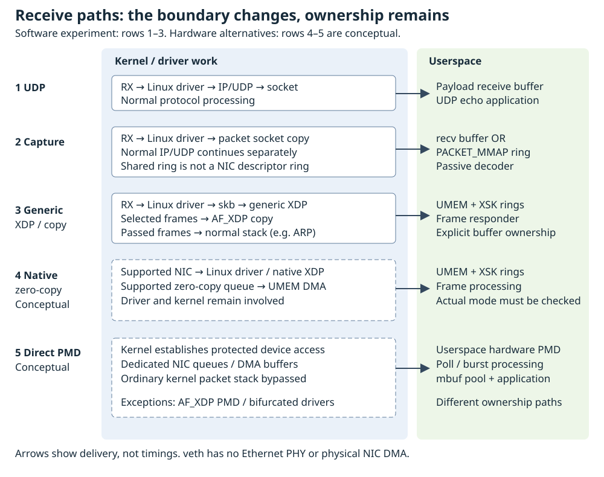

# 13.6 — Compare paths and explain full kernel bypass

You now have two programs that return the same eight-byte message: the ordinary UDP endpoint and the [AF_XDP responder](13.5-af-xdp-transmit-completion.md). This lesson compares their observable service, then explains which responsibilities each packet path moves into userspace. A shorter path is a capability, not a measured speedup.

Use the existing Pi checkout and build from [13.4](13.4-af-xdp-receive.md), the private namespace, and the same `6.12.96-hfs1-v8` course kernel. No second kernel build, wiring, Pico firmware, or physical-interface change is needed. Stop earlier packet programs first. A capable Linux test machine can run the software experiment, but record its actual kernel rather than calling it a Pi run.

## What each path owns



The diagram describes ingress. Replies travel through the corresponding transmit mechanism. Its last two rows require suitable hardware and driver support; neither is a result of this experiment.

| Path | Kernel and device ownership | Bytes exposed to application | Protocol responsibility and exercise |
| --- | --- | --- | --- |
| UDP socket | Linux driver, receive scheduling, IP/UDP and socket queues | UDP payload copied into the receive buffer | Linux handles network protocols; `udp_endpoint` echoes the validated lab message |
| AF_PACKET receive / PACKET_MMAP | Linux still owns the device; packet-socket delivery alongside normal networking | Ethernet bytes copied to a receive buffer / kernel-populated shared packet ring | `packet_rx` / `packet_ring` decode passively; neither supplies an echo service |
| Generic XDP + AF_XDP copy | Linux driver and generic XDP run; selected frames redirect before normal IP/UDP delivery | Kernel copies bytes into registered UMEM; software rings transfer ownership | `xsk_responder` validates headers and creates replies; Linux still answers passed ARP |
| Native XDP + AF_XDP zero-copy, conceptual | Kernel driver runs the native hook and manages queue/DMA integration | Supported NIC/driver can DMA into UMEM; socket must actually negotiate zero-copy | Application handles selected frames; native attachment alone does not establish zero-copy |
| Direct hardware userspace PMD, conceptual | Userspace driver manages dedicated device queues; kernel support still establishes protected access | DMA buffers managed through the PMD and packet-buffer pools | Application supplies required protocols and service; not run here |

Generic/native identifies **where XDP executes**. Copy/zero-copy identifies **how packet bytes reach UMEM**. Our explicit generic/copy flags and socket-option check establish the third row, including on the pinned Pi GENET route. The [Linux AF_XDP documentation](https://docs.kernel.org/6.12/networking/af_xdp.html) describes the separate bind modes and driver requirements. Shared memory and zero-copy are not synonyms: PACKET_MMAP shares a software ring without making that ring the NIC's DMA descriptor ring.

## Record a matched request/reply experiment

1. **Pi/Linux — repository root.** Install GNU time, verify the running kernel, and create a fresh private lab. If setup reports a collision, inspect and finish the previous session before proceeding.

```sh
sudo apt install time
uname -r
python3 scripts/build_network.py
sudo python3 scripts/network_lab.py setup
sudo python3 scripts/network_lab.py show
mkdir -p .build/network/compare
uname -a > .build/network/compare/machine.txt
lscpu >> .build/network/compare/machine.txt
systemd-detect-virt >> .build/network/compare/machine.txt || true
sudo python3 scripts/network_lab.py show > .build/network/compare/topology.json
sudo ethtool -i hfs-host > .build/network/compare/driver.txt
sudo ip netns exec hfs-lab ethtool -i hfs-peer >> .build/network/compare/driver.txt
```

Keep the build report as well. `show` records addresses and both offload feature sets. Setup disables TX checksum offload only on these disposable veth devices; it does not tune the Pi Ethernet port. This topology has one receive queue, no bridge and no physical link. Record any different bridge, VM, container, CPU contention or remote sender when comparing other experiments.

2. Open **two Pi/Linux terminals at the repository root**. Repeat the following pair of commands six times, in order `udp1`, `xsk1`, `udp2`, `xsk2`, `udp3`, `xsk3`. Set `trial` to the same name in both terminals each time. Keep every log. Each invocation is foreground and finite; do not begin another trial until both commands have returned.

**Terminal 1 — ordinary UDP trials (`udp1`, then `udp2`, then `udp3`):**

```sh
trial=udp1
ping -c 1 -W 1 198.18.0.2
date -u '+%Y-%m-%dT%H:%M:%SZ' > ".build/network/compare/$trial.server-start.txt"
sudo /usr/bin/time -f 'wall_s=%e user_s=%U system_s=%S cpu=%P exit=%x' -o ".build/network/compare/$trial.server-time.txt" ip netns exec hfs-lab .build/network/udp_endpoint 198.18.0.2 40420 100 60 2>&1 | tee ".build/network/compare/$trial.server.log"
```

**Terminal 1 — AF_XDP trials (`xsk1`, then `xsk2`, then `xsk3`), instead of the UDP command:**

```sh
trial=xsk1
ping -c 1 -W 1 198.18.0.2
date -u '+%Y-%m-%dT%H:%M:%SZ' > ".build/network/compare/$trial.server-start.txt"
sudo /usr/bin/time -f 'wall_s=%e user_s=%U system_s=%S cpu=%P exit=%x' -o ".build/network/compare/$trial.server-time.txt" ip netns exec hfs-lab .build/network/xsk_responder hfs-peer 100 60 0 64 2>&1 | tee ".build/network/compare/$trial.server.log"
```

3. Wait until terminal 1 visibly prints `{"event":"ready","port":40420}` or `READY mode=generic copy=1 queue=0 frames=64`. Then promptly run the sender below in **terminal 2**. If the server exits or does not become ready, do not send; inspect its error. Leave terminal 1 free of any other responder. The XDP program redirects the marked requests, so running a second echo service would also confuse fallback diagnosis.

```sh
trial=udp1
date -u '+%Y-%m-%dT%H:%M:%SZ' > ".build/network/compare/$trial.sender-start.txt"
/usr/bin/time -f 'wall_s=%e user_s=%U system_s=%S cpu=%P exit=%x' -o ".build/network/compare/$trial.sender-time.txt" python3 examples/network/udp_sender.py 198.18.0.2 --count 100 --timeout 0.1 --interval 0.01 2>&1 | tee ".build/network/compare/$trial.sender.jsonl"
```

Change `trial` for each run. Commands intentionally use the existing programs rather than introduce another packet implementation. Their complete sources are taught in [11.2](11.2-send-numbered-udp.md) and [13.5](13.5-af-xdp-transmit-completion.md); the actual sender is also included below so the measurement's meaning is inspectable.

```python
{{#include ../examples/network/udp_sender.py}}
```

Every run sends sequences 1–100 with the same `HFS`, version 1 and big-endian sequence payload, UDP port 40420 and eight-byte message size. The sender waits for each reply or a 100 ms deadline, then sleeps 10 ms, including after the last request. Thus 100 requests/s is only the nominal ceiling from the interval. This is a sequential request/reply workload, **not a fixed-rate load generator**. Actual offered rate is `100 / sender wall seconds`, approximately; process startup and final sleep are included. RTT, timeouts and scheduling change the achieved rate even though the pacing parameters match. With no failure in `send`, missing replies bound this sender loop to roughly 11 seconds plus scheduling overhead; the server has a separate 60-second limit. Start the sender within 30 seconds of readiness.

4. After both commands return, read the saved summaries and time files. `tee` can succeed when its producer fails, so use `exit=%x` in each time file rather than the pipeline's shell status. Preserve nonzero runs as failures. Do not silently discard loss and repeat until the numbers look good.

| Record for each of the six trials | Interpretation |
| --- | --- |
| Count, payload, interval, timeout, kernel, driver, topology and mode | Conditions that make results comparable |
| Sender wall, user and system CPU seconds | Whole sender process, including sleeps and output |
| Responder wall, user and system CPU seconds | Whole responder lifetime, including loading, readiness wait and teardown |
| `sent`, `received`, `timeouts`, `unexpected`, `unreachable` | Lost/unmatched requests = `sent - received`; loss percentage = `100 × (sent - received) / sent` |
| `rtt_min_ms`, `rtt_median_ms`, `rtt_max_ms` and per-reply records | One sender monotonic clock; only successful, exact replies contribute |
| UDP accepted/rejected or XSK received/transmitted/pending and socket counters | Service accounting and ownership errors, not a hardware timestamp trace |

The field named `rtt_median_ms` is the **upper middle observed value** after sorting; for 100 replies it selects index 50, not the average of indices 49 and 50. No reply gives `null`. Keep that convention across paths. Per-reply JSON lets you inspect the distribution; three summaries do not establish a stable tail percentile.

An illustrative reading is “received equals sent, no timeouts, exit zero”; numerical timing results must come from your files. Expect the XSK log to identify generic/copy mode and report `pending=0`; inspect actual drops and invalid-descriptor counters. Failed runs may last until the responder deadline because it never reached count 100.

GNU time's responder wall includes your manual readiness delay. Its CPU percentage therefore depends on that delay; compare CPU **seconds** and report this limitation. Process CPU accounting excludes some asynchronous kernel/softirq work and is not total machine cost. The sender interval, Python, terminal/file logging, scheduler and veth processing can dominate. These examples were written for visibility and bounded correctness, not equal implementation overhead. Alternating paths reduces order bias but does not remove thermal or background-load effects. Software CI run `43334222277` passed twelve integration cases; that is correctness evidence for a software topology, not these repeated measurements, a Pi boot, GENET DMA throughput or a hardware speedup.

## Keep passive capture a separate experiment

To compare capture APIs, repeat the ordinary UDP trial with a **third foreground terminal**, starting one reader before the sender and waiting for its ready line:

```sh
sudo /usr/bin/time -f 'wall_s=%e user_s=%U system_s=%S cpu=%P exit=%x' -o .build/network/compare/capture-recv-time.txt ip netns exec hfs-lab .build/network/packet_rx hfs-peer 100 60 2>&1 | tee .build/network/compare/capture-recv.log
```

Repeat with a fresh ordinary endpoint and the same sender parameters, replacing `packet_rx` with `packet_ring` and both output names with `capture-ring`. Wait for all three foreground commands to return between runs. Record decoded sequences, matched requests, drops, CPU seconds, and the ring's block count/queue freezes. The ring retires partial blocks after its configured 50 ms timeout, so batching can delay observation. Neither reader replies; the ordinary endpoint supplies both echo services. Capture CPU and batching belong in their own table, not as two extra echo contenders. No syscall reduction or throughput gain follows merely from seeing a ring.

## What full kernel bypass would change

A DPDK **poll mode driver (PMD)** presents burst receive/transmit operations to an application. A direct hardware PMD polls device queues and manages DMA buffers rather than receiving each packet through the ordinary kernel protocol path. Polling can consume a core while no traffic arrives; batching trades waiting time for amortized work. DPDK packet buffers (`mbuf`s) come from bounded memory pools. The pool must supply receive buffers and retain transmitted buffers until the driver can reclaim them. Empty pools and premature reuse remain correctness problems, just as with UMEM. See the [DPDK PMD architecture](https://doc.dpdk.org/guides/prog_guide/ethdev/ethdev.html).

Device ownership matters. Some hardware PMDs take a device away from its ordinary kernel driver and use VFIO for protected userspace access. That can remove the interface carrying SSH. Bifurcated drivers keep kernel control and share supported resources instead. DPDK also has an **AF_XDP PMD**, which uses kernel-bound netdev queues and AF_XDP sockets: putting the DPDK API above this mechanism does not remove its kernel dependencies. These distinctions are explicit in the [DPDK Linux driver guide](https://doc.dpdk.org/guides/linux_gsg/linux_drivers.html) and [AF_XDP PMD guide](https://doc.dpdk.org/guides/nics/af_xdp.html). This lesson neither installs DPDK nor unbinds the Pi's device; no additional NIC purchase is needed.

Choose ordinary UDP for an application that benefits from Linux protocols, routing and normal administration. Choose packet sockets for observing Ethernet frames while Linux keeps handling traffic; consider PACKET_MMAP when batching fits that observation task. Choose AF_XDP when owning selected frame processing and explicit buffer lifetimes solves a demonstrated problem. A direct PMD demands supported hardware, a device-ownership plan, CPU resources and application protocol work. Measure the actual service before accepting those costs.

A later Pico/W5500 experiment could move the boundary again: firmware would operate an external Ethernet controller over SPI, while that controller supplies particular networking functions. That is a possible extension, not code or additional hardware required here.

## Diagnose and leave the lab clean

If all requests time out, check the server's ready line, deadline, namespace and mode first. If `unreachable` increases, inspect whether the responder exited or traffic passed to a port without a UDP listener; this alone does not prove an XDP drop. If XSK startup refuses an existing attachment, inspect `sudo ip netns exec hfs-lab ip -details link show dev hfs-peer`; do not replace an unidentified program. If timing differences reverse between repetitions, inspect background load, logging and readiness delays before attributing them to the path.

Let every foreground process finish. A failed count still ends at its finite deadline. After interruption, inspect terminal 1: normal XSK signal handling verifies and detaches its own program, but SIGKILL or power loss cannot run that cleanup. Follow the ownership-based recovery in [13.2](13.2-selective-generic-xdp.md) if an attachment remains.

**Pi/Linux — repository root:**

```sh
sudo ip netns exec hfs-lab ip -details link show dev hfs-peer
sudo ip netns pids hfs-lab
sudo python3 scripts/network_lab.py cleanup
uname -r
```

Before cleanup, the link should show no XDP attachment and the PID command should print nothing. The helper refuses deletion with running namespace processes or changed ownership. Cleanup removes only the owned private link and namespace. Keep the measurement files; normal networking remains on the same course kernel.

## References

- [Linux 6.12 AF_XDP modes and ownership](https://docs.kernel.org/6.12/networking/af_xdp.html).
- [DPDK Ethernet poll mode driver architecture](https://doc.dpdk.org/guides/prog_guide/ethdev/ethdev.html).
- [DPDK device binding and bifurcated drivers](https://doc.dpdk.org/guides/linux_gsg/linux_drivers.html).
- [DPDK AF_XDP poll mode driver](https://doc.dpdk.org/guides/nics/af_xdp.html).
