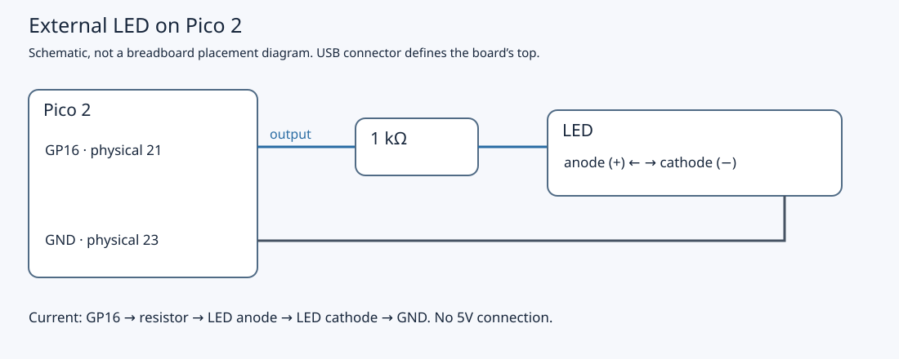
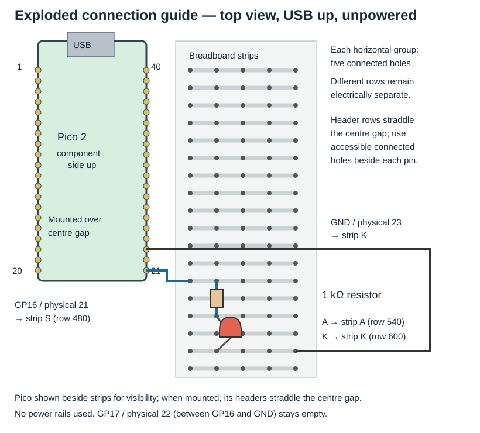

# 2.1 — Wire and verify an external LED

The external LED will blink under firmware control. This gives us a known-good circuit before replacing the SDK GPIO calls with register accesses. Complete the [build–flash loop](1.4-make-the-build-flash-observe-loop-repeatable.md) first, and reuse the LED circuit assembled in [0.6](0.6-assemble-the-bench-and-understand-the-electrical-rules.md).

Use the **non-wireless Pico 2 with headers**, breadboard, one LED, one **1 kΩ resistor**, jumpers and the Mac's micro-USB data connection. Leave the Pi, Debug Probe and button disconnected. Start with Pico USB unplugged; any wiring adjustment happens without power.

## An output supplies a voltage and current

An output driver connects a pin towards its high or low voltage level. With our circuit, high supplies current through the resistor and LED to ground; low removes the forward voltage and the LED goes dark. This is **active-high**: logical `1` turns the LED on.

The GPIO is a signal output with limited current capability. The series resistor limits the current drawn by the LED; it must stay in the circuit. As an illustrative estimate, a 3.3 V output and an LED forward voltage of 2.0 V give `(3.3 − 2.0) / 1000 = 1.3 mA`. Actual current and brightness depend on the unidentified kit LED and loaded output voltage. A high state does not force a fixed current through every load. The [Pico 2 datasheet](https://datasheets.raspberrypi.com/pico/pico-2-datasheet.pdf#page=15) specifies the GPIO electrical limits; the [official GPIO guide](https://www.raspberrypi.com/documentation/computers/raspberry-pi.html#outputs) explains LED current limiting.

## Check the complete circuit

View the Pico from above with components visible and USB at the top. Physical pin 1 is top-left, 20 bottom-left, **21 bottom-right**, and 40 top-right. GP16 is the signal on physical pin 21; passing `16` to the SDK selects **GP16**, not physical pin 16. The [official pinout](https://datasheets.raspberrypi.com/pico/pico-2-datasheet.pdf#page=5) identifies GP16, neighbouring GP17 and GND.



[Open the larger circuit diagram](assets/circuit-pico-led.svg). It shows electrical connectivity rather than physical placement.

| From | To | Purpose |
| --- | --- | --- |
| Pico GP16, physical 21 | First lead of 1 kΩ resistor | Controlled output supplies the LED branch. |
| Second resistor lead | LED anode (+) | Forward current enters the LED. |
| LED cathode (−) | Pico GND, physical 23 | Current returns to the board's reference. |



[Open the larger placement guide](assets/0.6-led-placement.svg). The Pico is drawn beside the contact strips to expose the connections; its mounted headers straddle the breadboard centre gap. S, A and K are three distinct five-hole strips. Drawing row coordinates are illustrative, not required markings on your breadboard. Side power rails are unused.

## Build, flash and observe

1. With USB unplugged, trace all three rows of the wiring table. Check that the resistor's ends occupy separate connected strips and the LED's two leads occupy separate strips. The resistor has no polarity. For an untrimmed LED the longer lead normally marks the anode; the flat on the body marks the cathode. If the leads were cut, use the body marking and the [component tour](0.5-recognise-the-breadboard-and-kit-components.md). Keep GP17 physical 22 empty.

2. Read the complete firmware file, `examples/pico/blink_sdk.cpp`:

```cpp
{{#include ../examples/pico/blink_sdk.cpp}}
```

   `led_pin` is the GPIO number. `gpio_init` prepares that GPIO for software control; `gpio_set_dir(..., GPIO_OUT)` enables its output driver. The loop alternates high and low with a 500 ms wait after each change.

3. **Mac — working directory `~/hardware-from-software`.** Use the checkout and pinned tools from Chapter 1. If your checkout is elsewhere, substitute its location in `cd`.

   ```sh
   cd ~/hardware-from-software
   python3 scripts/setup_deps.py
   python3 scripts/build_examples.py --pico
   ls -l .build/pico/blink_sdk.uf2 .build/pico/blink_sdk.elf
   ```

   The build script selects `pico2`, `rp2350-arm-s` and a Debug build. It builds all Pico targets, including `blink_sdk`. UF2 is the file for BOOTSEL copying; ELF retains the executable and debugging information for later SWD work. The shared CMake project was explained in [1.2](1.2-understand-the-smallest-useful-project.md); no new project configuration is needed here.

4. Hold Pico **BOOTSEL**, connect its USB data cable to the Mac, then release BOOTSEL. Confirm a volume named **RP2350** appears. This is the Pico 2 bootloader's USB mass-storage interface, as described by the [official flashing instructions](https://www.raspberrypi.com/documentation/microcontrollers/c_sdk.html#your-first-binaries). Leave the circuit untouched while powered.

5. **Mac — working directory `~/hardware-from-software`.** Copy this lesson's UF2:

   ```sh
   ls /Volumes/RP2350
   cp .build/pico/blink_sdk.uf2 /Volumes/RP2350/
   ```

   If the volume has a different mount name, identify it in Finder and use that actual path. After the copy, the bootloader disconnects its storage interface and starts the firmware. Select `blink_sdk.uf2`, rather than the earlier `heartbeat.uf2`.

6. Watch the **external** LED for several cycles. The expected observation is approximately half a second lit, half a second dark, repeating once per second. This is an illustrative expectation derived from the source, not a recorded hardware measurement. The onboard LED is not the indicator for this exercise. This program neither initialises stdio nor prints messages; a serial terminal is not a verification step here.

## What the SDK has done

In SDK 2.3.1, `gpio_init(16)` first disables output, clears the output value, then selects **SIO**, the software-controlled GPIO peripheral. Its function-selection implementation also configures the pad and removes RP2350 pad isolation. The following direction call enables output. Each `gpio_put` then changes the output value presented to that pin. See the pinned [GPIO initialisation implementation](https://github.com/raspberrypi/pico-sdk/blob/2.3.1/src/rp2_common/hardware_gpio/gpio.c) and [GPIO inline API implementation](https://github.com/raspberrypi/pico-sdk/blob/2.3.1/src/rp2_common/hardware_gpio/include/hardware/gpio.h).

Those calls hide several hardware operations behind a small interface. A successful blink establishes a useful baseline for the board, firmware selection and circuit together. It does not measure voltage, current or precise timing. In the next pages we will expose the pad, function selection and output registers while retaining SDK startup, clock setup and linking support.

## Troubleshoot by symptom

Unplug USB before moving a lead. Change one thing, restore power with the same UF2, and observe again.

| Symptom | Check |
| --- | --- |
| RP2350 volume never appears | Re-enter BOOTSEL with USB initially unplugged. Use the verified data cable and Mac connection from Chapter 1; a charge-only cable can power the board without carrying USB data. |
| Copy finishes, but external LED stays dark | Confirm `blink_sdk.uf2`, GP16 physical 21, and GND physical 23. Check LED polarity, resistor value, fully seated leads and the complete return wire. Physical 16 is a different pin. |
| LED is always on | Check whether the input wire goes to a supply pin instead of GP16, whether the intended firmware was copied, and whether a stray lead bypasses the intended connections. |
| LED stays dark despite correct-looking placement | Check actual five-hole strip connectivity. A resistor or LED can be bypassed when both leads share a strip; adjacent rows and opposite sides of the centre gap are separate. Do not assume a side rail is continuous. Our circuit uses no rails. |
| LED is faint or intermittent | Observe away from bright light; 1 kΩ deliberately limits brightness. Reseat loose leads without power. Keep the resistor rather than removing it to increase brightness. |

The examples have been target-compiled for Pico 2; this lesson's physical flashing and LED behaviour have not been exercised by the book's authoring environment. Your observed blink is the bench verification.

Unplug Pico USB when finished and leave the verified LED wiring intact. Keep Pi, probe and button detached. Continue to [the RP2350 register map](2.2-read-the-rp2350-register-map.md) with this same circuit and the SDK firmware available as a recovery baseline.

## References

- [Pico 2 datasheet](https://datasheets.raspberrypi.com/pico/pico-2-datasheet.pdf): board pinout and GPIO electrical specification.
- [Official C/C++ SDK flashing instructions](https://www.raspberrypi.com/documentation/microcontrollers/c_sdk.html#your-first-binaries): BOOTSEL and the RP2350 volume.
- [SDK 2.3.1 GPIO source](https://github.com/raspberrypi/pico-sdk/blob/2.3.1/src/rp2_common/hardware_gpio/gpio.c): initialisation, SIO selection and pad configuration.
- [SDK 2.3.1 GPIO header](https://github.com/raspberrypi/pico-sdk/blob/2.3.1/src/rp2_common/hardware_gpio/include/hardware/gpio.h): output-value and direction operations.
