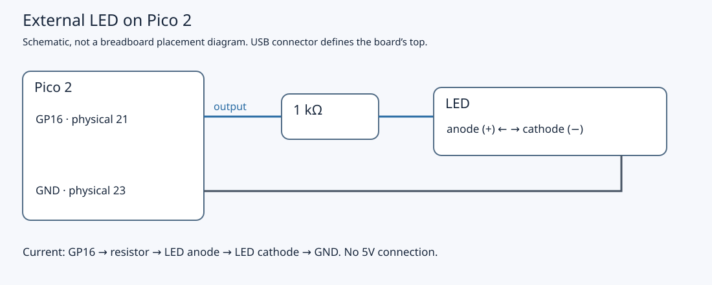

# 2.3 — Replace GPIO calls with register accesses

The same external LED will blink, but this time each GPIO operation is a store to a documented RP2350 register. Complete [the SDK baseline](2.1-wire-and-verify-an-external-led.md) and [the register map](2.2-read-the-rp2350-register-map.md) first. Keep `blink_sdk.uf2` available: it lets you distinguish a circuit problem from a change to the register program.

We retain SDK startup, clock initialisation, linker support and `sleep_ms`. Replacing the GPIO API does not require writing a boot sequence. This is the same non-wireless **Pico 2**, using one Arm Cortex-M33 application core and the existing shared CMake project.

## Keep the circuit unchanged

Unplug Pico USB before checking wiring. Leave the Pi, Debug Probe and button disconnected. With the board component side up and USB at the top, physical 21 is bottom-right; physical 23 is two positions above it. GP17, physical 22, stays empty. See the [official Pico 2 pinout](https://datasheets.raspberrypi.com/pico/pico-2-datasheet.pdf#page=5).



[Open the larger schematic](assets/circuit-pico-led.svg). It shows connectivity. For breadboard placement, reuse [the exploded placement guide](assets/0.6-led-placement.svg): the mounted Pico straddles the centre gap, and the resistor and LED each bridge distinct contact strips. Side power rails remain unused.

| From | To |
| --- | --- |
| Pico GP16, physical 21 | First lead of 1 kΩ resistor |
| Second resistor lead | LED anode (+) |
| LED cathode (−) | Pico GND, physical 23 |

High lights this active-high circuit; low makes it dark. Keep the resistor in series throughout the exercise.

## Typed pointers still perform register accesses

The SDK's `hardware/structs` headers describe register layouts. `sio_hw`, `io_bank0_hw` and `pads_bank0_hw` are pointers to fixed peripheral addresses. They do not allocate RAM or call a GPIO service. Array indexing selects a register using the layout established in 2.2. For example, `io_bank0_hw->io[16].ctrl` selects GP16's function-control register.

These fields use 32-bit types: `io_rw_32` and `io_wo_32` are typedefs of `volatile uint32_t`; `io_ro_32` adds `const`. The names document readable/writable intent, although the C++ type system does not enforce write-only access. Use the documented access type rather than reading a write-only field. The definitions are in [SDK 2.3.1's address-mapped header](https://github.com/raspberrypi/pico-sdk/blob/2.3.1/src/rp2_common/hardware_base/include/hardware/address_mapped.h).

`volatile` makes these accesses observable to the compiler under the toolchain's volatile rules. It prevents treating the register as an ordinary cached variable whose repeated stores can simply disappear. It supplies neither a CPU memory barrier nor inter-thread synchronisation, and does not order ordinary RAM accesses into a publication protocol. GCC documents [these limits](https://gcc.gnu.org/onlinedocs/gcc/Volatiles.html). This single-owner output loop needs no shared-RAM handoff; interrupt communication later requires a separate design.

## Build and run the replacement

1. With USB unplugged, trace the wiring table. If the SDK baseline has not blinked on your bench, establish that result before changing implementations.

2. Read the complete `examples/pico/blink_registers.cpp`. This replaces the baseline's GPIO initialisation, direction and output calls. Keep the shared project configuration from [1.2](1.2-understand-the-smallest-useful-project.md).

```cpp
{{#include ../examples/pico/blink_registers.cpp}}
```

3. **Mac — working directory `~/hardware-from-software`.** Substitute your actual checkout location in `cd` if needed. Use the pinned toolchain:

   ```sh
   cd ~/hardware-from-software
   python3 scripts/setup_deps.py
   python3 scripts/build_examples.py --pico
   ls -l .build/pico/blink_registers.uf2 .build/pico/blink_registers.elf
   ```

   The script builds all Pico targets with `pico2`, `rp2350-arm-s` and Debug configuration. The UF2 is for BOOTSEL copying; retain the ELF for the later disassembly and debugger lessons.

4. Hold **BOOTSEL**, connect the Pico's USB data cable to the Mac, then release BOOTSEL. Confirm the **RP2350** volume appears. **Mac — same working directory:**

   ```sh
   ls /Volumes/RP2350
   cp .build/pico/blink_registers.uf2 /Volumes/RP2350/
   ```

   If macOS assigned a different mount name, identify it in Finder and use that path. After copying, the bootloader's storage interface disappears and the firmware starts. This follows the [official BOOTSEL flashing procedure](https://www.raspberrypi.com/documentation/microcontrollers/c_sdk.html#your-first-binaries).

5. Observe the external LED. The illustrative expectation is the same as the SDK baseline: roughly 500 ms lit, 500 ms dark. This is a source-derived expectation, not a recorded physical result. This program has no `stdio_init_all` or printing, so USB serial output is not a verification step.

## Trace configuration to the pin

`mask` is `1u << 16`, selecting bit 16 in the SIO registers for GPIO0–31. The initialisation deliberately orders five stores:

| Store | Effect and reason |
| --- | --- |
| `gpio_oe_clr = mask` | Disable SIO's GP16 driver during configuration. |
| `gpio_clr = mask` | Make the output latch low before enabling the driver. |
| `io[led].ctrl = GPIO_FUNC_SIO` | Select function 5, SIO, with normal overrides. |
| `pads_bank0_hw->io[led] = ...SCHMITT_BITS` | Assign the complete chosen pad configuration while SIO output is disabled. |
| `gpio_oe_set = mask` | Enable the prepared low output. |

The pad assignment writes `0x00000002`. It clears isolation (`ISO`), output disable (`OD`), both pulls and input enable (`IE`); it selects 2 mA drive strength and slow slew, whose field encodings are zero. `SCHMITT` remains set, but input hysteresis has no role with the receiver disabled. `IE` is unnecessary for this pure output. Drive strength is not a regulated LED current: the resistor and circuit still determine current. RP2350 isolation must be cleared for the pad to operate. The [RP2350 pad definitions](https://github.com/raspberrypi/pico-sdk/blob/2.3.1/src/rp2350/hardware_regs/include/hardware/regs/pads_bank0.h) describe these fields; the [function-control struct](https://github.com/raspberrypi/pico-sdk/blob/2.3.1/src/rp2350/hardware_structs/include/hardware/structs/io_bank0.h) defines SIO and overrides.

Whole-register assignment is deliberate here: this program owns GP16 and chooses all its configuration fields. It would discard another owner's settings. The order assumes our SDK startup and dedicated LED circuit; it is not a general takeover procedure for a pin already driven by another peripheral.

Each loop calls `led_on`, waits, calls `led_off`, then waits again. Their stores set or clear bit 16 of the output latch. With SIO routed to the pad and output enabled, that changes the driver, which changes the voltage across the resistor/LED branch. `extern "C"` gives the functions stable names and `noinline` keeps separate functions for later disassembly and debugging.

## Atomic peripheral operations have a specific meaning

Writing `mask` to `gpio_set` changes only the selected output bits; writing it to `gpio_clr` clears only those bits. Zero bits leave other GPIO outputs alone. These are SIO's dedicated SET/CLR registers, described by the [pinned SIO struct](https://github.com/raspberrypi/pico-sdk/blob/2.3.1/src/rp2350/hardware_structs/include/hardware/structs/sio.h).

A read-modify-write of `gpio_out` would read all outputs and later write all outputs back. An interrupt changing a different bit between those operations could have its change overwritten. SET/CLR avoids that lost update by applying a masked operation in hardware. It does not resolve two owners issuing contradictory commands to GP16, or synchronise C++ variables. C++ `std::atomic` and its memory-order rules address a different problem; do not replace an MMIO field with an atomic object.

The RP2350's generic peripheral aliases use `+0x1000` for XOR, `+0x2000` for SET and `+0x3000` for CLR. **SIO uses its dedicated registers instead**; do not add those offsets to `sio_hw`. Likewise, write-one-to-clear status fields mean “acknowledge the events whose bits are 1”, rather than “replace this value” or “clear an ordinary configuration bit”. They need their documented acknowledgement operation, not an invented generic alias. See [RP2350 §2.1.3](https://datasheets.raspberrypi.com/rp2350/rp2350-datasheet.pdf#page=24) and the access-type discussion in 2.2.

## Troubleshoot and leave a known state

Unplug USB before changing any wiring.

| Symptom | Check |
| --- | --- |
| RP2350 volume absent | Start unplugged and repeat BOOTSEL; use the Chapter 1 data cable. |
| SDK baseline blinks, register program stays dark | Confirm `blink_registers.uf2` was copied. Restore the complete file if edited; check the bit-16 mask, SIO selection, pad assignment clearing ISO/OD, and output enable. |
| Both implementations stay dark | Return to 2.1: check GP16 physical 21, GND physical 23, LED polarity, separate contact strips and series resistor. |
| LED stays lit | Check the copied UF2 and that `led_off` still writes `gpio_clr`. With power removed, check for a supply connection or bypass around GP16. |
| No USB serial messages | Expected for this source. Observe the external LED. |

The existing verification record reports all 12 Pico targets compiled, including this one. Compilation does not establish flashing, electrical behaviour or timing; physical runtime has not been exercised by the authoring environment.

Unplug USB when finished. Leave the LED wiring intact, with Pi, button and probe detached. Keep `blink_registers.elf` and its matching source for [following the generated instructions](2.4-follow-the-generated-machine-instructions.md).

## References

- [RP2350 datasheet](https://datasheets.raspberrypi.com/rp2350/rp2350-datasheet.pdf): atomic access, SIO and GPIO/pad registers.
- [SDK 2.3.1 RP2350 struct headers](https://github.com/raspberrypi/pico-sdk/tree/2.3.1/src/rp2350/hardware_structs/include/hardware/structs): typed register layouts used by this program.
- [SDK 2.3.1 address-mapped definitions](https://github.com/raspberrypi/pico-sdk/blob/2.3.1/src/rp2_common/hardware_base/include/hardware/address_mapped.h): register access types and alias helpers.
- [GCC volatile documentation](https://gcc.gnu.org/onlinedocs/gcc/Volatiles.html): compiler access semantics and ordering limits.
