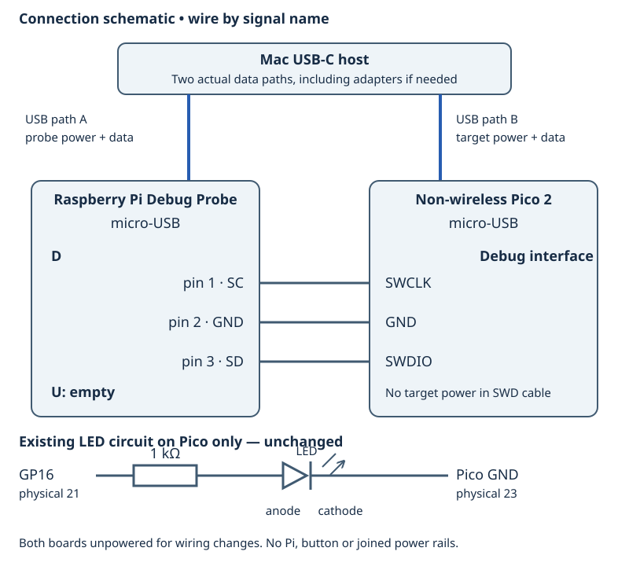

# 3.1 — Attach the Debug Probe over SWD

The result of this lesson is an OpenOCD server that has **examined the Pico 2's RP2350 Arm target**. Finding the Debug Probe on USB is only the first part of that result. Complete [the instruction walkthrough](2.4-follow-the-generated-machine-instructions.md) first; keep its `blink_registers` source and Debug ELF unchanged.

Retain the existing circuit: **Pico GP16, physical 21 → 1 kΩ resistor → LED anode; LED cathode → Pico GND, physical 23**. Add only the Debug Probe's SWD connection. Leave the button and Pi disconnected, and leave the probe's **U** socket empty. The example's diagnostic channel is Pico USB, not the probe's UART; `blink_registers` itself prints no diagnostic messages.

## What SWD adds

**Serial Wire Debug (SWD)** gives an external debugger access to the processor's debug hardware. SWCLK carries the probe's clock; SWDIO carries bidirectional data; GND provides their electrical reference. These are dedicated debug connections, separate from GP16 and the program's GPIO configuration.

OpenOCD runs on the Mac. It translates debugger requests into USB CMSIS-DAP requests to the probe, which produces SWD transactions at the target. GDB will speak to OpenOCD in [3.2](3.2-load-the-elf-and-step-through-the-led-write.md). Here we establish the connection without loading firmware or issuing reset/halt commands. Debugging can halt or otherwise change the target's running state; a frozen LED during a debug session is not sufficient evidence of a broken circuit.

## Match the actual connectors

Use the non-wireless **Pico 2**. With the component side facing you and USB at the top, its bare debug pads at the bottom read **SWCLK, GND, SWDIO from left to right**. See the [Pico physical drawing](assets/0.2-pico2-physical.svg) and [probe socket close-up](assets/0.4-probe-physical.svg) from Chapter 0. These are orientation references, not instructions to turn over the board while counting pads.

The factory “Pico 2 with headers” has a keyed debug connector: use the supplied three-pin SH-to-SH cable. A Pico 2 with aftermarket long GPIO headers may still have **bare debug pads**. If a suitable three-pin male debug header is already securely fitted, use the probe's SH-to-female breakout and match the signals individually. If only bare pads remain, resolve the missing connector before continuing; this lesson does not assume soldering or a press-fit connection. Consult the official [Pico debug connector guide](https://www.raspberrypi.com/documentation/microcontrollers/pico-series.html#debug-connector-swd).

The probe's **D** socket is SWD; **U** is UART. They look alike. Match the D marking and connector key, rather than selecting whichever socket is convenient.



[Open the larger connection diagram](assets/3.1-swd-connections.svg). This is a connection schematic, not a physical connector pinout. Use the table and Chapter 0 close-ups for orientation.

| Probe connection | Pico 2 connection | Role |
| --- | --- | --- |
| D pin 1, SC / SWCLK; orange on breakout | SWCLK debug contact, left bare pad in USB-up top view | Clock from probe |
| D pin 2, GND; black on breakout | GND debug contact, middle bare pad | Common signal reference |
| D pin 3, SD / SWDIO; yellow on breakout | SWDIO debug contact, right bare pad | Bidirectional debug data |
| Probe micro-USB | Mac USB data path A | Probe power and debugger traffic |
| Pico micro-USB | Mac USB data path B | Target power and Pico USB data |
| U | Nothing | Unused |

The three debug contacts are **not part of the numbered 40-pin GPIO header**. There is no target-power contact in this cable. Do not join 3V3, VBUS or VSYS rails between boards. The official [probe wiring instructions](https://www.raspberrypi.com/documentation/microcontrollers/debug-probe.html#getting-started) identify the SC/GND/SD leads and require a common reference when supplies are separate.

## Attach and start the server

1. Establish **two complete, data-capable Mac-to-micro-USB paths**. The existing Pico cable and the supplied probe lead are candidates, not proof of availability. Inspect both actual leads and their host plugs. USB-A plugs require a data-capable USB-C adapter or hub on this Mac; a USB-C-to-micro-USB data lead can connect directly. Resolve a missing lead or adapter first. Moving one cable between boards cannot power both simultaneously.

2. Unplug **both** boards from USB and remove any other power. Keep the LED circuit unchanged. Attach D to the Pico debug interface using the matching cable. For separate breakout ends, attach GND first, then SWCLK and SWDIO. Check all three endpoints against the table before applying power. Keyed plugs should fit without force.

3. Connect Pico USB to the Mac, then probe USB to the Mac. Use normal startup, without holding either BOOTSEL button. The target needs its own USB power even though D is connected. If the register-blink firmware from 2.3 is already installed, blinking is the intended baseline; no physical execution has been verified for this book.

4. **Mac — working directory `~/hardware-from-software`**, or your actual Chapter 1 checkout. Restore dependencies only if missing:

   ```sh
   cd ~/hardware-from-software
   python3 scripts/setup_deps.py
   ```

   Check the exact executable and both configurations:

   ```sh
   .deps/openocd/openocd --version
   ls .deps/openocd/scripts/interface/cmsis-dap.cfg .deps/openocd/scripts/target/rp2350.cfg
   ```

   The installed bundle inspected for this book reports `Open On-Chip Debugger 0.12.0+dev-gacff23f (2026-09-05-14:14)`. That is an observed **host version check**, not a recorded target attachment. A different `openocd` on your PATH might lack RP2350 support, so keep the explicit path.

5. **Mac — same working directory.** Start one server in a terminal you can leave open:

   ```sh
   .deps/openocd/openocd \
     -s "$PWD/.deps/openocd/scripts" \
     -f interface/cmsis-dap.cfg \
     -c "set USE_CORE cm0" \
     -f target/rp2350.cfg \
     -c "adapter speed 1000"
   ```

   `-s` supplies this bundle's script search path. The interface file selects CMSIS-DAP; the target file selects **RP2350**, not RP2040. In the inspected local `rp2350.cfg`, `USE_CORE cm0` selects Arm core 0 and must precede the target file that reads it. The default otherwise configures both Arm cores. This selection limits the debugger's target list; it does not rewrite firmware or start a second application core. The official [RP2350 configuration source](https://github.com/raspberrypi/openocd/blob/rpi-common/tcl/target/rp2350.cfg) documents these choices.

   Adapter speed is in kHz: `1000` requests a conservative 1 MHz SWD clock. It is not the Pico's processor clock. Do not copy the probe guide's older `target/rp2040.cfg` example for this RP2350 board.

## Recognise the two stages of success

Read the whole startup log. A CMSIS-DAP identification message establishes that OpenOCD reached the **probe**. It does not establish continuity through D, target power or a responsive RP2350.

Successful target examination should additionally identify `rp2350.cm0` as a Cortex-M33 and report its debug resources, without an examination failure. The following fragments are **illustrative**, not captured from physical hardware; exact wording and resource counts vary:

```text
Info : CMSIS-DAP: ...
Info : [rp2350.cm0] Cortex-M33 ... processor detected
Info : [rp2350.cm0] target has ... breakpoints, ... watchpoints
Info : Listening on port 3333 for gdb connections
```

A configured target name printed before an error is not successful examination. Likewise, a listening port alone is not proof: inspect target detection and errors together. Save your actual log and distinguish the observed host version, probe identification and target examination.

OpenOCD stays in the foreground as a server. With this single-target configuration, TCP **3333** serves GDB, **4444** serves a human command console and **6666** serves Tcl clients. These are Mac network ports, not USB serial device names or Pico pins. The [OpenOCD server manual](https://openocd.org/doc/html/Server-Configuration.html) defines these defaults. Leave the console and Tcl interfaces unused here; the next lesson connects GDB to port 3333.

## Troubleshoot the observed failure

| Symptom | Next check |
| --- | --- |
| Cannot find `rp2350.cfg`, or an unknown RP2350-related command | Check working directory, `-s`, and the explicit executable. Restore the pinned bundle; do not mix another installation's scripts with this executable. |
| No CMSIS-DAP device found | Check probe USB cable, adapter and enumeration in macOS System Information → USB. Close an IDE or another OpenOCD process that may already own the probe. A power LED proves power, not USB data. |
| Probe found, target examination fails | Stop OpenOCD. Remove power from both boards before checking D versus U, all three signal endpoints, fitted connector and target USB power. Retry with short supplied wiring; if needed lower `adapter speed` to `100`. |
| Port already in use | Stop the earlier debugger server in its terminal. Run one instance, rather than changing ports and losing track of which server GDB will reach. |
| USB serial device appears but no target is found | The probe also exposes a UART bridge. Its serial port is not an SWD target-discovery result; U remains empty. |

Probe firmware and host OpenOCD are separate compatibility layers. The CMSIS-DAP `FW Version` line can describe the protocol level, not the installed accessory firmware release. If cable/power/configuration checks or a concrete firmware error point to an old or overwritten probe image, consult the official [Debug Probe firmware release](https://github.com/raspberrypi/debugprobe/releases/tag/debugprobe-v2.3.1) and update procedure in the [probe guide](https://www.raspberrypi.com/documentation/microcontrollers/debug-probe.html#updating-the-firmware-on-the-debug-probe). Version 2.3.1 was the current official release when checked for this lesson; no firmware version has been measured on your accessory.

Do not update a working probe merely because a target is missing. For a justified recovery, stop the server, unplug both boards and disconnect D. Keep the **target Pico unplugged**. Follow the official enclosure/BOOTSEL instructions for the **Debug Probe**, then copy the official **`debugprobe.uf2`** to the probe's boot volume. This restores the accessory, not the target's `blink_registers.uf2`; the two images are not interchangeable. Unplug the probe again, reconnect D while both boards are unpowered, then repeat the power-up and server steps.

## Stop or continue

For 3.2, leave the verified wiring and powered boards in place with this server running. Keep the matching `.build/pico/blink_registers.elf`; we have not rebuilt or loaded it here. If it is missing, the next lesson restores the Debug build before loading.

To finish the session, press **Ctrl-C** in the OpenOCD terminal and wait for the shell prompt. Stopping the server does not guarantee that the processor resumes a previous running state. Unplug Pico USB and probe USB; after both are unpowered, detach the SWD lead if packing away. Leave the GP16 LED circuit intact. Next time, reconnect SWD with both boards unpowered and repeat the power-up and server command.

The commands and configuration have been inspected, and the Pico firmware has compiled. **Physical SWD attachment and target discovery have not been exercised**; your successful target-examination log is the missing hardware evidence.

## References

- [Pico-series debug connector guide](https://www.raspberrypi.com/documentation/microcontrollers/pico-series.html#debug-connector-swd): physical variants and debug signals.
- [Debug Probe documentation](https://www.raspberrypi.com/documentation/microcontrollers/debug-probe.html): wiring, USB interfaces and accessory firmware recovery.
- [Official RP2350 OpenOCD configuration](https://github.com/raspberrypi/openocd/blob/rpi-common/tcl/target/rp2350.cfg): Arm target selection; the installed pinned copy governs this command.
- [OpenOCD server configuration](https://openocd.org/doc/html/Server-Configuration.html): startup, target examination and server ports.
