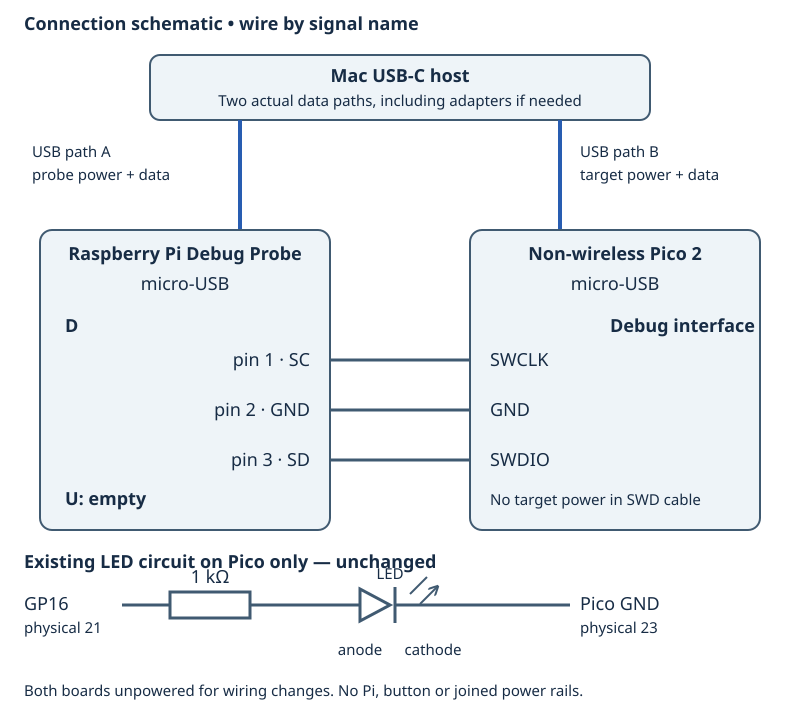

# 3.2 — Load the ELF and step through the LED write

You will stop the Pico at a known point, execute the instruction that sets GP16, and compare the LED with the output register. Complete [3.1](3.1-attach-the-debug-probe-over-swd.md) first: OpenOCD must successfully examine `rp2350.cm0`, with GDB listening on Mac port 3333.

Keep the same wiring and both USB connections. The probe's **D** socket connects SWCLK/GND/SWDIO; **U stays empty**. Leave the Pi and button disconnected. No wiring changes are needed.



| Existing connection | State for this lesson |
| --- | --- |
| Pico GP16, physical 21 | 1 kΩ resistor → LED anode |
| LED cathode | Pico GND, physical 23 |
| Probe D | Pico SWCLK, GND, SWDIO as checked in 3.1 |
| Pico USB and probe USB | Separate Mac data connections; both powered |
| Probe U, Pi, button | Disconnected |

The complete program remains `examples/pico/blink_registers.cpp`:

```cpp
{{#include ../examples/pico/blink_registers.cpp}}
```

SDK startup still initializes the processor environment. `main` then configures the pad, mux and output enable before entering its loop. We must let that setup run before expecting an output store to light the LED.

## What the debugger controls

GDB runs on the Mac and reads names, source locations and instructions from the **ELF**. OpenOCD carries its requests through the probe to the processor. Opening an ELF in GDB does not install it on the Pico; `load` performs that separate operation. The UF2 is useful for BOOTSEL, but the ELF also contains the debug information we need. OpenOCD's [GDB guide](https://openocd.org/doc/html/GDB-and-OpenOCD.html) describes this connection and flash-loading path.

A breakpoint stops execution before an instruction runs. We use hardware breakpoints so the debugger need not replace an instruction in flash. Their number is limited; delete ones you no longer need. A source line may cover several instructions or several calls. `next` advances by source lines and steps over calls; `stepi` advances one machine instruction. The loop here is one source line, so `next` is a poor way to isolate its output store. See the GDB manuals for [breakpoints](https://sourceware.org/gdb/current/onlinedocs/gdb.html/Set-Breaks.html) and [stepping](https://sourceware.org/gdb/current/onlinedocs/gdb.html/Continuing-and-Stepping.html).

## Load and reach the first LED operation

1. **Mac — working directory `~/hardware-from-software`**, or your actual Chapter 1 checkout. In a second terminal, rebuild the canonical Debug ELF so source and executable agree:

   ```sh
   cd ~/hardware-from-software
   python3 scripts/setup_deps.py
   python3 scripts/build_examples.py --pico
   ls .build/pico/blink_registers.elf
   ```

   These commands do not flash the target. Keep the 3.1 server running. If restarting it, use the same command in its own terminal, from the same checkout:

   ```sh
   .deps/openocd/openocd \
     -s "$PWD/.deps/openocd/scripts" \
     -f interface/cmsis-dap.cfg \
     -c "set USE_CORE cm0" \
     -f target/rp2350.cfg \
     -c "adapter speed 1000"
   ```

2. **Mac — same working directory, second terminal.** Start the bundled Arm GDB with the matching ELF:

   ```sh
   .deps/arm-gnu-toolchain-14.2.rel1-darwin-arm64-arm-none-eabi/bin/arm-none-eabi-gdb \
     -q .build/pico/blink_registers.elf
   ```

   The following blocks contain **Pico debugger commands at `(gdb)`**, not shell commands. Type the text after the prompt:

   ```text
   (gdb) set pagination off
   (gdb) target remote localhost:3333
   (gdb) monitor reset halt
   (gdb) load
   (gdb) monitor reset halt
   (gdb) hbreak main
   (gdb) continue
   ```

   Stop if loading reports an error. `monitor` sends an OpenOCD command; the second reset/halt establishes a fresh boot after programming. `continue` runs startup until `main`, rather than trying to single-step the boot ROM. Do not use the host-process `run` command for this remote bare-metal session.

3. **Pico debugger — stopped in `main`.** Inspect the source and constants, then exchange the main breakpoint for the LED breakpoint:

   ```text
   (gdb) list main
   (gdb) p led_pin
   (gdb) p/x led_mask
   (gdb) info registers pc sp lr
   (gdb) delete breakpoints
   (gdb) hbreak led_on
   (gdb) continue
   ```

   Confirm the breakpoint-deletion question if offered. `led_pin` is 16 and `led_mask` is `0x10000` in the inspected ELF. They are compile-time constants, not changing loop variables. This `continue` lets all of `main`'s GPIO setup execute before stopping in its first `led_on` call. Merely assigning `$pc` to `led_on` would skip that setup and the normal call context.

   `pc` identifies the current instruction location, `sp` the active stack pointer, and `lr` the link register used for a normal function's return address. `r0`–`r12` hold general data. These are processor registers, distinct from memory-mapped GPIO registers. Arm's [Cortex-M33 register summary](https://developer.arm.com/documentation/100230/0004/functional-description/programmers-model/processor-core-registers-summary) describes them; exception return has additional rules covered later.

## Execute the actual store

4. **Pico debugger — stopped in `led_on`.** Examine instructions and the current output latch:

   ```text
   (gdb) disassemble /r led_on
   (gdb) x/i $pc
   (gdb) x/wx 0xd0000010
   (gdb) p/x (*(volatile unsigned int *)0xd0000010) & 0x10000
   ```

   `x/i` displays an instruction. `x/wx` reads one 32-bit word in hexadecimal; it does not write it. The final expression isolates GP16's bit. These examination formats are documented in [GDB's memory guide](https://sourceware.org/gdb/current/onlinedocs/gdb.html/Memory.html).

   In the locally inspected ELF, the relevant instruction sequence is the following **disassembly fragment**, not a physical debug transcript. Instruction addresses may change when rebuilt:

   ```text
   mov.w r3, #0xd0000000
   mov.w r2, #0x10000
   str   r2, [r3, #24]
   bx    lr
   ```

   GDB may print the immediates in decimal. Repeatedly issue `stepi`, followed by `x/i $pc`, **only until the next instruction is the `str`**. If already at that store, do not step yet. The current instruction has not executed. Check its operands:

   ```text
   (gdb) info registers r2 r3 pc sp lr
   (gdb) p/x $r3 + 24
   ```

   For this sequence, `r3` is the address base `0xd0000000`; `r2` is the value `0x00010000`. The effective destination is `0xd0000018`, the SIO `GPIO_OUT_SET` register. **24 is a byte offset**, not GPIO24. The value has bit 16 set, so this store sets GP16's output latch without replacing other bits.

5. **Pico debugger — immediately before that store.** Execute exactly that instruction, then read the latch again:

   ```text
   (gdb) stepi
   (gdb) x/i $pc
   (gdb) x/wx 0xd0000010
   (gdb) p/x (*(volatile unsigned int *)0xd0000010) & 0x10000
   ```

   The intended observation is a transition from a masked value of `0` to `0x10000`, accompanied by the LED lighting. The CPU remains stopped afterward, so the LED should stay on while you inspect it. This is a prediction for the reader to verify; physical stepping has not been exercised for this book.

   Read **`GPIO_OUT` at `0xd0000010`**, not the write-only SET/CLR command registers. `GPIO_OUT` reports the output latch, not measured pin voltage. A correct latch with a dark LED still leaves mux, pad, output enable and circuit checks. Its access semantics and the SET/CLR offsets are specified in the [RP2350 datasheet, SIO register list](https://datasheets.raspberrypi.com/rp2350/rp2350-datasheet.pdf) and the pinned SDK's `hardware/regs/sio.h`.

6. **Pico debugger.** Stop at the opposite operation:

   ```text
   (gdb) delete breakpoints
   (gdb) hbreak led_off
   (gdb) continue
   (gdb) disassemble /r led_off
   (gdb) x/i $pc
   ```

   The running program finishes `led_on`, waits, then enters `led_off`. Again use `stepi` and `x/i $pc` until immediately before its store. In the inspected build it is `str r2, [r3, #32]`, with the same base and mask: destination `0xd0000020`, `GPIO_OUT_CLR`. Step that store once, then repeat the two latch reads from step 5. The masked result should become `0`, and the LED should go dark. Other output bits need not be zero.

## A stopped CPU changes the experiment

A breakpoint pauses the application, not the outside world. GPIO can retain its output while timers and peripherals have their own behavior. Wall-clock time spent reading GDB output is not an application delay measurement. USB service and interrupts can be delayed while the core is halted; a serial connection may stall or reconnect. This program emits no USB diagnostics, so silence is expected. Resume freely before judging blink timing or USB health. A successful instruction step and latch read establish a narrower fact than an electrical measurement of the pin.

| Symptom | Check |
| --- | --- |
| Connection refused | Confirm the 3.1 server is still running and successfully examined `rp2350.cm0` on port 3333. |
| No `main` or `led_on` symbol | Open the Debug `blink_registers.elf` with the explicit Arm GDB path; a UF2 has no equivalent source symbols. |
| Source differs from disassembly, or GDB says source is newer | Quit GDB, rebuild from this checkout, reopen this ELF and repeat reset/load/reset. Rebuilding alone leaves old firmware on the board; opening a new ELF alone does too. |
| A variable is unavailable or “optimized out” | The inspected Debug build uses `-Og -g`, which still optimizes. Inspect the constant, operand registers and instructions instead of assuming every C++ object has an address. |
| LED already on before the first store | Repeat the reset/load/main sequence and let initialization run. Confirm you stopped on the first call and have not already stepped its store. |
| Latch changes but LED does not | Check the GP16 pad/mux/output-enable setup and the unchanged circuit from 2.1. Remove both boards' power before correcting wiring. |
| Hardware breakpoint insertion fails | Delete unused breakpoints, close other debugger clients and retry with one breakpoint. |

## Restore the running baseline

**Pico debugger — while stopped:** remove breakpoints and restart normally:

```text
(gdb) delete breakpoints
(gdb) monitor reset run
(gdb) disconnect
(gdb) quit
```

Confirm deletion if asked. `reset run` restarts the installed known-good program; `disconnect` closes the debugger connection. The intended baseline is free-running register-controlled blinking. For [3.3](3.3-diagnose-a-broken-program-systematically.md), retain this source, ELF, circuit and SWD wiring; OpenOCD may stay running.

To pack away, exit GDB as above, press **Ctrl-C** in the OpenOCD terminal and wait for the shell prompt. Unplug both USB connections before detaching D. Leave the LED circuit intact. On the next session, attach D with both boards unpowered, power both, then repeat the server and debugger startup. Host ELF inspection verified the instructions used here; physical LED transitions and SWD execution remain unmeasured.

## References

- [GDB continuing and stepping](https://sourceware.org/gdb/current/onlinedocs/gdb.html/Continuing-and-Stepping.html): source steps and instruction steps.
- [OpenOCD with GDB](https://openocd.org/doc/html/GDB-and-OpenOCD.html): remote connection, reset, programming and flash memory maps.
- [Arm Cortex-M33 core registers](https://developer.arm.com/documentation/100230/0004/functional-description/programmers-model/processor-core-registers-summary): processor register roles.
- [RP2350 datasheet](https://datasheets.raspberrypi.com/rp2350/rp2350-datasheet.pdf): SIO output latch and SET/CLR semantics.
