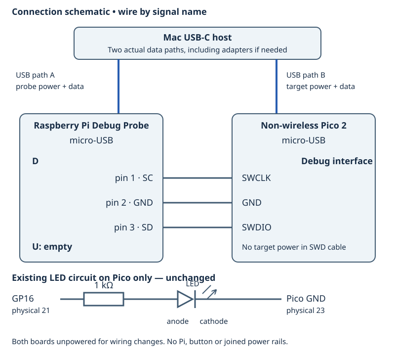

# 3.3 — Diagnose a broken program systematically

A dark LED does not identify a faulty line of code. In this lesson you will introduce four small faults, distinguish them using debugger evidence, and restore the working program after each one. Complete [3.2](3.2-load-the-elf-and-step-through-the-led-write.md) first, including its first `led_on` store and output-latch check.

Keep the non-wireless Pico 2 and the same circuit: **Pico GP16, physical 21 → 1 kΩ resistor → LED anode; LED cathode → Pico GND, physical 23**. Probe **D** remains connected to Pico SWCLK/GND/SWDIO; **U stays empty**. Pico USB supplies target power separately from probe USB. No Pi or button is connected. There are no wiring changes in these experiments. Remove both boards' power before any physical circuit inspection that requires moving a connection.



## Establish one known-good program

The canonical source is still `examples/pico/blink_registers.cpp`. SDK startup, clocks and linker support remain in use; we are debugging peripheral configuration and application control flow, not replacing startup.

```cpp
{{#include ../examples/pico/blink_registers.cpp}}
```

1. **Mac — working directory `~/hardware-from-software`**, or your actual Chapter 1 checkout. Before editing, confirm that your source matches the complete file above. Preserve any unrelated local work separately; do not overwrite an already modified file with an assumed baseline. Save this known-good file outside the source directory:

   ```sh
   cd ~/hardware-from-software
   cp examples/pico/blink_registers.cpp /tmp/hfs-3.3-blink-good.cpp
   python3 scripts/setup_deps.py
   python3 scripts/build_examples.py --pico
   ```

   Require a successful build. The pinned route uses SDK 2.3.1, Arm GNU 14.2.Rel1 and the Debug Pico 2/Arm build. The ELF is `.build/pico/blink_registers.elf`. Do not treat an ELF left behind by a failed build as the new experiment.

2. **Mac — same directory, separate terminal.** Keep the successfully examined server from 3.1 running, or restart it with its exact single-core command:

   ```sh
   .deps/openocd/openocd \
     -s "$PWD/.deps/openocd/scripts" \
     -f interface/cmsis-dap.cfg \
     -c "set USE_CORE cm0" \
     -f target/rp2350.cfg \
     -c "adapter speed 1000"
   ```

   Require successful examination of `rp2350.cm0`; a listening port alone is insufficient. In another terminal, **Mac — same directory**, start GDB:

   ```sh
   .deps/arm-gnu-toolchain-14.2.rel1-darwin-arm64-arm-none-eabi/bin/arm-none-eabi-gdb \
     -q .build/pico/blink_registers.elf
   ```

3. **Pico debugger — commands at `(gdb)`.** Load the baseline and let its configuration run:

   ```text
   (gdb) set pagination off
   (gdb) target remote localhost:3333
   (gdb) monitor reset halt
   (gdb) load
   (gdb) monitor reset halt
   (gdb) hbreak led_on
   (gdb) continue
   ```

   Stop on any load error. The first `led_on` stop is after GPIO setup and before its output store. Resetting after loading and continuing through startup matters: jumping directly to a function would skip setup and its normal calling context. [OpenOCD's GDB guide](https://openocd.org/doc/html/GDB-and-OpenOCD.html) explains the remote programming path.

## Collect evidence before changing anything

Use the following **Pico debugger** commands at the first `led_on` breakpoint for the baseline and each peripheral fault:

```text
(gdb) p/x mask
(gdb) info registers pc sp lr
(gdb) bt 4
(gdb) x/i $pc
(gdb) disassemble /r led_on
(gdb) x/wx 0xd0000010
(gdb) x/wx 0xd0000030
(gdb) x/wx 0x40028084
(gdb) x/wx 0x40038044
```

The final four reads have specific meanings:

| Address | Register | Relevant baseline after setup |
| --- | --- | --- |
| `0xd0000010` | SIO `GPIO_OUT` | GP16 bit `0x10000` low before first on-store, high afterward |
| `0xd0000030` | SIO `GPIO_OE` | GP16 bit `0x10000` set |
| `0x40028084` | IO_BANK0 `GPIO16_CTRL` | `0x00000005`: SIO function, normal overrides |
| `0x40038044` | PADS_BANK0 `GPIO16` | `0x00000002`: SCHMITT set; isolation and output-disable clear |

These are read-safe state/configuration registers for this exercise. The addresses and field values follow the [RP2350 register map](https://datasheets.raspberrypi.com/rp2350/rp2350-datasheet.pdf), also represented by the installed SDK's `hardware/regs/sio.h`, `io_bank0.h` and `pads_bank0.h`. Check bit 16 in OUT/OE rather than demanding that every unrelated bit be zero. The pad's input-enable bit is intentionally clear: this is an output-only example, and we do not use `GPIO_IN` as proof of voltage.

Do not read `GPIO_OUT_SET`, `GPIO_OUT_CLR`, or the OE SET/CLR command registers to discover state. They are write-only commands; inspect OUT and OE instead. More generally, a debugger memory read is a real bus access. A FIFO data read can consume an entry, and a register documented as clear-on-read can acknowledge status. Read the access description before examining an unfamiliar address; avoid broad MMIO dumps and automatic peripheral views. A write-one-to-clear register has a different hazard: writing back a value read from it can clear events. This lesson uses no arbitrary debugger MMIO writes.

The CPU registers answer another question: **where is execution?** `pc` identifies the next instruction, `sp` the active stack pointer, and `lr` a normal call's return link. `bt 4` asks GDB to reconstruct four frames. A stop in `led_on` should ordinarily lead back to `main`; optimizations can omit or alter frames. A plausible backtrace is supporting evidence, not a proof that the stack is intact. The [GDB backtrace documentation](https://sourceware.org/gdb/current/onlinedocs/gdb.html/Backtrace.html) describes these frames.

To compare before and after the store, repeat 3.2's method: use `x/i $pc` and individual `stepi` commands until the next instruction is the `str` in `led_on`. Inspect its source-value and address-base registers as identified by **this build's** disassembly, then execute that store once with `stepi` and reread OUT. Do not copy an instruction address from an earlier ELF. The canonical `while` body occupies one source line; source-level `next` can group several operations. [GDB's instruction stepping](https://sourceware.org/gdb/current/onlinedocs/gdb.html/Continuing-and-Stepping.html) gives the needed finer boundary.

All expected symptoms below are **predictions**, not recorded physical results.

## Use the same rebuild/load cycle every time

4. Introduce **only one** fragment below in your reader checkout. These are local teaching edits, not replacement canonical examples. Before editing or restoring, stop execution with **Ctrl-C in GDB**, then close that session:

   ```text
   (gdb) monitor halt
   (gdb) delete breakpoints
   (gdb) disconnect
   (gdb) quit
   ```

   Confirm breakpoint deletion if asked. The target may remain halted. **Mac — `~/hardware-from-software`:** edit the indicated source fragment, then run:

   ```sh
   python3 scripts/build_examples.py --pico
   ```

   Require success, reopen GDB using step 2's exact command, and repeat **all of step 3**, including `load` and both reset/halt commands. Opening the new ELF supplies symbols; loading it installs matching instructions. Neither operation substitutes for the other.

5. After diagnosing each fault, close GDB as in step 4. **Mac — same directory:** restore the saved baseline and rebuild:

   ```sh
   cp /tmp/hfs-3.3-blink-good.cpp examples/pico/blink_registers.cpp
   python3 scripts/build_examples.py --pico
   cmp examples/pico/blink_registers.cpp /tmp/hfs-3.3-blink-good.cpp
   ```

   Require a successful build and a silent, successful `cmp`. Reopen GDB and repeat step 3 to **load the repaired ELF**. Verify the baseline register table and the on-store transition. Then use these **Pico debugger** commands to exchange the breakpoint:

   ```text
   (gdb) delete breakpoints
   (gdb) hbreak led_off
   (gdb) continue
   (gdb) disassemble /r led_off
   ```

   Confirm deletion if asked. Find and step its store with `x/i $pc` and `stepi`, then check GP16's OUT bit returns to zero with `x/wx 0xd0000010`. Restore this baseline before starting the next fault.

## Fault A: the store carries the wrong mask

In `led_on` only, replace the function definition with this **editable fragment**. Leave the global `mask` and all setup unchanged:

```cpp
extern "C" __attribute__((noinline)) void led_on() { sio_hw->gpio_set = mask >> 1; }
```

Follow step 4. The LED should remain dark. `p/x mask` still reports `0x10000`, and GP16's OE, CTRL and pad should match the baseline. Yet the value operand for the on-store is now `0x8000`, bit 15. After the store, OUT bit 15 is set while bit 16 remains clear. Read OUT and isolate those bits if useful:

```text
(gdb) p/x (*(volatile unsigned int *)0xd0000010) & 0x18000
```

This distinguishes the compile-time constant from the expression actually stored. GP15 has not been configured or output-enabled by this edit; do not move the LED to it. `led_off` still clears bit 16, so it does not undo the accidentally set bit 15. The evidence points to `led_on`'s value, not GP16's wiring. Repair by step 5; resetting also removes that unwanted latch state.

## Fault B: the latch changes, but output is disabled

Starting from the restored baseline, replace **only the final** `sio_hw->gpio_oe_set = mask;` with this **editable fragment**:

```cpp
// Fault experiment: omit the final output-enable store.
```

Keep the earlier `gpio_oe_clr` unchanged. Follow step 4. After the on-store, OUT bit 16 should be high, CTRL should be 5 and the pad 2, but OE bit 16 should remain zero. The program has selected a high output value without enabling SIO to drive it. A dark LED therefore does not contradict the successful OUT store. In `disassemble /r main`, the final OE SET store should be absent. Repair by step 5 and verify OE bit 16 is now set before the first on-store.

## Fault C: SIO is disconnected by the mux

Starting from the restored baseline, replace the `io_bank0_hw->io[led].ctrl = GPIO_FUNC_SIO;` assignment with this **editable fragment**:

```cpp
io_bank0_hw->io[led].ctrl = IO_BANK0_GPIO16_CTRL_FUNCSEL_VALUE_NULL;
```

Follow step 4. NULL is the documented function value `0x1f`; it is not a C++ null-pointer dereference. This change selects no peripheral function for GP16. OUT bit 16 should still change and SIO OE bit 16 should still be set. The pad should remain 2. CTRL now reads `0x1f` rather than 5, identifying the broken connection between SIO and the pad. This differs from fault B, where CTRL was correct and OE was missing. Repair by step 5 and confirm CTRL returns to 5.

## Fault D: the program stops asking for more blinks

Starting from the restored baseline, replace the entire single-line `while (true)` statement with this **editable fragment**:

```cpp
for (unsigned cycle = 0; cycle < 3; ++cycle) {
    led_on(); sleep_ms(500); led_off(); sleep_ms(500);
}
while (true) { sleep_ms(1000); }
```

Follow step 4. All three peripheral settings are correct. At each of the first three `led_on` stops, inspect OUT before and after the store. To move to the next call, use `continue`. After the third stop, `continue` should not hit `led_on` again: the program reaches the final sleep loop. Give it several seconds while running, then press **Ctrl-C in GDB**. No source fault or delay measurement is implied by that manual wait.

Inspect the stopped context:

```text
(gdb) info registers pc sp lr
(gdb) bt 6
(gdb) info frame
(gdb) x/i $pc
(gdb) disassemble /s main
(gdb) info locals
```

You may stop inside SDK sleep/alarm code rather than directly in `main`. Use the backtrace to find `main`'s frame and select it with `frame N`, substituting the displayed frame number; then use `list` and `info locals`. The loop counter may be optimized out or out of scope. Inspect the disassembly's finite loop test and branch into the final sleep loop instead of requiring that variable to exist.

OUT bit 16 should be low after the third off-store; OE/CTRL/pad still match the baseline. Execution has left the blink loop, so changing electrical configuration cannot make another call occur. Compare SP and frames across stops in the same context, not arbitrary sleep and function locations: normal calls change stack usage. An unexpected PC or implausible backtrace would require more investigation; it would not by itself prove stack corruption. This deliberately bounded loop is ordinary control flow, with no exception or invented stack fault. Repair by step 5 and verify that a fourth `led_on` call now occurs.

## Finish with a verified baseline

If evidence does not match a prediction, first check the exact edited fragment and matching ELF/load cycle. For a correct OUT/OE/CTRL/pad combination with a dark LED, return to the known-good circuit checks in [2.1](2.1-wire-and-verify-an-external-led.md), with both boards unpowered before touching connections. For a stopped PC, identify the function and reason for stopping before calling the program hung. Breakpoints themselves freeze the application; a latched LED state while halted is expected.

After the final restore/load checks, **Pico debugger**:

```text
(gdb) delete breakpoints
(gdb) monitor reset run
(gdb) disconnect
(gdb) quit
```

The intended final state is the canonical program blinking freely, with GP16 LED and SWD wiring retained for Chapter 4. Once the restoration is confirmed, **Mac — checkout directory**, remove the temporary backup with `rm /tmp/hfs-3.3-blink-good.cpp`. To pack away, stop OpenOCD with Ctrl-C, unplug both USB connections, and detach D only after power is removed.

The canonical Pico examples have target-compilation evidence. These local fault fragments have been source-reviewed; they have not been separately target-compiled or exercised over SWD. No LED observation, register transcript or stack trace here is presented as measured hardware evidence.

## References

- [RP2350 datasheet](https://datasheets.raspberrypi.com/rp2350/rp2350-datasheet.pdf): SIO OUT/OE access types, GPIO16 mux and pad controls.
- [OpenOCD with GDB](https://openocd.org/doc/html/GDB-and-OpenOCD.html): remote connection and ELF loading.
- [GDB continuing and stepping](https://sourceware.org/gdb/current/onlinedocs/gdb.html/Continuing-and-Stepping.html): instruction versus source boundaries.
- [GDB backtraces](https://sourceware.org/gdb/current/onlinedocs/gdb.html/Backtrace.html): frames and call-chain evidence.
