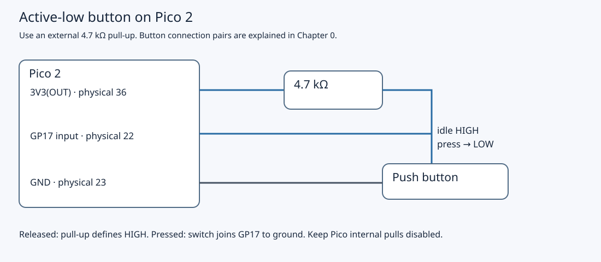
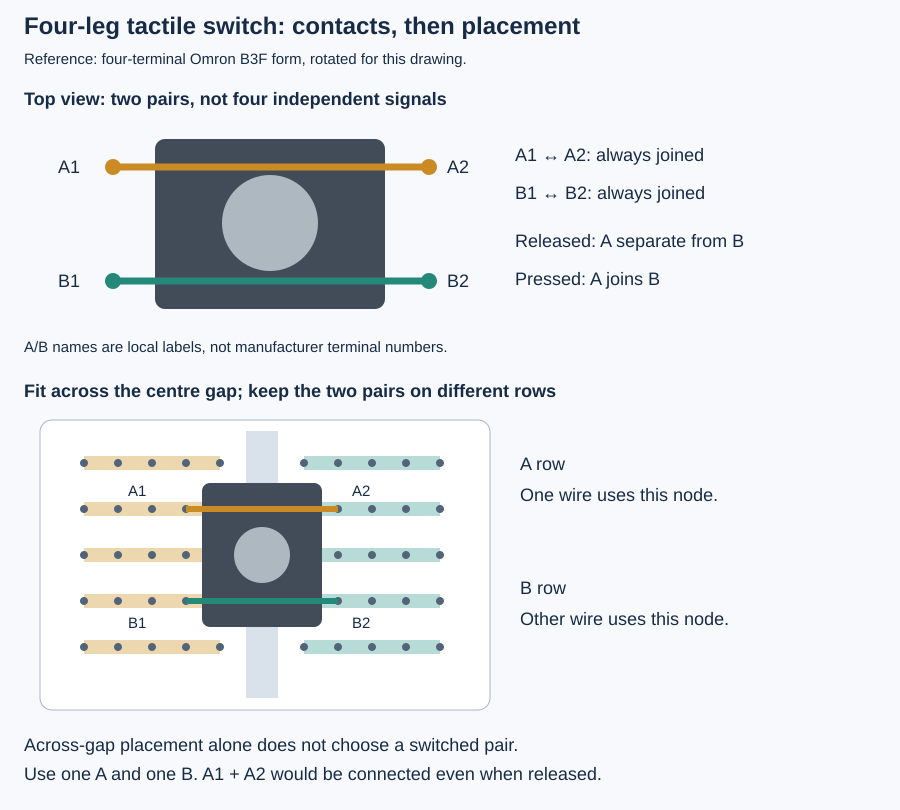

# 4.1 — Read a button by polling

You will add a button to the Pico 2 and read its electrical state from a register. Pressing connects GP17 to ground; releasing lets a resistor pull it high. The program counts sampled changes and prints them over Pico USB. Complete [3.3](3.3-diagnose-a-broken-program-systematically.md) first, restoring its canonical blink program before changing the circuit.

Use the non-wireless Pico 2, breadboard, four-leg momentary button, **4.7 kΩ resistor**, and jumper wires. Retain the GP16 LED and its **1 kΩ resistor**. The Pi stays disconnected. The Debug Probe's D connection may remain fitted for the next lesson; U stays empty. This polling program does not configure or drive the LED, so the previous blinking will stop after a reset into the new firmware.

## Give an open switch a defined voltage

A digital input measures voltage relative to GND and classifies it as low or high. An open switch supplies neither. Without another connection, the input can float: nearby signals and leakage can influence its voltage. A **pull-up** is a resistor from that input to the supply. Released, the button leaves GP17 near 3.3 V. Pressed, the switch connects GP17 directly to GND and the resistor limits the supply-to-ground current to approximately `3.3 V / 4700 Ω = 0.7 mA`.

This is **active-low**: the asserted condition, “pressed,” has electrical value 0. The C++ expression converts that electrical state into a meaningful Boolean; `pressed == true` does not mean a high voltage.



[Open the larger schematic](assets/circuit-pico-button.svg). This shows electrical connections, not breadboard hole positions. With the Pico component side facing you and USB at the top, physical 21 is at the bottom of the right header; 22 and 23 are the next two pins upward. Physical 36 is farther up that same header. Check the [board drawing](assets/0.2-pico2-headers.svg) and official [Pico 2 pinout, Figure 2](https://datasheets.raspberrypi.com/pico/pico-2-datasheet.pdf) before attaching wires.

| Pico 2 connection | Connect to | Purpose |
| --- | --- | --- |
| GP17, physical 22 | One switch contact pair and one end of 4.7 kΩ | Input node |
| 3V3(OUT), physical 36 | Other end of 4.7 kΩ | Pull input high when released |
| GND, physical 23 | Other switch contact pair | Pull input low when pressed |
| GP16, physical 21 | Existing 1 kΩ → LED anode | Retained for later firmware |
| LED cathode | GND, physical 23 | Existing LED return |

Use **3V3(OUT)**, not 3V3_EN, VSYS or VBUS. If several ground wires need one connection, connect physical 23 to a verified breadboard ground strip. Do not assume a rail continues across a visible break.

## Choose two switched contacts

A typical four-leg tactile button has only **two electrical nodes**. Two legs are permanently joined as pair A; the other two form pair B. Pressing joins A to B. Connecting GP17 and GND to two legs of A would permanently ground the input, regardless of pressing.



Use the placement shown for the reference switch: straddle the breadboard centre gap, with A and B on different numbered rows. Connect the GP17/pull-up node to A and ground to B. Across-gap placement alone does not establish which legs are paired. Match the actual switch's contact drawing; the kit revision is unconfirmed. If a continuity meter is available, test the loose, unpowered switch: each permanent pair conducts when released, while A-to-B conducts only when pressed. See [0.5](0.5-recognise-the-breadboard-and-kit-components.md) for the reference component and breadboard contacts.

## Configure the input path

The pad is the chip's electrical interface to the pin. Turning off its output driver makes it an input, but the input buffer must also be enabled and pad isolation removed. Unlike Chapter 2's output-only setup, we need that input path.

Here the SDK performs configuration and the loop reads the register directly. In the pinned SDK, `gpio_init(17)` disables SIO output, clears its output latch, and selects SIO. Its `gpio_set_function` implementation enables the input buffer, sets normal overrides, then removes RP2350 pad isolation. `gpio_set_dir(..., GPIO_IN)` explicitly retains input direction; `gpio_disable_pulls` disables both internal pull resistors because the external resistor defines the circuit. These details are visible in the official [SDK 2.3.1 GPIO implementation](https://github.com/raspberrypi/pico-sdk/blob/2.3.1/src/rp2_common/hardware_gpio/gpio.c).

Early silicon needs particular care. **RP2350-E9 affects A2**: an enabled input can source leakage current when its voltage lies in the undefined region, defeating a weak pull-down. The hardware fix arrived in **A3** and is retained in A4. This circuit instead uses an external pull-up and a direct switch connection to ground; it does not rely on a weak pull-down. Keep the specified resistor even on corrected silicon. Check your package's stepping marking against the official identification image; a board labelled Pico 2 does not identify the silicon revision. The [RP2350 datasheet, silicon revisions and RP2350-E9](https://datasheets.raspberrypi.com/rp2350/rp2350-datasheet.pdf) gives the revision-specific details; the [A4 announcement](https://www.raspberrypi.com/news/rp2350-a4-rp2354-and-a-new-hacking-challenge/) shows the package marking and explains that some Pico boards use A3. No revision has been measured on your board.

## Wire, build and run

1. Close GDB after removing breakpoints and disconnecting as in 3.3. Stop OpenOCD with Ctrl-C. Unplug **both Pico and probe USB**, and remove any other power before changing wiring. Retain the LED circuit and add the button and pull-up using the table. Recheck all endpoints, the resistor values and the contact pairs. Reconnect Pico USB normally; reconnect probe USB only if retaining SWD. No probe UART wiring is needed.

2. **Mac — working directory `~/hardware-from-software`**, or your actual Chapter 1 checkout:

   ```sh
   cd ~/hardware-from-software
   python3 scripts/setup_deps.py
   python3 scripts/build_examples.py --pico
   ls -l .build/pico/button_poll.uf2 .build/pico/button_poll.elf
   ```

   Require a successful build. The UF2 is the BOOTSEL image; the ELF retains symbols for SWD. The complete application is `examples/pico/button_poll.cpp`:

```cpp
{{#include ../examples/pico/button_poll.cpp}}
```

3. Use the established BOOTSEL route from [1.3](1.3-flash-with-bootsel-and-read-output.md): unplug Pico USB, hold **the Pico's BOOTSEL**, reconnect Pico USB, then release after the **RP2350** volume appears. If the probe is powered and D remains attached, it still supplies no target power. **Mac — same checkout**, after checking that the volume is present:

   ```sh
   ls /Volumes/RP2350
   cp .build/pico/button_poll.uf2 /Volumes/RP2350/
   ```

   Leave Pico USB attached as the volume disappears and the application starts. Do not flash the Debug Probe with this image.

4. **Mac — same checkout:** find the Pico USB console and open its actual device path:

   ```sh
   find /dev -maxdepth 1 -name 'cu.usbmodem*' -print
   screen /dev/cu.usbmodemYOUR_SUFFIX 115200
   ```

   Replace the placeholder with the detected Pico path. If the probe also appears, identify the Pico by which device disappears when Pico USB alone is unplugged. The `115200` setting is conventional USB line coding here, not a GPIO UART bit rate.

5. Press and hold the button, then release it. Repeat slowly. The program prints **only on a sampled change**, so a blank terminal while the button is untouched is expected. This output is illustrative, not measured:

   ```text
   raw transition 1 pressed=1
   raw transition 2 pressed=0
   ```

   A held press should settle to `pressed=1`, and release to `pressed=0`. The initial state seeds `last` without printing; holding the button through startup is not counted as a new press. USB output produced before the terminal connects may be lost, so the first visible transition number need not be 1. The LED is not an indicator for this program.

## What polling observes

`SIO GPIO_IN` reports input levels, unlike `GPIO_OUT`, which reports output latch state. `sio_hw->gpio_in` is the SDK's volatile register access; masking with `1u << 17` selects GP17. Comparing the masked value to zero implements active-low interpretation. The loop compares this sample with `last`, updates its software state, and increments `transitions` for either direction.

Polling observes the level **when a read executes**. A pulse that begins and ends between two reads is invisible. This loop requests no sleep, but neither `tight_loop_contents()` nor a fast CPU guarantees a fixed sample interval. USB interrupts, formatting and potentially blocking `printf` output take time; printing inside the transition branch stretches the interval precisely when changes occur. This is a raw diagnostic, not a lossless edge recorder or a timing instrument. `transitions` counts observed changes, not every physical transition and not deliberate presses.

Mechanical contacts can briefly separate and reconnect while moving: **bounce**. One press/release may therefore produce more than two changes. You may see several lines, or miss the bounce entirely because it falls between samples. Either observation is compatible with a bouncing switch. Do not insert a sleep and call that a general solution: it also hides short legitimate events. [4.3](4.3-share-state-and-debounce-correctly.md) will define a stable-state acceptance rule; [4.2](4.2-configure-and-acknowledge-a-gpio-interrupt.md) first changes how software learns of an edge.

## Diagnose and leave a known state

| Symptom | Check |
| --- | --- |
| Console blank until a press | Expected: there is no heartbeat. Press and release after connecting. |
| Console always blank | Check Pico rather than probe serial path, successful build and correct UF2; disconnect other serial clients. Confirm GDB is closed and the target runs freely. |
| Only `pressed=1`, or release never changes it | Power down both boards; check whether GP17 and GND use the same permanent contact pair or share a breadboard strip. |
| No press detected, or input stays released | Power down; check GP17 physical 22, the ground path and that A-to-B actually closes. |
| Changes while untouched | Power down; check the external pull-up reaches physical 36, its value, loose leads and split rails. Noise is not proof of bounce. |
| LED stops blinking | Expected after this firmware starts: it does not drive GP16. |
| Several changes around a press | Bounce may be visible. First establish stable held/released states; this counter is not debounced. |

Quit `screen` with **Ctrl+A**, then **Ctrl+\\**, confirming Y if prompted. Closing the terminal does not stop polling. Leave the GP17 button, external pull-up and GP16 LED assembled for 4.2. If packing away, unplug both USB connections before detaching SWD or moving wires.

The example has target-compilation evidence in the project's verification record. Button states, bounce, wiring and USB output have **not been physically exercised** for this book; the observations above are predictions for your bench.

## References

- [Pico 2 datasheet](https://datasheets.raspberrypi.com/pico/pico-2-datasheet.pdf): header allocation, power pins and USB programming.
- [RP2350 datasheet](https://datasheets.raspberrypi.com/rp2350/rp2350-datasheet.pdf): GPIO pad/input path, SIO GPIO_IN, silicon revisions and RP2350-E9.
- [Pico SDK 2.3.1 GPIO source](https://github.com/raspberrypi/pico-sdk/blob/2.3.1/src/rp2_common/hardware_gpio/gpio.c): exact initialization used here.
- [RP2350 A4 announcement](https://www.raspberrypi.com/news/rp2350-a4-rp2354-and-a-new-hacking-challenge/): stepping identification and Pico board revision qualifications.
