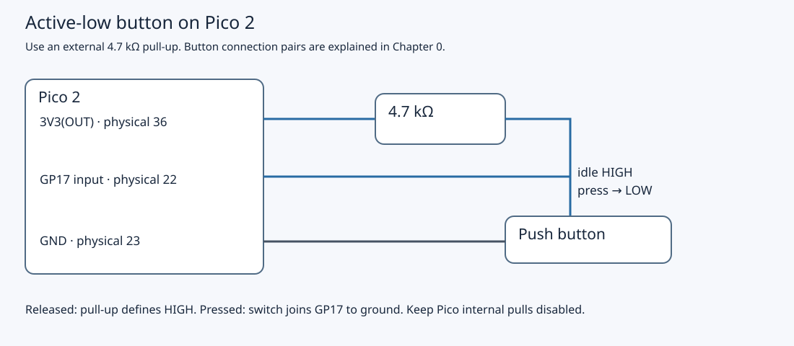

# 4.2 — Configure and acknowledge a GPIO interrupt

A press can notify the processor without `main` repeatedly testing for a transition. You will first run an SDK callback that reports raw falling edges, then load a program whose own interrupt handler acknowledges the GPIO hardware. Complete [4.1](4.1-read-a-button-by-polling.md) first: the released button must read HIGH and the pressed button LOW. Keep the Debug Probe setup from [3.1](3.1-attach-the-debug-probe-over-swd.md) available if using SWD.

## Keep the same circuit

Use the non-wireless Pico 2, button, external 4.7 kΩ pull-up and existing GP16 LED with its 1 kΩ resistor. Unplug Pico and probe USB before moving a connection. No Pi is connected. Pico USB supplies target power and diagnostic data; probe D provides SWD only, and U stays empty.



This schematic shows electrical connections, not breadboard hole positions. Retain the Pico straddling the breadboard centre gap, USB at the top in component-side view. A four-leg button has two permanently connected contact pairs; connect GP17 and ground to opposite switch contacts, as identified in [0.5](0.5-recognise-the-breadboard-and-kit-components.md). Two legs from one pair would hold the input low permanently.

| Pico connection | Destination | Purpose |
| --- | --- | --- |
| GP17, physical 22 | One switch contact and one end of 4.7 kΩ | Active-low input |
| 3V3(OUT), physical 36 | Other end of 4.7 kΩ | External pull-up |
| GND, physical 23 | Opposite switch contact | LOW when pressed |
| GP16, physical 21 | 1 kΩ → LED anode | LED output in the second program |
| LED cathode | GND, physical 23 | LED return |

Both programs disable internal pulls and retain SDK GPIO initialization, including RP2350 pad input setup and isolation removal. Keep 4.1's silicon-revision/E9 qualification and external resistor; changing notification software does not change input electrical requirements.

## An edge is an event; a level is a condition

A **falling edge** is HIGH → LOW, normally the start of a press here. A rising edge is LOW → HIGH, normally release. Mechanical bounce can produce several of either. A level interrupt remains asserted while its selected level holds. Acknowledging a LOW-level interrupt cannot make a held-low wire HIGH; it would immediately remain a cause for service. We use latched edge events. The SDK's [GPIO event definitions and acknowledgment contract](https://github.com/raspberrypi/pico-sdk/blob/2.3.1/src/rp2_common/hardware_gpio/include/hardware/gpio.h) distinguish these cases.

An **interrupt service routine (ISR)** temporarily takes control from the interrupted application. The GPIO block detects an enabled event and raises the bank interrupt; the Cortex-M33's **Nested Vectored Interrupt Controller (NVIC)** decides when that interrupt can be taken. The processor uses its vector-table entry to reach the installed handler, then returns to interrupted execution. GPIO source enable, CPU IRQ enable and global interrupt masking are separate gates. Registering a function alone does not open them. We will inspect exception entry and return in [4.4](4.4-inspect-exception-entry-and-return.md).

## Run the SDK callback baseline

1. **Mac — working directory `~/hardware-from-software`**, or your actual checkout. Restore the pinned tools and build:

   ```sh
   cd ~/hardware-from-software
   python3 scripts/setup_deps.py
   python3 scripts/build_examples.py --pico
   ls .build/pico/button_irq_sdk.uf2 .build/pico/button_irq_sdk.elf
   ```

   Require build success. The shared project already defines `button_irq_sdk`; no new CMake project is needed. Its complete source is `examples/pico/button_irq_sdk.cpp`:

```cpp
{{#include ../examples/pico/button_irq_sdk.cpp}}
```

2. Close any serial terminal and stop an earlier GDB session. For BOOTSEL, unplug Pico USB, hold the **Pico's** BOOTSEL button while reconnecting it, then release once **RP2350** mounts. **Mac — same checkout:**

   ```sh
   cp .build/pico/button_irq_sdk.uf2 /Volumes/RP2350/
   ls /dev/cu.usbmodem*
   ```

   The volume should disappear as the target restarts. Select the actual Pico USB device as in [1.3](1.3-flash-with-bootsel-and-read-output.md); the probe may expose another serial device. **Mac — same directory**, replace the entire placeholder:

   ```sh
   screen /dev/cu.usbmodemYOUR_SUFFIX 115200
   ```

3. Release the button, then press and release it a few times. The expected text is `falling edge (raw; may bounce or coalesce)`. This is a prediction, not a captured hardware log. There is no startup banner or periodic heartbeat, and this baseline does not configure or drive the LED.

`gpio_set_irq_enabled_with_callback` installs the SDK's GPIO dispatcher, enables GP17's falling event and enables `IO_IRQ_BANK0` on the calling core. In SDK 2.3.1 the dispatcher reads enabled status and **acknowledges the event before invoking the callback**. `button_callback` therefore only sets `pending`; it does not acknowledge again. The main loop briefly masks interrupts while copying and clearing that flag, then prints with interrupts restored. These steps follow the actual [SDK dispatcher implementation](https://github.com/raspberrypi/pico-sdk/blob/2.3.1/src/rp2_common/hardware_gpio/gpio.c).

A Boolean means “at least one notification since the last handoff.” Several callbacks can coalesce into one report; bounce can also yield several reports for one press. Neither line count nor callback count is a reliable press count. No sleeping or USB printing occurs inside the callback.

## Locate GP17's event bits

IO_BANK0 packs four event bits per GPIO and eight GPIOs per 32-bit word. For GP17, `word = 17 / 8 = 2`; the four-bit field begins at `shift = 4 * (17 % 8) = 4`.

| GP17 event | Unshifted SDK value | Mask in word 2 |
| --- | --- | --- |
| LOW level | `0x1` | `0x10`, bit 4 |
| HIGH level | `0x2` | `0x20`, bit 5 |
| Falling edge | `0x4` | `0x40`, bit 6 |
| Rising edge | `0x8` | `0x80`, bit 7 |

The [RP2350 register definitions](https://raw.githubusercontent.com/raspberrypi/pico-sdk/2.3.1/src/rp2350/hardware_regs/include/hardware/regs/io_bank0.h) identify these as `GPIO17_EDGE_LOW/HIGH`. Here LOW/HIGH names the direction's destination level. The direct program enables both edges: `edges = 0xc0`.

| C++ register expression | Datasheet register | Meaning |
| --- | --- | --- |
| `io_bank0_hw->intr[2]` | `INTR2`, offset `0x238` | Raw level state and latched edge events |
| `io_bank0_hw->proc0_irq_ctrl.inte[2]` | `PROC0_INTE2`, offset `0x250` | Events enabled for processor 0 |
| `io_bank0_hw->proc0_irq_ctrl.ints[2]` | `PROC0_INTS2`, offset `0x280` | Read-only status after enable/force processing |

Offsets are relative to IO_BANK0, not absolute addresses. With force bits left at reset, enabled status is raw status AND enable. `INTR2` can retain an edge even when its enable is clear. Clearing an enable blocks notification; it does not acknowledge a latched event.

The raw **edge** bits are write-one-to-clear (W1C): write a 1 to clear that latch; write a 0 to leave it alone. The level bits are read-only. Thus `intr[2] = pending` clears exactly the selected observed edge bits. Do not use `intr[2] |= pending`: the read could collect unrelated latched edges, and writing them back would clear them too. Acknowledgment belongs in raw `INTR`, not `INTS` or `INTE`. These access types are specified in the [RP2350 IO_BANK0 register map](https://datasheets.raspberrypi.com/rp2350/rp2350-datasheet.pdf#tab-registerlist_io_bank0).

## Replace the dispatcher with the direct handler

4. Read the complete `examples/pico/button_irq.cpp` before loading it. It owns the entire bank IRQ in this single-core program. Do not combine its exclusive handler with the SDK callback baseline or enable unrelated GPIO IRQ sources.

```cpp
{{#include ../examples/pico/button_irq.cpp}}
```

The setup installs `gpio_isr`, clears stale GP17 edge latches, sets those two peripheral enable bits with `hw_set_bits`, then enables the CPU IRQ. The installed [SDK IRQ implementation](https://github.com/raspberrypi/pico-sdk/blob/2.3.1/src/rp2_common/hardware_irq/irq.c) updates the RAM vector entry for the exclusive handler; on this RP2350 Arm build, enabling also clears NVIC pending state before setting its enable bit. That CPU pending clear is separate from clearing GPIO's raw edge latches. An edge after the peripheral clear can still become pending during setup; the sequence is not a promise to ignore all button activity until `main` reaches its loop.

When invoked, `gpio_isr` reads processor-0 enabled status, masks out everything except GP17's two edges, writes those bits to raw `INTR` to acknowledge, and sets `changed` if any selected bit was present. It does not count, read a timestamp, toggle the LED, sleep or print. It also does not call the SDK dispatcher: **this handler owns its W1C acknowledgment**. Repeated edges of one kind can merge in a hardware latch before acknowledgment; the Boolean handoff merges notifications too.

The rest of this actual program already contains the debounce used in [4.3](4.3-share-state-and-debounce-correctly.md). Main copies/clears `changed` with interrupts masked, samples GP17, and restarts a candidate timer on a notification or changed sample. A candidate differing from the stable state is accepted after at least 20,000 microseconds without another observed reset of that timer. An accepted LOW toggles GP16 and prints a press count; accepted HIGH rearms the next press. Initial state is sampled, so booting with the switch held does not itself count a press. This is a software policy in main, not hardware suppression of bounce; 4.3 explains the handoff and timing limits fully. `volatile` alone would not protect a read-then-clear sequence.

5. Quit `screen` with `Ctrl+A`, then `Ctrl+\`, confirming Y if asked. Re-enter Pico BOOTSEL and, **Mac — checkout directory**, load the second image:

   ```sh
   cp .build/pico/button_irq.uf2 /Volumes/RP2350/
   ls /dev/cu.usbmodem*
   ```

   Reopen the actual Pico device with the `screen` command above. Make distinct presses and releases, holding each state comfortably longer than 20 ms. Expected behavior is one LED toggle and an `accepted press ... led=...` line per accepted press; release alone does not print. For example, `accepted press 1 led=1` is illustrative, not measured. USB work can delay main, so the configured interval is not a measured response latency.

## Use SWD instead of BOOTSEL

Either image can be loaded as an ELF using Chapter 3's probe wiring. Close the serial terminal first. **Mac — checkout directory, separate terminal:** start one server, or retain the successfully examined one:

```sh
.deps/openocd/openocd \
  -s "$PWD/.deps/openocd/scripts" \
  -f interface/cmsis-dap.cfg \
  -c "set USE_CORE cm0" \
  -f target/rp2350.cfg \
  -c "adapter speed 1000"
```

**Mac — same directory, another terminal:**

```sh
.deps/arm-gnu-toolchain-14.2.rel1-darwin-arm64-arm-none-eabi/bin/arm-none-eabi-gdb \
  -q .build/pico/button_irq.elf
```

Use `button_irq_sdk.elf` instead for the baseline. **Pico debugger:**

```text
(gdb) target remote localhost:3333
(gdb) monitor reset halt
(gdb) load
(gdb) monitor reset run
(gdb) disconnect
(gdb) quit
```

Stop on a load error. Reconnect the Pico USB serial port afterward. There are deliberately no handler breakpoints here: halting distorts bounce, USB service and timing. The ELF supplies instructions and symbols for SWD; UF2 supplies the BOOTSEL image. Rebuilding either does not install it.

## Troubleshoot and leave a known state

| Symptom | Check |
| --- | --- |
| No output when idle | Expected: neither program prints a heartbeat. Press after opening the correct Pico USB device. |
| No output on a press | Recheck 4.1's HIGH/LOW polling result, GP17 versus physical pin 17, switch contact pairs, pull-up and ground. Verify the loaded target name and resume any halted debugger. |
| Several baseline lines per press | Raw falling edges can bounce. Switch to the direct program for its accepted-press behavior; do not call the raw reports debounced. |
| Direct program prints raw-edge wording | Old or wrong firmware is installed. Load `button_irq.uf2` or its matching ELF. |
| Handler runs continuously after a local edit | Check level versus edge masks and raw W1C acknowledgment. Clearing NVIC pending alone cannot clear an asserted peripheral source. |
| Reports arrive but the LED stays dark | Verify GP16 physical 21, LED polarity and 1 kΩ resistor with power removed; reuse [2.1](2.1-wire-and-verify-an-external-led.md). The SDK baseline does not drive it. |
| A very brief press is ignored | The direct program accepts stable states, not every raw pulse. Its Boolean flags and edge latches are not queues. |

Leave `button_irq` running with GP17 and GP16 wiring intact for 4.3. Exit the serial terminal when finished. If packing away, stop OpenOCD with Ctrl-C and unplug both USB connections before detaching SWD or changing the circuit.

The repository's `verification.json` records target compilation of both examples for SDK 2.3.1 / Pico 2 Arm. The source and register path have been reviewed; **physical GPIO interrupts, LED behavior and SWD loading have not been exercised**. The observations above are expected results for the reader to verify.

## References

- [Pico SDK 2.3.1 GPIO implementation](https://github.com/raspberrypi/pico-sdk/blob/2.3.1/src/rp2_common/hardware_gpio/gpio.c): callback dispatch and setup ordering.
- [Pico SDK 2.3.1 GPIO declarations](https://github.com/raspberrypi/pico-sdk/blob/2.3.1/src/rp2_common/hardware_gpio/include/hardware/gpio.h): event values and acknowledgment contract.
- [RP2350 datasheet](https://datasheets.raspberrypi.com/rp2350/rp2350-datasheet.pdf): IO_BANK0 raw, enable and status registers; edge latch access semantics.
- [Pico SDK 2.3.1 IRQ implementation](https://github.com/raspberrypi/pico-sdk/blob/2.3.1/src/rp2_common/hardware_irq/irq.c): vector registration and CPU IRQ enable.
