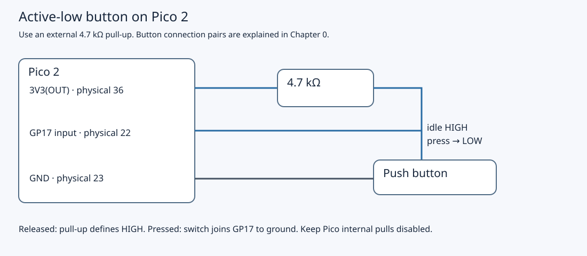

# 4.3 — Share state and debounce correctly

One deliberate press should toggle the external LED once, even if the contacts bounce. The `button_irq` program from [4.2](4.2-configure-and-acknowledge-a-gpio-interrupt.md) already implements that policy. This lesson explains its two separate jobs: transferring a notification safely from the interrupt handler to `main`, and deciding when a sampled button state is worth accepting. You will run the same target, then deliberately slow its main loop to see what that policy can and cannot preserve.

Complete 4.1's HIGH-when-released, LOW-when-pressed check and 4.2's interrupt setup first. This program uses one application core on the non-wireless Pico 2's Arm Cortex-M33, with no RTOS. The other core does not access its state.

## Retain the circuit

No wiring changes are needed. The Pi remains disconnected. Pico USB supplies power and diagnostics; the optional Debug Probe D connection is SWD, and U stays empty. If correcting wiring, unplug Pico and probe USB first.



[Open the larger schematic](assets/circuit-pico-button.svg). This is an electrical schematic, not a breadboard layout. With the Pico component side facing you and USB at the top, physical 21 is at the bottom right; 22 and 23 are the next pins upward. Keep the Pico straddling the breadboard gap. Connect the button's two different contact pairs, as established in [4.1](4.1-read-a-button-by-polling.md); two legs from the same permanent pair would short the input to ground continuously.

| Pico 2 connection | Destination |
| --- | --- |
| GP17, physical 22 | One button contact pair and one end of 4.7 kΩ |
| 3V3(OUT), physical 36 | Other end of 4.7 kΩ |
| GND, physical 23 | Opposite button contact pair |
| GP16, physical 21 | 1 kΩ → LED anode |
| LED cathode | GND, physical 23 |

Retain the external pull-up and 4.1's silicon-revision/E9 qualification. The firmware disables internal pulls. Use 3V3(OUT), not 3V3_EN, VBUS or VSYS. The LED circuit is unchanged from [2.1](2.1-wire-and-verify-an-external-led.md).

## Transfer responsibility without losing a notification

The ISR acknowledges the selected rising/falling edge latches and sets `volatile bool edge_pending`. It says only: “there has been activity since main last collected this flag.” It does not report a direction, timestamp, number of transitions or number of presses. Several interrupts setting an already-true Boolean coalesce into one notification; repeated edges can also merge in the hardware latches before service. The [RP2350 IO_BANK0 register description](https://datasheets.raspberrypi.com/rp2350/rp2350-datasheet.pdf#tab-registerlist_io_bank0) defines those edge latches.

`volatile` keeps these accesses visible to the compiler under the embedded toolchain's rules. It does not make a read followed by a clear indivisible. Consider this **incorrect fragment**, without masking:

```cpp
// Incorrect handoff fragment; not a replacement for the program.
const bool edge_seen = edge_pending;
edge_pending = false;
```

An interruption can split it:

| Order | Main | ISR |
| --- | --- | --- |
| 1 | Reads `edge_pending == false` | |
| 2 | Paused | Acknowledges a new edge and writes `edge_pending = true` |
| 3 | Resumes and writes `edge_pending = false` | |

Main has neither a true local copy nor a true shared flag afterward. The new notification has disappeared. Individual Boolean loads/stores would not solve this sequence problem even if each were atomic. Nor would `volatile` publish an unrelated payload with C++ acquire/release semantics: [GCC's volatile documentation](https://gcc.gnu.org/onlinedocs/gcc/Volatiles.html) explicitly says it does not order non-volatile memory accesses as a memory barrier.

The actual **handoff fragment**, shown again here to isolate the operation, is:

```cpp
const uint32_t saved_interrupt_state = save_and_disable_interrupts();
const bool edge_seen = edge_pending;
edge_pending = false;
restore_interrupts(saved_interrupt_state);
```

The [SDK 2.3.1 implementation](https://github.com/raspberrypi/pico-sdk/blob/2.3.1/src/rp2_common/hardware_sync/include/hardware/sync.h) saves Arm `PRIMASK`, masks interrupts, and later writes back the saved value. Its inline assembly includes compiler memory clobbers. An ISR that ran before masking leaves a flag for this copy; one whose edge arrives while masked can run after restoration and leave a flag for the next copy. The handler cannot execute between this read and clear on this core.

Restoration matters: blindly enabling interrupts would break a caller that entered with them already masked. PRIMASK prevents configurable interrupts from being taken; it does not stop the GPIO hardware detecting an edge or prevent an interrupt becoming pending. It also does not mask NMI or HardFault. See [Arm's PRIMASK and interrupt-mask documentation](https://arm-software.github.io/CMSIS_6/main/Core/group__Core__Register__gr.html).

This is a platform-specific single-core handoff, not portable C++ thread synchronization. It excludes this ISR because main and the ISR run on the same core. Local masking cannot exclude another core, DMA, or an unrelated agent writing memory. Introducing multicore or an RTOS requires revisiting ownership and using suitable synchronization.

Keep the masked region to the copy and clear. Reading GPIO, taking time, formatting text and sleeping occur afterward. A long masked region delays other interrupt services, including USB. Likewise, the ISR contains no sleep, USB printing or debounce wait: it acknowledges and notifies, then returns. Slow work belongs in main, where interrupts can still run.

## Accept a state after observed quiet time

Main owns the remaining state; the ISR never touches it:

| Variable | Meaning |
| --- | --- |
| `stable_level` | Last accepted electrical level |
| `candidate_level` | Most recently sampled proposed level |
| `candidate_since_us` | Main's timestamp when that candidate's observation interval last restarted |
| `led_is_on`, `press_count` | LED state and accepted-press count |

At startup, the first input sample seeds both `stable_level` and `candidate_level`. Booting with the button held therefore does not create a press.

Each iteration collects the notification, reads `raw_level`, and obtains `now_us`. Either a notification **or** `raw_level != candidate_level` assigns the new sample to `candidate_level` and restarts `candidate_since_us`. A notification restarts the interval even when the sample matches: the pin may have moved away and back between reads. If `candidate_level != stable_level` and `now_us - candidate_since_us >= 20000`, main accepts the candidate.

An illustrative sequence makes the two directions explicit. Suppose the initial stable state is HIGH. Main samples LOW at time 0 and starts a candidate. A bounce notification observed at 7 ms restarts the interval, even if the sample is again LOW. At a later iteration at or after 27 ms, with no intervening observed reset, LOW can become stable. Only that accepted LOW toggles GP16 and increments `press_count`. Holding LOW produces no more toggles because candidate equals stable. Release must also become an accepted HIGH after its observation interval; it rearms the next LOW acceptance without toggling or printing. A release too brief to be accepted cannot rearm a second press. These times illustrate the algorithm; they are not measured traces.

The 20 ms value is a software acceptance threshold, not a measured property of your switch or a guaranteed response latency. `candidate_since_us` records when **main observed** activity, not the physical edge time. `sleep_ms(1)` requests a delay between iterations; USB work and interrupts add time.

There is also a gap between collecting `edge_pending`, sampling the pin and accepting the candidate. For example, an ISR after the handoff can leave `edge_pending = true` while the current iteration still uses its older `edge_seen`. That notification is collected next iteration. The critical section protects the flag transfer; it does not make the later sample and decision one atomic measurement. A narrow pulse can also begin and end between samples. Consequently, acceptance means **20 ms of observed quiet time under this loop's policy**, not proof of continuous electrical stability throughout that interval. This is suitable for exploring a human button, not a guaranteed pulse recorder.

If main is delayed, interrupts can keep setting the flag, but the Boolean cannot retain their history. A burst of press/release activity while main is busy may yield one notification and one final sampled level. The accepted-press count is a count of this state machine's accepted LOW transitions, not a proven count of all physical presses. A design that must preserve individual events needs a bounded queue or counter with defined overflow and appropriate synchronization, plus hardware/timing analysis; replacing a flag alone does not recover edges already merged by hardware.

## Build, load and observe

1. **Mac — working directory `~/hardware-from-software`**, or your actual checkout:

   ```sh
   cd ~/hardware-from-software
   python3 scripts/setup_deps.py
   python3 scripts/build_examples.py --pico
   ls -l .build/pico/button_irq.uf2 .build/pico/button_irq.elf
   ```

   Require a successful build. The existing project target is `button_irq`; there is no separate debounce target. Read its complete `examples/pico/button_irq.cpp`:

```cpp
{{#include ../examples/pico/button_irq.cpp}}
```

2. Close the serial terminal and any GDB session. Use BOOTSEL: unplug Pico USB, hold the **Pico's BOOTSEL**, reconnect USB, then release once RP2350 mounts. **Mac — same directory:**

   ```sh
   ls /Volumes/RP2350
   cp .build/pico/button_irq.uf2 /Volumes/RP2350/
   ```

   The volume should disappear and firmware start. UF2 is for BOOTSEL; ELF supplies code and debug symbols for the alternative [4.2 SWD load procedure](4.2-configure-and-acknowledge-a-gpio-interrupt.md#use-swd-instead-of-bootsel). Rebuilding does not install either image.

3. **Mac — same directory:**

   ```sh
   find /dev -maxdepth 1 -name 'cu.usbmodem*' -print
   screen /dev/cu.usbmodemYOUR_SUFFIX 115200
   ```

   Replace the whole placeholder with the actual Pico USB device; the probe can expose another device. There is no startup banner or heartbeat.

4. Press and hold, release and hold, then repeat slowly. Allow each level comfortably more than 20 ms. Expected behavior is one LED toggle per accepted press and no toggle on release. Illustrative output, **not recorded on hardware**, is:

   ```text
   accepted press 1 led=1
   accepted press 2 led=0
   ```

   A long held press should produce just one line. The first visible number may be higher if output occurred before the terminal connected. Do not infer physical response time from when USB text appears.

## Deliberately delay main

5. For an optional controlled experiment, first preserve your current source. **Mac — checkout directory:**

   ```sh
   cp examples/pico/button_irq.cpp .build/button_irq-before-4.3.cpp
   ```

   Change only the final `sleep_ms(1);` to `sleep_ms(100);` in the main loop. This is an edit fragment, not a new program:

   ```cpp
   sleep_ms(100);
   ```

   Rebuild with step 1 and reload with steps 2–3. Slow, well-separated presses should still be accepted, with greater delay. Brief press/release pairs may disappear because both fit between observations. The ISR can record activity during the sleep, but its flag cannot tell main how many transitions occurred or their times. This demonstrates coalescing and sampling limits; it does not deliberately introduce the read/clear race.

6. Restore the saved source, rebuild and reload the original image before continuing. **Mac — checkout directory:**

   ```sh
   cp .build/button_irq-before-4.3.cpp examples/pico/button_irq.cpp
   python3 scripts/build_examples.py --pico
   ```

   Repeat steps 2–3. After verifying the restored one-millisecond loop in the source, remove the temporary backup:

   ```sh
   rm .build/button_irq-before-4.3.cpp
   ```

## Diagnose and leave a known state

| Symptom | Check |
| --- | --- |
| Blank console while idle | Expected. Press after opening the Pico USB device. |
| Raw falling-edge messages | The SDK baseline from 4.2 is loaded. Install `button_irq.uf2`. |
| No response at all | Check the actual USB path, matching image and freely running CPU; repeat 4.1's wiring/state diagnosis. |
| LED toggles but text arrives late | USB delivery is separate from the GPIO decision. Avoid debugger halts and check for a slow main-loop experiment left installed. |
| LED never lights although counts increase | With power removed, check GP16 physical 21, 1 kΩ, LED polarity and ground. |
| A short release does not enable another toggle | HIGH must itself be accepted before another LOW can count. Try a longer release. |
| Multiple accepted presses from one intended press | Inspect wiring and pull-up first. Activity with observed intervals long enough to accept HIGH then LOW can produce another press; 20 ms is not a universal switch specification. |

Exit `screen` with `Ctrl+A`, then `Ctrl+\`, confirming Y if prompted. Leave the restored `button_irq` firmware and circuit intact for [4.4](4.4-inspect-exception-entry-and-return.md). If packing away, stop OpenOCD with Ctrl-C and unplug Pico and probe USB before detaching SWD or moving wires.

`verification.json` records target compilation for Pico 2 Arm with SDK 2.3.1. The source and handoff have been inspected; **physical interrupts, debounce behavior, LED output and timing have not been exercised** for this book. The observations and experiment outcomes above are expected results for your bench, not hardware measurements.

## References

- [Pico SDK 2.3.1 synchronization source](https://github.com/raspberrypi/pico-sdk/blob/2.3.1/src/rp2_common/hardware_sync/include/hardware/sync.h): save/disable/restore implementation.
- [Arm CMSIS core register documentation](https://arm-software.github.io/CMSIS_6/main/Core/group__Core__Register__gr.html): PRIMASK and pending interrupts.
- [GCC volatile documentation](https://gcc.gnu.org/onlinedocs/gcc/Volatiles.html): volatile access and ordering limits.
- [RP2350 datasheet](https://datasheets.raspberrypi.com/rp2350/rp2350-datasheet.pdf): GPIO edge latches and interrupt registers.
