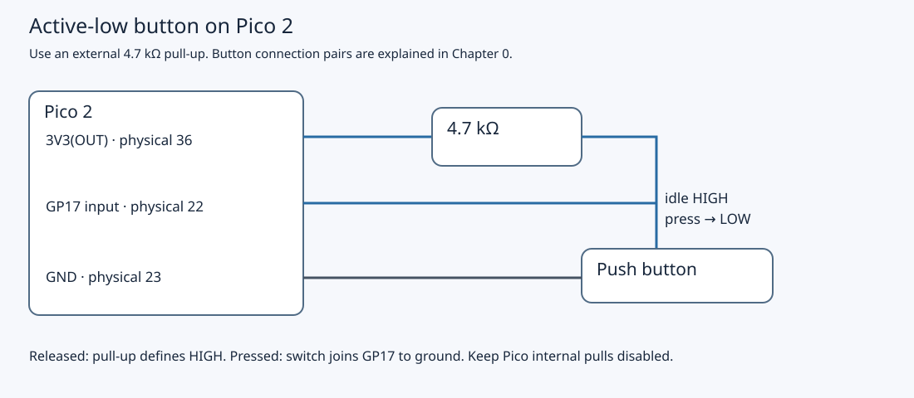
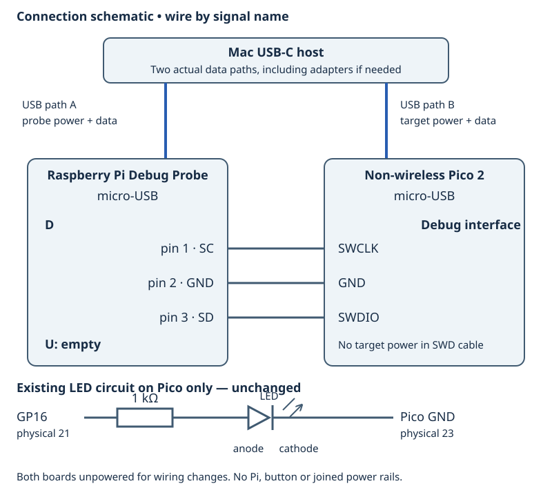
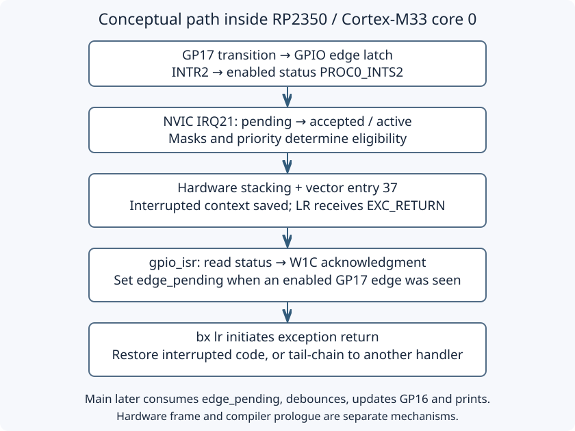

# 4.4 — Inspect exception entry and return

You will stop at the first instruction of `gpio_isr`, find the interrupted program's saved state, execute the acknowledgment, and follow exception return. Complete [4.2](4.2-configure-and-acknowledge-a-gpio-interrupt.md) and [4.3](4.3-share-state-and-debounce-correctly.md) first. This uses their unchanged `button_irq` program and the working SWD connection from [3.1](3.1-attach-the-debug-probe-over-swd.md).

The source has target-compiled for Pico 2 Arm, and the instructions below were regenerated from its actual ELF with the bundled tools. **No target was connected during authoring.** All live register values, button behavior and debugger stops described below are expected observations for you to verify, not recorded hardware results.

## Keep the bench unchanged

Use the non-wireless Pico 2. Keep it straddling the breadboard gap, component side up and USB at the top. No Pi is connected. Power off Pico and probe before changing wiring. The switch's two permanently joined leg pairs must straddle the intended contacts; use opposite switch contacts for GP17 and ground, as in [0.5](0.5-recognise-the-breadboard-and-kit-components.md).





The SWD drawing omits the retained button; use both drawings and this table together.

| Connection | State |
| --- | --- |
| GP17, physical 22 | Switch contact and one end of 4.7 kΩ pull-up |
| 3V3(OUT), physical 36 | Other end of pull-up |
| GND, physical 23 | Opposite switch contact and LED cathode |
| GP16, physical 21 | 1 kΩ → LED anode |
| Probe D pin 1 SC / SWCLK | Pico SWCLK, left bare debug pad in USB-up top view |
| Probe D pin 2 GND | Pico middle debug pad |
| Probe D pin 3 SD / SWDIO | Pico right bare debug pad |
| Mac USB | Separate data connections to Pico and probe |
| Probe U; Pi | Disconnected |

Use the fitted debug connector/cable verified in 3.1; debug pads have no GPIO physical pin numbers. D supplies no target power. Do not join board power rails. Retain the external pull-up, disabled internal pulls, and [4.1's input/E9 silicon qualification](4.1-read-a-button-by-polling.md).

## A handler has two kinds of saved state

An interrupt is an architectural **exception**, distinct from a C++ exception. The application normally executes in Thread mode; an ISR executes in Handler mode. Hardware preserves interrupted execution on a stack and supplies an exception-return token in the handler's LR. The compiler may then add a software prologue, such as saving registers or allocating locals. A source breakpoint can skip that prologue. Consequently, neither a source line nor an arbitrary current SP identifies the hardware frame reliably.



For this lesson, the installed ELF's handler is a leaf: it calls no function, changes neither SP nor LR, and ends in `bx lr`. We will verify that before interpreting memory. Cortex-M33 also supports floating-point frames, stack-alignment padding, and Secure/Non-secure contexts. These are reasons to decode LR first, rather than blindly reading eight words at SP. See [Arm's Cortex-M33 guide, §3.3.7, figures 3-6–3-8 and table 3-25](https://documentation-service.arm.com/static/641b2ec1de84571cc27f3ca3).

## Load the matching ELF and stop before the handler body

1. **Mac — working directory `~/hardware-from-software`**, or your actual checkout. Read the complete unchanged source below, then build:

```cpp
{{#include ../examples/pico/button_irq.cpp}}
```

   ```sh
   cd ~/hardware-from-software
   python3 scripts/setup_deps.py
   python3 scripts/build_examples.py --pico
   ls .build/pico/button_irq.elf
   ```

   The shared project already contains this target. Its single application core uses `rp2350-arm-s`, the Secure Arm baseline. SDK startup remains responsible for boot and runtime initialization. Main performs the IRQ-masked flag handoff, timed debounce, LED update and USB printing; the ISR only acknowledges and notifies.

2. Close the Pico serial terminal. **Mac — same directory, separate terminal:** keep one successfully examined OpenOCD server, or start it with the installed bundle:

   ```sh
   .deps/openocd/openocd \
     -s "$PWD/.deps/openocd/scripts" \
     -f interface/cmsis-dap.cfg \
     -c "set USE_CORE cm0" \
     -f target/rp2350.cfg \
     -c "adapter speed 1000"
   ```

   Require successful `rp2350.cm0` examination as in 3.1. **Mac — same directory, another terminal:**

   ```sh
   .deps/arm-gnu-toolchain-14.2.rel1-darwin-arm64-arm-none-eabi/bin/arm-none-eabi-gdb \
     -q .build/pico/button_irq.elf
   ```

3. **Pico debugger — type after `(gdb)`:**

   ```text
   (gdb) set pagination off
   (gdb) target remote localhost:3333
   (gdb) monitor reset halt
   (gdb) load
   (gdb) monitor reset halt
   (gdb) delete breakpoints
   (gdb) disassemble /r gpio_isr
   (gdb) hbreak *gpio_isr
   (gdb) continue
   ```

   Stop on a load error. Reset/load/reset installs the ELF and starts from a fresh boot; opening the ELF alone does not program flash. Release, then press the button if execution has not already stopped on an edge. Bounce or setup-time activity can produce the first stop before your deliberate press.

   `hbreak *gpio_isr` specifies the symbol's instruction address. `hbreak gpio_isr` or a source-line breakpoint may select the first source location after a prologue. Hardware breakpoint resources are limited. See [GDB breakpoint locations](https://sourceware.org/gdb/current/onlinedocs/gdb.html/Set-Breaks.html).

4. **Pico debugger — at the stop:**

   ```text
   (gdb) x/i $pc
   (gdb) p/x (unsigned int)$pc == ((unsigned int)&gpio_isr & ~1u)
   (gdb) info registers pc sp lr xpsr
   (gdb) set $exc = (unsigned int)$lr
   (gdb) p/x $exc
   (gdb) p/d ((unsigned int)$xpsr & 0x1ff)
   (gdb) info all-registers
   ```

   The equality must be true before using the entry recipe. The last numeric expression reads the CPU's IPSR field from xPSR, avoiding dependence on a separate `$ipsr` debugger register. Expect exception **37**, because this program uses `IO_IRQ_BANK0 = 21`, and external IRQ exception numbers start at 16. It uses the Secure bank IRQ, not the separate `IO_IRQ_BANK0_NS` line. The pinned [RP2350 IRQ definitions](https://raw.githubusercontent.com/raspberrypi/pico-sdk/2.3.1/src/rp2350/hardware_regs/include/hardware/regs/intctrl.h) define these lines.

## Qualify the frame before reading it

5. **Pico debugger — still before the first instruction:** decode the saved handler LR using this table. Inspect `p/x $exc & 0x7f` to isolate these low bits.

| EXC_RETURN field | Interpretation for this inspection |
| --- | --- |
| Bits 31:7 | Exception-return prefix/reserved pattern, all ones here; LR must be a token, not a code address |
| Bit 6, S | 1 means saved state is on a Secure stack; 0 selects Non-secure state |
| Bit 5, DCRS | 1 applies default callee-register stacking rules; other cases need the security context rules |
| Bit 4, FType | 1 means no FP frame space allocated; 0 means extended FP context space |
| Bit 3, Mode | 1 returns to Thread; 0 returns to a preempted handler |
| Bit 2, SPSEL | For this same-security-state case: 0 means MSP, 1 means PSP |
| Bit 1; bit 0, ES | Bit 1 is zero; ES=1 means the exception was taken to Secure state |

   These are the Security Extension meanings from Arm's table 3-25, not a list of Cortex-M0 return constants. This unchanged build is expected to give **`0xfffffff9`**: same Secure state, default stacking, basic frame, Thread mode, MSP. This is conditional expectation, not a measured value.

   Proceed with the recipe only for `0xfffffff9`, or `0xfffffffd` after establishing the same Secure/basic/Thread conditions and an exposed Secure PSP register. The latter would be unexpected for this application and warrants checking the loaded image. In Handler mode `$sp` addresses the handler's MSP even when the interrupted Thread used PSP. `CONTROL` read in the handler is therefore insufficient to choose the interrupted stack.

   For `0xfffffff9`, this leaf's unchanged `$sp` is the post-stacking Secure MSP, so:

   ```text
   (gdb) set $frame = (unsigned int *)$sp
   ```

   For the qualified PSP case, use `set $frame = (unsigned int *)$psp` **only if** `info all-registers` exposes and identifies that register as the Secure PSP. If the needed bank is unavailable, stop frame interpretation; retain the register dump and use OpenOCD's read-only `monitor reg` inventory to identify supported names. Do not substitute MSP or guess an address.

   If FType is zero, security states differ, DCRS differs, the mode is Handler, or LR is not the expected token, stop this basic-frame recipe. Match the actual state to Arm's figures before continuing. Extended FP allocation can involve lazy saving, so reserved FP space need not contain saved FP values yet. Security transitions can add integer state. Do not import an unverified “add 0x48” rule or assume total frame size is 32 bytes. [Arm's Armv8-M exception guide, §§2.6–2.7 and chapter 4](https://documentation-service.arm.com/static/64c7832738511951cb7a246e) explains these qualifications.

6. **Pico debugger — only after choosing that qualified basic frame:**

   ```text
   (gdb) x/8wx $frame
   (gdb) p/x $frame[5]
   (gdb) set $resume = $frame[6]
   (gdb) set $saved_psr = $frame[7]
   (gdb) p/x $resume
   (gdb) p/x $saved_psr
   (gdb) p/d ($saved_psr & 0x1ff)
   (gdb) p/d (($saved_psr >> 9) & 1)
   (gdb) p/x (unsigned int)$frame + 32 + 4 * (($saved_psr >> 9) & 1)
   (gdb) info symbol $resume
   (gdb) x/i $resume
   ```

   The eight words are `r0, r1, r2, r3, r12, interrupted LR, return PC, stacked xPSR`, in increasing address order. Word 5 is the interrupted code's LR; it is distinct from the handler's EXC_RETURN. Word 6 identifies where execution should resume, possibly in an SDK sleep or USB routine rather than a line of `main`. Stacked IPSR should be zero for Thread mode; the live CPU IPSR is 37. Stacked xPSR bit 24 should indicate Thumb state.

   Stacked xPSR bit 9 records an extra alignment word. The final address expression reconstructs the **original pre-exception SP for this basic frame**, including that padding. Padding does not shift the eight displayed register slots. Never use this size calculation for an extended/security frame. A call stack from `bt` can supplement these reads, but does not replace establishing the correct frame.

## Inspect the source, execute its acknowledgment, and return

7. **Pico debugger — still at entry:** read the controller path without changing it:

   ```text
   (gdb) set $vtor = *(unsigned int *)0xe000ed08
   (gdb) x/wx $vtor + 4 * 37
   (gdb) x/wx 0x40028280
   (gdb) x/wx 0x40028238
   (gdb) x/wx 0xe000e200
   (gdb) x/wx 0xe000e300
   ```

   VTOR is the current Secure vector-table base. Entry 37 should hold `gpio_isr`'s address with Thumb bit 0 set; do not assume the table remains in flash. The SDK installs the exclusive handler in its vector table ([SDK IRQ implementation](https://github.com/raspberrypi/pico-sdk/blob/2.3.1/src/rp2_common/hardware_irq/irq.c)).

   `0x40028280` is `PROC0_INTS2`; `0x40028238` is raw `INTR2`. Isolate GP17's edge bits with mask `0xc0`; other bits include level state. `0xe000e200` is NVIC ISPR0, and `0xe000e300` is IABR0. Mask bit 21 (`0x200000`) for this IRQ. Active should be set at the handler stop; pending may be clear because entry accepted it, or set because another request arrived. GPIO latches, NVIC pending, and NVIC active describe different stages. These addresses follow the [RP2350 register map](https://datasheets.raspberrypi.com/rp2350/rp2350-datasheet.pdf) and [pinned M33 register definitions](https://raw.githubusercontent.com/raspberrypi/pico-sdk/2.3.1/src/rp2350/hardware_regs/include/hardware/regs/m33.h).

   These selected reads do not acknowledge the GPIO edge or clear NVIC pending. Do not use GDB assignments to MMIO during this inspection. In general, debugger memory reads can have side effects; checking each register's access semantics matters. `stepi`, in contrast, executes firmware and can perform its stores.

   Before stepping the handler, optionally release and press the button once while still halted at entry, then repeat this step's reads. Additional edges may appear in the raw latch and pending state while the core is stopped; their exact state depends on hardware and debug behavior. Repeated same-direction edges coalesce in a one-bit latch. `edge_pending` also coalesces notifications. This cannot count every physical transition.

8. Compare `disassemble /r gpio_isr` with this **actual ELF disassembly fragment**, regenerated with bundled Arm GCC 14.2 tools. Addresses can change after rebuilding:

   ```text
   100001e0: ldr   r2, [pc, #20]       ; literal 0x40028000, IO_BANK0
   100001e2: ldr.w r3, [r2, #640]      ; +0x280, PROC0_INTS2
   100001e6: and.w r3, r3, #192        ; 0xc0, GP17 edges
   100001ea: str.w r3, [r2, #568]      ; +0x238, INTR2 W1C
   100001ee: cbz   r3, 0x100001f6
   100001f0: ldr   r3, [pc, #8]        ; address of edge_pending
   100001f2: movs  r2, #1
   100001f4: strb  r2, [r3, #0]
   100001f6: bx    lr
   ```

   The words after `bx lr` in the full dump are literals, not further handler instructions. Verify there is no `push`, SP adjustment or call. Use one `stepi` followed by `x/i $pc` repeatedly until immediately **before** `str.w` at handler offset +10. Read `r2` and `r3`: the destination must be `0x40028238` and the masked value can be `0x40`, `0x80`, `0xc0`, or zero if the cause has changed. Execute that store once, then reread `INTR2` and `PROC0_INTS2`. An observed edge bit may clear, but a new physical transition can latch it again. Reading a status value later cannot prove no intervening edge occurred.

   Continue instruction stepping only until the displayed instruction is `bx lr`. The conditional path sets `edge_pending` only for nonzero `pending`. Do not expect an LED write here: main handles it later. [GDB's instruction stepping manual](https://sourceware.org/gdb/current/onlinedocs/gdb.html/Continuing-and-Stepping.html) distinguishes this from source `next`.

9. **Pico debugger — before `bx lr`:** retain `$resume`, delete the entry breakpoint, and catch resumed application execution:

   ```text
   (gdb) delete breakpoints
   (gdb) thbreak *$resume
   (gdb) stepi
   (gdb) x/i $pc
   (gdb) p/d ((unsigned int)$xpsr & 0x1ff)
   ```

   `bx lr` recognizes EXC_RETURN and initiates hardware restoration. If return completes directly, PC should match the saved return address and live IPSR should become zero. Another eligible pending exception can instead **tail-chain** into a handler without first returning to Thread mode. Debug stepping itself can affect interrupt delivery; a single step is not a promise that the next stop is Thread mode. If stopped elsewhere without an error, `continue` lets the temporary hardware breakpoint catch `$resume`. Do not force `$pc` or use GDB's `return` command: those would bypass the mechanism being studied.

## What halting changes

A long breakpoint pause interrupts USB service and delays debounce sampling. On resumption the timer may have advanced far beyond 20 ms without main having observed intermediate contact states. Therefore an accepted press, missing report or USB disconnect during stepping says little about normal debounce quality. Finish by testing freely running firmware; no breakpoint-derived latency or bounce measurements are claimed here.

Polling repeatedly samples input in application code. IRQ notification lets the GPIO block request service and the ISR record work, while main remains responsible for debounce and output. It does not by itself make the main loop sleep. This example retains `sleep_ms(1)` and SDK timing behavior. An explicit **WFI** (wait for interrupt) can be useful in an idle design, but it is not a replacement for the handoff: an interrupt can set a flag after an empty-work check and before WFI, leaving work waiting until some later wake. A correct design must coordinate masking, pending/wakeup rules and timed debounce work. We make no WFI edit here; consult [Arm's Cortex-M33 guide, §3.6 and §4.13.17](https://documentation-service.arm.com/static/641b2ec1de84571cc27f3ca3) before designing that protocol.

| Symptom | Check |
| --- | --- |
| Handler never stops | Verify exact ELF load, `continue`, `cm0`, IRQ setup and 4.1's HIGH/LOW wiring result. Holding LOW alone does not repeatedly create falling edges. |
| PC differs from function entry; frame looks implausible | Recheck `hbreak *gpio_isr`, disassembly and source/ELF agreement. A prologue, nested handler, different stack or security state invalidates the simple recipe. |
| MSP/PSP register unavailable | Use the qualified MSP/entry-SP route only where justified above. For any required unexposed bank, stop interpreting memory and inspect the remote register inventory. |
| NVIC pending is zero at entry | Expected possibility: taking an exception changes pending to active. Inspect IABR and GPIO status separately. |
| Immediate second handler on return | Inspect newly latched edges and pending requests; bounce and tail-chaining can explain it. Clearing NVIC pending alone does not acknowledge GPIO. |
| USB stalls, LED seems frozen, or presses are lost | Remove breakpoints and reset/run. Resume normal timing before judging the circuit or debounce. |

## Restore the free-running program

**Pico debugger — stop with Ctrl-C if running, then:**

```text
(gdb) delete breakpoints
(gdb) monitor reset run
(gdb) disconnect
(gdb) quit
```

Confirm breakpoint deletion if asked. Reopen the actual Pico USB serial port using [1.3's procedure](1.3-flash-with-bootsel-and-read-output.md). Expected free-running behavior is one GP16 toggle and an `accepted press ... led=...` line per accepted press, with comfortably separated presses/releases. No startup heartbeat is expected. These are still unmeasured predictions.

Leave `button_irq`, LED and button wiring intact. To pack away, stop OpenOCD with Ctrl-C, unplug both USB connections, then detach SWD if needed. [Chapter 5](5.1-prepare-raspberry-pi-os-and-ssh.md) introduces the Pi; no Pi connection is needed for this inspection.

## References

- [Arm Cortex-M33 Devices Generic User Guide, issue 05](https://documentation-service.arm.com/static/641b2ec1de84571cc27f3ca3): §3.3.7, frame layouts and EXC_RETURN.
- [Armv8-M Exception Model User Guide](https://documentation-service.arm.com/static/64c7832738511951cb7a246e): stacking, exception states and floating-point qualifications.
- [RP2350 datasheet](https://datasheets.raspberrypi.com/rp2350/rp2350-datasheet.pdf): IO_BANK0 and Cortex-M33 register semantics.
- [GDB manual](https://sourceware.org/gdb/current/onlinedocs/gdb.html/): address breakpoints, register/memory inspection and instruction stepping.
