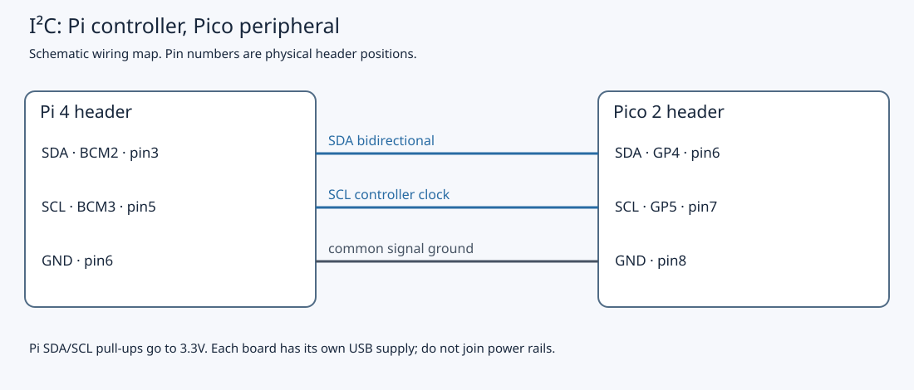

# 6.1 — I²C on the wires

I²C lets one controller exchange bytes with addressed devices over two shared signal wires. Our Pi 4 will be the **controller**, starting each transfer and supplying its clock. The Pico 2 will be a **target** at address `0x42`, behaving like a small sensor with readable and writable registers.

This page prepares the wiring and Linux interface. [6.2](6.2-turn-the-pico-into-a-register-based-peripheral.md) installs the target firmware; [6.3](6.3-write-a-linux-i-c-client.md) makes the first transfer. Keep that order: the button firmware from Chapter 4 is not an I²C target. No firmware build or bus transfer is needed here.

Start after [5.3](5.3-establish-gpio-identity-and-ownership.md), with SSH working and the Pi header unwired. Keep the Pico's GP16 LED and GP17 button circuit intact. You need three suitable jumper wires, the Pi's USB-C supply, and the Pico's USB data cable to the Mac. Leave the Debug Probe disconnected, including its UART connector marked **U**. No analyser or external sensor is required. The wiring and commands below are source-reviewed; no physical bus voltage or transfer was measured during authoring.

## A wire can be released

An ordinary push-pull output drives both high and low. An I²C **open-drain** output instead pulls its line low or releases it. A pull-up resistor raises a released line towards 3.3 V. If either participant pulls low, the shared line is low; it becomes high only when every participant releases it. This permits the Pi and Pico to take turns transmitting on **SDA**, the data line, without connecting a driven high output to a driven low output.

**SCL** is the clock line. The controller normally creates its pulses, but a target can delay progress by keeping SCL low: **clock stretching**. The [RP2350 I²C peripheral](https://datasheets.raspberrypi.com/rp2350/rp2350-datasheet.pdf) supports stretching in target mode. That does not guarantee that every controller handles every stretching pattern correctly. The Pico hardware holds SCL low while software supplies a requested read byte (datasheet §12.2.10.1.2), so stretching is part of our design even with a short callback. Pi 4 retains older controllers with a stretching defect; its newer **BSC3 / I²C3** can use the same BCM2/BCM3 pins. We select that controller below, following [a Raspberry Pi engineer’s correction about the newer controllers](https://github.com/raspberrypi/linux/issues/4884#issuecomment-1038929049). Keep callbacks bounded and avoid debugger halts during transfers. This configuration is source-reviewed, not physically validated here.

Both lines should be high while an otherwise healthy, powered bus is idle. The Pi header already has fixed **1.8 kΩ pull-ups to 3.3 V** on SDA and SCL; these are board components, distinct from software-selectable internal pulls. Do not add another pair for this two-board circuit. The upcoming `i2c_target.cpp` explicitly disables Pico internal pulls on GP4/GP5. See the [official Pi header specification](https://www.raspberrypi.com/documentation/computers/raspberry-pi.html#gpio-pin-inputs-outputs-and-communication-protocols).

Released lines do not rise instantly. Wiring and input pins have capacitance, which the pull-up charges. Longer jumpers and more attached devices increase that capacitance and slow the rising edge. A stronger pull-up speeds the rise but increases the current a device must sink while low. Keep this bench bus short and start at **100 kHz**, the explicit controller rate selected below and the nominal rate used by the example. A target's `i2c_init(i2c0, 100000)` does not set the Pi's clock: the controller determines transfer speed. The [official overlay reference for the book’s kernel baseline](https://github.com/raspberrypi/linux/blob/ae161617d7a4552fa91d03626b8d9f3696d17481/arch/arm/boot/dts/overlays/README) documents I²C3’s pin selection and `baudrate` parameter.

## How a transfer is delimited

During ordinary data bits, SDA stays stable while SCL is high and changes during the low portion. Two deliberate exceptions delimit communication: SDA falling while SCL is high is **START**; SDA rising while SCL is high is **STOP**. A repeated START begins another address phase without an intervening STOP.

Bytes travel most-significant bit first. After each eight-bit byte, the transmitter releases SDA for a ninth clock. The receiver pulls SDA low to **ACK**, or leaves it high to **NACK**. A target ACKs a received address or write byte; during reads, the controller ACKs bytes it wants to continue receiving and NACKs the final byte. That last NACK is normal termination, not an error. An address NACK can mean no powered, correctly configured device answered; it does not identify the cause. These conventions are specified in [NXP UM10204, sections 3.1.3–3.1.8](https://www.nxp.com/docs/en/user-guide/UM10204.pdf).

The address is seven bits. For our `0x42`, the first byte on the wire is `(0x42 << 1) | direction`: **`0x84` for write** and **`0x85` for read**. Linux and the Pico SDK take the unshifted address `0x42`. An analyser may display either the seven-bit address plus direction or the raw byte; check its display convention before diagnosing an address mismatch.

## A register is a device convention

I²C defines byte transport, not the meaning of a byte. Our target firmware will interpret the first write byte as a **register pointer**, an index into a 16-byte device image. These are protocol registers implemented in Pico RAM, not RP2350 peripheral addresses or pointers into another process.

| Register index | Meaning in our upcoming device |
| --- | --- |
| `0`, `1` | Identity `0x42`, protocol version `1` |
| `2` | LED state; write `0` or `1` to request a change |
| `4`–`7` | Unsigned 32-bit accepted button-press count, least-significant byte first |
| `8`–`11` | Signed 32-bit approximate chip temperature in thousandths of a degree Celsius, least-significant byte first |

For the later client's 16-byte read, the intended sequence is:

```text
START → 0x42 write → pointer 0 → repeated START → 0x42 read
      → 16 data bytes (controller ACKs first 15, NACKs last) → STOP
```

This is a protocol sketch, not a captured trace. Each address/write byte also has its target ACK clock. A repeated START keeps pointer selection and reading together in one combined transaction. It does not itself freeze changing data. Our firmware separately copies the published register image when serving the first read byte and keeps that snapshot for the read, so a four-byte counter cannot combine bytes from different updates. Chapter 6.2 explains the implementation; 6.3 uses Linux `I2C_RDWR` to issue the combined transaction.

## Configure the Pi before connecting wires

1. On the **Pi**, working directory `~`, inspect the configuration and existing ownership before enabling anything:

```sh
cd ~
grep -nE 'i2c|dtoverlay' /boot/firmware/config.txt
ls /sys/bus/i2c/devices
```

No matching lines, or an absent I²C sysfs directory before enabling the interface, can be normal. Record whether I²C was already enabled. An existing HAT, sensor service, custom overlay or GPIO program may already use BCM2/BCM3. Stop your own conflicting programs and establish what any existing configuration does before changing it. GPIO ownership tools from 5.3 help identify pin multiplexing, but an unrequested GPIO line does not prove its alternate-function bus is unused. Do not remove an unfamiliar kernel driver or force access to an address it owns. This lab uses only the bare Pi and Pico.

2. On the **Pi**, from `~`, save a uniquely named configuration backup, then edit the active boot file:

```sh
sudo cp -a /boot/firmware/config.txt "/boot/firmware/config.txt.hfs-i2c-$(date +%Y%m%d-%H%M%S).bak"
sudo nano /boot/firmware/config.txt
```

Record the backup name and the exact lines you change. Preserve unrelated settings. Inspect active `include` files and conditional sections too. Comment out enabled `dtparam=i2c_arm=on`, `dtparam=i2c=on` or `dtparam=i2c1=on` settings, including equivalent combined parameter lines, that would enable the older controller on BCM2/BCM3. Resolve any other overlay using those pins first; do not enable two controllers on the same wires. If an existing device needs that configuration, defer this lab until it can be disconnected and its configuration changed deliberately.

Under an existing final `[all]` section, or a new `[all]` section at the end, add the following **configuration lines**:

```text
[all]
dtparam=i2c_arm=off
dtoverlay=i2c3,pins_2_3,baudrate=100000
```

Use only one copy of the overlay. If the existing final section is already `[all]`, omit the duplicate section heading. This selects I²C3 on BCM2/BCM3 at 100 kHz; the wires and fixed board pull-ups stay the same. The usual `raspi-config` I²C switch enables the older ARM-side bus and is insufficient for this controller selection. The [official I²C3 overlay reference](https://github.com/raspberrypi/linux/blob/ae161617d7a4552fa91d03626b8d9f3696d17481/arch/arm/boot/dts/overlays/README) supplies these exact parameters. Save in nano with **Ctrl-O**, **Enter**, then exit with **Ctrl-X**.

The `i2c-dev` module exposes adapters as character devices. On the **Pi**, from `~`, inspect whether it is already configured to load at boot:

```sh
grep -nE '^[[:space:]]*i2c[-_]dev([[:space:]]|$)' /etc/modules /etc/modules-load.d/*.conf
```

If there is no active entry, create a dedicated file using this **Pi** command. It refuses to overwrite an existing file; if the file already exists, inspect it instead.

```sh
sudo sh -c 'set -C; printf "i2c-dev\n" > /etc/modules-load.d/hfs-i2c-dev.conf'
```

Remember whether you created that file. Then, on the **Pi**, from `~`:

```sh
sudo modprobe i2c-dev
sudo reboot
```

SSH disconnects; reconnect using 5.1's method. Leave the Pico unplugged throughout configuration. Reboot applies the controller and pin-multiplexing selection; `modprobe` alone does not apply a boot overlay.

3. On the **Pi**, from `~`, inspect the resulting adapter without sending any bus messages:

```sh
cd ~
cat /sys/class/i2c-dev/i2c-3/name
readlink -f /sys/class/i2c-dev/i2c-3/device
ls -l /dev/i2c-3
id -nG
test -r /dev/i2c-3 && test -w /dev/i2c-3 && echo 'Adapter permissions ready'
ls -l /sys/bus/i2c/devices/3-*
```

With this Pi 4 overlay, expect `/dev/i2c-3`. Match its sysfs name and resolved device path to I²C3, rather than trusting the suffix alone. The next commands expose its Device Tree identity:

```sh
tr -d '\000' < /proc/device-tree/aliases/i2c3
printf '\n'
readlink -f /sys/class/i2c-dev/i2c-3/device/of_node
```

The [Pi 4 Device Tree](https://github.com/raspberrypi/linux/blob/ae161617d7a4552fa91d03626b8d9f3696d17481/arch/arm/boot/dts/broadcom/bcm2711-rpi-ds.dtsi) supplies the `i2c3` alias. It gives a Device Tree path, and `of_node` should resolve to that same controller under `/sys/firmware/devicetree/base`. On Pi 4, BSC3 is the controller at `7e205600`; the path may include a parent prefix. If identity disagrees, stop and resolve configuration before wiring. Enabling a different bus merely to obtain a device node would not establish the intended routing.

The final glob in step 3 lists registered devices on bus 3; a “No such file” result is expected when none are registered. Entries such as `3-0042` indicate a registered device at address `0x42`; investigate its `name` and `driver` link before proceeding. Absence of entries does not prove that no userspace service uses the bus. Linux explains adapter identity and `i2c-dev` in its [userspace interface documentation](https://www.kernel.org/doc/html/latest/i2c/dev-interface.html).

The permission message checks your current account's access, not the Pico. Raspberry Pi OS normally grants this through group `i2c`. If the node is owned by `root:i2c` with group read/write permission but `id -nG` lacks `i2c`, run `sudo usermod -aG i2c "$USER"` on the **Pi**, disconnect SSH and reconnect, then repeat the checks. Do not make the device world-writable. If the node is missing, see troubleshooting below.

Do not run an address scan or the I²C client yet. `i2cdetect` without its list-only mode probes devices with real transactions; it is not a passive wiring test. We have not installed the target firmware.

## Wire with both boards off

4. On the **Pi**, from any directory, run `sudo poweroff`. Wait for shutdown to finish, then unplug its USB-C supply. Ensure the Pico and Debug Probe are unplugged too. Linux shutdown alone does not remove header power.
5. Find physical pin 1 using [the Pi orientation drawing](0.3-a-labelled-tour-of-your-raspberry-pi-4.md#orient-the-board) and [the Pico header drawing](0.2-a-labelled-tour-of-your-pico-2.md). The Pi's odd-numbered pins form one row; Pico header numbering runs around its board. **Pico GP4 is physical pin 6**, whereas **Pi physical pin 6 is ground**. Count on each board separately.
6. Fit precisely these three jumpers, checking the destination at both ends of each wire:

| Signal | Pi 4 header | Pico 2 header |
| --- | --- | --- |
| SDA | BCM2, physical **3** | GP4 / I2C0 SDA, physical **6** |
| SCL | BCM3, physical **5** | GP5 / I2C0 SCL, physical **7** |
| Ground reference | GND, physical **6** | GND, physical **8** |



The drawing is a connection map, not a physical placement diagram. SDA connects to SDA, SCL to SCL. Ground gives both receivers the same voltage reference. **Do not join any Pi 3V3/5V pin to Pico 3V3, VBUS or VSYS.** The Pi receives its own USB-C supply; the Pico receives USB power from the Mac. Keep both unpowered until all three wires have been checked. Both use 3.3 V signalling; the Pi GPIO pins are not 5 V tolerant.

The retained Pico circuit stays GP16 physical 21 → 1 kΩ → LED anode, LED cathode → GND physical 23; GP17 physical 22 → button → GND physical 23, with 4.7 kΩ from GP17 to Pico 3V3(OUT) physical 36. That local Pico pull-up is for the button, not SDA/SCL. Pi BCM17 and BCM27 remain unwired. Probe **U** remains empty.

## Check the resting state and continue

7. After the unpowered inspection, reconnect Pico USB to the Mac and Pi USB-C power to its supply. Reconnect SSH and repeat step 3. Do not request an I²C transfer. The old Pico program may still react to its button; that is not proof of bus readiness.

With the known Chapter 4 firmware leaving GP4/GP5 unused, the expected bus state is SDA and SCL released high. Without instruments, record **wiring inspected, adapter ready; electrical idle not measured**. If you already have a suitable meter, an optional voltage check is approximately 3.3 V from each line to common ground. A high idle voltage proves neither address decoding nor successful transfers. An optional analyser can inspect digital idle and, after 6.2, the 6.3 transfer; [Appendix D](appendix-d.md) covers that accessory. No ACK capture is claimed here.

| Symptom | Check and correction |
| --- | --- |
| `/dev/i2c-3` absent | Confirm this is the Pi SSH shell and that the I²C3 overlay/reboot completed. Inspect `/sys/class/i2c-dev`, the Device Tree alias and boot configuration. On the Pi, `sudo modprobe i2c-dev` can load the userspace interface for the current boot; if still absent, inspect `sudo dmesg` and the boot configuration instead of guessing another bus. |
| Permission check prints nothing | Inspect node ownership and current login groups. Apply the conditional group fix above and start a fresh SSH login. |
| Either line stays low, if measured | Disconnect both supplies before inspection. Check a short to ground, swapped wires, incorrect physical pin counting, and unexpected firmware driving GP4/GP5. Verify both boards are powered during measurement; a connected unpowered board can disturb the bus. Do not try to repair this by driving a push-pull high. |
| Intermittent failures later | Recheck the common ground, short jumpers, pin mux and 100 kHz configuration. Extra pull-ups change sink current; missing pull-ups or excessive capacitance impair rising edges. A logic decoder alone cannot establish analogue rise-time quality. |
| An address NACK after 6.2 | Verify the actual flashed target and seven-bit `0x42`, then power, SDA/SCL and bus identity. A scan while button firmware is loaded cannot establish target readiness. |

Leave the three verified wires in place and the Pi interface enabled for the next lesson. Before changing wiring or disconnecting just one board for programming, shut down the Pi, remove **both** boards' power, and follow 6.2's programming sequence. Chapter 6.2 replaces the old firmware; only then does 6.3 run the client. If abandoning the lab, power both off before removing all three jumpers. On the **Pi**, undo only this lesson’s configuration edits: remove the I²C3 overlay and added disable line, restore any original lines you commented, and remove `/etc/modules-load.d/hfs-i2c-dev.conf` only if you created it here. Reboot after saving. Use the backup to compare original settings, rather than overwriting changes made since the backup. Preserve configurations that predated this exercise.

## References

- [NXP UM10204](https://www.nxp.com/docs/en/user-guide/UM10204.pdf) — electrical signalling, byte acknowledgement and transfer boundaries.
- [Raspberry Pi header documentation](https://www.raspberrypi.com/documentation/computers/raspberry-pi.html#gpio-pin-inputs-outputs-and-communication-protocols) — physical pins, fixed pull-ups and voltage limits.
- [RP2350 datasheet](https://datasheets.raspberrypi.com/rp2350/rp2350-datasheet.pdf) — GPIO function selection and the hardware I²C peripheral.
- [Linux I²C userspace interface](https://www.kernel.org/doc/html/latest/i2c/dev-interface.html) — adapter discovery and device nodes.
