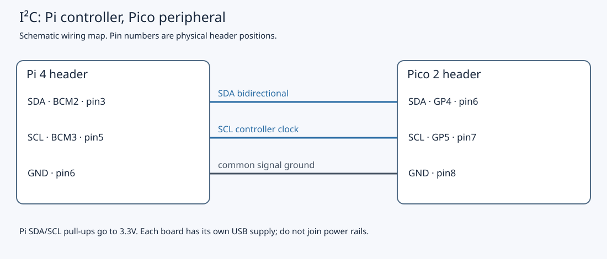
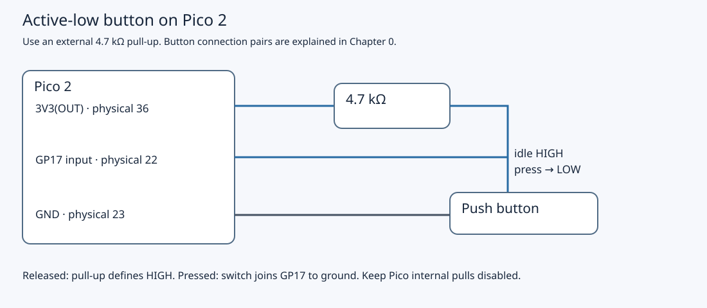

# 6.2 — Turn the Pico into a register-based peripheral

The Pico will now answer at I²C address `0x42`, exposing its LED, accepted button-press count and approximate chip temperature as a small register interface. This page builds and installs that firmware. [6.3](6.3-write-a-linux-i-c-client.md) supplies the Pi client and checks real reads and LED changes; do not send transfers or run an address scan yet.

Start with [6.1's wiring and Pi configuration](6.1-i-c-on-the-wires.md) checked. Use the non-wireless Pico 2, existing GP16 LED/GP17 button circuit, Mac USB data cable and separately powered Pi 4. Leave the Debug Probe disconnected. Source review and the recorded Pico 2 compilation support this example; physical operation has **not been exercised** during authoring.

## The register interface is software

An I²C address selects a device. A register index selects a byte *within our device's protocol*. These indices are offsets in a 16-byte RAM image, unlike Chapter 2's MMIO addresses that select RP2350 hardware registers. The I²C peripheral moves wire bytes through small hardware queues, called FIFOs; our callback gives those bytes their meaning. This follows the pattern of the [official memory-target example](https://github.com/raspberrypi/pico-examples/blob/master/i2c/slave_mem_i2c/slave_mem_i2c.c), with explicit read snapshots and restricted writes.

| Byte index | Read meaning | Write meaning |
| --- | --- | --- |
| `0` | Identity `0x42` | Ignored |
| `1` | Protocol version `1` | Ignored |
| `2` | Applied LED state, `0` or `1` | Request LED off/on with `0`/`1`; other values ignored |
| `3`, `12`–`15` | Reserved, currently zero | Ignored |
| `4`–`7` | Unsigned 32-bit accepted press total | Ignored |
| `8`–`11` | Signed 32-bit approximate chip temperature, milli-°C | Ignored |

Multi-byte values are **little endian**: the lowest index contains the least-significant byte. For illustration, count `258` is `02 01 00 00`; these are example bytes, not a captured read. Temperature `25000` represents `25.000 °C`. The milli-degree unit encodes a number conveniently; it does not promise milli-degree accuracy. Count and LED state reset when the firmware restarts; the unsigned count eventually wraps.

The first byte of each write sets `register_cursor = byte & 15`. Subsequent write bytes address the cursor, then advance it modulo 16, even for ignored writes. Reads also advance modulo 16. A read without a preceding pointer write starts at the retained cursor; the client will always select its pointer explicitly. A pointer value outside `0`–`15` wraps rather than producing an error. These choices belong to this protocol, not to I²C generally.

For example, the later client writes the two bytes `02 01` to request LED on. To read the complete image it writes pointer `00`, issues repeated START, reads 16 bytes and sends STOP. An ACK confirms acceptance of a wire byte; ignored writes can still be ACKed. It does not prove that the main loop has applied the LED request or that the physical LED lights. Register `2` reports software's applied state; observing the LED separately checks the circuit.

## Preserve the physical circuit

For programming below, disconnect the three inter-board jumpers while **both boards are unpowered**, then reconnect them only after programming with both off again. The final wiring remains:

| Connection | Pi 4 | Pico 2 |
| --- | --- | --- |
| SDA | BCM2, physical **3** | GP4 / I2C0 SDA, physical **6** |
| SCL | BCM3, physical **5** | GP5 / I2C0 SCL, physical **7** |
| Ground | GND, physical **6** | GND, physical **8** |
| External LED | No connection | GP16, physical **21** → **1 kΩ** → LED anode; cathode → GND, physical **23** |
| Active-low button | No connection | GP17, physical **22** → switch → GND, physical **23**; **4.7 kΩ** from GP17 to 3V3(OUT), physical **36** |





Keep the breadboard orientation from Chapter 4: the four-leg button straddles the centre gap, and the signal/ground wires use opposite internally connected contact pairs ([button contact drawing](0.5-recognise-the-breadboard-and-kit-components.md)). The [LED circuit drawing](assets/circuit-pico-led.svg) shows its polarity. Pi BCM17/27 stay unwired. Join no Pi/Pico power rails. The Pi's fixed 1.8 kΩ SDA/SCL pull-ups supply the bus high level; the target disables its internal GP4/GP5 pulls. The button's local pull-up is a separate circuit. See [6.1](6.1-i-c-on-the-wires.md#a-wire-can-be-released) for the source-checked electrical arrangement.

## 1. Read and build the complete firmware

Use your Mac example checkout or archive extraction from Chapter 1. Commands assume `~/hardware-from-software`; substitute your own extraction root if different. The target is `examples/pico/i2c_target.cpp`:

```cpp
{{#include ../examples/pico/i2c_target.cpp}}
```

Its complete shared helper, `examples/pico/device_io.hpp`, is part of the project too:

```cpp
{{#include ../examples/pico/device_io.hpp}}
```

`Device` polls the active-low button. A candidate level must remain unchanged for at least **20 ms** before becoming the stable level; only an accepted transition to low increments `presses`. This is sampled debounce, so a press too short to satisfy that interval can be missed. Unlike the earlier button demonstration, pressing does **not** toggle the LED locally. The I²C command controls it.

The ADC converts an analogue voltage to a numeric sample. For Pico 2's RP2350A, input `4` is the internal temperature sensor. `temperature()` uses the SDK's approximate conversion formula with nominal **3.3 V** reference, then truncates to signed milli-°C. Actual reference voltage, sensor variation and chip heating affect the result. It measures approximate **chip temperature**, not calibrated ambient temperature. The [SDK ADC documentation](https://www.raspberrypi.com/documentation/pico-sdk/hardware.html#group_hardware_adc) documents the channel and formula; [RP2350 datasheet §12.4.6](https://datasheets.raspberrypi.com/rp2350/rp2350-datasheet.pdf) explains the temperature sensor and its limitations.

**Mac — Terminal, working directory `~/hardware-from-software`:**

```sh
cd ~/hardware-from-software
python3 scripts/setup_deps.py
python3 scripts/build_examples.py --pico
ls -l .build/pico/i2c_target.uf2 .build/pico/i2c_target.elf
```

The existing shared CMake project links `pico_i2c_slave`, the hardware libraries and SDK startup. The script selects `pico2`, `rp2350-arm-s`, SDK **2.3.1** and a Debug build. This is a standalone firmware target; do not append it to the button program. The **UF2** programs flash; retain the **ELF** for source/debug information. The project's compilation evidence is recorded in `verification.json`; it does not establish wire timing or successful board execution.

## Why the callback has three events

The [SDK target API](https://github.com/raspberrypi/pico-sdk/blob/079c6f39023649b154152db30f1d781e884879bc/src/rp2_common/pico_i2c_slave/include/pico/i2c_slave.h) runs `on_i2c` in the I²C interrupt handler on the initialising core. `RECEIVE` consumes one available byte. The first selects the pointer; later bytes may set `requested_led_state` and `led_update_pending`. `REQUEST` supplies one byte to the controller, taking the snapshot on its first invocation. `FINISH` clears `has_register_pointer` and `snapshot_captured`, preparing a new write phase and new read snapshot, while deliberately preserving `register_cursor`.

That last detail makes pointer-write/repeated-START/read work. In the [pinned SDK handler](https://github.com/raspberrypi/pico-sdk/blob/079c6f39023649b154152db30f1d781e884879bc/src/rp2_common/pico_i2c_slave/i2c_slave.c), START, STOP or transmit-abort detection causes `FINISH` if a transfer was in progress, before dispatching RECEIVE/REQUEST work from that interrupt. Thus a repeated START may finish the pointer-write phase. Resetting `register_cursor` there would discard the selected register. With this implementation, pointer `4` survives that boundary, and the following read starts at byte `4` of a fresh snapshot.

There are **two coherence boundaries**. Main constructs `next_registers`, including the ADC sample, with interrupts enabled. Only main writes `published_registers`, so copying it to `next_registers` cannot race with another writer. Main then briefly disables interrupts while consuming the LED request and replacing `published_registers`. The callback cannot copy a half-published image. Separately, the first read request copies that complete image into `read_snapshot`; later read requests reuse it, even if main publishes newer samples between bytes. A counter changing from `255` to `256` therefore cannot produce mixed bytes from those versions. This is a coherent published record, not a claim that button sampling and ADC conversion occurred at the identical instant. Repeated START alone supplies no such coherence.

This handoff assumes the book's **single application core**. IRQ masking excludes this core's callback; `volatile` alone would not protect the array or implement the handoff. The callback uses bounded byte operations and one 16-byte copy. ADC conversion, sleeping and LED application remain in main. Multiple LED writes before main runs coalesce to the latest request; there is no command queue or application-level completion reply.

The SDK enables target clock stretching while transmit data is needed and while its receive FIFO is full. A fast callback reduces delay but does not remove stretching. Keep the Pi 4 on **I²C3/BSC3** as configured in 6.1, using `dtoverlay=i2c3,pins_2_3,baudrate=100000`, with conflicting I²C1 routing disabled. [Raspberry Pi's controller correction](https://github.com/raspberrypi/linux/issues/4884#issuecomment-1038929049) explains the older controller's defect. Do not halt the Pico in GDB during a Pi transfer: an unserviced callback can leave the controller waiting or timing out. No interrupt-latency measurement is claimed here.

## 2. Program the Pico by itself

1. **Pi — SSH shell, any directory:** run `sudo poweroff`. Wait for shutdown completion as described in [5.1](5.1-prepare-raspberry-pi-os-and-ssh.md#leave-a-known-state), then unplug Pi USB-C power. Unplug Pico USB too. With **both unpowered**, remove all three Pi–Pico jumpers. Leave the local Pico LED/button circuit intact.
2. Hold the Pico's **BOOTSEL** button, connect only Pico USB to the Mac, and release BOOTSEL after the **RP2350** volume appears. The Pi remains disconnected from power and from the Pico. Check the volume and copy this target's UF2.

**Mac — Terminal, working directory `~/hardware-from-software`:**

```sh
cd ~/hardware-from-software
ls /Volumes/RP2350
cp .build/pico/i2c_target.uf2 /Volumes/RP2350/
```

3. Let the copy finish and the volume disappear as the loader restarts the Pico ([official UF2 procedure](https://www.raspberrypi.com/documentation/microcontrollers/c_sdk.html#your-first-binaries)). Unplug Pico USB again. While **both boards remain unpowered**, reconnect the three jumpers from the table and inspect each endpoint. Then power Pico from Mac USB and Pi from its own USB-C supply. Leave the probe disconnected and the firmware free-running.

This prevents separately powered bus lines from remaining connected to an unpowered board during programming. Repeat the same disconnect/program/reconnect sequence for any later reflash.

## 3. Check readiness without sending bytes

The expected initial LED is off. Button presses should no longer toggle it. The program has no `stdio_init_all()` and no printing, so do not look for a USB serial greeting or diagnose silence as a failure. The BOOTSEL volume disappearing establishes a loader transition, not target identity. The actual `0x42` identity read comes in 6.3.

Reconnect SSH. **Pi — working directory `~`:** repeat the passive adapter checks:

```sh
cd ~
cat /sys/class/i2c-dev/i2c-3/name
tr -d '\000' < /proc/device-tree/aliases/i2c3
printf '\n'
readlink -f /sys/class/i2c-dev/i2c-3/device/of_node
ls -l /dev/i2c-3
test -r /dev/i2c-3 && test -w /dev/i2c-3 && echo 'Adapter permissions ready'
```

Match the Device Tree alias to the resolved node as in 6.1: I²C3 is the Pi 4 controller at `7e205600`. A node named `/dev/i2c-3` alone is insufficient identity evidence. Expected idle SDA/SCL is released high; without instruments, record wiring inspected and adapter ready, **electrical idle unmeasured**. None of these checks sends a target request or proves an ACK.

| Symptom | Check and correction |
| --- | --- |
| Build fails or target files are absent | Confirm the Mac working directory and successful setup step; inspect the first compiler/configuration error. Keep both `i2c_target.cpp` and `device_io.hpp` in `examples/pico`. |
| No RP2350 volume, or UF2 copy fails | Use the hold-before-connect BOOTSEL sequence with the bus jumpers detached and a known data cable; follow [1.3](1.3-flash-with-bootsel-and-read-output.md#diagnose-the-observed-symptom). |
| LED still toggles on a button press or old USB logs appear | Suspect the earlier firmware. Recheck the UF2 filename and repeat the complete powered-down programming sequence. |
| LED off and no USB messages | Expected for this idle program; proceed to the identity/readback test in 6.3. Do not infer success solely from silence. |
| Adapter absent or identity differs | Return to 6.1's overlay, reboot and identity checks; do not substitute an arbitrary adapter. |
| Bus line measured low while idle | Remove both supplies before inspecting shorts, physical pin counts and SDA/SCL routing. Confirm both boards were powered during measurement. |
| Later read is inconsistent, or LED appears unchanged | Use 6.3's identity, full-snapshot and applied-state checks. Check the intended firmware and client before blaming sensor accuracy or replacing pull-ups. |

Leave the target running, all three verified jumpers attached, and Pi I²C3 ready for [6.3 — Write a Linux I²C client](6.3-write-a-linux-i-c-client.md). To pack away instead, shut down Pi, remove **both** supplies, then remove the three bus jumpers. Keep the local Pico circuit assembled and the build artifacts. Restore Pi configuration only if abandoning the bus exercise, following 6.1's recorded-edit cleanup.

## References

- [SDK 2.3.1 target API](https://github.com/raspberrypi/pico-sdk/blob/079c6f39023649b154152db30f1d781e884879bc/src/rp2_common/pico_i2c_slave/include/pico/i2c_slave.h) — events and interrupt-context callback contract.
- [SDK 2.3.1 target implementation](https://github.com/raspberrypi/pico-sdk/blob/079c6f39023649b154152db30f1d781e884879bc/src/rp2_common/pico_i2c_slave/i2c_slave.c) — FINISH ordering and clock stretching.
- [SDK ADC API](https://www.raspberrypi.com/documentation/pico-sdk/hardware.html#group_hardware_adc) — sensor channel and approximate conversion.
- [RP2350 datasheet](https://datasheets.raspberrypi.com/rp2350/rp2350-datasheet.pdf) — I²C target operation (§12.2) and chip temperature sensing (§12.4.6).
