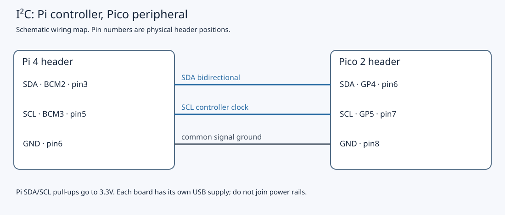

# 6.3 — Write a Linux I²C client

The Pi will now read the Pico's 16-byte register image and request an LED change. This is the first bus transfer in the chapter. Complete [6.1's controller setup](6.1-i-c-on-the-wires.md) and [6.2's target programming](6.2-turn-the-pico-into-a-register-based-peripheral.md) first: the earlier button firmware cannot answer this client.

Use the non-wireless Pico 2 running `i2c_target`, free-running without GDB, and the separately powered Pi 4 with SSH working. Leave the Debug Probe disconnected. The example has compilation evidence recorded in `verification.json`, including native Arm64 Linux CI; that runner is not a Pi. No physical I²C transfer, LED change or temperature measurement was exercised during authoring. The observations below are checks for your bench.

## Keep the established circuit

The bus uses **Pi I²C3/BSC3**, although its wires are still on BCM2/BCM3. In 6.1 you disabled conflicting I²C1 routing and selected `dtoverlay=i2c3,pins_2_3,baudrate=100000`. The newer controller avoids the older BSC0/1 clock-stretching defect; the SDK target needs stretching while supplying bytes. See [Raspberry Pi's controller correction](https://github.com/raspberrypi/linux/issues/4884#issuecomment-1038929049) and the [frozen overlay reference](https://github.com/raspberrypi/linux/blob/ae161617d7a4552fa91d03626b8d9f3696d17481/arch/arm/boot/dts/overlays/README). Do not switch back to I²C1 to follow another tutorial.

| Connection | Pi 4 | Pico 2 |
| --- | --- | --- |
| SDA | BCM2, physical **3** | GP4 / I2C0 SDA, physical **6** |
| SCL | BCM3, physical **5** | GP5 / I2C0 SCL, physical **7** |
| Ground | GND, physical **6** | GND, physical **8** |
| External LED | No connection | GP16, physical **21** → **1 kΩ** → LED anode; cathode → GND, physical **23** |
| Button | No connection | GP17, physical **22** → switch → GND, physical **23**; **4.7 kΩ** pull-up to Pico 3V3(OUT), physical **36** |



The Pi's fixed SDA/SCL pull-ups are sufficient for this short two-board bus; the Pico firmware disables its internal bus pulls. Both use 3.3 V signalling. Keep Pico USB connected to the Mac and Pi USB-C connected to its own supply, with **no power-rail connection** between them. See [Pi header documentation](https://www.raspberrypi.com/documentation/computers/raspberry-pi.html#gpio-pin-inputs-outputs-and-communication-protocols). If any wire needs moving, shut down the Pi, unplug both supplies, change and inspect the wiring, then power both boards again. Follow 6.2's detached-bus sequence for reflashing.

## 1. Confirm which adapter you will open

**Pi — SSH shell, working directory `~`:**

```sh
cd ~
cat /sys/class/i2c-dev/i2c-3/name
tr -d '\000' < /proc/device-tree/aliases/i2c3
printf '\n'
readlink -f /sys/class/i2c-dev/i2c-3/device/of_node
ls -l /dev/i2c-3
id -nG
test -r /dev/i2c-3 && test -w /dev/i2c-3 && echo 'Adapter permissions ready'
ls -l /sys/bus/i2c/devices/3-*
```

As in 6.1, match the alias path to the resolved `of_node` path under `/sys/firmware/devicetree/base`: Pi 4 I²C3 is the controller at `7e205600`. A numbered device node alone is insufficient. Linux's [userspace interface documentation](https://www.kernel.org/doc/html/latest/i2c/dev-interface.html) explains sysfs adapter discovery and `i2c-dev` character devices.

Proceed only with the known bare-board setup and no conflicting userspace service or kernel device. A `3-0042` entry needs investigation through its `name` and `driver` link; an unmatched glob can simply mean no devices are registered. The client does not claim exclusive ownership of the target. In particular, do not use combined transfers to bypass a driver-owned address. Do not scan, force access or send experimental writes to diagnose ownership.

If permissions fail, use 6.1's conditional `i2c` group fix and reconnect SSH; avoid running the client as root merely to hide the problem. If adapter identity differs, return to 6.1's configuration and reboot checks before sending anything.

## 2. Build the complete client

Use the example checkout or source archive on the **Pi**, at `~/hardware-from-software` as established in Chapter 5. The application is `examples/linux/i2c_client.cpp`:

```cpp
{{#include ../examples/linux/i2c_client.cpp}}
```

**Pi — SSH shell, working directory `~/hardware-from-software`:**

```sh
cd ~/hardware-from-software
mkdir -p .build
g++ -std=c++20 -Wall -Wextra -Wpedantic -O2 examples/linux/i2c_client.cpp -o .build/i2c_client
```

This builds a Linux executable for the Pi, not a Pico UF2. It needs the compiler and Linux userspace headers from 5.2; no Pico SDK or SMBus helper library is involved.

`open` obtains an adapter descriptor with read/write access; `O_CLOEXEC` prevents inheritance across a later successful `exec`. Opening does not select or contact the Pico. `I2C_FUNCS` queries the adapter capability mask; the program requires `I2C_FUNC_I2C` before attempting the combined transaction. This check establishes interface support, not correct wiring or target identity.

## One ioctl describes the whole read

`i2c_msg` is a Linux userspace ABI structure with an address, flags, byte length and buffer pointer. Our first message writes one byte, pointer `0`; the second reads **16 bytes**, with `I2C_M_RD` selecting direction. Both carry the seven-bit address **`0x42`**. Pass neither `0x84` nor `0x85`: those are the address-plus-direction bytes transmitted on the wire. The [Linux message definition](https://github.com/torvalds/linux/blob/master/include/uapi/linux/i2c.h) specifies these fields and transfer boundaries; [NXP UM10204](https://www.nxp.com/docs/en/user-guide/UM10204.pdf) defines the wire address and acknowledgement conventions.

The following is a protocol sketch, not a measured capture:

```text
START → 0x42 write → pointer 0 → repeated START → 0x42 read
      → 16 bytes → STOP
```

`i2c_rdwr_ioctl_data` points to the message array and sets `nmsgs = 2`. `I2C_RDWR` submits them together, without STOP between pointer selection and reading. Separate `write()` and `read()` calls create separate transfers with a STOP between them; they cannot express this combined operation. The [Linux device interface](https://www.kernel.org/doc/html/latest/i2c/dev-interface.html) documents the distinction. The Pico preserves its cursor across transfer boundaries, but using the combined form also keeps these two messages together against other Linux bus users. The firmware's snapshot mechanism separately prevents multi-byte tearing; repeated START does not freeze the data by itself.

The [kernel implementation](https://github.com/raspberrypi/linux/blob/ae161617d7a4552fa91d03626b8d9f3696d17481/drivers/i2c/i2c-dev.c) copies message descriptors and buffers into kernel storage, performs the transfer synchronously, then copies received data back. Keep `register_address`, `registers`, `messages` and `request` alive and unchanged until `ioctl` returns; their stack lifetimes here satisfy that requirement. Their pointers are user virtual addresses, not addresses placed on SDA. No separate application `I2C_SLAVE` call is needed: each `I2C_RDWR` message supplies its own address. That convenience does not enforce ownership.

The returned success count is **messages**, not bytes: require `2` for the combined read, and `1` for the later write. The read message's length is what requests 16 bytes. A negative result is a system failure; a nonnegative short result is incomplete and must not be decoded as a valid image. The client also rejects the wrong identity or protocol **before** attempting any LED write.

The `read_le32` helper assembles four little-endian bytes with shifts, independent of host byte order or alignment. For temperature, it first obtains the unsigned bit pattern, then subtracts `2^32` in a signed 64-bit value when bit 31 is set. Thus a negative signed milli-°C value is decoded without relying on an out-of-range unsigned-to-`int32_t` cast. This encoding is our device protocol, not an I²C feature.

## 3. Run and separate request from result

With both boards powered, wiring inspected, adapter identity/ownership/permissions checked, and 6.2's firmware installed, run the first transfer.

**Pi — SSH shell, working directory `~/hardware-from-software`:**

```sh
cd ~/hardware-from-software
.build/i2c_client /dev/i2c-3
```

Illustrative output, assuming an initially off LED and no accepted presses:

```text
identity=0x42 protocol=1 led=0 presses=0 chip_milliC=25000
LED update requested; run again to read a fresh snapshot
```

Your count and temperature may differ. The first line is the snapshot **before** this invocation requests a change. The client then writes two bytes: register `2` and the opposite LED state (`1` for that example). The Pico callback records the request; its main loop later applies it and publishes the applied state. The successful ioctl and second line establish transport completion, not immediate application or a lit LED.

Wait for the external LED to change, then run the same command again. Its first line should now show `led=1` after main has applied the previous request. This invocation then requests off again. Each invocation reads first and requests a toggle second; it is not a read-only monitor, and the program contains no immediate readback verification. Register state plus a visible LED change provides stronger evidence than an ACK alone, although even register readback does not prove LED polarity or current.

Press and release the Pico button deliberately between runs. Allow each new level to remain stable for more than **20 ms**, including a full release before the next press. The next snapshot should show an increased `presses` count; holding the button should not continually increment it. This firmware counts accepted presses without locally toggling the LED. Resetting the Pico resets the counter.

`chip_milliC=25000` means approximately 25 °C **inside the chip**. The nominal ADC reference and conversion formula, sensor variation and self-heating limit accuracy; it is not calibrated ambient temperature. See [6.2's ADC explanation](6.2-turn-the-pico-into-a-register-based-peripheral.md#1-read-and-build-the-complete-firmware). A plausible number proves neither calibration nor the actual physical temperature.

## Diagnose the observed failure

A failed `open` captures `errno` before printing. Each failed ioctl captures it immediately and throws `std::system_error` with an operation label; semantic checks instead throw `std::runtime_error`, without interpreting stale `errno`. These include incomplete transfers and an unexpected identity/protocol. A failure after the snapshot line can belong to the LED write; do not treat the printed read as evidence that the write succeeded. The descriptor closes on normal completion and on the caught failure path.

| Symptom | Check and correction |
| --- | --- |
| `open` reports “No such file or directory” (`ENOENT`) | Confirm the Pi shell, I²C3 overlay, `i2c-dev`, reboot and sysfs/Device Tree identity using 6.1. Do not substitute an arbitrary numbered adapter. |
| `open` reports “Permission denied” (`EACCES`) | Check node mode/group and the current SSH login's groups; apply the conditional group fix in 6.1 and reconnect. |
| Adapter lacks combined transfers, or operation is unsupported | Confirm the selected adapter and capability mask; this client requires full I²C, not an SMBus-only interface. Do not replace the transaction with unrelated SMBus calls. |
| Address NACK (`ENXIO`), “Remote I/O error” (`EREMOTEIO`), or other transfer failure | Check the flashed target, unshifted `0x42`, both supplies, ground, SDA/SCL and I²C3 routing. Error mapping depends on the adapter; a message alone does not identify a broken wire. Power both off before inspecting connections. |
| Timeout or intermittent failures | Let the Pico run without debugger halts. Check short wires, common ground, the explicit 100 kHz I²C3 configuration and conflicting programs. Do not add pull-ups or retry writes blindly. |
| Incomplete read/write | Stop and inspect the adapter, target and bus state. The program deliberately rejects the returned count; do not decode a partly updated buffer or assume an LED request was absent. |
| Unexpected identity/protocol | Check the actual UF2 and register map from 6.2, and rule out another target at `0x42`. No LED write follows this rejection. Do not remove the check to obtain apparent success. |
| Readback changes but external LED does not | Inspect GP16, the resistor, polarity and ground with both boards off; register `2` reports software state. |
| Count stays fixed or temperature seems surprising | Check button contact pairs and pull-up, stable press/release intervals, and firmware restart. Treat chip temperature as approximate rather than adjusting calibration to match room temperature. |

Linux's [fault-code reference](https://www.kernel.org/doc/html/latest/i2c/fault-codes.html) explains address NACK, unsupported operations and timeout conventions. Record the failing operation and full diagnostic before changing the setup. Never bypass a busy address, scan for a replacement address or issue unreviewed writes as a repair.

## Leave a known state

The client exits after one read and one request, closing its descriptor; it leaves the last requested LED state in the Pico firmware. Keep the setup intact if repeating the checks. To pack away or move to SPI, shut down the Pi with `sudo poweroff` in its SSH shell, wait for shutdown, unplug **both** supplies, then remove all three bus jumpers. Keep the local Pico LED/button circuit. Follow [6.4](6.4-compare-spi-with-a-loopback-experiment.md) for the different firmware and loopback wiring before powering again.

If abandoning I²C, use [6.1's recorded-edit rollback](6.1-i-c-on-the-wires.md#check-the-resting-state-and-continue): remove only the overlay/disable lines added for this lab, restore the original lines you changed, and remove the dedicated module-load file only if you created it. Reboot after saving. Compare against the backup; do not overwrite later or pre-existing configuration blindly.

## References

- [Linux I²C userspace interface](https://www.kernel.org/doc/html/latest/i2c/dev-interface.html) — discovery, capability query and combined transfers.
- [Linux I²C message ABI](https://github.com/torvalds/linux/blob/master/include/uapi/linux/i2c.h) — message addresses, flags and byte lengths.
- [Pi-baseline i2c-dev implementation](https://github.com/raspberrypi/linux/blob/ae161617d7a4552fa91d03626b8d9f3696d17481/drivers/i2c/i2c-dev.c) — buffer copies and per-message addressing.
- [NXP UM10204](https://www.nxp.com/docs/en/user-guide/UM10204.pdf) — address phases, repeated START and ACK/NACK.
