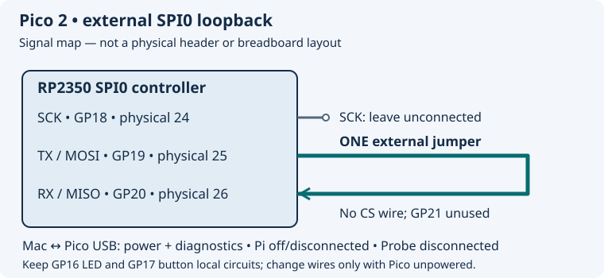

# 6.4 — Compare SPI with a loopback experiment

The Pico will send four known bytes through its SPI0 transmitter and receive them through its SPI0 input. One jumper connects the output back to the input: an **external loopback**. A successful comparison exercises the controller and local wire path without an external sensor or logic analyser.

Start after [6.3](6.3-write-a-linux-i-c-client.md), with the Mac toolchain and USB console procedure from Chapter 1 available. Use the non-wireless Pico 2, its USB data cable and one jumper. Keep the local GP16 LED/GP17 button circuit assembled. The firmware has Pico 2 compilation evidence in `verification.json`; **physical loopback has not been exercised during authoring**. The observations below are predicted checks for your bench.

## Two data paths share a clock

SPI is a synchronous serial interface: the controller supplies **SCK**, the clock that tells both ends when to change and sample bits. **MOSI** means controller-to-peripheral data (historically “master out, slave in”); **MISO** means peripheral-to-controller data. On the Pico controller these are labelled **TX** and **RX**. Each clock moves one bit out and one bit in, simultaneously: **full duplex**. Reading requires transmitting something to generate those clocks, even if the transmitted bytes are only dummy values.

A typical peripheral also needs **CS**, chip select, usually active low. The controller selects one device, clocks its command/data, then releases CS. The device's datasheet specifies which bytes form a transaction, whether CS must stay low across them, and when the peripheral may drive MISO. SPI has no universal address byte or ACK/NACK phase. Receiving a byte does not establish that a device understood a command.

This program uses **8-bit words, most-significant bit first, mode 0**. **CPOL = 0** means SCK rests low; **CPHA = 0** means sample on the first edge, here the rising edge, and change subsequent data on the falling edge. Other modes choose different idle levels and sampling edges. Both participants must agree with the peripheral's specified mode and timing. The [RP2350 datasheet's SPI chapter](https://datasheets.raspberrypi.com/rp2350/rp2350-datasheet.pdf) describes these clock formats; the [pinned SDK format API](https://github.com/raspberrypi/pico-sdk/blob/079c6f39023649b154152db30f1d781e884879bc/src/rp2_common/hardware_spi/include/hardware/spi.h) exposes their selection.

Here the same controller supplies both shifting and sampling timing internally. SCK is configured on GP18 but needs **no external connection**. There is no peripheral to select, so there is **no CS wire**. GP21 is unused. Do not assemble a four-wire peripheral bus for this experiment.

## 1. Replace the inter-board wiring

1. **Pi — SSH shell, any directory:** run `sudo poweroff`. Wait for shutdown to finish, then unplug Pi USB-C power. Unplug Pico USB and leave the Debug Probe disconnected, including its **U** UART connector.
2. With **both boards unpowered**, remove **all three** Pi–Pico I²C jumpers: SDA (Pi physical 3 ↔ Pico physical 6), SCL (Pi physical 5 ↔ Pico physical 7), and ground (Pi physical 6 ↔ Pico physical 8). Leave the Pi off with its GPIO header unwired for this lab. Join no power rails.
3. With Pico power still removed, connect **only GP19 physical 25 to GP20 physical 26**. Count physical pins using [the Pico orientation drawing](0.2-a-labelled-tour-of-your-pico-2.md). These adjacent contacts are on the right header when viewed from above with USB at the top; physical pin 26 is closer to USB than pin 25.

| Pico 2 signal | Physical pin | State in this experiment |
| --- | --- | --- |
| GP18 / SPI0 SCK | **24** | Clock output; leave externally unconnected |
| GP19 / SPI0 TX / MOSI | **25** | One jumper to GP20, physical **26** |
| GP20 / SPI0 RX / MISO | **26** | Receives that same jumper from GP19 |
| GP21 | **27** | Unused; no CS connection |
| GP16 LED | **21** | Retain GP16 → **1 kΩ** → LED anode; cathode → GND **23** |
| GP17 button | **22** | Retain switch to GND **23**, and **4.7 kΩ** pull-up to Pico 3V3(OUT) **36** |



The drawing is a signal map, not a breadboard layout. The [official Pico 2 pinout](https://datasheets.raspberrypi.com/pico/pico-2-datasheet.pdf) supplies the header assignments. No extra ground jumper is needed between two pins on the same board. The local LED/button use different pins; this firmware does not configure them or react to button presses.

SPI TX and SCK are **push-pull** outputs: they actively drive high and low. Connect TX to the input RX only. Shorting two outputs can make one drive high against the other's low. The I²C rule of sharing an open-drain line does not apply to these SPI outputs.

## 2. Build and install the complete program

The standalone target is `examples/pico/spi_loopback.cpp`:

```cpp
{{#include ../examples/pico/spi_loopback.cpp}}
```

**Mac — Terminal, working directory `~/hardware-from-software`:**

```sh
cd ~/hardware-from-software
python3 scripts/setup_deps.py
python3 scripts/build_examples.py --pico
ls -l .build/pico/spi_loopback.uf2 .build/pico/spi_loopback.elf
```

The existing shared CMake project links `hardware_spi` and SDK startup, enables USB stdio and disables UART stdio. The build script selects `pico2`, `rp2350-arm-s` and a Debug build. Use the UF2 for programming; retain the ELF for debugging.

4. Inspect the unpowered jumper endpoints. Hold **BOOTSEL**, connect Pico USB to the Mac, then release BOOTSEL when the **RP2350** volume appears. The Pi remains off and disconnected.

**Mac — Terminal, working directory `~/hardware-from-software`:**

```sh
cd ~/hardware-from-software
ls /Volumes/RP2350
cp .build/pico/spi_loopback.uf2 /Volumes/RP2350/
```

5. Let the copy finish and the volume disappear as the Pico restarts. Leave USB connected. Discover the application's port:

**Mac — Terminal, working directory `~/hardware-from-software`:**

```sh
find /dev -maxdepth 1 -name 'cu.usbmodem*' -print
screen /dev/cu.usbmodemYOUR_SUFFIX 115200
```

Replace the entire placeholder path with the actual one found on your Mac; its suffix can change after reconnecting. If several match, identify the Pico by which path disappears when you disconnect it, then reconnect normally. See [1.3](1.3-flash-with-bootsel-and-read-output.md) for the full BOOTSEL/port-discovery procedure. The terminal's `115200` setting is for USB CDC line coding; it does not set SPI speed or configure a GPIO UART.

Predicted successful output, **illustrative rather than measured**:

```text
GP19->GP20 loopback: pass [00 55 aa ff]
GP19->GP20 loopback: pass [00 55 aa ff]
```

The program requests a one-second sleep between comparisons. Initial lines may be lost before the USB terminal connects; later repetitions are sufficient. Quit `screen` with **Ctrl+A**, release, then **Ctrl+\\**, and confirm **Y** if requested. Closing the terminal does not stop the firmware.

## Follow the bytes through the controller

`spi_init(spi0, 100000)` selects controller mode and requests **100,000 clock cycles per second**. The hardware derives SCK from a peripheral clock using integer dividers. The [SDK implementation](https://github.com/raspberrypi/pico-sdk/blob/079c6f39023649b154152db30f1d781e884879bc/src/rp2_common/hardware_spi/spi.c) returns the achievable rate; this example ignores that return value and does not print or measure the actual clock. Treat 100 kHz as the request. It is a bit-clock rate, not 100,000 bytes per second or the USB print rate.

The three `gpio_set_function` calls route SPI0 to the selected pads. `spi_set_format` explicitly selects the mode-0, eight-bit, MSB-first settings that `spi_init` also uses by default. `spi_write_read_blocking` feeds the transmit FIFO and drains the receive FIFO, completing four outgoing and four incoming bytes together. The [SDK API contract](https://github.com/raspberrypi/pico-sdk/blob/079c6f39023649b154152db30f1d781e884879bc/src/rp2_common/hardware_spi/include/hardware/spi.h) describes that simultaneous transfer.

The patterns test all-low, alternating bits in both phases, and all-high: `00 55 aa ff`. The jumper presents each driven TX level to RX. Array equality checks all four received bytes; the status and brackets report that comparison and received data. Completion alone would not prove a connected input: the controller generates clocks even when nobody answers.

A pass supports correct operation of this local path at this configuration. It does **not** validate an external peripheral's mode, CS timing, command framing, response delay, maximum speed or identity. In particular, local loopback cannot establish that an independently timed device will meet setup/hold requirements, and it does not test external SCK wiring.

## 3. Remove the return path and restore it

6. Quit `screen`, unplug Pico USB, and remove the GP19–GP20 jumper **only while unpowered**. Reconnect USB normally, rediscover the port and reopen `screen`. Do not rebuild or change the program.
7. The controller still transfers four bytes, but GP20 now lacks the intended driven data. Expect comparisons to fail; the exact received bytes are **not specified**. An undriven input can reflect pad state, weak pulls or noise, so do not infer a valid signal from a stable-looking value or one accidental pass.
8. Quit the terminal and unplug Pico power again. Restore the single GP19–GP20 jumper, inspect both endpoints, reconnect USB and repeat the known-pattern check. Sustained passes after restoration are the intended final state.

## Compare the two buses

| Property | Our I²C lab | This SPI controller experiment |
| --- | --- | --- |
| Data paths | Shared SDA; direction changes by phase | Separate TX and RX shift simultaneously |
| Clock owner | Pi controller; Pico may stretch SCL | Pico controller supplies SCK |
| Device selection | Seven-bit address in each address phase | Usually a separate CS per peripheral; none needed for loopback |
| Framing | START/repeated START/STOP and ACK/NACK clocks | Clocked words; device-specific CS and command rules |
| Electrical sharing | Open-drain lines with pull-ups | Push-pull outputs; prevent conflicting drivers |

I²C register pointers were already a device convention; SPI commands and register addresses are likewise defined by each device. Neither bus guarantees meaningful application data merely because bits moved. The optional [BME280 SPI lesson](appendix-c-4.md) adds a real peripheral, its CS and register protocol; it is separate from this no-purchase baseline.

## Diagnose the observed symptom

| Symptom | Check and correction |
| --- | --- |
| No RP2350 volume or USB serial port | Repeat hold-before-connect BOOTSEL; check the data cable, adapter and actual UF2. A charge-only cable can supply power without either USB interface. |
| Old logs or no loopback identity | Rebuild and copy `spi_loopback.uf2`, then rediscover the port. The previous I²C target prints nothing; an old image can explain silence. |
| Port busy or blank | Quit other terminals and detached `screen` sessions; check `screen -ls`. Open the current path and wait for repeated prints. |
| Repeated `FAIL` | Power Pico off before inspecting GP19 **25** ↔ GP20 **26**. Check physical pin counting and breadboard contacts. Remove any external peripheral or conflicting wire. |
| No external clock observed, with optional instruments | Ensure firmware is running and inspect GP18 **24** during a transfer. Bursts are short and separated by the sleep; an idle low clock between bursts is expected. No external SCK jumper is required. |
| LED/button no longer responds | Expected: this program only tests SPI and prints USB diagnostics. Their retained wiring is not a loopback indicator. |

To finish, quit the terminal and unplug Pico USB. With power removed, remove the loopback jumper. Leave Pi off, both headers free of inter-board wires, and the Pico's local LED/button circuit intact. [Chapter 7](7.1-make-a-uart-link-electrically-and-logically-correct.md) establishes different UART connections with both boards unpowered; do not reconnect the earlier I²C jumpers. If retiring I²C configuration, follow [6.1's recorded-edit rollback](6.1-i-c-on-the-wires.md#check-the-resting-state-and-continue) when the Pi is next booted separately.

## References

- [Pico 2 datasheet](https://datasheets.raspberrypi.com/pico/pico-2-datasheet.pdf) — physical pinout and alternate signal assignments.
- [RP2350 datasheet](https://datasheets.raspberrypi.com/rp2350/rp2350-datasheet.pdf) — SPI clock formats and electrical/peripheral behaviour.
- [Pinned SDK SPI header](https://github.com/raspberrypi/pico-sdk/blob/079c6f39023649b154152db30f1d781e884879bc/src/rp2_common/hardware_spi/include/hardware/spi.h) — formats, controller default and transfer API.
- [Pinned SDK SPI implementation](https://github.com/raspberrypi/pico-sdk/blob/079c6f39023649b154152db30f1d781e884879bc/src/rp2_common/hardware_spi/spi.c) — divider selection, initialisation and FIFO transfer loop.
