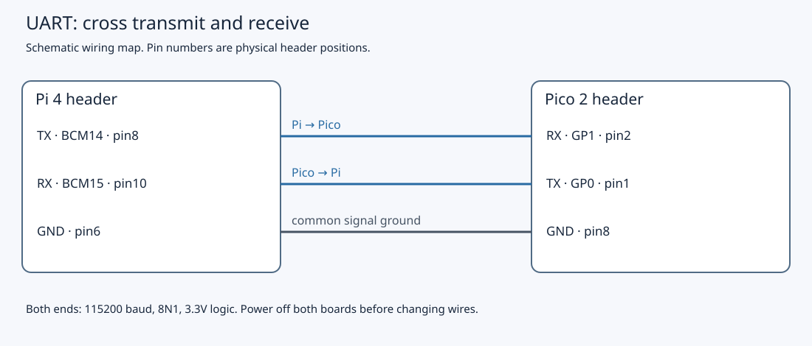

# 7.1 — Make a UART link electrically and logically correct

This lesson replaces the SPI loopback with three wires between the Pi 4 and Pico 2. You will check the electrical connections and define the same serial format for both ends. [7.2](7.2-configure-the-pi-uart-and-test-an-echo.md) configures the controllers and tests the first bytes; this page leaves the assembled link **unpowered**.

Start after [6.4](6.4-compare-spi-with-a-loopback-experiment.md), with the Pico's local GP16 LED and GP17 button circuits intact. You need the two boards, three signal jumpers, the Pi's own USB-C supply and the Pico's USB data cable to the Mac. No serial adapter, meter or logic analyser is required. The example firmware has compilation evidence in `verification.json`; the physical Pi–Pico UART link has **not been exercised during authoring**.

## A UART supplies timing without a clock wire

A **UART**, Universal Asynchronous Receiver/Transmitter, converts bytes into timed bits and back. Unlike SPI, this link has no SCK wire. Each endpoint derives bit timing from its own clock. The receiver detects the beginning of a character and samples the following bits at the agreed rate. The clocks must be close enough for those samples to remain inside their bit intervals; agreeing on a number in software does not measure either clock.

Our baseline is **115200 baud, 8N1, no flow control**, in both directions:

| Setting | Meaning |
| --- | --- |
| 115200 baud | 115,200 signalling intervals per second; here one interval carries one bit |
| 8 | Eight data bits per character, least-significant bit first |
| N | No parity bit |
| 1 | One stop bit |
| No flow control | No RTS/CTS wires and no XON/XOFF interpretation |

An ordinary transmitted character starts from **idle HIGH**, falls LOW for one **start bit**, sends eight data bits, then holds HIGH for one **stop bit**. The next start bit may follow immediately, or the line may remain HIGH between characters. The stop bit ends a character; it is not an application message terminator. The [RP2350 UART chapter](https://datasheets.raspberrypi.com/rp2350/rp2350-datasheet.pdf) describes the serial frame and baud generator.

For example, byte `0x41` has the following ideal levels, read left to right in time. This is an explanation, not a captured waveform:

```text
             start  bit0 bit1 bit2 bit3 bit4 bit5 bit6 bit7  stop
idle HIGH      0      1    0    0    0    0    0    1    0     1    idle HIGH
```

At 115200 baud, the ideal bit period is `1 / 115200`, approximately **8.68 µs**. An 8N1 character occupies ten bit periods: one start, eight data and one stop, about **86.8 µs**. Continuous traffic therefore carries at most **11,520 data bytes per second per direction** before gaps and software overhead. These are calculated limits, not measured throughput or command latency. Parity can detect some bit errors when enabled, but our no-parity baseline supplies no such check.

## Three electrical connections

**TX** means transmit from the board whose label you are reading; **RX** means receive into that board. A TX output must feed the other board's RX input. Connecting TX to TX joins two outputs that can drive opposite levels; RX to RX provides no transmitter. The two data paths are independent, so both boards can send simultaneously: **full duplex**. Ground is the third wire and gives both inputs a shared voltage reference.

This is a direct **3.3 V logic-level UART**, often called TTL serial even when the circuitry uses CMOS. LOW is near ground and HIGH is near 3.3 V. It is not a 5 V interface, and these instructions make no claim of 5 V tolerance. Raspberry Pi explicitly warns that its [UART GPIOs operate at 3.3 V](https://www.raspberrypi.com/documentation/computers/configuration.html#configuring-uarts). **RS-232** uses different electrical levels and polarity, potentially including negative voltages; an RS-232 cable or DB9 connector must not connect directly to these GPIOs.

**USB serial** is different again. The Pico USB connector carries USB signalling; firmware may expose a USB CDC serial port that macOS presents as `/dev/cu.usbmodem…`. That device name does not make USB D+/D− into UART TX/RX. Do not connect USB connector contacts to the GPIO header. In this chapter the Mac–Pico USB path supplies power, programming and any diagnostic output; the Pi–Pico GPIO UART carries protocol bytes. Opening a Mac USB terminal at “115200” does not configure either GPIO UART. The next lesson’s echo image does not initialise USB stdio or print diagnostics, so it does not promise a Mac serial port; its USB cable still supplies power and programming.

## 1. Remove the previous circuit's bus wires

1. If the Pi is running, use **Pi — SSH shell, any directory** to run `sudo poweroff`. Wait for shutdown to finish, then unplug its USB-C supply. If it is already shut down and unplugged after 6.4, leave it that way.
2. Quit any Mac USB terminal, unplug Pico USB and leave the Debug Probe disconnected. Its **D** SWD lead stays disconnected and its **U** UART connector stays empty. Both boards must be unpowered for every wiring change, including a later correction or disconnected-wire experiment.
3. Remove the SPI jumper **GP19 physical 25 ↔ GP20 physical 26** if still present. Remove any remaining I²C jumpers: Pi BCM2 physical **3** ↔ Pico GP4 physical **6**, Pi BCM3 physical **5** ↔ Pico GP5 physical **7**, and Pi GND physical **6** ↔ Pico GND physical **8**. We will install that ground connection afresh below.
4. Retain only the Pico's local circuits: **GP16 physical 21 → 1 kΩ → LED anode**, LED cathode → **GND physical 23**; **GP17 physical 22 → switch → GND physical 23**, with **4.7 kΩ** from GP17 to **3V3(OUT) physical 36**. Leave Pi BCM17 and BCM27 unwired; those belong to a later chapter.

## 2. Install and inspect the UART wires

5. Identify header orientation before inserting jumpers. Use the [Pico top view](0.2-a-labelled-tour-of-your-pico-2.md) and [Pi header view](0.3-a-labelled-tour-of-your-raspberry-pi-4.md). With the Pico USB connector at the top, physical 1 is at the top left and physical 2 is directly below it. Pi physical numbers count header contacts, not BCM GPIO names: **BCM14 is physical 8**, not physical 14.
6. While both boards remain unpowered, install exactly these three inter-board wires:

| From | To | Direction / purpose |
| --- | --- | --- |
| Pico **GP0 / UART0 TX**, physical **1** | Pi **BCM15 / RX**, physical **10** | Pico → Pi |
| Pi **BCM14 / TX**, physical **8** | Pico **GP1 / UART0 RX**, physical **2** | Pi → Pico |
| Pi **GND**, physical **6** | Pico **GND**, physical **8** | Common signal reference |



The drawing is a signal map, not a physical breadboard layout. The [Pico 2 pinout](https://datasheets.raspberrypi.com/pico/pico-2-datasheet.pdf) and [Pi UART documentation](https://www.raspberrypi.com/documentation/computers/configuration.html#configuring-uarts) establish the assignments.

7. Trace each wire end to end against the table, counting physical pins again. Check that a jumper has not landed on an adjacent power contact or an unconnected breadboard row. Use short bench wires. **Do not join the boards' 3V3, 5V, VBUS or VSYS power rails.** Each board will use its own USB supply; the ground connection is a reference, not permission to parallel power outputs.
8. Record the agreed settings as **115200 / 8 data / no parity / 1 stop / no flow control** for both endpoints. Leave power disconnected. Wiring inspection is the completion check here, not a successful transfer.

When 7.2 configures and powers the UARTs, an idle transmitter should hold its line HIGH, near 3.3 V relative to common ground. That is a **predicted, unmeasured** observation. Previous SPI firmware and unconfigured Pi pins do not establish this idle state. If you already have a meter, 7.2's configured idle state can be checked in DC-voltage mode against ground, taking care not to bridge adjacent pins. A meter cannot resolve individual 8.68 µs bits or prove correct baud/framing; no instrument is needed for the echo test.

## Bytes are not messages

The UART delivers a **byte stream**. One application write need not correspond to one read at the receiver. Bytes can arrive in pieces, several commands can accumulate together, and resets can interrupt a line. A stop bit frames one UART character; it supplies neither message length, acknowledgement nor reconnect recovery. Wrong baud settings can corrupt characters, and finite receive buffers can overrun when software does not drain them.

[7.2](7.2-configure-the-pi-uart-and-test-an-echo.md) first uses `uart_echo.cpp` to return received bytes unchanged. [7.3](7.3-build-a-robust-c-serial-client.md) then uses the actual shared line parser and serial client: requests such as `1 LED 1` end with a newline, and successful replies carry the same identifier, such as `1 OK 1`. [7.4](7.4-trace-a-command-end-to-end.md) follows that command to the LED. Those application rules add boundaries and checks; the electrical connection does not supply them.

Linux ownership is another separate requirement. On a Pi 4, Bluetooth routing, a boot console or a login service can occupy the UART. `/dev/serial0` is an alias whose actual target must be inspected. The next lesson establishes the PL011 baseline with Bluetooth disabled and the serial console removed, then checks the device. Leave configuration edits and port writes until that lesson.

## Diagnose the symptom and leave a known state

| Symptom | Meaning and next check |
| --- | --- |
| No text appears after wiring | Expected on this page: neither UART has been configured or tested. Three wires do not start a program. |
| Mac USB output works | This proves something about the USB path, not the Pi UART wires. Keep the two paths separate when diagnosing 7.2. |
| Later echo is absent in both directions | Power both boards down before rechecking crossed TX/RX, common ground, physical numbering and breadboard contacts; then follow 7.2's ownership checks. |
| Bytes are observed in one direction, but no round-trip echo | Inspect each TX→RX path separately. An independently observed one-way path does not prove its return wire; a successful round-trip echo uses both directions. |
| Later bytes are garbled or include boot/login text | Compare both framing settings; check console and Bluetooth ownership in 7.2 before changing wires. |

Finish with **both boards unpowered**, the three UART wires installed, the Pico LED/button circuit retained, and the probe disconnected. Leave Pi power and Pico USB unplugged. Continue to [7.2](7.2-configure-the-pi-uart-and-test-an-echo.md) for the controlled power-up, configuration, firmware installation and first echo.

## References

- [Raspberry Pi UART configuration](https://www.raspberrypi.com/documentation/computers/configuration.html#configuring-uarts) — GPIO levels, routing, console ownership and device aliases.
- [RP2350 datasheet](https://datasheets.raspberrypi.com/rp2350/rp2350-datasheet.pdf) — UART frame format, bit order and baud generation.
- [Pico 2 datasheet](https://datasheets.raspberrypi.com/pico/pico-2-datasheet.pdf) — board pinout, power connections and USB interface.
