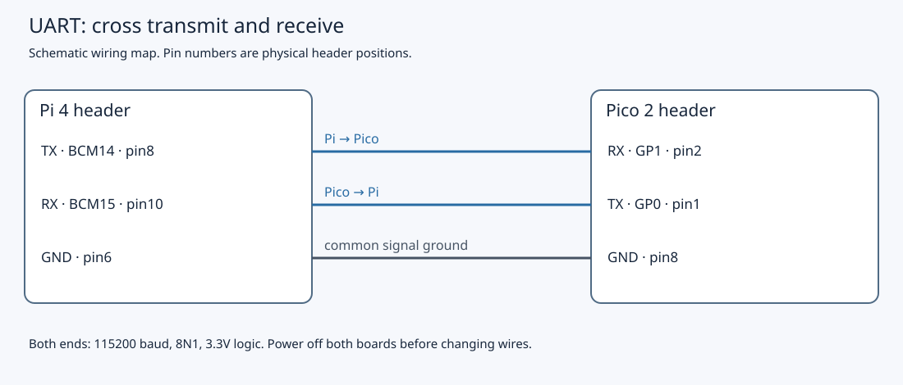

# 7.3 — Build a robust C++ serial client

The Pi will send a command, receive a complete reply, and check that the reply belongs to that command. You will control the Pico's external LED and read its button count and approximate chip temperature. Complete [7.2's exact echo test](7.2-configure-the-pi-uart-and-test-an-echo.md) first. Echo establishes the byte transport; this page replaces the echo firmware with a command interpreter.

Use the same non-wireless Pico 2, Pi 4 and Mac checkout. The firmware and Linux application have compilation evidence, and the framing/client have host tests. Physical UART operation and the observations below **were not exercised during authoring**.

## A stream needs a boundary

A UART carries bytes. Neither a Linux `write` nor a Pico receive loop creates a message boundary. One reply can arrive over several reads; several lines can already be waiting together. We use LF (`\n`) as the boundary and share one parser between firmware and host validation.

The exact request grammar is an identifier, one ASCII space, and one of these suffixes:

| Request, before LF | Successful reply, before LF | Meaning |
| --- | --- | --- |
| `1 PING` | `1 OK 1` | Command interpreter answered |
| `1 LED 0` or `1 LED 1` | `1 OK 0` or `1 OK 1` | Applied software LED state |
| `1 COUNT` | `1 OK <number>` | Accepted button presses, unsigned 32-bit range |
| `1 TEMP` | `1 OK <number>` | Signed 32-bit milli-°C chip-temperature estimate |

Identifiers range from **1 through 999999**, with at most six decimal digits. The parser permits leading zeroes within that limit; firmware replies print the numeric identifier without padding. Commands are uppercase. `LED true`, `LED 2`, extra spaces, tabs and trailing arguments are invalid. A malformed request produces **`0 ERR malformed\n`**, including when the identifier cannot be recovered. This error deliberately uses reserved ID zero.

A line holds at most **63 printable ASCII characters**, excluding LF; the 64th storage byte holds the terminating NUL for C string parsing. CR (`\r`) is ignored **anywhere**, not just before LF. Any other control byte, NUL, DEL, non-ASCII byte, or excess length switches the collector into discard mode through the next LF. That LF returns `overflow`, which therefore means an invalid frame as well as an overlong one. The next line starts afresh. Without LF, no reply is produced by firmware for that incomplete frame. These are application rules defined by our complete `examples/common/protocol.hpp`:

```cpp
{{#include ../examples/common/protocol.hpp}}
```

A byte arriving alone and the same byte inside a larger read have identical effects on `Line`. After each LF, the firmware can process another line. The CLI below performs one transaction and returns at its first complete reply; it is not a pipelined multi-request client.

## 1. Replace echo with the device firmware

Shut down the **Pi** with `sudo poweroff`, wait for shutdown, then unplug its supply and the Pico USB cable. With **both boards off**, detach **all three UART jumpers**, including ground. Program the Pico alone. Remove any remaining I²C wires or GP19–GP20 SPI loopback jumper; leave the Debug Probe disconnected and its U connector empty.

Retain the Pico's GP16 physical **21** → **1 kΩ** → LED anode, with cathode to GND physical **23**. Retain GP17 physical **22** → button → GND physical **23**, with a **4.7 kΩ** external pull-up to Pico 3V3(OUT) physical **36**. Keep the button across the breadboard gap using opposite contact pairs, as in [the button circuit](4.1-read-a-button-by-polling.md). Pi BCM17/27 stay unwired.

The complete `examples/pico/uart_device.cpp` replaces `uart_echo.cpp`:

```cpp
{{#include ../examples/pico/uart_device.cpp}}
```

Its shared `examples/pico/device_io.hpp` supplies the physical operations:

```cpp
{{#include ../examples/pico/device_io.hpp}}
```

`Device` polls GP17 and tracks a candidate level. It accepts that candidate when later samples still match and at least 20 ms have elapsed since the sample that first recorded it. This sampled check cannot prove continuous electrical stability or detect transitions between samples. Only an accepted transition to low increments the counter. A held button does not repeatedly increment it; short presses can be missed. Pressing does not locally toggle the LED. `led` changes GP16 and records the commanded state. Temperature uses the internal ADC sensor and nominal conversion, with the accuracy limits explained in [6.2](6.2-turn-the-pico-into-a-register-based-peripheral.md). It is not calibrated room temperature. Resetting the Pico resets its state and count; the unsigned counter eventually wraps.

The firmware services at most 32 received bytes per pass before polling the button again. It uses UART0 GP0/GP1, 115200/8N1, no hardware flow control and no CRLF translation. USB stdio is initialised, but there are **no normal USB prints or startup banner**. All protocol replies go to UART0. The [pinned SDK UART interface](https://github.com/raspberrypi/pico-sdk/blob/079c6f39023649b154152db30f1d781e884879bc/src/rp2_common/hardware_uart/include/hardware/uart.h) defines these operations.

**Mac — Terminal, working directory `~/hardware-from-software`:**

```sh
cd ~/hardware-from-software
python3 scripts/setup_deps.py
python3 scripts/build_examples.py --pico
ls -l .build/pico/uart_device.uf2 .build/pico/uart_device.elf
```

Hold BOOTSEL while connecting the isolated Pico to the Mac with its USB data cable. When `/Volumes/RP2350` appears, release BOOTSEL. **Mac — same directory:**

```sh
ls /Volumes/RP2350
cp .build/pico/uart_device.uf2 /Volumes/RP2350/
```

The volume should disappear as firmware starts. UF2 is the programming file; keep the ELF for debugging. Unplug the Pico again. With **both boards still off**, reconnect exactly these three wires:

| Source | Destination | Purpose |
| --- | --- | --- |
| Pico GP0 TX, physical **1** | Pi BCM15 RX, physical **10** | Reply |
| Pi BCM14 TX, physical **8** | Pico GP1 RX, physical **2** | Request |
| Pi GND, physical **6** | Pico GND, physical **8** | Shared signal reference |



Join **no power rails** between boards. Power both through their separate USB connections, and reconnect SSH. Keep the Pico free-running without debugger halts.

## 2. Read and build the Linux client

The CLI is `examples/linux/serial_client.cpp`:

```cpp
{{#include ../examples/linux/serial_client.cpp}}
```

It constructs the reusable RAII owner in `examples/linux/serial_port.hpp`:

```cpp
{{#include ../examples/linux/serial_port.hpp}}
```

`open` requests read/write access (`O_RDWR`), avoids acquiring a controlling terminal (`O_NOCTTY`), enables nonblocking I/O (`O_NONBLOCK`), and closes the descriptor across a successful `exec` (`O_CLOEXEC`). These flags do **not** claim exclusive ownership. See [Linux open(2)](https://man7.org/linux/man-pages/man2/open.2.html).

`cfmakeraw` removes terminal echo, canonical line editing and byte translations. The explicit `IXON | IXOFF | IXANY` clear also removes inherited software flow control; glibc's raw-mode helper alone does not clear IXOFF. Speed is 115200, format is eight data bits/no parity/one stop bit, and `CRTSCTS` is cleared. `CLOCAL` ignores modem-control status and `CREAD` enables reception. `VMIN` and `VTIME` are zero because the application manages readiness and time. `tcflush(TCIOFLUSH)` discards queued input and untransmitted output at construction; it does not reset the Pico. The destructor closes the descriptor, including during exception unwinding, but **does not restore previous terminal attributes**. Constructor failure closes it explicitly. See [Linux termios(3)](https://man7.org/linux/man-pages/man3/termios.3.html).

`transact` validates the outgoing request before writing. One absolute `steady_clock` deadline covers **all write and read chunks**, starting after validation and allowing two seconds. Each `poll` receives the remaining time; a fragment does not restart the timeout. `POLLERR`, `POLLHUP` and `POLLNVAL` abort the transaction. Poll timeouts and process scheduling are not a real-time guarantee of return at exactly two seconds. See [Linux poll(2)](https://man7.org/linux/man-pages/man2/poll.2.html).

Writes advance by the returned byte count, preserving any unsent suffix. Reads here request one byte at a time and feed bounded `Line` storage. Both paths retry `EINTR` and `EAGAIN` against the same deadline; readiness does not guarantee a later nonblocking call will succeed. Other failures, including zero progress, terminate the transaction. Short transfers are normal interface behaviour, described by [read(2)](https://man7.org/linux/man-pages/man2/read.2.html) and [write(2)](https://man7.org/linux/man-pages/man2/write.2.html).

A complete reply must have the expected ID and `OK ` followed by a fully consumed signed decimal integer. The client rejects ERR/status failures, invalid numbers, a PING value other than 1, an LED value different from the request, COUNT outside **0…4294967295**, and TEMP outside the signed 32-bit range. An invalid-byte frame is reported as `overlong reply` because both use `Line::overflow`.

Use the Pi checkout from [5.2](5.2-verify-the-linux-development-environment.md), or extract the [source archive](downloads/hardware-examples.zip) into a new directory. The archive has `examples/linux/serial_client.cpp`, `examples/linux/serial_port.hpp` and `examples/common/protocol.hpp` directly under its extraction root; preserve those relative paths. Commands assume that root is `~/hardware-from-software`.

**Pi — SSH, working directory `~/hardware-from-software`:**

```sh
cd ~/hardware-from-software
mkdir -p .build
g++ -std=c++20 -Wall -Wextra -Wpedantic -O2 examples/linux/serial_client.cpp -o .build/serial_client
```

This native Linux executable uses the Pi compiler from Chapter 5. Do not run the Mac-only dependency installer on the Pi.

## 3. Run one transaction at a time

Close serial terminals and the echo diagnostic. Repeat [7.2's live routing checks](7.2-configure-the-pi-uart-and-test-an-echo.md#3-verify-the-live-owner-and-permissions): `/dev/serial0` must resolve to **`/dev/ttyAMA0`** on this Pi 4 PL011 route, with no serial console/debug console, active getty, or Bluetooth owner. Keep the `disable-bt` configuration and stopped/disabled `hciuart`. Confirm current login permissions. Use a single owner and reader; competing readers divide incoming bytes.

**Pi — SSH, working directory `~/hardware-from-software`:**

```sh
cd ~/hardware-from-software
readlink -f /dev/serial0
sudo fuser -v /dev/ttyAMA0
.build/serial_client /dev/serial0 PING
.build/serial_client /dev/serial0 LED 1
.build/serial_client /dev/serial0 COUNT
.build/serial_client /dev/serial0 TEMP
.build/serial_client /dev/serial0 LED 0
```

No owner from `fuser` is the expected pre-run result. Illustrative output from the five CLI invocations, assuming no accepted button press:

```text
1 OK 1
1 OK 1
1 OK 0
1 OK 25000
1 OK 0
```

Expect the external LED to turn on after `LED 1` and off after `LED 0`; the acknowledgement reports software state, so inspect the LED too. Press and release the Pico button deliberately, keeping each level stable for more than 20 ms, then repeat COUNT: it should increase. TEMP varies; `25000` represents approximately 25 °C inside the chip, not a measured result here.

Each invocation starts a new process and uses **ID 1**. IDs help correlate replies within a transaction; this firmware has no deduplication, retry history or automatic reconnect recovery. There are no automatic retries. After a timeout the command may already have taken effect and its reply may be delayed. Reopening flushes local queues but cannot exclude a later stale ID-1 reply. Stop, establish the port/firmware state, and inspect the result before issuing another command.

## What the tests establish

`verification.json` records Pico firmware compilation separately on the pinned Mac toolchain route. The recorded [Linux CI run](https://github.com/EthanHosier/hardware-from-software/actions/runs/43079878334) runs host tests and compiles native Arm64 Linux applications and modules against the recorded Pi kernel headers; it does not build Pico firmware. Host checks include normal and ASan/UBSan parser tests and **11 pseudo-terminal cases**. The parser test covers multiple lines, fragmentation, malformed grammar, forbidden bytes and recovery after overflow. PTY tests supply replies byte by byte, check CRLF, inherited flow-control clearing, wrong IDs, ERR, oversized/NUL/nonnumeric replies, wrong PING/LED results and a missing-reply deadline. They establish host software behaviour for those cases, not electrical UART timing, every signal-interruption path, or physical button/LED operation.

To repeat software checks without boards, use **Mac — checkout root**:

```sh
cd ~/hardware-from-software
python3 scripts/build_examples.py --host
python3 scripts/test_serial.py
```

Or **Pi/Linux — checkout root**:

```sh
cd ~/hardware-from-software
python3 scripts/build_examples.py --host --linux
python3 scripts/test_serial.py
```

The PTY script opens its own simulated ports; it does not access `/dev/serial0`.

## Diagnose and leave a known state

| Symptom | Next check |
| --- | --- |
| `invalid command` | Check uppercase spelling, exact argument count and LED `0`/`1`. Validation prevents sending the malformed request. |
| `open UART` failure | Check Pi shell, resolved device, `dialout` membership and 7.2's routing. Do not conceal permissions by running the client as root. |
| `UART deadline expired` | Check both supplies, `uart_device` rather than `uart_echo`, free-running firmware and port ownership. Power both off before checking crossed TX/RX and ground. |
| Unexpected ID, rejected command or malformed reply | Stop competing readers/loggers; inspect console/getty/Bluetooth ownership and matching firmware. Echo firmware returns the request, which is not an `OK` reply. Do not strip unwanted bytes to manufacture success. |
| `overlong reply` | Investigate invalid bytes or length, wiring/settings and competing traffic. The collector discards through LF before reporting failure. |
| LED acknowledgement but no light | With both boards off, inspect GP16, resistor, LED polarity and ground. Software state does not prove current flows. |
| COUNT unchanged | Inspect GP17's pull-up/contact pairs and deliberate press/release intervals; Pico reset clears the count. |

A successful invocation exits after one reply and closes its descriptor. A caught exception prints the diagnostic and exits with status 1; missing CLI arguments return 2. The last LED state and Pi UART settings remain. Leave `uart_device` installed, the LED off, the circuit intact and the port otherwise unused for [7.4's end-to-end trace](7.4-trace-a-command-end-to-end.md). To stop bench work, power off the Pi, wait, then unplug both supplies before moving wires. To abandon UART, detach all three jumpers with both boards off and follow [7.2's recorded rollback](7.2-configure-the-pi-uart-and-test-an-echo.md#diagnose-and-leave-the-next-state).

## References

- [Linux termios(3)](https://man7.org/linux/man-pages/man3/termios.3.html) — raw mode, serial format and queue flushing.
- [Linux poll(2)](https://man7.org/linux/man-pages/man2/poll.2.html) — readiness, error flags and timeout qualifications.
- [Pico SDK 2.3.1 UART API](https://github.com/raspberrypi/pico-sdk/blob/079c6f39023649b154152db30f1d781e884879bc/src/rp2_common/hardware_uart/include/hardware/uart.h) — firmware UART configuration and byte operations.
- [Protocol implementation](downloads/examples/common/protocol.hpp) — the exact framing and request grammar included above.
