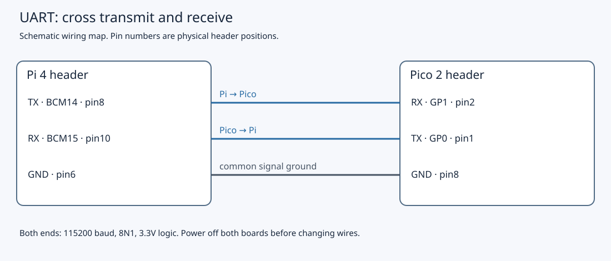

# 7.4 — Trace a command end to end

A successful LED command crosses two operating environments and two physical UARTs. This lesson follows **`1 LED 1\n`** from your Mac's SSH session to the Pico's output hardware and back as **`1 OK 1\n`**. You will distinguish what a reply, a system-call trace and a debugger can each establish.

Complete [7.3](7.3-build-a-robust-c-serial-client.md) first. Keep **`uart_device`**, not `uart_echo`, installed and free-running, with the external LED initially off. Keep its matching ELF on the Mac and the compiled `serial_client` on the Pi. The source and compilation were checked during authoring; no physical UART transaction, LED observation, live debugger session or timing measurement was recorded.

## Keep the same circuit

Use the Pi 4 PL011 route from [7.2](7.2-configure-the-pi-uart-and-test-an-echo.md): `/dev/serial0` resolves to `/dev/ttyAMA0`, Bluetooth is disabled with `disable-bt`, `hciuart` remains stopped/disabled, and the serial console and getty are absent. Both endpoints use **115200, eight data bits, no parity, one stop bit, no flow control**.

| Connection | Destination |
| --- | --- |
| Pi BCM14 TX, physical **8** | Pico GP1 RX, physical **2** |
| Pico GP0 TX, physical **1** | Pi BCM15 RX, physical **10** |
| Pi GND, physical **6** | Pico GND, physical **8** |
| Pico GP16, physical **21** | 1 kΩ → LED anode; cathode → Pico GND, physical **23** |
| Pico GP17, physical **22** | Button → Pico GND, physical **23**; 4.7 kΩ pull-up to Pico 3V3(OUT), physical **36** |



The Pico remains USB-powered from the Mac and the Pi uses its own USB-C supply. Join no power rails. Keep earlier I²C wires and the SPI loopback jumper removed; Pi BCM17/27 remain unwired. Keep the Debug Probe disconnected for the main experiment, with its U socket unused. If a connection needs changing, shut down the Pi, disconnect **both boards' power**, then change it.

## 1. Send one identified command

Use your existing Chapter 5 SSH connection from the **Mac** to reach the **Pi**. The command below runs on the Pi; SSH carries shell input and terminal output over the network. It does not forward `/dev/serial0` to the Mac.

**Pi — SSH shell, working directory `~/hardware-from-software`:**

```sh
cd ~/hardware-from-software
readlink -f /dev/serial0
sudo fuser -v /dev/ttyAMA0
./.build/serial_client /dev/serial0 LED 1
```

The first command must identify `/dev/ttyAMA0`; the second should show no owner before the client runs. Close any serial terminals or other readers. If the executable is missing, repeat only [7.3's native Pi build](7.3-build-a-robust-c-serial-client.md#2-read-and-build-the-linux-client); do not reinstall or reflash working firmware for this trace.

The intended terminal result is the following **illustrative output**, accompanied by the external LED turning on:

```text
1 OK 1
```

The CLI constructs ID **1** for its single transaction, validates `LED 1`, and transmits the eight ASCII bytes `1 LED 1\n`. Each CLI invocation reuses ID 1. The identifier correlates a reply; it supplies no authentication, deduplication or automatic retry. A timeout can occur after the LED has changed. Do not treat it as proof that the command did nothing.

## 2. Follow the outward path

The complete [CLI and serial-port owner in 7.3](7.3-build-a-robust-c-serial-client.md#2-read-and-build-the-linux-client) remain the host program. They are also available as [serial_client.cpp](downloads/examples/linux/serial_client.cpp), [serial_port.hpp](downloads/examples/linux/serial_port.hpp), and in the [complete source archive](downloads/hardware-examples.zip), which preserves the shared-header paths.

`Serial` opens the device and applies raw `termios` settings: no terminal echo, canonical editing, byte translation or software/hardware flow control. It flushes queued input and untransmitted output once at construction. `transact` starts a two-second absolute deadline, polls for writability and advances by each successful `write` count until all eight bytes have been accepted. A successful `write` reports bytes accepted by Linux; it does not report that the Pico parsed them.

The descriptor enters Linux's TTY/serial machinery. The PL011 driver supplies bytes to the controller's transmit hardware; its shift register serializes each byte onto BCM14. The [official PL011 driver source](https://github.com/raspberrypi/linux/blob/ae161617d7a4552fa91d03626b8d9f3696d17481/drivers/tty/serial/amba-pl011.c) shows the kernel's register/FIFO operations and interrupt/DMA support. This is the book's frozen kernel baseline, not a claim that every reader's running kernel uses exactly that revision or transfer path. Userspace needs no direct mapping of those registers.

Across the crossed wire, Pico GP1 receives the waveform. UART0 reconstructs bytes into its receive FIFO. The SDK's `uart_init` enables FIFOs; `uart_is_readable` tests for waiting data, and `uart_getc` consumes a byte. Firmware polls this hardware; there is no UART receive ISR in this example. Each outer pass processes at most 32 received bytes before returning to button polling. These operations are defined by the [pinned SDK UART API](https://github.com/raspberrypi/pico-sdk/blob/079c6f39023649b154152db30f1d781e884879bc/src/rp2_common/hardware_uart/include/hardware/uart.h).

Here is the complete receive, dispatch and reply loop, `examples/pico/uart_device.cpp`:

```cpp
{{#include ../examples/pico/uart_device.cpp}}
```

The complete shared collector and parser, `examples/common/protocol.hpp`, give those bytes their meaning:

```cpp
{{#include ../examples/common/protocol.hpp}}
```

`Line` retains bytes until LF. CR is ignored anywhere. Storage holds at most 63 printable characters plus NUL; excess length or another invalid byte discards the frame through LF. An incomplete line has no reply. For our completed line, `parse` assigns ID 1, operation `led`, and Boolean `true`. A malformed line instead generates `0 ERR malformed\n` without entering the LED case.

The physical operation is in the complete `examples/pico/device_io.hpp`:

```cpp
{{#include ../examples/pico/device_io.hpp}}
```

`Device.led(true)` records `light = true` and calls `gpio_put(16, true)`. GPIO setup already selected SIO and enabled GP16's output. The output operation changes SIO's GP16 output latch; the configured mux, pad and output driver carry that state to the header pin. With the stated circuit, current through the resistor and forward-biased LED should produce light. A software latch and a lit component are different observations.

The other commands share this path but read different state: COUNT reports accepted debounced **presses**, not every electrical edge; TEMP uses the internal ADC sensor and nominal conversion, giving approximate chip temperature rather than calibrated room temperature.

## 3. Follow the acknowledgement home

The LED case calls `device.led` **before** reading `device.light` into the reply value. `snprintf` formats seven bytes, `1 OK 1\n`; `uart_puts` queues them through UART0's transmit path with CRLF translation disabled. GP0 TX carries the reply to Pi BCM15 RX. The Pi controller receives bytes, and the Linux driver makes them available through the TTY device.

`Serial::transact` polls and reads one byte at a time against the **same** deadline used for transmission. `Line` collects the reply. The client accepts it only when the ID prefix is exactly `1 `, the status is `OK `, the signed decimal number consumes the entire remaining string, and the LED result equals the requested Boolean value. Wrong IDs, ERR replies, malformed numbers and an LED result of zero fail this transaction. COUNT and TEMP have explicit unsigned-32-bit and signed-32-bit range checks respectively.

Only after these checks does `main` print the returned line to stdout. The SSH session carries that text back to the Mac's terminal. The process then exits and closes the descriptor; it leaves the LED state and terminal settings in place.

This acknowledgement follows the firmware's software application of the command. It contains no pin-voltage measurement or LED-current feedback. A disconnected or reversed LED can still yield `1 OK 1`. After a failed transaction, even reopening and flushing cannot exclude a delayed old ID-1 reply: stop and establish the state before trying again.

## 4. Identify the actual output instruction offline

Chapter 2 deliberately used a CPU memory store to SIO SET/CLR. This firmware uses SDK `gpio_put`, whose pinned RP2350 Arm implementation defaults to **`PICO_USE_GPIO_COPROCESSOR`**. It uses the Cortex-M33 GPIO coprocessor interface to the same SIO output hardware. The [SDK implementation](https://github.com/raspberrypi/pico-sdk/blob/079c6f39023649b154152db30f1d781e884879bc/src/rp2_common/hardware_gpio/include/hardware/gpio_coproc.h) and [RP2350 datasheet §3.6.1.3](https://datasheets.raspberrypi.com/rp2350/rp2350-datasheet.pdf) define its single-bit write operation.

Inspecting an ELF needs no connected target. **Mac — working directory `~/hardware-from-software`:**

```sh
cd ~/hardware-from-software
.deps/arm-gnu-toolchain-14.2.rel1-darwin-arm64-arm-none-eabi/bin/arm-none-eabi-objdump \
  -d -C --disassemble=main .build/pico/uart_device.elf
```

If the ELF is absent, use the Chapter 1 setup and build commands, `python3 scripts/setup_deps.py` then `python3 scripts/build_examples.py --pico`. They create the Debug ELF and UF2; rebuilding does not replace firmware already on the board. Keep the ELF matched to the installed UF2.

This **disassembly fragment was inspected from the built ELF**, not captured from a live processor:

```text
100005a8: ldrb.w r3, [sp, #20]
100005ac: strb.w r3, [sp, #160]
100005b0: movs   r2, #16
100005b2: mcrr   0, 4, r2, r3, cr0
```

The `strb` saves `Device.light` in RAM. The `mcrr` is the output operation: `r2` supplies pin index **16**, and bit zero of `r3` supplies the Boolean level. It corresponds to `gpioc_bit_out_put(16, value)`. There is no GPIO_OUT_SET `str` at this point in this SDK path. Addresses and register allocation can change with source, SDK or compiler options; locate the operation in your own disassembly before using its address.

For an optional **live** inspection, use Chapter 3's verified SWD connection and OpenOCD/GDB procedure with **`uart_device.elf`**. Power both boards off before adding or removing probe wiring; use D only, and retain the UART circuit. Start OpenOCD exactly as in 3.1. **Mac — another terminal, working directory `~/hardware-from-software`:**

```sh
cd ~/hardware-from-software
.deps/arm-gnu-toolchain-14.2.rel1-darwin-arm64-arm-none-eabi/bin/arm-none-eabi-gdb \
  -q .build/pico/uart_device.elf
```

**Pico debugger — only after successful target examination by OpenOCD:**

```text
(gdb) set pagination off
(gdb) target remote localhost:3333
(gdb) monitor reset halt
(gdb) load
(gdb) monitor reset halt
(gdb) hbreak main
(gdb) continue
(gdb) delete breakpoints
(gdb) hbreak *0x100005b2
(gdb) continue
```

Confirm breakpoint deletion if asked. Substitute the actual `mcrr` address from **your** ELF for the inspected address above. Continuing from `main` lets initialization run before waiting for a request; do not jump `$pc` to the output operation and bypass setup.

In a separate Pi shell, launch the same LED command once. Expect the two-second CLI deadline to expire while you inspect the halted Pico. This is a controlled debugger experiment, not a successful timed transaction. **Pico debugger — stopped immediately before the verified output instruction:**

```text
(gdb) x/i $pc
(gdb) info registers r2 r3 pc
(gdb) p/x (*(volatile unsigned int *)0xd0000010) & 0x10000
(gdb) stepi
(gdb) p/x (*(volatile unsigned int *)0xd0000010) & 0x10000
```

For `LED 1`, expect `r2 = 16`, `r3 = 1` and GP16's masked output latch to be `0x10000` after stepping; it changes from zero only if the LED was previously off. Read **GPIO_OUT at `0xd0000010`**, not the write-only SET/CLR aliases. The read reports a latch, not voltage. These are predicted observations; no live register transcript is supplied. GDB's [instruction-stepping documentation](https://sourceware.org/gdb/current/onlinedocs/gdb.html/Continuing-and-Stepping.html) explains `stepi`.

Delete the breakpoint and resume with `continue` so the firmware can finish the reply. Wait for any timed-out Pi client to exit, then stop debugger activity and reset the Pico to establish fresh firmware state before resuming ordinary transactions. Reset clears its LED/count state and unfinished reply. Reopening the Pi client flushes its local queues. Do not interpret the timeout, late reply or USB disruption during halting as wire timing. Exit GDB/OpenOCD using Chapter 3's cleanup; power both boards off before detaching D.

## 5. Choose evidence for the question

| Evidence | What it can establish | Limit |
| --- | --- | --- |
| Validated protocol reply plus looking at LED | Accepted software result and visible physical response | No measurement of electrical levels or transition timing |
| Linux `strace` | Device open/configuration, bytes accepted by write/read, poll and errors | Sees the process/kernel boundary, not UART edges or Pico execution |
| ELF disassembly | Instructions generated for this source/build | Does not establish execution on a board |
| Live SWD inspection | Reached instruction, operands and output latch around a step | Halts distort execution, UART deadlines and USB servicing |
| Optional analyser | Observed wire transitions, decoded request/reply and their timing | Decoder settings matter; no proof of parser state, voltage margin or LED current |
| USB diagnostics | Only messages deliberately emitted by firmware | This firmware initializes USB stdio but has **no normal USB prints** |

There is no USB startup banner to collect here. Adding USB logging would change the program and may delay its polling loop; never put those bytes on the protocol UART. An analyser is optional; [Appendix D](appendix-d.md) gives the separate device-specific route. The Debug Probe's U port is another UART interface, not a logic analyser.

To collect actual syscall evidence, install Debian's [strace package](https://packages.debian.org/bookworm/strace) if absent. **Pi — SSH, working directory `~/hardware-from-software`, with the Pico free-running and no other reader:**

```sh
cd ~/hardware-from-software
sudo apt update
sudo apt install -y strace
strace -tt -T -yy -s 128 \
  -e trace=openat,ioctl,poll,ppoll,read,write,close \
  -o .build/led.strace \
  ./.build/serial_client /dev/serial0 LED 1
less .build/led.strace
```

Skip installation when already available. The [official strace project](https://strace.io/) documents descriptor decoding and syscall filtering. Identify the descriptor opened for `/dev/serial0`, rather than assuming it is 3. Find its configuration ioctls, outgoing bytes, polls and reply reads; distinguish UART writes from the later write to stdout. Reads here request one byte each. Transfers or interrupted attempts need not have the same grouping on every run. `-tt` adds timestamps, `-T` syscall duration, and `-o` keeps trace output separate from stdout. No sample syscall transcript is presented as a measurement. Tracing itself adds overhead.

At 115200 baud, 8N1 uses ten bits per character. The ideal continuous payload throughput is therefore **11520 bytes/s per direction**. Our eight-byte request takes about **0.694 ms** on its wire and the seven-byte reply about **0.608 ms** on the return wire. Their sum, about **1.30 ms**, is an ideal serialization budget, not a measured request latency. Firmware waits for request LF before replying; processing, queues and scheduling add delay. SSH startup/network/display, tracing and debugger halts add different delays again. Name the interval you measure—such as Pi transaction start to accepted reply—before comparing it with wire time.

## Localize a failure and leave the bench ready

| Symptom | Next boundary to inspect |
| --- | --- |
| Device open/configuration fails | Pi device identity, login permissions and 7.2's console/Bluetooth/getty ownership |
| Writes succeed but no reply | Supply, correct `uart_device` firmware, free-running core, crossed TX/RX and ground; power both off before wiring checks |
| Request echoed or unexpected ID/status | Old echo firmware, serial console noise, competing reader or stale reply; stop and restore the known state |
| `0 ERR malformed` or numeric/result validation fails | Exact request grammar, forbidden bytes, matching parser/client, complete reply; do not strip bytes to force acceptance |
| LED acknowledgement but dark LED | GP16 mux/pad/output enable and physical resistor, polarity and ground; reply alone cannot distinguish these |
| Timeout only under debugger or USB instrumentation | Resume without breakpoints and remove added logging before judging transport behaviour |

After the ordinary free-running trace, **Pi — checkout root**, run `./.build/serial_client /dev/serial0 LED 0` and check the off acknowledgement and LED. Let it exit; close any trace viewer. No client daemon remains. Keep `uart_device`, the source/ELF pair, circuit and UART configuration for later reuse. The [next chapter](8.1-establish-a-userspace-gpio-baseline.md) moves to a Pi GPIO circuit: shut down the Pi, wait for shutdown, and unplug **both** supplies before removing UART wires or doing that future wiring. To abandon the UART configuration, use [7.2's recorded rollback](7.2-configure-the-pi-uart-and-test-an-echo.md#diagnose-and-leave-the-next-state).

The existing verification record covers source review, Pico compilation, native Arm64 Linux compilation and 11 pseudo-terminal client cases. Those checks support the software path; they do not establish physical runtime, electrical timing or LED current.

## References

- [RP2350 datasheet](https://datasheets.raspberrypi.com/rp2350/rp2350-datasheet.pdf) — GPIOC single-bit operations, SIO latch and UART hardware.
- [Pinned Pico SDK GPIO coprocessor implementation](https://github.com/raspberrypi/pico-sdk/blob/079c6f39023649b154152db30f1d781e884879bc/src/rp2_common/hardware_gpio/include/hardware/gpio_coproc.h) — the instruction used by this build.
- [Official Raspberry Pi Linux PL011 driver](https://github.com/raspberrypi/linux/blob/ae161617d7a4552fa91d03626b8d9f3696d17481/drivers/tty/serial/amba-pl011.c) — kernel-side serial hardware access.
- [strace project](https://strace.io/) — process/kernel tracing and its options.
