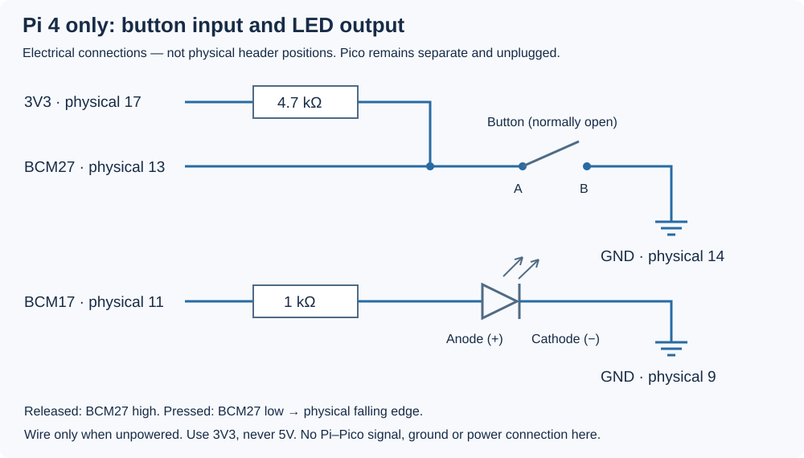

# 8.1 — Establish a userspace GPIO baseline

You will connect a **separate button and LED to the Pi 4**, then toggle that LED from a C++ process receiving button edges. Linux already has a GPIO controller driver and a userspace interface for this. Establish this baseline before adding an educational kernel module: it separates circuit and controller problems from bugs in the new driver.

Start after [7.4](7.4-trace-a-command-end-to-end.md), with the Pi development environment and checkout from Chapter 5. Read [5.3's identity and ownership procedure](5.3-establish-gpio-identity-and-ownership.md) again. The program below was source-reviewed and compiled by the project's native Arm64 Linux CI; **physical GPIO runtime has not been exercised during authoring**. The observations are predictions for your bench, not recorded measurements.

## 1. Separate the boards and build the Pi circuit

Select an additional LED, four-leg momentary button, **1 kΩ** resistor, **4.7 kΩ** resistor and suitable jumper wires from your inspected kit. Identify their values, LED polarity and switch contact pairs using [0.5](0.5-recognise-the-breadboard-and-kit-components.md). Keep the Pico's GP16 LED and GP17 button intact; they are different components with different physical pin numbers.

Stop any UART client or serial terminal. In the **Pi SSH shell**, run:

```sh
sudo shutdown -h now
```

Wait for shutdown, then remove **both** the Pi's USB-C supply and the Pico's USB supply. Disconnect any powered debug connection too. With both boards unpowered, remove **all three** Pi–Pico UART wires: Pi physical 8, 10 and the common ground at 6. Confirm that earlier I²C wires and the Pico SPI loopback jumper are absent. Leave `uart_device` installed on the Pico, retain its local LED/button circuit, and leave the Pico unplugged and separate. Keep the Debug Probe disconnected and its U socket empty.

Wire only the unpowered Pi. Match the top-view orientation in [0.3](0.3-a-labelled-tour-of-your-raspberry-pi-4.md#orient-the-board) and the [5.3 header map](5.3-establish-gpio-identity-and-ownership.md#four-numbers-that-mean-different-things) before counting contacts. The diagram below is an **electrical schematic**, not a drawing of header positions. Raspberry Pi's [official header documentation](https://www.raspberrypi.com/documentation/computers/raspberry-pi.html#40-pin-gpio-header) and [Pi 4 schematic, J8](https://datasheets.raspberrypi.com/rpi4/raspberry-pi-4-reduced-schematics.pdf) provide the physical reference.



| Pi 4 contact | Connection |
| --- | --- |
| **17 — 3V3** | 4.7 kΩ resistor → button input node |
| **13 — BCM27** | Same input node → one switch contact pair A |
| **14 — GND** | Opposite switch contact pair B |
| **11 — BCM17** | 1 kΩ resistor → LED **anode** (positive lead) |
| **9 — GND** | LED **cathode** (negative lead, flat-side marking) |

For the four-leg switch, A1–A2 are permanently joined, and B1–B2 are permanently joined; pressing connects A to B. Use one A leg and one B leg. Fit the switch across the breadboard centre gap as shown in [0.5's contact-pair drawing](0.5-recognise-the-breadboard-and-kit-components.md#a-four-leg-button-contains-two-contact-groups). Keep A and B on different breadboard rows: merely straddling the gap does not guarantee a switched connection. Do not infer internal pairs from an unfamiliar switch's appearance.

The external pull-up holds BCM27 high while released; pressing connects it to ground, producing a falling transition. The resistor limits current through the pressed switch. The LED's separate resistor limits output current. Use Pi **3V3, never 5V**; Pi GPIO is not 5V tolerant. Join no Pi and Pico power rails or breadboard rails. After checking every endpoint, power the Pi using its own USB-C supply and reconnect by SSH. The Pico stays unplugged.

## 2. Rediscover the lines before requesting them

**Pi — SSH shell, working directory `~`:**

```sh
cd ~
gpioinfo --version
gpiodetect
gpioinfo
```

Use 5.3's installed `gpiod` tools; if absent, follow its package setup. Identify the header controller by its label (expected `pinctrl-bcm2711`) **and** its neighbouring GPIO names. Do not assume `/dev/gpiochip0`. Enter its verified full path:

```sh
printf 'Verified header chip path: '
read -r gpio_chip
test -c "$gpio_chip" && printf 'Character device: %s\n' "$gpio_chip"
```

If the check prints nothing, correct the path. Inspect it using **one** version branch, still on the **Pi, in `~`**:

```sh
# libgpiod CLI 1.x only:
gpioinfo "$gpio_chip"
```

```sh
# libgpiod CLI 2.x only:
gpioinfo --chip "$gpio_chip"
```

These forms follow the [Bookworm 1.x manual](https://manpages.debian.org/bookworm/gpiod/gpioinfo.1.en.html) and [upstream 2.x manual](https://libgpiod.readthedocs.io/en/v2.3.1/gpioinfo.html). Bookworm can supply 1.x. The CLI major is independent of the kernel's **GPIO API v2** used by our program; no libgpiod library is linked here.

Confirm `GPIO17` and `GPIO27` really map to offsets **17 and 27** on this controller. Check their used state and consumer labels, plus the boot configuration and mux-ownership checks in 5.3. An empty consumer alone does not prove availability; alternate peripheral ownership may not appear as a GPIO consumer. Resolve an unexpected name, offset or owner before continuing. Do not force a busy line or change random overlays.

**Pi — `~`:** check device access in the current login:

```sh
ls -l "$gpio_chip"
getfacl "$gpio_chip"
id
getent group gpio
```

If the node's actual group policy grants access to `gpio` and your account lacks membership, add yourself on the **Pi** with `sudo usermod -aG gpio "$USER"`, then log out and reconnect. Verify membership with `id`; repeat discovery and set `gpio_chip` again in the new shell. For another policy, resolve that policy rather than assuming a group name. `sudo` for metadata inspection does not grant your ordinary client access. Do not bypass this with world-writable device modes, sysfs GPIO or `/dev/mem`.

Only after confirming the expected mapping, set the offsets in the same **Pi shell**:

```sh
led_offset=17
button_offset=27
```

These are chip-local offsets, not physical header contacts. Metadata inspection does not reserve them; the actual requests below still check for conflicts.

## 3. Read and build the complete program

The complete file is `examples/linux/gpio_events.cpp`:

```cpp
{{#include ../examples/linux/gpio_events.cpp}}
```

**Pi — SSH shell, working directory `~/hardware-from-software`:**

```sh
cd ~/hardware-from-software
mkdir -p .build
g++ -std=c++20 -Wall -Wextra -Wpedantic -O2 \
  examples/linux/gpio_events.cpp -o .build/gpio_events
./.build/gpio_events "$gpio_chip" "$led_offset" "$button_offset"
```

The argument order is **CHIP LED_OFFSET BUTTON_OFFSET**. Use the existing Pi checkout and native compiler from 5.2; do not run this GPIO executable on the Mac. The signature rejects malformed numbers and equal offsets, but cannot tell whether you chose the correct physical circuit.

Release the button before launch. The program has no startup banner and should wait silently until a falling edge arrives. Press and release slowly, leaving roughly half a second between actions. An **illustrative** sequence is:

```text
accepted edge 1 led=1
accepted edge 2 led=0
accepted edge 3 led=1
accepted edge 4 led=0
accepted edge 5 led=1
```

Each accepted edge toggles the Pi LED. After the fifth, the program immediately attempts to drive it low and exits, so the last on-state may be too brief to see. A wait without an event for 30 seconds prints `GPIO timeout/error` and exits with status 1. **Pi — same directory, immediately after the program returns:** `echo $?` reports the exit status.

## What crosses the userspace boundary

Opening the chip gives access to its controller interface. Two `GPIO_V2_GET_LINE_IOCTL` calls request separate single-line objects labelled `hfs-led` and `hfs-button`. The kernel returns their request descriptors in `out.fd` and `in.fd`. The requests own the lines until those descriptors close; closing the chip descriptor alone would not release them. This source keeps all three open until cleanup. Another request for an owned line fails with `EBUSY`. See the kernel's [request API](https://www.kernel.org/doc/html/latest/userspace-api/gpio/gpio-v2-get-line-ioctl.html).

The output request sets `OUTPUT`, without `ACTIVE_LOW` or an initial-value attribute. Its initial value is inactive, physically low, as implemented by `gpio_v2_line_config_output_value` in the [baseline kernel source](https://github.com/raspberrypi/linux/blob/ae161617d7a4552fa91d03626b8d9f3696d17481/drivers/gpio/gpiolib-cdev.c). Later writes use `GPIO_V2_LINE_SET_VALUES_IOCTL` on **out.fd**. `mask=1` selects index zero in this request's offsets array; it does not mean BCM0 or BCM1.

The input sets `INPUT | EDGE_FALLING | BIAS_DISABLED`. The external 4.7 kΩ resistor supplies the pull-up; the program does not request an internal pull-up. Although the **circuit** is active-low, the request does **not** set `ACTIVE_LOW`: logical and physical polarity therefore match, and a physical high-to-low press produces the requested falling edge. Setting `ACTIVE_LOW` would invert the API's edge meanings; it is not a harmless descriptive flag. These flags and bitmap meanings are defined in the [baseline UAPI header](https://github.com/raspberrypi/linux/blob/ae161617d7a4552fa91d03626b8d9f3696d17481/include/uapi/linux/gpio.h).

The kernel queues timestamped events. `poll(in.fd)` sleeps until readable, then `read` copies one `gpio_v2_line_event`. No clock flag is set, so timestamps use **CLOCK_MONOTONIC**, not wall-clock time. Events also contain their edge ID, offset, request sequence and line sequence. The default single-line queue holds at least 16 events; bursts can overflow it, dropping oldest events. Sequence numbers allow loss detection, but this program does not inspect them. Its stdout time is not the edge time. The [event-read documentation](https://www.kernel.org/doc/html/latest/userspace-api/gpio/gpio-v2-line-event-read.html) describes the queue and polarity rules.

The variable `presses` counts **accepted falling edges**, not proven physical presses. After an accepted edge, timestamps less than 20,000,000 ns (20 ms) later are discarded; discarded events do not advance `last`. This is a timestamp lockout since the last **accepted** edge. It requests no kernel or hardware debounce, never checks that a level stayed stable, and ignores rising/release events. Bounce can still produce another accepted falling edge after the interval, including during release. Holding the button low creates no new falling edge. An already-held button at startup is not an initial press notification.

The loop ends at five accepted edges, not five raw queued events. Every `poll` gets a fresh 30-second timeout; interruptions retry, and ignored events also lead to another wait. Thus 30 seconds is not an overall runtime limit. Poll errors and timeouts share one diagnostic. Read or LED-write failures can return status 1 without a detailed message. This deliberately small baseline demonstrates requests and queued events; it is not a complete event recorder or stable-level debouncer.

## Diagnose, release and continue

| Symptom | Check |
| --- | --- |
| Open reports permission denied | Recheck node mode, ACL and current groups; a new group membership needs a new SSH login. |
| `request LED/button: Device or resource busy` | Repeat 5.3's consumer and mux inspection. Stop only an identified owner through its normal cleanup; privileges do not override ownership. |
| Invalid argument, missing v2 definitions, or unsupported ioctl | Confirm actual Pi kernel, development headers and discovered offsets. CLI version alone cannot establish kernel API support. |
| Silent wait, then timeout | Release, then press; inspect selected chip/line identity and the A/B switch nodes. Power down before checking wires. |
| Multiple counts for one action | Mechanical bounce can outlast the lockout. Do not interpret this count as debounced presses. |
| Text toggles but LED stays dark | Check the **Pi** LED, polarity, 1 kΩ series resistor, physical 11 and ground 9. A successful ioctl is not an electrical measurement. |

Let five accepted edges complete, or let an idle wait time out. Both paths reaching the end attempt an LED-low write, **without checking that final write's result**, then close the requests and chip. Ctrl-C uses the default signal action and skips that explicit low write; process termination still closes descriptors and releases ownership. Linux does not guarantee the electrical output state after release, even following a successful low write. Do not use the program's exit as a permanent low-output guarantee.

Repeat the version-appropriate `gpioinfo` command from step 2 after exit. Confirm BCM17/27 are unclaimed and `hfs-led`/`hfs-button` consumers are gone. If still used, identify the remaining owner before proceeding. Leave this Pi-only circuit attached, the Pico unplugged with its local circuit and firmware retained, and all inter-board wires absent. No custom button overlay or driver is bound. [8.2](8.2-build-and-load-the-smallest-external-module.md) begins with an unrelated minimal module; the button driver comes later.

Userspace already provides ownership, edge notification and output control through an existing kernel driver. Many GPIO applications need nothing more, and standard subsystem drivers are preferable when they fit a device. Our later custom module teaches Device Tree binding, IRQ/deferred work, state publication and lifetime management. Its responsibility will move into the kernel; that educational choice does not make a custom driver a prerequisite for controlling an LED.

## References

- [Linux GPIO v2 requests](https://www.kernel.org/doc/html/latest/userspace-api/gpio/gpio-v2-get-line-ioctl.html) — exclusive ownership, descriptors and configuration.
- [Linux GPIO v2 event reads](https://www.kernel.org/doc/html/latest/userspace-api/gpio/gpio-v2-line-event-read.html) — polarity, buffering and sequence numbers.
- [Baseline Linux GPIO UAPI header](https://github.com/raspberrypi/linux/blob/ae161617d7a4552fa91d03626b8d9f3696d17481/include/uapi/linux/gpio.h) — structures, flags and timestamp clock.
- [Raspberry Pi header documentation](https://www.raspberrypi.com/documentation/computers/raspberry-pi.html#40-pin-gpio-header) — physical orientation, signals and 3.3 V limits.
