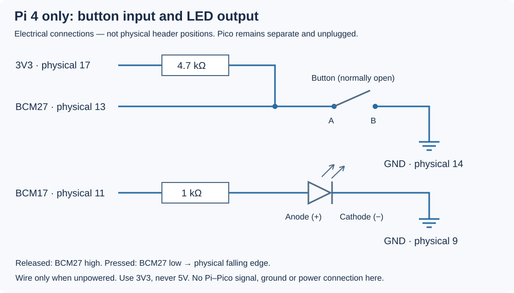

# 8.3 — Describe the device and bind the driver

You will describe the Pi button circuit to Linux, then bind `mybutton.ko` to that description. Successful binding gives this driver exclusive GPIO requests for BCM27 and BCM17. A loaded module alone does not establish that result.

Start with [8.2's exact running-kernel/header checks](8.2-build-and-load-the-smallest-external-module.md#1-establish-the-exact-kernelheader-match) complete, its `hello` module unloaded, and 8.1's userspace GPIO program stopped with both requests released. Retain the **Pi-only** circuit below. The Pico remains unplugged, its local circuit retained, and **all Pi–Pico wires are absent**. Power down before changing any wiring.



| Pi 4 contact | Retained connection |
| --- | --- |
| Physical 17, 3V3 | 4.7 kΩ → BCM27 input node |
| Physical 13, BCM27 | Input node → switch contact group A |
| Physical 14, GND | Switch's opposite contact group B |
| Physical 11, BCM17 | 1 kΩ → LED anode |
| Physical 9, GND | LED cathode |

Use the switch's two distinct contact groups as established in [8.1](8.1-establish-a-userspace-gpio-baseline.md); two permanently connected legs cannot form a button input. Released is electrically high; pressed is low. The LED lights when its output is high. Neither GPIO connects to 5V.

The complete driver and overlay were source-reviewed. Arm64 CI compiled the driver against official **6.12.96+rpt-rpi-v8** headers and compiled the overlay separately with `dtc`. Neither artifact was exercised on a Pi during authoring: this is compilation evidence, **not Pi runtime or electrical validation**. The observations below are expected bench results, not captured measurements.

## 1. Read the device description

Device Tree describes hardware connections that software cannot discover by asking this passive button for an identity. An overlay adds to the board's base tree. Our complete `examples/kernel/hardware-button-overlay.dts` is:

```dts
{{#include ../examples/kernel/hardware-button-overlay.dts}}
```

`fragment@0` adds a pin configuration beneath the existing `gpio` controller; `fragment@1` adds `/hfs_button`. The references beginning with `&` refer to labelled nodes, not C pointers. `pinctrl-0` selects `hfs_pins` for the device's `default` state.

The controller binding defines the paired arrays: pins **17, 27**, functions **1, 0** (output, input), and pulls **0, 0** (disabled). The external 4.7 kΩ resistor supplies the button pull-up. These `brcm,*` properties are the supported legacy form used by this example; the [baseline binding](https://github.com/raspberrypi/linux/blob/ae161617d7a4552fa91d03626b8d9f3696d17481/Documentation/devicetree/bindings/pinctrl/brcm%2Cbcm2835-gpio.txt) recommends generic properties for new bindings.

Each GPIO specifier contains the controller reference, its pin number, and flags. `button-gpios = <&gpio 27 1>` means active-low; `led-gpios = <&gpio 17 0>` means active-high. These are controller pin numbers, not physical contacts or a guessed `/dev/gpiochip` index. The [GPIO mapping rules](https://www.kernel.org/doc/html/v6.12/driver-api/gpio/board.html) connect a property's prefix to the driver's function name.

`compatible = "hfs,mybutton"` is our educational device contract. It must match the driver's table exactly. `status = "okay"` enables the node; it does not prove correct wiring or successful probe.

## 2. Read the complete matching driver

Here is all of `examples/kernel/mybutton.c`. It already contains the IRQ, debounce, device-file and lifetime mechanisms explained in 8.4–8.6. Build this complete file; do not extract only `hfs_probe`. Here, focus on device matching, acquisition and cleanup.

```c
{{#include ../examples/kernel/mybutton.c}}
```

`module_platform_driver` registers `hfs_driver`. The platform bus matches its `of_match_table` against the device's compatible property and calls `hfs_probe`. Zero means probe succeeded; a negative errno rejects binding. This is the [platform driver model](https://www.kernel.org/doc/html/v6.12/driver-api/driver-model/platform.html).

The module name is **`mybutton`**; the platform driver name is **`hfs-mybutton`**; the compatible is **`hfs,mybutton`**. They serve different purposes. `MODULE_DEVICE_TABLE` exports matching aliases into module metadata. It does not install the `.ko` into the running kernel's module directory. We will use explicit `insmod`; no persistent module autoload is configured.

`devm_gpiod_get(..., "button", GPIOD_IN)` finds `button-gpios`; `"led"` finds `led-gpios`. These required descriptor requests are exclusive. A busy line causes an error; root privileges do not make sharing safe. `GPIOD_OUT_LOW` requests logical zero, physically low for this active-high LED. It establishes the requested output at probe, not a guarantee of glitch-free voltage throughout boot. Descriptor reads apply polarity, so a pressed button returns logical **1**, although its wire is low. See the [descriptor API](https://www.kernel.org/doc/html/v6.12/driver-api/gpio/consumer.html).

The getters return error pointers, checked with `IS_ERR` and converted with `PTR_ERR`. Returning the original error also preserves `-EPROBE_DEFER` if a supplier is not ready. The `devm_` resources are released automatically after failed probe or removal, but the separately allocated `b` needs its own reference cleanup. If `misc_register` fails after the IRQ was requested, this source explicitly frees the IRQ, synchronously cancels queued work, then drives the LED low **before** dropping `b`. Reversing that order could let pending work relight the LED or use freed state. Managed allocation does not cancel arbitrary work for us.

## 3. Compile both artifacts on the Pi

**Pi — SSH shell, working directory `~/hardware-from-software`:**

```sh
cd ~/hardware-from-software
uname -r
make -s -C "/lib/modules/$(uname -r)/build" kernelrelease
sudo apt install device-tree-compiler
mkdir -p .build
make -C "/lib/modules/$(uname -r)/build" M="$PWD/examples/kernel" W=1 modules
dtc -@ -I dts -O dtb -o .build/hardware-button.dtbo \
  examples/kernel/hardware-button-overlay.dts
file examples/kernel/mybutton.ko
modinfo -F vermagic ./examples/kernel/mybutton.ko
modinfo -F alias ./examples/kernel/mybutton.ko
```

Stop if either build fails. The two release strings must match exactly, and the module must be AArch64 with matching vermagic, as in 8.2. Recheck the environment after every kernel update. The shared Makefile, included completely below, builds both modules; only load `mybutton` here.

```makefile
{{#include ../examples/kernel/Makefile}}
```

The `-@` option generates overlay reference information. This standalone source uses numeric flags and needs no C-preprocessor step. Raspberry Pi documents [overlay compilation and firmware loading](https://www.raspberrypi.com/documentation/computers/configuration.html#device-trees-overlays-and-parameters).

## 4. Enable the boot overlay, then reboot

Repeat 5.3's controller, consumer and mux checks. BCM17/27 must be available, with the userspace program gone. Inspect existing configuration, including any `include` files, for conflicting use of these pins. If this lesson's overlay, module or `/dev/mybutton` already exists, establish its owner before replacing anything.

**Pi — same directory, Bookworm's verified `/boot/firmware` layout:**

```sh
ls -l /boot/firmware/config.txt /boot/firmware/overlays
ls -l /boot/firmware/overlays/hardware-button.dtbo
ls -ld /sys/module/mybutton /dev/mybutton
sudo cat /boot/firmware/config.txt
```

Missing custom overlay, module and device paths are expected on the first run. Continue only when there is no collision. Save a backup and install the newly compiled overlay:

```sh
config_backup=$(sudo mktemp /boot/firmware/config.txt.hfs.XXXXXX)
sudo cp /boot/firmware/config.txt "$config_backup"
printf 'Configuration backup: %s\n' "$config_backup"
sudo install -m 0644 .build/hardware-button.dtbo \
  /boot/firmware/overlays/hardware-button.dtbo
sudoedit /boot/firmware/config.txt
```

Record the backup path outside the shell. At the end of the configuration add these lines, ensuring the directive is under `[all]`, rather than an earlier board-specific filter:

```ini
[all]
# Hardware from Software button lesson
dtoverlay=hardware-button
```

Review the saved file, then **Pi, same directory**:

```sh
sudo cat /boot/firmware/config.txt
sudo reboot
```

Reboot disconnects SSH. Reconnect normally. Firmware has now had a chance to apply the overlay; it has **not** been given our locally built module. A firmware-applied overlay is baked into this boot's tree: `dtoverlay -l` is not its verification, and `dtoverlay -r` cannot remove it. Configuration changes require another reboot.

## 5. Verify the device, then load and verify binding

**Pi — new SSH shell, working directory `~/hardware-from-software`:**

```sh
cd ~/hardware-from-software
tr '\0' '\n' < /sys/firmware/devicetree/base/hfs_button/compatible
tr '\0' '\n' < /sys/firmware/devicetree/base/hfs_button/status
```

Expected strings are `hfs,mybutton` and `okay`. Discover the platform device by its **Device Tree node**, without assuming its generated device name:

```sh
button_device=
for candidate in /sys/bus/platform/devices/*; do
    if [ "$(readlink -f "$candidate/of_node")" = \
         /sys/firmware/devicetree/base/hfs_button ]; then
        printf 'Matched platform device: %s\n' "$candidate"
        button_device=$candidate
    fi
done
test -n "$button_device"
cat "$button_device/modalias"
```

Continue only if exactly one device matched. An existing `driver` link before insertion needs explanation; do not replace an unknown driver. In a **second Pi shell, working directory `~`**, watch `sudo dmesg --follow-new`. In the **first Pi shell, same checkout directory**:

```sh
mybutton_loaded_by_us=no
if sudo insmod ./examples/kernel/mybutton.ko; then
    mybutton_loaded_by_us=yes
fi
lsmod | awk '$1 == "mybutton" { print }'
readlink -f "$button_device/driver"
readlink -f "$button_device/driver/module"
ls -l /sys/class/misc/mybutton /dev/mybutton
```

Successful binding should resolve to `/sys/bus/platform/drivers/hfs-mybutton` and `/sys/module/mybutton`. The misc device should exist. The source prints no probe-success banner. **`insmod` can succeed while probe fails**, leaving a loaded driver with no bound device; check these links and new kernel errors.

Repeat 8.1's version-appropriate `gpioinfo` discovery. On the verified header controller, GPIO17 and GPIO27 should now be used by this driver; inspect identity and flags rather than requiring one particular consumer string. Do not rerun the userspace requester against these owned lines. The LED starts off after successful probe and a later accepted press should toggle it; 8.4 explains that path. A sysfs link establishes software binding, not physical circuit correctness.

## Troubleshooting and next state

| Symptom | Check |
| --- | --- |
| `/hfs_button` absent | Confirm installed filename, active configuration section, included files and completed reboot. A `.dtbo` sitting on disk is not an enabled overlay. |
| DT node exists but no platform match | Inspect the live node and boot/kernel logs; confirm this Pi 4 configuration and enabled status. Do not invent a sysfs device name. |
| Module loaded but no `driver` link | Read new kernel errors; check compatible spelling, exclusive owners, matching running headers and module. The driver returns acquisition errors without adding its own detailed log. |
| Probe reports busy | Stop the identified userspace owner normally or resolve the conflicting overlay. Do not force requests or overwrite pin mux settings behind a driver. |
| Device exists but access is denied | This page does not install `99-mybutton.rules`; 8.5 introduces the file's access policy and client. Do not make the node world-writable. |
| Invalid module format or unknown symbols | Follow 8.2's exact-release recovery and rebuild. Never force-load. |

For immediate continuation to 8.4, leave the circuit and successful binding in place, close the log watcher with Ctrl-C, and record that the kernel driver owns both lines. After any reboot, the overlay remains enabled but this manually loaded module must be loaded and verified again; no `modules_install` or boot-load setting was added.

To stop instead, close any device clients and remove **only the module inserted by this run**, on the **Pi, same first shell and directory**:

```sh
if [ "$mybutton_loaded_by_us" = yes ]; then
    sudo rmmod mybutton && mybutton_loaded_by_us=no
fi
lsmod | awk '$1 == "mybutton" { print }'
test ! -e "$button_device/driver" && printf 'Device is unbound\n'
sudoedit /boot/firmware/config.txt
```

Remove only this lesson's `dtoverlay=hardware-button` line and comment; retain unrelated settings and any `[all]` needed by later settings. Review the edit, then run `sudo reboot` on the Pi. Module removal runs `hfs_remove`, cancels activity and requests LED-low before releasing resources; it leaves the DT node present until reboot. Released GPIOs have no permanent electrical-level guarantee.

After reconnecting, **Pi — `~/hardware-from-software`**, verify `/sys/firmware/devicetree/base/hfs_button` is absent and repeat the GPIO ownership checks. Only then remove this lesson's installed file with `sudo rm /boot/firmware/overlays/hardware-button.dtbo`. If boot recovery is necessary, shut down and remove power before moving the microSD to the Mac; remove the same overlay directive from `config.txt` on the mounted boot partition, then return the card and boot. Preserve other configuration changes rather than blindly restoring an old whole-file backup.

## References

- [Raspberry Pi Device Tree and overlays](https://www.raspberrypi.com/documentation/computers/configuration.html#device-trees-overlays-and-parameters) — firmware application, compilation and runtime-removal limits.
- [Linux GPIO mappings](https://www.kernel.org/doc/html/v6.12/driver-api/gpio/board.html) — named properties and function lookup.
- [Linux GPIO descriptor consumers](https://www.kernel.org/doc/html/v6.12/driver-api/gpio/consumer.html) — acquisition, logical polarity and managed resources.
- [Linux platform drivers](https://www.kernel.org/doc/html/v6.12/driver-api/driver-model/platform.html) — matching, probe and removal.
