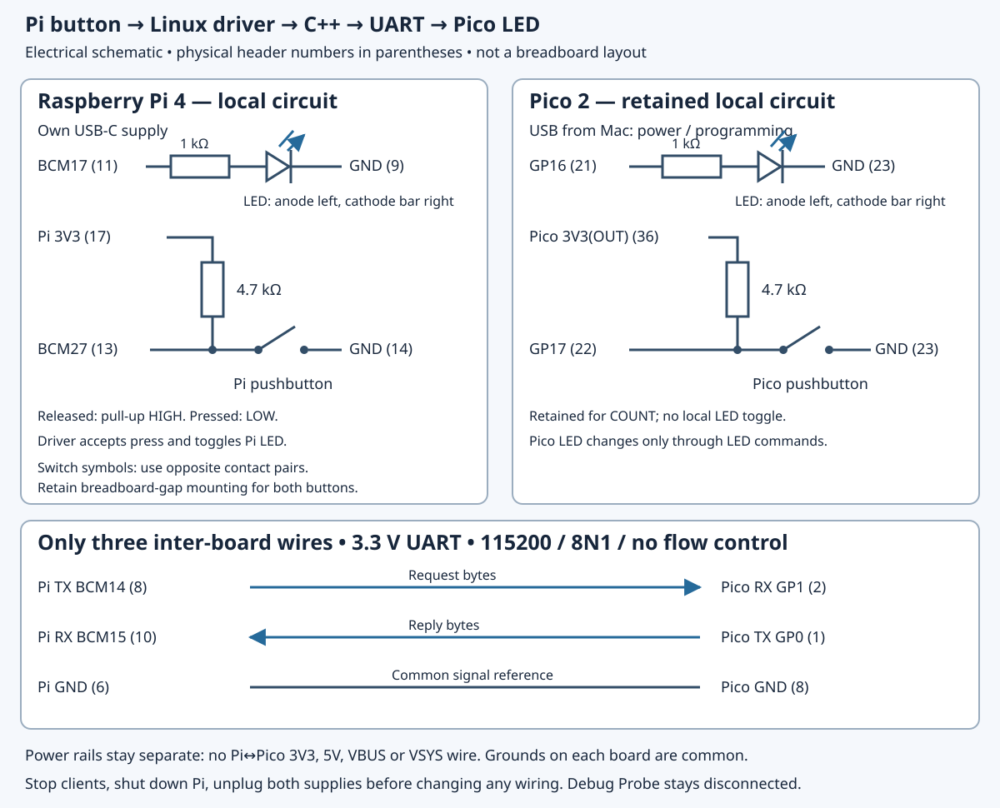

# Appendix A — Pinouts and circuits

Use this page to identify a contact, reconstruct a circuit, or check which bench state a lesson expects. The baseline is a **Pi 4 Model B and non-wireless Pico 2 with headers**, with separately powered USB connections. Kit revision, switch identity, fitted debug connector and silicon stepping still require inspection on your bench. None of these circuits has been physically measured during authoring.

## Read the names before counting pins

A **physical pin number** identifies a connector position. **BCM17** identifies a Pi SoC GPIO signal; **GP17** identifies a Pico GPIO signal. They belong to different chips. Pi BCM17 is our LED output at physical 11; Pico GP17 is our button input at physical 22.

Linux identifies a GPIO line by **controller device plus chip-local offset**. Discover the header controller by its label and neighbouring line names, then confirm GPIO17/27 and their offsets as in [5.3](5.3-establish-gpio-identity-and-ownership.md). The expected offsets are 17/27 on that controller; `/dev/gpiochip0` is not a permanent identity. Another chip can have its own offset 17. A line request owns the line until the last descriptor/reference to that request closes; duplicated descriptors can share the same request. Access permissions do not override an existing owner. [Linux GPIO interface](https://www.kernel.org/doc/html/latest/userspace-api/gpio/chardev.html)

Orient the boards from above, components visible:

| Board | Counting reference |
| --- | --- |
| Pico 2 | USB up: physical 1 top-left, 20 bottom-left, 21 bottom-right, 40 top-right. Use the [complete labelled header](assets/0.2-pico2-headers.svg) and [physical tour](0.2-a-labelled-tour-of-your-pico-2.md). |
| Pi 4 | Header along the upper edge, USB-C lower-left, Ethernet upper-right: physical 1 is the header's inner-left contact. Inner row: 1, 3 … 39; outer row: 2, 4 … 40, left to right. The [header close-up](assets/5.3-pi-header-identity.svg) rotates this top view; it is not an underside view. See the [physical tour](0.3-a-labelled-tour-of-your-raspberry-pi-4.md). |

The official [Pico 2 pinout and schematic](https://datasheets.raspberrypi.com/pico/pico-2-datasheet.pdf) and [Pi 4 schematic, J8](https://datasheets.raspberrypi.com/rpi4/raspberry-pi-4-reduced-schematics.pdf) establish the contacts below. A peripheral name printed beside a GPIO denotes a selectable function; firmware or Linux pin configuration must route that function to the contact.

## Ground, power and control contacts

| Board | Physical pins | Role in this book |
| --- | --- | --- |
| Pi | 6, 9, 14, 20, 25, 30, 34, 39 | GND. We choose 6 for inter-board reference, 9 for LED return, 14 for button return. |
| Pi | 1, 17 | 3V3 power; 17 supplies the Pi button pull-up. |
| Pi | 2, 4 | 5V power; unused. Never connect to a GPIO input. |
| Pi | 27, 28 | BCM0/ID_SD and BCM1/ID_SC: reserved HAT identification contacts; leave unused. |
| Pico | 3, 8, 13, 18, 23, 28, 38 | GND. Local circuits use 23; inter-board reference uses 8. |
| Pico | 33 | AGND, intended for analogue return; leave unused in these digital circuits. |
| Pico | 36 | 3V3(OUT), regulated output for its own button pull-up. |
| Pico | 40, 39 | VBUS (USB supply) and VSYS (board supply input). Leave unwired; use USB power. |
| Pico | 37, 35, 30 | 3V3_EN, ADC_VREF and RUN: regulator enable, analogue reference and reset control. Leave unwired. |

Power and control contacts are not ordinary GPIO. BOOTSEL is the Pico's USB-boot selection button, not a general reset button or a header GPIO. The [Pico hardware guide](https://www.raspberrypi.com/documentation/microcontrollers/pico-series.html#debug-connector-swd) also distinguishes factory debug connectors from bare pads.

GPIO signalling here is **3.3 V**; use no 5 V signal source. Each board uses its own supply: Pi USB-C and Pico USB from the Mac. Share the specified signal ground, but **join no Pi–Pico 3V3, 5V, VBUS or VSYS rails**, including through breadboard rails. Shutdown does not remove Pi header power. Before changing inter-board wires, stop clients, shut down Linux, wait, unplug both supplies and disconnect powered debug equipment. A connected unpowered board can load or be fed through signal pins; do not leave one endpoint powered while programming the other. [Pi GPIO electrical guidance](https://www.raspberrypi.com/documentation/computers/raspberry-pi.html#gpio)

## The two local LED and button circuits

These are separate sets of components. Retain the Pico set when Chapter 8 adds the Pi set.

| Circuit | Complete connection |
| --- | --- |
| Pico LED | **GP16 physical 21 → 1 kΩ → LED anode; LED cathode → GND physical 23**. |
| Pico button | **GP17 physical 22 → switch → GND physical 23**; **4.7 kΩ** from the GP17 node to **Pico 3V3(OUT) physical 36**. |
| Pi LED | **BCM17 physical 11 → 1 kΩ → LED anode; LED cathode → GND physical 9**. |
| Pi button | **BCM27 physical 13 → switch → GND physical 14**; **4.7 kΩ** from the BCM27 node to **Pi 3V3 physical 17**. |

The LED resistor is in series with the LED, limiting branch current. The pull-up is a separate resistor from supply to input. Released buttons read physically high; pressed buttons connect the input to ground and read low. LEDs are active-high with these connections.

For a reference four-leg button, A1/A2 are permanently joined, as are B1/B2; pressing joins A to B. Connect input to one A contact and ground to one B contact. Use the [contact-pair drawing](assets/0.5-switch.svg), checking the actual switch rather than assuming all four-leg parts match. Across-gap placement keeps the nodes separate only with the correct orientation. Each resistor and LED must also span distinct breadboard nodes; a rail stripe does not establish continuity across a break.

The physical circuit's **active-low** description is separate from API polarity. [8.1](8.1-establish-a-userspace-gpio-baseline.md) requests physical falling edges **without** `ACTIVE_LOW`; its values retain physical polarity. The later kernel Device Tree button property **does** specify `GPIO_ACTIVE_LOW`, so a descriptor's logical asserted value represents a physical low. Do not add the userspace flag merely to describe the same wiring. Both routes retain the external pull-up and disable internal bias. The Pico input's revision qualification remains in [4.1](4.1-read-a-button-by-polling.md).

## Bus and debugger connections

### Pi–Pico I²C

| Signal | Pi 4 | Pico 2 |
| --- | --- | --- |
| SDA | BCM2, physical **3** | GP4 / I2C0 SDA, physical **6** |
| SCL | BCM3, physical **5** | GP5 / I2C0 SCL, physical **7** |
| Reference | GND, physical **6** | GND, physical **8** |

Use the [I²C connection map](assets/circuit-i2c.svg). The Pi is controller; `i2c_target` makes the Pico target **0x42**, a seven-bit address. Retain its local LED/button. Pi board pull-ups already raise SDA/SCL to 3.3 V; add no external bus pull-ups or power wire.

The primary Pi configuration is **`dtoverlay=i2c3,pins_2_3,baudrate=100000`**, with conflicting I²C1/`i2c_arm` routing disabled, as in [6.1](6.1-i-c-on-the-wires.md). This selects the newer I²C3 controller at **100 kHz on the same BCM2/3 contacts**. Familiar `SDA1`/`SCL1` header labels do not select I²C1. Older controllers' clock-stretching defects matter because the SDK target stretches its clock. [Official overlay reference](https://github.com/raspberrypi/linux/blob/ae161617d7a4552fa91d03626b8d9f3696d17481/arch/arm/boot/dts/overlays/README), [Raspberry Pi controller correction](https://github.com/raspberrypi/linux/issues/4884#issuecomment-1038929049)

Expect `/dev/i2c-3`, but verify its sysfs adapter identity and `of_node` against the live `i2c3` Device Tree alias. A suffix alone proves no routing. Idle-high is an expected electrical state, not evidence that an address responds. Do not scan a bus merely to inspect its configuration.

### Pi–Pico UART

| Direction | Transmitter | Receiver |
| --- | --- | --- |
| Pi → Pico | Pi BCM14 TX, physical **8** | Pico GP1 RX, physical **2** |
| Pico → Pi | Pico GP0 TX, physical **1** | Pi BCM15 RX, physical **10** |
| Common reference | Pi GND, physical **6** | Pico GND, physical **8** |

The [UART connection map](assets/circuit-uart.svg) crosses TX to RX. Use **115200 baud, 8 data bits, no parity, one stop bit, no flow control**. There are exactly three inter-board wires: no clock, RTS/CTS or positive supply. This is 3.3 V UART, not RS-232. Pico USB and any diagnostics are separate from protocol traffic.

[7.2](7.2-configure-the-pi-uart-and-test-an-echo.md) establishes the Pi 4 PL011 baseline: `enable_uart=1`, `dtoverlay=disable-bt`, `hciuart` stopped/disabled or absent, no serial console/getty, and verified `/dev/serial0` → `/dev/ttyAMA0`. One client owns the stream by bench convention; competing readers can consume each other's replies. [Official UART configuration](https://www.raspberrypi.com/documentation/computers/configuration.html#configuring-uarts)

### Pico-only SPI loopback

| Pico signal | Physical pin | Connection in 6.4 |
| --- | --- | --- |
| GP18 / SPI0 SCK | **24** | Configured clock output; externally unconnected. |
| GP19 / SPI0 TX / MOSI | **25** | One jumper to GP20, physical 26. |
| GP20 / SPI0 RX / MISO | **26** | Receives that GP19 jumper. |
| GP21 | **27** | Unused; no chip-select wire in loopback. |

The [one-wire map](assets/6.4-spi-loopback.svg) retains the local Pico LED/button and disconnects the Pi and probe. No extra same-board ground jumper is needed. The optional real SPI sensor route uses **GP21 physical 27 for CS** after removing loopback. [Appendix C](appendix-c-1.md) specifies the optional **Adafruit BME280 product 2652**, its exact breakout contacts and header requirements; do not infer a generic sensor pinout or assume the extra part is present.

### Debug Probe D to Pico SWD

| Probe D contact | Signal / supplied breakout colour | Pico debug contact |
| --- | --- | --- |
| 1 | SC / SWCLK, orange | SWCLK |
| 2 | GND, black | GND |
| 3 | SD / SWDIO, yellow | SWDIO |

Use the [probe socket close-up](assets/0.4-probe-physical.svg) to establish connector orientation and the [SWD connection schematic](assets/3.1-swd-connections.svg) for the full path. Bare non-wireless Pico 2 pads read **SWCLK, GND, SWDIO left to right**, USB-up top view; these are outside the numbered header. A factory keyed connector uses the matching SH-to-SH lead. Aftermarket GPIO headers do not guarantee a fitted SWD connector: resolve actual cable fit before proceeding, without assuming soldering or an additional purchase.

D supplies **no target power**. The Mac needs two actual USB data paths, one for probe and one for Pico, including any required adapters. Probe **U stays empty**. Orange/black/yellow are the supplied breakout's documented signal colours; check names and keys as well. [Official probe wiring](https://www.raspberrypi.com/documentation/microcontrollers/debug-probe.html), [probe schematic](https://pip.raspberrypi.com/documents/RP-008194-DS)

## Select one bench state

The table describes operating states after the relevant lesson's configuration checks. “Pico local” means the circuits already introduced at that stage; retaining a circuit does not mean every image drives it.

| State | Attached wires and power | Pico image / tool owner | Pi ownership and access |
| --- | --- | --- | --- |
| LED, Chapter 2 | Pico LED only; Pico USB; Pi/probe detached. | `blink_sdk` or `blink_registers`; no debugger. | Pi header unwired. |
| SWD, Chapter 3 | Pico LED; D's three signals; separate probe/Pico USB. No Pi wires. | Matching ELF, one OpenOCD/GDB session; debugger can halt firmware. | Pi separate. No Pi GPIO permission change. |
| Button, Chapter 4 | Add Pico button/pull-up; D may remain as lesson specifies. No Pi bus. | `button_poll`, then IRQ images; USB terminal separate from debugger. | Pi separate. |
| I²C, Chapter 6 | Pico local; SDA/SCL/GND table above; both supplies. Probe detached. | `i2c_target`, free-running; Pi I²C client. | I²C3 mux and `i2c-dev`; inspect node policy, normally `i2c` group. Pi local pins unwired. |
| SPI loopback, 6.4 | Pico local plus GP19→GP20 only; Pico USB. Pi off/disconnected; probe detached. | `spi_loopback`; Mac USB terminal. | Earlier I²C configuration may persist, but no Pi wires. |
| UART, Chapter 7 | Pico local plus three UART wires; both supplies; no I²C/loopback/debug. | `uart_echo`, then `uart_device`; one Pi serial client. | PL011 route, consoles removed; current `dialout` access checked. Pi local pins unwired. |
| Pi GPIO, Chapters 8–9 | Pi local LED/button; Pico local retained but Pico unplugged; no inter-board wires. | Retain `uart_device`; no tool controls Pico. | First `gpio_events` requests BCM17/27; later bound `mybutton` owns them. Never run both. Inspect `gpio` policy; `/dev/mybutton` has 8.5's deliberate udev rule. |
| Capstone, Chapter 10 | **Both local LED/button circuits**, plus exactly three UART wires; both supplies; probe detached. | `uart_device` free-running; one `capstone` process on Pi. | Bound `mybutton` owns BCM17/27; bridge opens `/dev/mybutton` and UART with established access. Reload manual module after reboot. |

I²C, SPI loopback, SWD and UART are alternative wiring states in this route. Different pin assignments do not make mixed power/debug ownership an approved operating state. Before installing a new UF2 from a bus state: stop clients, power both boards off, remove **all** inter-board bus wires, keep the Pi separate, and program the isolated Pico through USB. Unplug Pico again before reattaching the selected wires with both boards off. The same rule applies when recovering firmware through BOOTSEL.

Closing a client releases its descriptors; it does not undo an overlay, stop firmware, unload a module or guarantee a permanent output level. Record configuration edits and group changes when making them. Retiring I²C follows [6.1's recorded rollback](6.1-i-c-on-the-wires.md#check-the-resting-state-and-continue); retiring UART follows [7.2](7.2-configure-the-pi-uart-and-test-an-echo.md#diagnose-and-leave-the-next-state); retiring the driver follows [8.3](8.3-describe-the-device-and-bind-the-driver.md#troubleshooting-and-next-state). Preserve later unrelated settings rather than replacing a whole configuration file with an old backup.

## Complete capstone and diagram index

[Open the complete capstone schematic](assets/10.1-capstone-circuit.svg). It includes both 1 kΩ LED resistors, both 4.7 kΩ pull-ups and every connection in the local/UART tables. The older [capstone overview](assets/circuit-capstone.svg) illustrates the command path; it omits component detail and is **not a complete wiring schematic**.

| Diagram | What to find; kind of drawing |
| --- | --- |
| [0.1 command chain](assets/0.1-build-chain.svg) | Identify the machines and software boundaries; conceptual path with board silhouettes, not wiring. |
| [0.2 Pico physical](assets/0.2-pico2-physical.svg), [header](assets/0.2-pico2-headers.svg) | USB, BOOTSEL, LED, flash, RP2350, clock/power support and SWD; physical landmarks and contact identity. |
| [0.2 RP2350 internals](assets/0.2-rp2350-concept.svg) | CPU, SRAM and controllers inside the package; conceptual blocks, not visible separate chips. |
| [0.3 Pi top](assets/0.3-pi4-top.svg), [underside](assets/0.3-pi4-underside.svg), [SoC relationships](assets/0.3-pi4-concept.svg) | SoC/RAM, USB controller, Ethernet PHY/ports, power/video/ribbon connectors and microSD. The first two identify physical landmarks; the third explains chip boundaries. Underside is explicitly flipped. |
| [0.4 probe physical](assets/0.4-probe-physical.svg), [cable ends](assets/0.4-cable-ends.svg), [cable paths](assets/0.4-cable-paths.svg) | D versus U and probe controller; plug/socket shapes; separate USB/debug paths. Only the socket close-up establishes contact orientation. |
| [0.5 breadboard](assets/0.5-breadboard.svg), [parts](assets/0.5-parts.svg), [switch](assets/0.5-switch.svg) | Hidden strips/rail breaks, resistor bands, LED polarity, jumper ends and permanent switch pairs; reference physical forms, not an exact kit packing list. |
| [0.6 bench](assets/0.6-bench-paths.svg), [LED schematic](assets/0.6-led-schematic.svg), [LED placement](assets/0.6-led-placement.svg) | Separate power/data paths, electrical series connection, then distinct breadboard nodes. Placement coordinates belong to that illustration. |
| [Pico LED](assets/circuit-pico-led.svg), [Pico button](assets/circuit-pico-button.svg), [Pi local circuit](assets/8.1-pi-userspace-circuit.svg) | Electrical connectivity and component values; not physical header positions. |

The earlier bus/debug sections link their dedicated connection diagrams. Follow their text labels and endpoint tables even when lines share a colour.

## Colour and symbol conventions

Colour helps follow a drawing; it does not assign an electrical function to a loose kit wire. Blue commonly follows signals or USB paths in these figures; dark grey follows reference/return paths; board green identifies the PCB. Other figures use teal for loopback or orange for a grouped debug path. Those are local drawing choices, not a universal wiring standard. Match **signal name, board and physical contact**, then optionally choose consistent wire colours for your own bench.

The probe's supplied breakout colours have the specific documented meanings above. Resistor **bands** encode resistance and tolerance independently of jumper colours: [0.5](0.5-recognise-the-breadboard-and-kit-components.md#select-the-resistors) supplies both four- and five-band codes for 1 kΩ and 4.7 kΩ. Body colour alone is insufficient.

A schematic line denotes an electrical connection, not wire length or breadboard position. A filled dot marks a junction where branches meet; an LED's bar is its cathode; outward arrows denote emitted light. A board silhouette locates objects; a conceptual block diagram explains relationships. None substitutes for a verified contact map or establishes continuity, voltage, timing or successful hardware operation.

## References

- [Pico 2 datasheet](https://datasheets.raspberrypi.com/pico/pico-2-datasheet.pdf) — pinout, supply/control contacts, schematic and component locations.
- [Pi 4 reduced schematic](https://datasheets.raspberrypi.com/rpi4/raspberry-pi-4-reduced-schematics.pdf) — J8 connections; compare with the live board's identity.
- [Debug Probe documentation](https://www.raspberrypi.com/documentation/microcontrollers/debug-probe.html) — D/U roles, breakout colours, supplies and reference connection.
- [Linux GPIO character-device API](https://www.kernel.org/doc/html/latest/userspace-api/gpio/chardev.html) — chip/offset identity, ownership and polarity flags.
