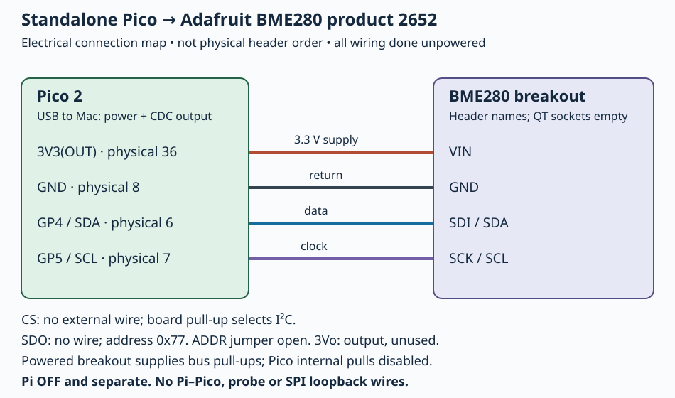

# C.2 — Read a BME280 over I²C

This optional experiment makes the Pico 2 an I²C **controller** and the Adafruit BME280 a **target**. It reads the chip identity, factory temperature calibration and a burst of raw registers, then prints compensated chip temperature over USB. The main course is complete without this extra sensor. Start after [C.1's board identification and assembly checks](appendix-c-1.md), with Chapter 1's Mac build and USB procedure available. No Pi software is needed.

Use **Adafruit product 2652**, with a securely soldered seven-pin header, a breadboard, four jumpers, your non-wireless Pico 2 with headers and a USB data cable. Loose header pins pressed against unsoldered holes are not reliable connections. If headers are not fitted, completing [Adafruit's assembly procedure](https://learn.adafruit.com/adafruit-bme280-humidity-barometric-pressure-temperature-sensor-breakout/assembly) requires soldering equipment and skills beyond the assumed kit. This page uses the header, leaving STEMMA QT sockets empty.

## 1. Separate the boards and wire the sensor

Stop the capstone, serial/I²C clients, terminals, GDB and OpenOCD. If the Pi is running, issue **`sudo poweroff` in its SSH shell**, wait for shutdown, then unplug its USB-C supply. Unplug Pico USB and any powered Debug Probe. With **both boards unpowered**, remove **every Pi–Pico wire**, including UART, I²C and shared ground, and all probe-to-Pico debug/UART leads. Remove the GP19–GP20 SPI loopback jumper too. The Pi stays off and physically separate for this appendix. A Linux shutdown alone does not remove header power.

You may retain the Pico GP16 LED and GP17 button/pull-up circuit from [Appendix A](appendix-a.md), provided it uses only its specified local contacts and does not bridge the new bus nodes. This firmware neither drives that LED nor reads that button. No Pi power rail connects to this circuit.

Product 2652 has original and STEMMA QT board versions; identify yours using [C.1's labelled QT orientation drawing](assets/C.1-bme280-orientation.svg) and the [official board drawings](https://learn.adafruit.com/adafruit-bme280-humidity-barometric-pressure-temperature-sensor-breakout/downloads). The selected wiring uses the seven header contacts, whose functions are the same. Read the actual silkscreen: the power input may read **Vin/VIN**, and the regulator output **3Vo**. The signal contacts read **SCK, SDO, SDI, CS**; SCK doubles as SCL and SDI as SDA. Match names rather than copying a position from another breakout.

| Pico 2 contact | Adafruit 2652 contact | Meaning here |
| --- | --- | --- |
| **3V3(OUT), physical 36** | **VIN** | Power input; use the selected 3.3 V route, with matching 3.3 V bus logic. |
| **GND, physical 8** | **GND** | Power return and signal reference. |
| **GP4 / I2C0 SDA, physical 6** | **SDI / SDA** | Bidirectional I²C data. |
| **GP5 / I2C0 SCL, physical 7** | **SCK / SCL** | Clock supplied by the Pico. |
| No wire | **SDO** | In I²C, address selection; onboard pull-up selects default `0x77`. |
| No wire | **CS** | Sensor-side pull-up holds chip select high, selecting I²C. |
| No wire | **3Vo** | Regulator **output**; leave unused, not a second power input. |



[Open the electrical map](assets/C.2-bme280-i2c.svg). It represents connections, not breadboard hole positions or a photograph. Use the Pico's USB-up top-view pin numbering from [Appendix A](appendix-a.md) to find the contacts. Put each sensor header contact on a distinct breadboard strip; keep wires short and check any split rails.

Here the **powered Adafruit board supplies bus pull-ups**; the Pi's 1.8 kΩ pull-ups from Chapter 6 are absent. The firmware disables Pico internal pulls. The [Adafruit pinout instructions](https://learn.adafruit.com/adafruit-bme280-humidity-barometric-pressure-temperature-sensor-breakout/pinouts) permit leaving CS and SDO disconnected. The [QT schematic linked by Adafruit](https://github.com/adafruit/Adafruit-BMP280-Breakout-PCB/blob/master/Adafruit%20BMP280%20STEMMA%20QT.sch) shows bus pull-ups, the sensor-side CS pull-up and SDO address pull-up; Adafruit documents this PCB as shared with the QT BME280. This is a property of this breakout, not permission to float a bare BME280's address input. Keep the **ADDR solder jumper open** and no SDO-to-ground wire: either low strap changes the address to `0x76` and would require editing `Bus::address` before rebuilding.

## 2. Read and build the complete program

Use the Chapter 1 checkout or [complete examples archive](downloads/hardware-examples.zip); preserve its directory structure. Both files below are required. `examples/pico/bme280_i2c.cpp` configures the bus and adapts register reads/writes:

```cpp
{{#include ../examples/pico/bme280_i2c.cpp}}
```

`examples/pico/bme280_common.hpp` contains the complete shared temperature experiment:

```cpp
{{#include ../examples/pico/bme280_common.hpp}}
```

The shared [CMake project explained in 1.2](1.2-understand-the-smallest-useful-project.md) already defines `bme280_i2c`, links the SDK I²C library, enables USB stdio and disables UART stdio. Use the pinned setup rather than an assumed system compiler path. Commands assume the project is `~/hardware-from-software`; substitute your actual extraction directory.

**Mac — Terminal, project root:**

```sh
cd ~/hardware-from-software
python3 scripts/setup_deps.py
python3 scripts/build_examples.py --pico
ls -l .build/pico/bme280_i2c.uf2 .build/pico/bme280_i2c.elf
```

The script selects `pico2`, `rp2350-arm-s`, SDK 2.3.1 and a Debug build. The **UF2** is the flash image; the **ELF** retains debugging information. The recorded Mac Pico build compiled this target, including its explicit disabling of internal pulls. Physical sensor operation, electrical levels and bus timing remain **unexercised**; compilation does not establish them.

## How register reads reach the chip

`i2c_init(i2c0, 100000)` requests a **100 kHz** bus. Unlike the Pico target in Chapter 6, this Pico generates the clock. The seven-bit target address is `0x77`, not the earlier firmware's `0x42`. Pass it unshifted to the SDK.

A register read first writes a one-byte register cursor, with `nostop=true`. The following read uses a **repeated START** and ends with STOP (`nostop=false`). For the identity read, the intended sequence is:

```text
START → 0x77 write → register 0xd0 → repeated START → 0x77 read
      → one identity byte → controller NACK → STOP
```

This is a protocol sketch, not a captured trace. Address and write bytes have target ACK clocks. Repeated START changes direction while keeping cursor selection and reading in one transaction. The [pinned SDK I²C API](https://github.com/raspberrypi/pico-sdk/blob/079c6f39023649b154152db30f1d781e884879bc/src/rp2_common/hardware_i2c/include/hardware/i2c.h) documents `nostop`, timeout and return semantics. Each bus call gets **100000 µs**; a successful read requires write count `1` and then exactly `len` read bytes. C++ `&&` short-circuits: a failed cursor write prevents the read. A register-value write requires count `2` and sends STOP. These are per-call limits, not a promise that the complete experiment or every combined read finishes within 100 ms.

The helper's sequence follows the [Bosch register definitions](https://www.bosch-sensortec.com/media/boschsensortec/downloads/datasheets/bst-bme280-ds002.pdf), §§3.3, 4.2 and 5:

| Operation | Purpose |
| --- | --- |
| Read `0xd0`, require `0x60` | Reject a missing device or different chip. The raw ID is checked internally, not printed. |
| Read `0x88`–`0x8d` | Load six temperature calibration bytes. Decode `T1` unsigned and `T2/T3` signed, least-significant byte first; reject all-zero/all-one `T1`. |
| Write `0xf4 = 0x21` | Temperature oversampling ×1, pressure skipped, forced mode: request one conversion, then return to sleep. No humidity conversion is requested. |
| Delay 10 ms; poll `0xf3` | Require both `measuring` (bit 3) and `im_update` (bit 0) clear, hence mask `0x09`. At most 100 status reads, with 1 ms sleeps after busy results. Bus-call time adds to these delays. |
| Burst read `0xf7`–`0xfe` | Fetch eight consecutive raw bytes. Only temperature bytes `0xfa`–`0xfc` feed compensation; pressure/humidity bytes are not reported as measurements. |

There is no soft reset or `config` register write. A fresh power-on provides the baseline, with a two-second delay in `main` and a further 10 ms before the identity read. The helper assembles a 20-bit temperature sample, rejects the skipped-channel sentinel and applies factory compensation. [C.3](appendix-c-3.md) explains that arithmetic and its limits.

## 3. Flash and observe through USB

Keep the sensor wiring inspected and Pico USB **unplugged** before programming. The Pi and probe must still be detached. With this single Pico-powered circuit, hold **BOOTSEL**, attach Pico USB to the Mac, and release after **RP2350** mounts. This starts the ROM loader before the previous firmware can use GPIO. Sensor power comes only from Pico 3V3; never add wires while USB is attached.

**Mac — Terminal, project root, RP2350 mounted:**

```sh
cd ~/hardware-from-software
ls /Volumes/RP2350
cp .build/pico/bme280_i2c.uf2 /Volumes/RP2350/
```

Let the volume disappear as the Pico restarts. Then discover its USB CDC device:

**Mac — Terminal, project root:**

```sh
find /dev -maxdepth 1 -name 'cu.usbmodem*' -print
screen /dev/cu.usbmodemYOUR_SUFFIX 115200
```

Replace the placeholder with the actual discovered path, using [1.3's identification procedure](1.3-flash-with-bootsel-and-read-output.md#4-find-and-open-the-serial-device) if several match. `115200` is a conventional terminal setting for USB CDC; it does not set the I²C clock or create a GPIO UART connection. The program does not accept terminal commands.

Successful output repeats with a requested one-second sleep between measurements. This example is **illustrative, not a recorded hardware result**:

```text
BME280 temperature 24.36 C (chip temperature, not calibrated ambient)
BME280 temperature 24.37 C (chip temperature, not calibrated ambient)
```

There is no unconditional startup banner. On failure the helper prints one reason and returns; `main` then sleeps forever to keep USB alive, **without retrying**. Opening a terminal late may miss that sole diagnostic. A repeated temperature line implies the earlier identity and calibration checks passed; it is not a transcript of their raw bytes. This measures approximate chip temperature, affected by nearby heat, not calibrated room temperature.

## Diagnose and leave the next state

| Symptom | Check and correction |
| --- | --- |
| No RP2350 volume or USB device | Follow 1.3's BOOTSEL/data-cable checks; verify this UF2 and actual port. |
| Blank terminal | Close other serial owners. Success repeats; an early one-shot error may already be lost. Quit `screen`, unplug Pico, reconnect normally and promptly rediscover/open the port during the two-second startup delay. No retry occurs merely by reopening `screen`. |
| `missing device or wrong chip ID (expected 0x60)` | This deliberately combines bus failure and wrong identity. Power off; check BME280 versus BMP280, VIN/GND, GP4→SDI and GP5→SCK, solder joints, CS state, open ADDR and unstrapped SDO for `0x77`. It does not print the actual received ID. |
| `invalid calibration`, calibration/data/status read or forced-mode write failed | Inspect the four endpoints, short bus wires, reliable header soldering, powered breakout pull-ups and absent Pi/loopback connections. Power off before corrections; avoid adding arbitrary pull resistors. |
| `measurement timeout` or `temperature channel skipped` | Recheck the exact firmware/configuration and clean power-on baseline. Do not defeat status checks or reduce delays to force a result. A debugger halt distorts timing. |
| Temperature seems too warm | Check nearby heat and sensor placement; hundredths in the output are formatting, not ambient accuracy. |

Quit `screen` with **Ctrl+A**, then **Ctrl+\\**, and confirm **Y** if asked; detaching leaves it owning the port. For [C.3](appendix-c-3.md), retain exactly the four sensor wires, CS/SDO/3Vo unconnected, ADDR open, `bme280_i2c` installed, Pi off/separate and probe detached. You may leave Pico USB connected to continue observing, or unplug it for an idle, unpowered bench. Reconnect normally to restart. Before any wiring change, quit the terminal and unplug Pico USB; the later SPI lesson replaces this I²C wiring explicitly.

## References

- [Adafruit 2652 pinouts](https://learn.adafruit.com/adafruit-bme280-humidity-barometric-pressure-temperature-sensor-breakout/pinouts) — power, dual-purpose signals and default address.
- [Adafruit downloads and original/QT schematics](https://learn.adafruit.com/adafruit-bme280-humidity-barometric-pressure-temperature-sensor-breakout/downloads) — breakout pull-ups and board revision drawings.
- [Bosch BME280 datasheet](https://www.bosch-sensortec.com/media/boschsensortec/downloads/datasheets/bst-bme280-ds002.pdf) — registers, forced measurement, interface and compensation.
- [Pinned SDK I²C API](https://github.com/raspberrypi/pico-sdk/blob/079c6f39023649b154152db30f1d781e884879bc/src/rp2_common/hardware_i2c/include/hardware/i2c.h) — combined transfer and error semantics.
