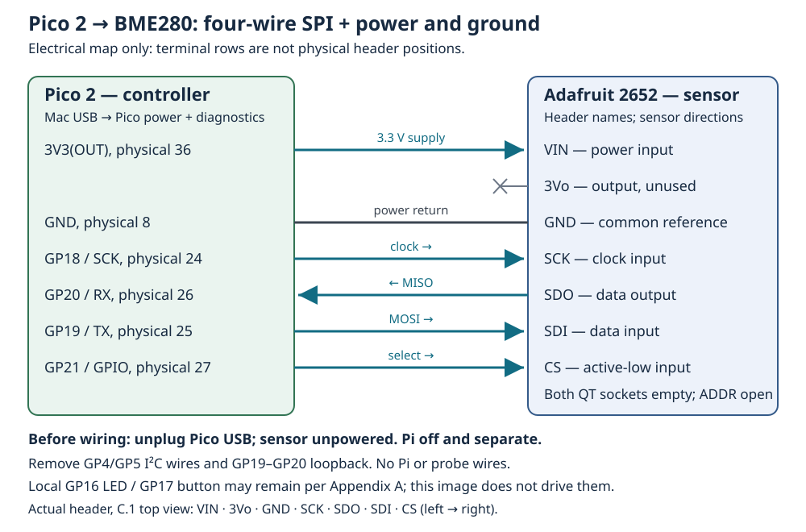

# C.4 — Read the same chip over SPI

This optional experiment reads the **same Adafruit BME280, product 2652**, through four-wire SPI. The Pico supplies the clock and selects the sensor; USB carries temperature diagnostics to the Mac. You need the identified board with a securely soldered seven-pin 2.54 mm header from [C.1](appendix-c-1.md), six jumpers, breadboard space, a non-wireless Pico 2 with headers and its USB data cable. An additional sensor purchase or soldering equipment is not assumed. Resolve missing headers before proceeding; loose pins pressed into unsoldered holes are unsuitable.

Start after [C.2](appendix-c-2.md) and [C.3](appendix-c-3.md), with [6.4's SPI vocabulary](6.4-compare-spi-with-a-loopback-experiment.md) available. The compensation code stays the same; the transport changes. Both sensor images have recorded Pico 2 compilation evidence in `verification.json`. **Physical sensor operation over either bus has not been exercised during authoring.**

## 1. Replace the wiring with power removed

Stop USB terminals, Pi clients, GDB and OpenOCD. If the Pi is running, use **Pi — SSH shell, any directory:** `sudo poweroff`; wait for shutdown, then unplug its USB-C supply. Unplug Pico USB and powered debug equipment. Remove every Pi–Pico UART, I²C and ground wire, and all probe/debug/UART leads. Keep the Pi off and separate throughout this experiment.

With the Pico and sensor **unpowered**, remove the C.2 GP4→SDI and GP5→SCK wires. Also remove any GP19–GP20 loopback jumper from 6.4: leaving it would join the Pico's transmitting output to the sensor's transmitting output. Retain VIN/GND only if they match the table below. Keep the ADDR solder jumper open and remove any SDO-to-ground address strap. You may retain the exact local GP16 LED and GP17 button/pull-up circuits from [Appendix A](appendix-a.md); this image does not configure or drive them.

Match sensor **contact names** against [C.1's component-side orientation drawing](assets/C.1-bme280-orientation.svg). With its header below the sensor, that drawing orders the seven contacts **VIN, 3Vo, GND, SCK, SDO, SDI, CS**, left to right. The electrical map below is not a breadboard layout. Each header contact needs a distinct breadboard node; check split rails and avoid bridging adjacent nodes.

| Pico 2 contact | Sensor contact | Direction and purpose |
| --- | --- | --- |
| **3V3(OUT), physical 36** | **VIN** | Pico supplies sensor power at 3.3 V. |
| No connection | **3Vo** | Sensor-board regulator output; leave unused. |
| **GND, physical 8** | **GND** | Common power return and signal reference. |
| **GP18 / SPI0 SCK, physical 24** | **SCK** | Pico output → sensor clock input. |
| **GP20 / SPI0 RX / MISO, physical 26** | **SDO** | Pico input ← sensor data output. |
| **GP19 / SPI0 TX / MOSI, physical 25** | **SDI** | Pico output → sensor data input. |
| **GP21, physical 27** | **CS** | Pico GPIO output → sensor active-low select input. |



[Open the electrical map](assets/C.4-bme280-spi.svg). Find Pico contacts using [Appendix A's USB-up top view](appendix-a.md). Both STEMMA QT sockets stay empty. Use **3.3 V power and logic**, with no Pi supply, Pico VBUS or VSYS connection. Adafruit's [pinouts](https://learn.adafruit.com/adafruit-bme280-humidity-barometric-pressure-temperature-sensor-breakout/pinouts) distinguish SDI/SDO from the microcontroller's TX/RX names; its [schematics and CAD](https://learn.adafruit.com/adafruit-bme280-humidity-barometric-pressure-temperature-sensor-breakout/downloads) establish the selected breakout's header. Unlike C.2, **CS and SDO now have active signal wires**.

Start from a fresh power-up after changing interface wiring. Pulling CS low selects SPI and disables this chip's I²C interface until the next power-on reset. Merely returning CS high does not restore I²C. Never hot-rewire the circuit. [Bosch datasheet, §6.1](https://www.bosch-sensortec.com/media/boschsensortec/downloads/datasheets/bst-bme280-ds002.pdf)

## 2. Read and build the complete source

Keep the existing checkout or [examples archive](downloads/hardware-examples.zip) directory structure. The SPI adapter is `examples/pico/bme280_spi.cpp`:

```cpp
{{#include ../examples/pico/bme280_spi.cpp}}
```

The complete shared helper is `examples/pico/bme280_common.hpp`:

```cpp
{{#include ../examples/pico/bme280_common.hpp}}
```

The shared [CMake project from 1.2](1.2-understand-the-smallest-useful-project.md) already defines `bme280_spi`, links `hardware_spi`, enables USB stdio and disables UART stdio. Build on the Mac using the checkout-local tools. Substitute your actual project directory for `~/hardware-from-software`.

**Mac — Terminal, project root:**

```sh
cd ~/hardware-from-software
python3 scripts/setup_deps.py
python3 scripts/build_examples.py --pico
ls -l .build/pico/bme280_spi.uf2 .build/pico/bme280_spi.elf
```

The script selects `pico2`, `rp2350-arm-s`, SDK 2.3.1 and a Debug build. Flash the **UF2**; retain the **ELF** for debugging. This is Arm microcontroller firmware, not a native Mac/Pi executable or a Linux kernel module; no Linux kernel headers are needed.

## How this adapter changes the transaction

`main` initializes GP21, sets its output latch **high before enabling output direction**, and then configures SPI0. This avoids deliberately asserting the active-low select while enabling the GPIO output. CS remains an ordinary GPIO controlled by `gpio_put`, rather than an automatic SPI frame-select pin.

The requested clock is **100 kHz**, with **8-bit words, most-significant bit first, mode 0**: CPOL=0 gives an idle-low clock; CPHA=0 samples on its first, rising edge. BME280 supports modes 0 and 3; this source chooses 0. These are configuration requests, not measured waveforms. [Bosch SPI interface, §6.3](https://www.bosch-sensortec.com/media/boschsensortec/downloads/datasheets/bst-bme280-ds002.pdf)

The adapter takes the same full register numbers as the I²C helper. It forms an SPI command with **bit 7 as read/write**, leaving seven register-address bits. `register_address |= 0x80` selects a read; `register_address & 0x7f` selects a write. Thus reading `0xd0` sends command `0xd0`; writing `0xf4 = 0x21` sends **`0x74, 0x21`**. These are register commands, not I²C device address `0x77`.

For a read, GP21 stays low across both the command write and the complete read, including all eight burst bytes. The sensor auto-increments its register cursor; raising CS ends the transaction. `spi_write_blocking` discards incoming bits while transmitting the command. `spi_read_blocking(spi0, 0, buffer, byte_count)` transmits dummy **zero bytes** to generate clocks while receiving sensor bytes. Both wires shift simultaneously even though the C++ API calls are sequential. [Bosch SPI read/write rules, §§6.3.1–6.3.2](https://www.bosch-sensortec.com/media/boschsensortec/downloads/datasheets/bst-bme280-ds002.pdf)

The adapter checks counts: one command byte and exactly `byte_count` received bytes, or two written bytes. A successful count means the controller completed transfers; **SPI has no built-in peripheral ACK**. A disconnected sensor can still yield a full count. These calls block and supply **no explicit SPI bus timeout**. The two-second sleep is a startup delay for USB, not a transaction deadline. See the [pinned SDK SPI API](https://github.com/raspberrypi/pico-sdk/blob/079c6f39023649b154152db30f1d781e884879bc/src/rp2_common/hardware_spi/include/hardware/spi.h).

The shared helper adds 10 ms before reading `0xd0` and requires ID `0x60`; it does not print the raw ID. It reads six temperature calibration bytes at `0x88`, then repeatedly writes `0xf4 = 0x21`, waits 10 ms, and checks status mask `0x09`. There are at most **100 status-read attempts**, with 1 ms sleeps after busy results; transfer time adds to them, so this is not a strict 100 ms deadline. The eight-byte read from `0xf7` supplies the same temperature bytes and compensation described in [C.3](appendix-c-3.md). The source performs **no soft reset or `config` write**, requests no pressure/humidity conversion and reports temperature only.

## 3. Flash and observe

Inspect all six wires while Pico USB remains unplugged and the sensor is unpowered. With the Pi and probe detached, hold **BOOTSEL**, connect Pico USB to the Mac, then release when **RP2350** mounts. This enters the ROM loader before the previous image uses GPIO; power reaches the sensor only through the Pico.

**Mac — Terminal, project root, RP2350 mounted:**

```sh
cd ~/hardware-from-software
ls /Volumes/RP2350
cp .build/pico/bme280_spi.uf2 /Volumes/RP2350/
```

After the volume disappears and firmware restarts, discover the actual USB port:

**Mac — Terminal, project root:**

```sh
find /dev -maxdepth 1 -name 'cu.usbmodem*' -print
screen /dev/cu.usbmodemYOUR_SUFFIX 115200
```

Replace the placeholder with the discovered path; use [1.3's port-identification procedure](1.3-flash-with-bootsel-and-read-output.md#4-find-and-open-the-serial-device) if several appear. The terminal's `115200` does not set SPI clock speed. There are no terminal commands or GPIO UART wires.

Successful measurements repeat with a requested one-second sleep between them. This line is **illustrative, not measured**:

```text
BME280 temperature 24.36 C (chip temperature, not calibrated ambient)
```

A repeating line implies the identity and calibration checks passed. There is no unconditional startup banner. On an error, the helper prints one reason, returns, and `main` idles forever without automatically retrying; USB remains initialized. A terminal opened late can miss that sole error.

## Compare the two routes and diagnose symptoms

| Property | C.2 I²C | C.4 SPI |
| --- | --- | --- |
| Select the sensor | Seven-bit device address `0x77` | Dedicated active-low CS wire |
| Data path | Shared bidirectional SDA; pull-ups needed | Separate MOSI and MISO; full duplex |
| Register read boundary | Cursor write, repeated START, read, STOP | CS low across command and returned bytes |
| Agreement and error evidence | Address/data ACK phases; SDK timeout calls | Match clock mode; transferred count supplies no device ACK |
| Measurement | Shared temperature helper | Same helper and chip calibration |

The same sensor retains its factory coefficients across these transport changes. Temperatures need not match digit for digit: the samples occur at different times, and handling, board heat and thermal settling change chip temperature. Formatting hundredths does not establish ambient accuracy. A successful local loopback from 6.4 also cannot establish sensor identity or correct CS timing.

| Symptom | Check and correction |
| --- | --- |
| No USB port or RP2350 volume | Follow 1.3's data-cable/BOOTSEL checks; confirm this UF2 and the actual port. |
| Blank terminal | Close competing owners. Quit `screen`, unplug Pico, reconnect normally and promptly rediscover/open the port during startup. Reopening a terminal alone cannot restart a failed helper. |
| `missing device or wrong chip ID (expected 0x60)` | Power off; check VIN/GND polarity, 3.3 V levels, solder joints, GP21→CS, GP18→SCK and mode 0. Confirm a BME280 rather than BMP280. |
| Same identity error after checking power | Check **GP19→SDI**, **GP20←SDO**, absent GP19–GP20 loopback, removed GP4/GP5 wires, empty QT sockets and open ADDR. Do not swap TX/RX by treating sensor SDO as Pico output. |
| Suspected all-zero/all-one received bytes | A floating/disconnected MISO or stuck line can produce `0x00`/`0xff` with successful transfer counts. The stock image combines these failures into its ID error; it does not display those byte values. Inspect wiring before changing the ID requirement. |
| Invalid calibration, read/write failure, timeout or skipped temperature | Restore the exact source and fresh power-on state; inspect select/data wiring unpowered. Keep status checks and delays. A debugger halt changes timing. |
| Temperature too warm or differs from I²C | Let the board settle away from heat sources; compare chip temperatures under similar conditions. |

Quit `screen` with **Ctrl+A**, then **Ctrl+\\**, confirming **Y** if requested. Detaching leaves the process owning the port. Unplug Pico USB before changing any wire. Leave the bench unpowered with these six sensor wires, or remove all six with power off. The Pi stays off and separate. To return to the main-route capstone, remove the sensor wiring, restore `uart_device` on the isolated Pico, and follow [10.1's both-boards-off restoration procedure](10.1-use-a-linux-device-event-to-control-pico-hardware.md). Do not reconnect inter-board UART/I²C/debug leads while either board is powered.

## References

- [Bosch BME280 datasheet](https://www.bosch-sensortec.com/media/boschsensortec/downloads/datasheets/bst-bme280-ds002.pdf) — interface selection §6.1, SPI §6.3 and timing §6.4.3.
- [Adafruit BME280 pinouts](https://learn.adafruit.com/adafruit-bme280-humidity-barometric-pressure-temperature-sensor-breakout/pinouts) — power and signal direction.
- [Adafruit downloads and board schematics](https://learn.adafruit.com/adafruit-bme280-humidity-barometric-pressure-temperature-sensor-breakout/downloads) — original/QT header layouts and supporting circuitry.
- [SDK 2.3.1 SPI header at the course commit](https://github.com/raspberrypi/pico-sdk/blob/079c6f39023649b154152db30f1d781e884879bc/src/rp2_common/hardware_spi/include/hardware/spi.h) — format, dummy transmit data, blocking calls and counts.
