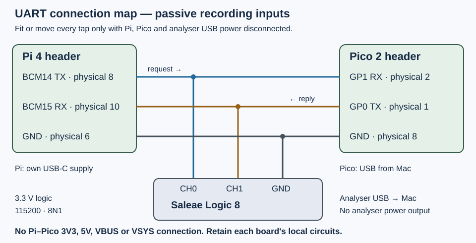

# Appendix D — Optional logic analyser

A logic analyser records several input signals against one time axis. A protocol decoder interprets those recorded levels as bytes. Here you will capture an LED request travelling from the Pi to the Pico and its reply travelling back, then save the evidence for later inspection.

This appendix is optional. The main book requires no analyser purchase. The worked route is specifically for a **genuine Saleae Logic 8 with official Logic 2 on an Apple Silicon Mac**. It does not establish compatibility for another eight-channel device, a clone, or different software. The Debug Probe is not a logic analyser. If you lack the analyser, its suitable harness/clips, or the necessary Mac USB connections, skip the practical steps; the protocol explanations still apply.

Start from the working [7.3 UART device](7.3-build-a-robust-c-serial-client.md), or the stopped-client [Chapter 10 capstone](10.1-use-a-linux-device-event-to-control-pico-hardware.md). Keep `uart_device` installed and free-running, with no GDB breakpoints. No Logic 2 installation or physical capture was exercised during authoring. All waveform expectations below are **predictions from the source, not recorded results**.

## Know which instrument is connected

Saleae currently supports **macOS 12 Monterey or later**, including Apple silicon. Its [download page](https://www.saleae.com/downloads) offers separate Intel and Apple Silicon builds; check [supported operating systems](https://www.saleae.com/support/logic-software/download-and-installation/supported-operating-systems) again if using a later release.

Logic 8 provides eight digital inputs, with up to 100 MS/s under restricted channel configurations. **10 MS/s is a supported digital rate**, including the two- and four-channel digital-only configurations used here. The maximum is not needed. Logic 8 requires a **USB 2.0 High Speed** data path; Saleae recommends a direct computer connection instead of a hub or dock. Use its supplied data cable and, if necessary, an appropriate USB-C adapter that you actually have. Account for the Pico's USB power/data connection too; leave the Debug Probe detached. No extra port, adapter or clips are assumed available. [Logic 8 specifications](https://downloads.saleae.com/specs/logic_8_data_sheet.pdf), [connection instructions](https://www.saleae.com/support/logic-software/capturing-data/connecting-the-logic-hardware).

**Logic 8 is different from Logic Pro 8.** Logic 8's digital thresholds are fixed: input-low specification **0.6 V**, input-high **1.2 V**; the region between them is undefined. It supports this book's 3.3 V logic. There is no Logic 8 threshold dropdown to set to 3.3 V. The Pro models have adjustable thresholds. Use the model-specific [Supported Voltages guide](https://www.saleae.com/support/specifications-hardware/electrical-characteristics/supported-voltages) and [Device Settings guide](https://www.saleae.com/support/logic-software/capturing-data/capture-settings) for that distinction.

This route measures **only known 3.3 V GPIO circuits**. Do not attach it to mains, unknown voltages, RS-232 or power circuitry. The leads are recording inputs, not GPIO drivers or board power outputs. A digital HIGH means the input crossed the analyser's threshold; it does **not** measure 3.3 V, analogue rise time, noise margin, current, or electrical signal quality. Logic 8 also supports analogue acquisition, but all analogue channels stay disabled in this exercise.

## 1. Prepare the Mac application

1. **Mac — browser:** open Saleae's download page, choose **macOS → Apple Silicon**, and download Logic 2. In Finder, double-click the downloaded ZIP, then drag the extracted **Logic2** app into **Applications**. Open it from there. This is Saleae's [macOS installation procedure](https://www.saleae.com/support/logic-software/download-and-installation/sw-installation); do not follow its Windows driver instructions on the Mac. Record the downloaded release number with your capture notes.
2. With the analyser's signal leads unattached to the boards, connect its USB cable to the Mac. Let configuration complete; first use may download the unit's calibration file. Click the application's **Logic Analyzer Connection Status** control and check the actual device type, serial number and calibration status. Require **Logic 8**, matching the unit in your hand. A lit USB LED alone is insufficient. Saleae describes this control in [Navigating the Software](https://www.saleae.com/support/logic-software/viewing-and-analyzing-data/navigating-the-software).
3. If the app offers **Demo Mode**, it has not established a physical instrument connection. Demo captures contain generated data, even when their protocol decoding looks convincing. They are useful for practising the interface, never evidence about your wires. Resolve recognition or stop here. [Official Demo Mode documentation](https://github.com/saleae/gitbook-docs/blob/master/product/user-guide/using-logic/demo-mode.md).
4. Unplug the analyser's USB cable before attaching its probes below. Leave Logic 2 open.

## 2. Add passive taps with all power removed

Stop `capstone`, serial clients, UART terminals, GDB and OpenOCD. **Pi — SSH, any directory:** run `sudo poweroff`, wait for shutdown, then unplug Pi USB-C power. Unplug Pico USB and the analyser USB too. A Linux shutdown does not remove header power.

Retain the existing UART circuit and Pico local circuits: **GP16 physical 21 → 1 kΩ → LED anode; cathode → GND physical 23**, and **GP17 physical 22 → switch → GND physical 23**, with **4.7 kΩ** from GP17 to **3V3(OUT) physical 36**. If arriving from Chapter 10, also retain its separate Pi LED/button circuit, but leave every event client stopped. Remove leftover I²C, SPI and debug leads. Use [Appendix A's header orientation](appendix-a.md) before counting contacts.

| Existing connection, retained | Additional analyser tap |
| --- | --- |
| Pi **BCM14 TX physical 8 → Pico GP1 RX physical 2** | **Channel 0** to that request net |
| Pico **GP0 TX physical 1 → Pi BCM15 RX physical 10** | **Channel 1** to that reply net |
| Pi **GND physical 6 ↔ Pico GND physical 8** | One analyser **GND** lead to that common ground |



[Open the full-size connection map](assets/D-uart-taps.svg). This is an electrical map, not a physical breadboard placement or captured trace.

Tap an accessible contact or connected breadboard node without displacing its existing jumper. These are branches from the same electrical nets, not wires inserted in series. Use securely attached clips or suitable header connections already available; avoid bare metal bridging adjacent pins. Connect no analyser wire to VIN, 3V3, 5V, VBUS or VSYS, and join no Pi–Pico supply rails. The [Pico 2 pinout](https://datasheets.raspberrypi.com/pico/pico-2-datasheet.pdf) and [Pi UART reference](https://www.raspberrypi.com/documentation/computers/configuration.html#configuring-uarts) establish these board contacts.

Check the harness orientation against the marking on the analyser's underside. On the **Gen 2 2×4 harness**, the four ground leads occupy the ground row; signal leads have numbered labels. Follow those labels, not a remembered wire colour from an older model. Grounds are internally common; one short ground lead suffices for this slow two-channel exercise. Secure unused leads away from the circuit. See [Saleae's harness instructions](https://www.saleae.com/support/logic-software/capturing-data/connecting-accessories).

The analyser's ground is connected to the Mac's USB ground; the Pico's USB connection already supplies another ground path. Adding the probe therefore creates an additional ground path. This is acceptable for these already common-grounded boards when the lead reaches **ground only**. A ground clip brushing a power contact can instead short that supply through USB. This is why all three devices are disconnected while fitting or moving clips. Saleae's [ground-current guidance](https://www.saleae.com/support/specifications-hardware/product-comparison-and-selection/safety-and-warranty) explains the mechanism; the inputs are not isolated instruments.

Inspect every endpoint while unpowered. Reconnect analyser USB to the Mac, then restore both board supplies as the paired UART bench startup. Do not leave one powered board driving an unpowered peer, and do not run a transaction until both are powered. Reconnect SSH. For isolated Pico programming, first remove all three inter-board wires with both boards off, following 7.3; do not reflash through an attached, partly powered circuit.

## 3. Configure a short triggered capture

1. **Mac — Logic 2:** verify the real Logic 8 connection again. Open the right-side **Device Settings** panel (called Capture Settings in some introductory guides). Enable digital **0 and 1 only**; disable digital 2–7 and **every analogue channel**. Set the digital sampling rate to **10 MS/s**. Label channel rows `Pi TX / request` and `Pico TX / reply` by editing their displayed names, retaining their channel numbers in your notes.
2. Select **Trigger** capture mode. Under **Pattern and Channel**, choose **Falling Edge** on channel **0**. Do not require a state on another channel. Set **Capture duration after trigger** to **100 ms**; enable **Trim pre-trigger data** and enter **10 ms**. Set **Memory buffer size** to **100 MB**, rather than leaving an unbounded wait to consume RAM. Leave glitch filtering off for the first capture. These labels and edge selection follow Saleae's [capture-mode guide](https://www.saleae.com/support/logic-software/capturing-data/capture-modes). This uses an edge trigger, not the separate analyzer-result **Trigger View** feature.
3. **Pi — SSH, `~/hardware-from-software`:** verify the Chapter 7 route and no reader. Build the existing client only if its executable is missing:

```sh
cd ~/hardware-from-software
readlink -f /dev/serial0
sudo fuser -v /dev/ttyAMA0
mkdir -p .build
g++ -std=c++20 -Wall -Wextra -Wpedantic -O2 examples/linux/serial_client.cpp -o .build/serial_client
```

Require `/dev/serial0` → `/dev/ttyAMA0`, no owner, current `dialout` access, and [7.2's absent console/getty/Bluetooth ownership](7.2-configure-the-pi-uart-and-test-an-echo.md#3-verify-the-live-owner-and-permissions). `fuser` showing no owner has a normal nonzero exit status. Stop conflicting clients rather than running a second reader.

4. Before arming, set a known initial Pico state with **Pi — same directory**:

```sh
./.build/serial_client /dev/serial0 LED 0
```

Expect `1 OK 0` and the external Pico LED off. This direct command does not change the Pi driver's LED state; the two LEDs can differ. It neither consumes a button event nor unloads the driver. If the command fails, resolve 7.3's failure first; do not capture repeated blind retries.

At 10 MS/s, samples are **0.1 µs apart**. A nominal 115200-baud bit lasts **8.68 µs**, giving about **87 samples per bit**. A nominal 100 kHz I²C/SPI clock period lasts **10 µs**, giving 100 samples per period. Saleae recommends at least four times the SPI clock; this route has ample margin. Sampling twice a nominal frequency is not a sufficient asynchronous decoding recipe: edges have arbitrary phase relative to sample instants, and a missed or displaced edge can change framing. Faster sampling improves time resolution but does not turn the instrument into an exact latency proof. See [Saleae's sampling-rate guidance](https://www.saleae.com/support/logic-software/capturing-data/what-sample-rate-is-required).

## 4. Arm, send once, and decode both directions

1. **Mac — Logic 2:** click the green **Start** button. The capture now waits for channel 0's falling edge. An idle UART is high; the first start bit supplies that edge. If it never arrives, stop the capture and inspect the cause rather than leaving it waiting indefinitely.
2. **Pi — SSH, `~/hardware-from-software`:** after the capture is armed, run exactly one transaction:

```sh
./.build/serial_client /dev/serial0 LED 1
```

Pass `LED` and `1` as separate arguments. The existing client supplies request ID **1** and LF itself; do not include an ID or literal `\n` in the command. Expected terminal output is `1 OK 1`, and the Pico LED should light. Wait for the triggered capture to finish automatically.

3. **Mac — Logic 2:** open **Analyzers**, click **+**, and add **Async Serial**. Set **Input Channel** to 0, **Bit Rate (Bits/s)** to **115200**, **Bits per Frame** to **8 Bits per Transfer**, **Stop Bits** to **1 Stop Bit**, **Parity Bit** to **No Parity Bit**, **Significant Bit** to **Least Significant Bit Sent First**, **Signal inversion** to **Non Inverted**, and **Mode** to **Normal**. Leave **Use Autobaud** unchecked if displayed. Add a second Async Serial analyzer with the identical settings except **Input Channel 1**. One serial analyzer decodes one direction; it does not automatically pair TX/RX. [Saleae Async Serial guide](https://www.saleae.com/support/protocol-analyzers/analyzer-user-guides/using-async-serial), [official settings implementation](https://github.com/saleae/serial-analyzer/blob/master/src/SerialAnalyzerSettings.cpp).
4. Zoom into the first activity with the mouse wheel. Inspect a high idle, low start bit, data bits and high stop bit. Use the analyzer's display radix control to view **ASCII**, or **Hexadecimal** for LF and spaces. The intended bytes are shown below; this is an expected sequence, not a capture:

```text
Channel 0: 1 LED 1\n    hex: 31 20 4c 45 44 20 31 0a
Channel 1: 1 OK 1\n     hex: 31 20 4f 4b 20 31 0a
```

An 8N1 byte uses ten bits, nominally **86.8 µs**. The eight-byte request uses 80 bit periods, about **694.44 µs**; the seven-byte reply uses 70, about **607.64 µs**. These are calculated continuous serialization times. Gaps between bytes, firmware polling/parsing and queueing can lengthen observed intervals. Linux scheduling also affects software round-trip latency; SSH/display time is another interval again. Do not report their ideal sum as a measured command response time.

For your own measurement, use the **Timing Markers, Measurements & Notes** panel to add a **Marker Pair**, placing the markers at explicitly chosen edges—for example the first request start edge and first reply start edge. Record that definition with the value. Those edges bound wire activity, not Linux `write` entry, parser entry or the precise GP16 change. Digital sampling and threshold crossings limit the result. [Saleae timing-marker guide](https://www.saleae.com/support/logic-software/viewing-and-analyzing-data/measurements-timing-markers).

## 5. Preserve evidence and return to a known state

Use **File → Save Capture** to save `uart-led.sal`; reopen it with **File → Open Capture** to verify you saved the intended tab. The native capture keeps the recorded data for later inspection. For each Async Serial analyzer, click its **three-dot menu → Export to TXT/CSV**, choose CSV in the save dialog, and save separate `uart-request.csv` and `uart-reply.csv` files. Decoder CSV is derived data, not a substitute for the capture. Record Logic 2 version, real model, channel mapping, rate, decoder settings and firmware name in the capture's Notes. A screenshot is optional and must be one you take from your actual capture. [Capture management](https://www.saleae.com/support/logic-software/saving-and-exporting-data/saving-loading-and-exporting-data), [export instructions](https://www.saleae.com/support/logic-software/saving-and-exporting-data/exporting-data).

Stop capture and let all clients exit. **Pi — checkout root:** run `./.build/serial_client /dev/serial0 LED 0`, check its reply and LED, then run `sudo poweroff`. Wait for shutdown; unplug Pi power, Pico USB **and analyser USB before unclipping anything**. Remove only the analyser taps. Leave the three UART wires and local circuits intact, unpowered, with `uart_device` installed and no client running. On the next startup the Pico begins off. A Chapter 10 return also requires its manual module/binding checks after reboot; a future forwarded Pi button state resynchronises the LEDs, since direct serial commands did not change the Pi state. Follow [10.1](10.1-use-a-linux-device-event-to-control-pico-hardware.md) for that return.

## Alternative captures using the existing labs

These are separate bench states, not simultaneous buses. Before switching, stop clients/capture, shut down the Pi, remove both board supplies and analyser USB, detach the old bus/probes, then follow the linked lesson's firmware and wiring procedure. Reattach analyser inputs only while everything is unpowered. Preserve the same grounding rules and use digital-only **10 MS/s**.

**GPIO:** for an optional third trace of the UART experiment, add channel **2** to **Pico GP16 physical 21**, on the GPIO side of its LED resistor, with power removed. Enable digital 2 before repeating steps 3–4; keep the request trigger on 0 and the serial decoders on 0/1. Expect GP16 to become high after a complete valid request and before the reply is issued by firmware. This is a thresholded output observation, not LED-current feedback. No serial decoder belongs on the GPIO row. Remove the extra tap during the same powered-down cleanup.

**I²C:** restore [6.1–6.3](6.3-write-a-linux-i-c-client.md), with `i2c_target` and Pi **I²C3** routed by `dtoverlay=i2c3,pins_2_3,baudrate=100000`, conflicting I²C1 routing disabled, and actual adapter identity verified. Retain Pi BCM2 physical **3** ↔ Pico GP4 physical **6** (SDA), BCM3 physical **5** ↔ Pico GP5 physical **7** (SCL), and Pi GND **6** ↔ Pico GND **8**. Tap **channel 0 SDA**, **channel 1 SCL**, and common GND. Add **I2C** under Analyzers, selecting SDA=0 and SCL=1; remove/disable the UART analyzers and select hexadecimal display for byte comparisons. Built-in Logic 2 I2C decoding uses **seven-bit addresses**, so expect **0x42 plus direction**, not raw wire address bytes `0x84`/`0x85`. No 8-bit-address extension is needed. [Saleae I2C guide](https://www.saleae.com/support/protocol-analyzers/analyzer-user-guides/using-i2c).

Arm a falling-edge trigger on SDA, with 100 ms after trigger, then run **Pi — checkout root** `./.build/i2c_client /dev/i2c-3` (build exactly as 6.3 if missing). Expected: START, address 0x42/write and ACK, pointer `00` and ACK, **repeated START**, address 0x42/read and ACK, then **16 bytes** beginning identity `42`, version `01`. The controller ACKs the first 15 data bytes, NACKs the last, and sends STOP. A later separate write sends register `02` and the opposite LED value. The client reads then requests a toggle; it is not a passive read-only observer. Clock stretching can lengthen SCL-low periods. Decode and save `.sal`/CSV as above. For cleanup, leave the known 6.3 state unpowered with analyser taps removed, or remove all three I²C wires before restoring UART through 7.3/10.1.

**SPI without a sensor:** restore [6.4's loopback](6.4-compare-spi-with-a-loopback-experiment.md): Pi off and detached, `spi_loopback` installed, GP19 physical **25** jumpered to GP20 physical **26**. Add taps **0=SCK GP18 physical 24**, **1=MOSI GP19 physical 25**, **2=MISO GP20 physical 26**, and GND physical **8**. Enable digital 0–2 only. Add **SPI**, setting Clock=0, MOSI=1, MISO=2, **Enable=None**, **8 bits**, **MSB first**, clock idle low/CPOL=0 and leading-edge sampling/CPHA=0. Saleae explicitly supports [SPI without an enable channel](https://www.saleae.com/support/protocol-analyzers/analyzer-user-guides/using-spi). Trigger on a rising SCK edge and capture **1 s** after trigger so another complete repeated burst is available if the first word's boundary is ambiguous. Expect MOSI and MISO `00 55 aa ff`. Without CS, byte alignment needs inspection; a decoder label alone does not establish the first bit. Save the capture, then unplug Pico and analyser before removing taps/jumper. Leave 6.4's unpowered, separated-board state.

**SPI with the optional BME280 already owned:** use [C.4's complete six-wire circuit and firmware](appendix-c-4.md), with no loopback jumper and Pi detached. Tap **0=SCK GP18 physical 24**, **1=MOSI GP19 physical 25**, **2=MISO GP20 physical 26**, **3=CS GP21 physical 27**, plus common Pico GND **8**. Sensor VIN remains powered by Pico **3V3(OUT) physical 36**, not the analyser. Enable digital 0–3, choose the same mode-0/MSB/8-bit SPI settings, but **Enable=3, active low**. Trigger on channel 3's falling edge and capture **100 ms** after trigger. To catch the startup-only identity check, attach everything unpowered, connect analyser USB, arm capture, then connect Pico USB normally with `bme280_spi` already installed. Its startup delay lets the first CS assertion trigger the capture. The first read should send MOSI **`d0 00`**, with MISO **`60` during the second byte**; command-phase MISO is not the identity result. `d0` is an SPI register-read command, not an I²C device address. Later repeated temperature traffic cannot substitute for a missing startup ID capture. Stop, save, unplug Pico/analyser, then remove taps; retain C.4's unpowered sensor state or follow its complete UART restoration procedure.

## Diagnose the observed trace

| Symptom | Next check |
| --- | --- |
| Demo data, wrong model or no recognized unit | Check connection status, data cable, actual USB path and model. Simulated decoded bytes are not board evidence. |
| Capture waits forever | Check trigger channel/edge and whether a command was sent after Start. Stop before retrying; verify both boards and correct free-running image. |
| Flat or unrelated channels | With all supplies/analyser USB removed, inspect numbered input leads, common ground and exact TX/RX nets. Do not move a powered ground clip. |
| UART framing errors or plausible garbage | Check 115200, 8 data, no parity, one stop, LSB first and non-inverted on both decoders; inspect complete start/stop intervals and actual sample rate. Rule out competing UART owners and old echo firmware. |
| I²C decode fails near SCL edges | Zoom into narrow extra transitions; inspect short leads, ground, pull-ups, clock stretching and correct firmware. Save the unfiltered capture. A glitch filter changes interpreted edges; do not use it to conceal a faulty circuit or claim analogue quality. |
| SPI words shifted or no decode | Check mode, channel assignments, CS active-low setting and byte alignment. Loopback has no CS; the real sensor must have it. Do not change settings merely until a desired byte appears. |
| Capture stops with a USB/bandwidth error | Recheck direct connection, supported channel/rate combination and analogue channels disabled. Reduce competing USB traffic; retain the stated decoding margin rather than silently dropping to an inadequate rate. |

## References

- [Saleae Supported Voltages](https://www.saleae.com/support/specifications-hardware/electrical-characteristics/supported-voltages) — model-specific thresholds; use alongside the [Logic 8 datasheet](https://downloads.saleae.com/specs/logic_8_data_sheet.pdf) for channel/rate limits.
- [Saleae Device Settings](https://www.saleae.com/support/logic-software/capturing-data/capture-settings) and [Capture Modes](https://www.saleae.com/support/logic-software/capturing-data/capture-modes) — digital/analogue selection and triggered recording.
- [Saleae Async Serial](https://www.saleae.com/support/protocol-analyzers/analyzer-user-guides/using-async-serial), [I2C](https://www.saleae.com/support/protocol-analyzers/analyzer-user-guides/using-i2c) and [SPI](https://www.saleae.com/support/protocol-analyzers/analyzer-user-guides/using-spi) — decoder settings and framing limits.
- [Saleae ground-current safety](https://www.saleae.com/support/specifications-hardware/product-comparison-and-selection/safety-and-warranty) — common USB ground paths and probe connections.
